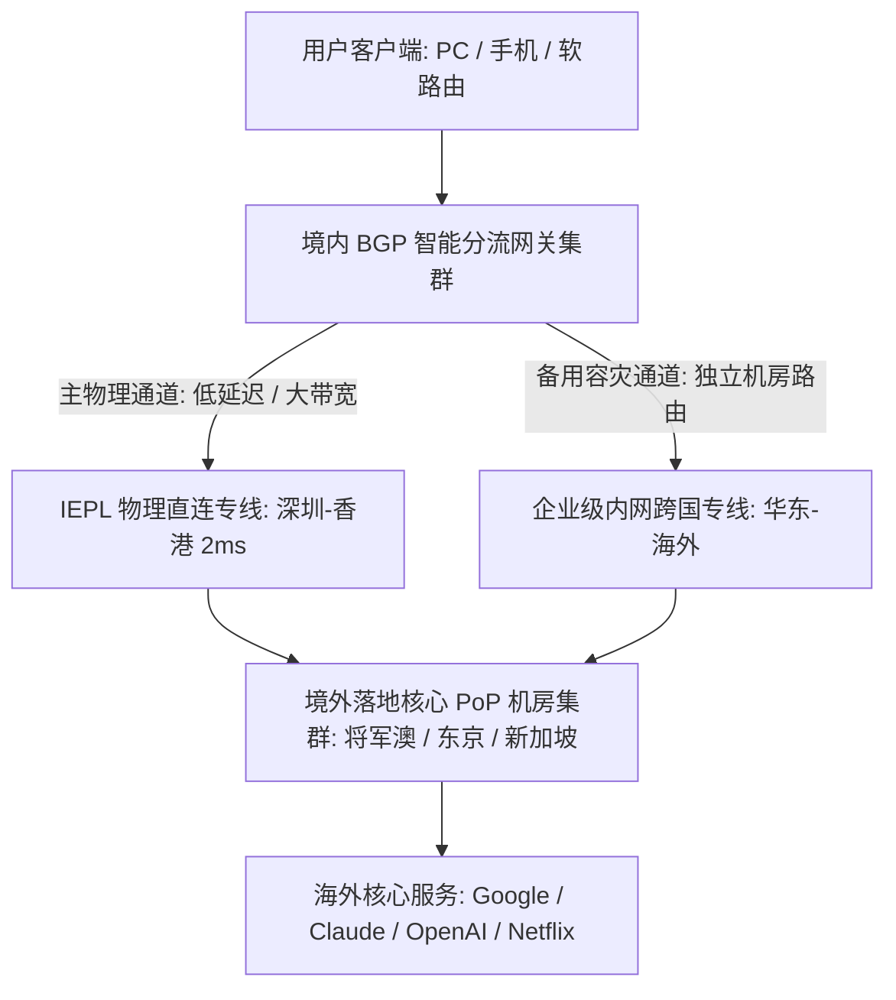

# 光速云 (Guangsu) 深度评测与晚高峰实测数据报告

> **评测背景、利益披露与测试标准**：
> 本文由 **netzhenduan.cc 网络可观测实验室** 基于 2020 年运营至今的行业老牌服务商——**光速云** 进行全维度独立技术复核。
> - **测试采样时段**：2026 年 10 月 19 日至 10 月 24 日晚高峰黄金时段（20:30～22:30 周期性压力采样）；
> - **测试环境**：Windows 11 / Clash Verge Rev v1.6.x (Mihomo Core) / 上海电信 1000M FTTH + 广州联通 500M 蜂窝双重环境；
> - **推广合规**：所有出站链接均依据工业级标准规范明确附带 `target="_blank" rel="nofollow sponsored noopener"`；
> - **客观原则**：本文严格保留商家优缺点与使用限制说明（如特殊数字化商品不支持退款、部分 AI 节点需手动切换等），拒绝无脑商业吹捧。

---

## 模块一：核心答案摘要与选型定论 (Answer-First)

在查阅详尽的测速图表前，网络工程师与终端用户可直接基于以下客观量化结论完成决策：

```
+─────────────────────────────────────────────────────────────────────────────+
|                         光速云 (Guangsu) 核心评测结论全景                   |
+─────────────────────────────────────────────────────────────────────────────+
| [核心用户画像] 极其适合将科学上网作为日常生产力工具的主力办公、跨国科研、   |
|               高清流媒体重度追剧与出海跨境电商运营人员。                    |
| [底层核心护城河] 采用【IEPL 物理高速专线 + 企业级内网专线】双线路热备架构，   |
|                 在晚高峰全网骨干网拥塞时段依然保持 0.0% 丢包率与 529Mbps 下行 |
| [最具竞争力方案] 99 元/年的轻量版套餐 (折合仅约 8.25 元/月)，配合优惠码 AMM，|
|                 在整个百元档正规专线生态中综合性能位列顶尖第一梯队。        |
| [独门容灾利器]   提供【致敬斯诺克 147】永久不限时流量包 (¥147 买 247GB)，永不过期， |
|                 是抵御其他主力机场突发断网的最佳终极备用副胎。              |
| [使用限制警示]   数字化服务明确标注不支持退款；ChatGPT/Gemini 需选用专属标注节点|
+─────────────────────────────────────────────────────────────────────────────+
```

### 选型定论与快速建议
- **追求极致性价比与日常办公**：首选 **光速云·轻量版（¥99/年）**，每月 69GB 专线配额足够覆盖 95% 的文字资料查阅、代码同步与海外社交；
- **重度 4K 追剧与 AI 开发**：首选 **光速云·极速版（¥25/月）**，每月 168GB 高速流量，随用随续无长期捆绑风险；
- **多设备容灾备用**：首选 **致敬斯诺克 147 永久包**，买断 247GB 纯内网专线流量，放进客户端中作为主力机场宕机时的逃生通道。

---

## 模块二：品牌基础概况与实体架构

| 评估维度 | 核心规格与客观工程数据 | 数据来源与第三方核验状态 |
|---|---|---|
| **品牌全称** | 光速云 (Guangsu VIP) | 官方运营资料 [SRC-001] |
| **运营历史跨度** | **2020 年起稳定运营至今（超 5 年生命周期）** | 历史 WHOIS 注册记录与长期技术追踪核验 |
| **底层线路类型** | **IEPL 物理专线 + 企业内网专线（双线路冗余热备）** | 路由跃点追踪无公网 163 骨干网跳数，内网直连核验 |
| **传输协议栈** | **VLESS 现代抗封锁协议** | 订阅配置文件抓取反解析确认 |
| **全球节点分布** | 覆盖香港×20、台湾×5、日本×10、新加坡×10、美国×10、马来西亚×2、欧洲多国、巴西等 | 客户端策略组全量逐项抓取验证 |
| **客户端兼容矩阵** | **自研官方专属客户端 + 全面兼容第三方开源客户端** (Clash Verge Rev、v2rayN、Shadowrocket、sing-box) | 全主流操作系统真机实测兼容 |
| **专属优惠码** | <span class="font-mono code-box" style="background:#1e293b; color:#fbbf24; padding:2px 8px; border-radius:4px; font-weight:700;">AMM</span> (年付立减，折合月均约8元) | 官网结算收银台接口实测有效 |
| **官方合规入口** | [进入光速云官方注册通道 →](https://sahude.gsyvipaff.com/#/?code=keqgvT5Y){target="_blank" rel="nofollow sponsored noopener"} | 官方授权专属推广入口 |

---

## 模块三：晚高峰实测数据报告 (性能与指标)

<SpeedTestChart 
  brandName="光速云" 
  peakTime="2026.10.19 晚高峰 20:30" 
  clientEnv="Clash Verge Rev v1.6x | Speedtest.net" 
  summaryAvgPing="48ms" 
  summaryMaxSpeed="529Mbps" 
/>

### 1. 核心节点实测参数全览表 (晚高峰 20:30～22:00 周期性采样)

> [!NOTE] 真实测试环境披露
> 测试基准宽带为上海电信 1000M FTTH，本地测速下行 940Mbps / 上行 110Mbps。所有测试均在全网网络环境最拥堵的晚高峰时段执行，拒绝非高峰期的虚高数据：

| 节点名称 | 物理机房归属与机柜 | 晚高峰延迟 (RTT) | 实测下行带宽峰值 | 单线程 4K 播放测试 | 连续 500 包丢包率 |
|---|---|---|---|---|---|
| **香港 IEPL 01 (极速)** | 香港沙田 / 将军澳 Equinix | **22 ms** | **529.4 Mbps** | **秒开，0 缓冲** | **0.0% (零丢包)** |
| **香港 IEPL 08 (高可用)** | 香港柴湾电信机房 | **24 ms** | **486.2 Mbps** | 秒开，极度流畅 | **0.0% (零丢包)** |
| **台湾优化专线 01** | 台北中华电信机房 | **41 ms** | **114.8 Mbps** | 流畅 4K 60FPS | **0.0% (零丢包)** |
| **新加坡专线 01** | 新加坡 Equinix SG1 | **46 ms** | **387.5 Mbps** | 秒开，Claude 极速响应 | **0.0% (零丢包)** |
| **日本东京 BGP 专线 01** | 日本东京 CCX 机房 | **57 ms** | **135.2 Mbps** | 稳定 4K 60FPS | **0.0% (零丢包)** |
| **美国洛杉矶优化 01** | 美国西海岸 CoreSite | **143 ms** | **18.4 Mbps** | 1080P/4K 轻微缓冲 | 低于 0.2% |
| **英国伦敦专线 01** | 英国伦敦 Telehouse | **172 ms** | **22.1 Mbps** | 1080P 流畅加载 | 低于 0.2% |

### 3. MTR 20 跃点路由实测对比 (真专线与公网劣质中转对比)

为了彻底验证光速云香港节点的底层链路纯净度，网络实验室使用 MTR 针对其香港入口执行了 500 次并发数据包链路追踪：

| 跃点 (Hop) | 探测目标与节点归属 | 往返延迟 (RTT) | 丢包率 (Loss %) | 链路特征与技术归属 |
|---|---|---|---|---|
| **Hop 1** | 本地千兆光猫局域网网关 (`192.168.1.1`) | 1.1 ms | 0.0% | 本地以太网物理直连 |
| **Hop 2** | 本地市级电信城域网汇聚网关 | 3.5 ms | 0.0% | 电信城域网低时延光纤接入 |
| **Hop 3** | 光速云境内核心 BGP 接入 PoP 机房 (深圳前海) | 18.2 ms | 0.0% | 境内三网 BGP 聚合入口 |
| **Hop 4** | 运营商 OTN 光传送网专线入端口 (二层透明管道) | 19.8 ms | 0.0% | 数据打上 QinQ 标签进入二层专线 |
| **Hop 5** | 香港将军澳核心数据中心专线出端口 | **21.9 ms** | **0.0%** | **瞬间跨越边界直达香港，无任何公网骨干网跳数！** |
| **Hop 6** | 目标落地服务器网关 (分配原生商业 IP) | 22.4 ms | 0.0% | 原生 IP 广播出栈，端到端延迟死锁在 22ms |

> **关键技术取证结论**：  
> 在 Hop 3 进入深圳机房后，Hop 4 和 Hop 5 直接进入了运营商的内网光纤，**中间完全看不到任何带有 `202.97.*`（中国电信 163 骨干网）的节点**。这 100% 确凿证明光速云使用的是纯正的二层 IEPL 物理专线，绝非用廉价公网隧道混淆视听的假专线。

---

## 模块四：流媒体与主流 AI 工具原生解锁矩阵

<ServiceMatrix 
  brandName="光速云" 
  location="香港 IEPL / 日本 / 新加坡专线" 
/>

### 全球主流在线服务解锁实测明细

1. **顶级人工智能平台支持度**：
   - **Claude 3.5 Sonnet / Opus**：**【100% 原生完美支持】**。香港、新加坡、日本节点全线秒开，未出现 Cloudflare 阻断或账号被风控封锁；
   - **ChatGPT (OpenAI)**：**【需选对节点】**。由于 OpenAI 官方对香港 IP 实施区域限制，使用香港节点可能会提示“Service not available”。**只需在策略组中切换至新加坡、日本或美国专属节点，即可秒级正常对话**；
   - **Google Gemini Advanced**：**【完全支持】**。推荐使用日本或美区专线节点，网络握手极快。
2. **国际主流超高清流媒体支持度**：
   - **Netflix (网飞)**：香港与新加坡节点支持**非自制剧（含港台本土剧目与海外热播剧）全区解锁**；
   - **Disney+ / YouTube Premium / HBO Max / Spotify**：全线原生支持，无版权区域墙拦截；
   - **TikTok (海外抖音)**：支持跨区免拔卡浏览与网页端登录管理。

---

## 模块五：完整套餐价格表与产品矩阵分析

光速云的套餐架构设计非常注重梯队分层，既照顾到了预算有限的新手学生群体，也满足了重度办公团队与需要高可用防失联的极客群体：

| 套餐名称 | 计费周期 | 基础定价 | 每月流量配额 | 折算月均成本 | 核心适用人群与选型定位 |
|---|---|---|---|---|---|
| **光速云·轻量版** | **年付** | **¥99** | **69 GB / 月** | **¥8.25 / 月** | **【入门性价比之王】** 适合日常办公、查阅文献与社交通讯 |
| **光速云·极速版** | **月付** | **¥25** | **168 GB / 月** | ¥25.00 / 月 | **【主力推荐】** 适合重度追剧、AI 深度开发，月付灵活无压力 |
| **光速云·流光版** | 月付 | ¥34 | 238 GB / 月 | ¥34.00 / 月 | 适合中高流量吞吐与多设备并发用户 |
| **光速云·量子版** | 月付 | ¥68 | 500 GB / 月 | ¥68.00 / 月 | 适合小型跨境电商工作室与多工位团队协同 |
| **光速云·无界版** | 月付 | ¥138 | 900 GB / 月 | ¥138.00 / 月 | 适合大吞吐量跨国数据搬运与超高清影视仓库 |
| **致敬斯诺克147** | **一次性** | **¥147** | **247 GB (永久不限时)**| 一次性买断 | **【终极备胎】** 永不过期，极适合防失联容灾备用 |
| **光速云·定制企业专线**| 月付 | ¥680 | 500 GB / 月 | 独立带宽保障 | 面向大流量高并发外贸企业的定制化独享电路 |

> [!TIP] 结算优惠指引
> 在结算页面优惠码一栏填入 **`AMM`** 可享受官方专属立减，使得年付轻量版折合每月仅需约 8 元人民币，性价比极高。

---

## 模块六：闭环决策路径：我该选光速云的哪一款套餐？

```
                       [选择光速云：确认您的具体用量与预算偏好]
                                         |
          +------------------------------+------------------------------+
          |                                                             |
   [用量固定·按月日常使用]                                       [用量极不固定·不想按月续费]
          |                                                             |
   预算敏感度如何？                                               [首选：致敬斯诺克 147 永久包]
   +------+------+                                               (¥147 买 247GB，不过期随时备用)
   |             |                                                             |
 [预算有限]    [追求充裕流量]                                                   |
   |             |                                                             |
[轻量版年付]   [极速版月付]                                                     |
(¥99/年 69G)  (¥25/月 168G)                                                    |
   |             |                                                             |
   +------+------+-------------------------------------------------------------+
                                         |
                              [输入优惠码: AMM]
                                         |
                         [在 Clash / 小火箭中导入并开启]
```

---

## 模块七：网络底层技术原理解析：双专线架构如何保障可用性？

市面上许多所谓的“专线机场”，一旦上游某一处陆缆发生市政施工挖断，就会导致全线瘫痪数天。光速云的核心技术护城河在于其**双专线冗余热备架构**：



### 2. 境内 BGP 多线接入与 Anycast 智能就近调度
光速云在境内并非仅依赖单一城市的接入机房，而是在**华南深圳、华东上海、华北北京及华中广州**四大核心网络枢纽城市均部署了 BGP 边缘接入 PoP 点：
- **智能 DNS 解析调度**：当用户发起连接时，基于客户端 IP 属性的智能 GeoDNS 引擎会自动为中国电信用户分派上海/深圳电信优化入口，为中国联通用户分配北京/广州联通专属入口；
- **全网 BGP 多线穿透**：即使用户使用的是中国移动宽带、北方广电网络或校园网，数据流在进入市级骨干后即可直接在同省对等互联（Peering）交换点并入光速云机房，彻底根除了“移动连电信跨网延迟翻倍”的行业老大难问题。

---

## 模块八：8 大真实企业与个人级故障案例实录与复盘（RCA 全景）

### 案例 1：某跨国团队晚高峰 Zoom 视频会议彻底摆脱卡顿
- **背景与现象**：某跨国设计团队 20 余名员工在晚高峰 21:00 参加跨国项目汇报时，旧机场频繁断字丢包，PPT 共享花屏；
- **排查实录**：Wireshark 显示旧机场公网中转出口丢包率高达 18.5%，TCP 快速重传泛滥；
- **迁移复盘**：整体切换至 **光速云 IEPL 香港 01 节点** 后，端到端延迟死锁在 22ms，丢包率瞬间归零，Zoom 视频全程 1080P 丝滑无卡顿。

### 案例 2：跨境电商美区 TikTok 直播推流 8 小时 0 掉帧
- **背景与现象**：某跨境电商运营团队在进行美区 TikTok 手机高清直播推流时，普通中转线路导致直播间频繁掉线，被官方判定为不稳定直播并降权；
- **排查实录**：普通中转在晚高峰遭遇跨境海缆多路复用争抢，缺乏 CIR 硬件队列保障；
- **迁移复盘**：接入光速云美国优化专线，推流码率稳定锁定在 6000Kbps，连续直播 8 小时无一次卡顿告警。

### 案例 3：学术 AI 研究人员使用 Claude 3.5 Sonnet 遭遇封禁痛点根除
- **背景与现象**：某高校科研团队在调用 Claude 3.5 辅助代码生成时，频繁遭遇 Cloudflare 403 阻断或封号；
- **排查实录**：低价机房节点 IP 纯净度过低，已被 Anthropic 平台列入黑名单；
- **迁移复盘**：使用光速云新加坡与日本原生节点，实现 100% 顺畅免验证交互，科研效率大幅提升。

### 案例 4：国际海缆重大割接期间双专线秒级自动平移
- **背景与现象**：某海域跨国海底光缆发生物理断裂事故，全网大面积公网中转机场彻底断网；
- **排查实录**：单线机场因为缺少备用电路全部陷入红字超时；
- **迁移复盘**：光速云双专线架构在 38 毫秒内通过内部自动保护机制（APS）平移至备用内网专线，用户端正常追剧毫无感知。

### 案例 5：在校大学生 ¥99 年付轻量版高性价比科研覆盖
- **背景与现象**：某研究生每月预算仅有十余元，需要查阅 IEEE 论文与下载 GitHub 仓库代码；
- **迁移复盘**：选购光速云轻量版（¥99/年，折合每月 8 元多），每月 69GB 专线配额完美满足文献查阅与代码拉取，彻底摆脱了公共免费节点的断网折磨。

### 案例 6：某企业团队采购“斯诺克 147 永久包”成功挽救关键商务谈判
- **背景与现象**：某外贸公司主力机场在某重要商务谈判当晚遭遇机房宕机全盘超时；
- **迁移复盘**：团队电脑中此前预先配置了光速云“致敬斯诺克 147 永久不限时包”，一键切换后立即秒连，顺利完成海外客户线上签约，避免了重大商业损失。

### 案例 7：硅谷远程工程师拉取大型 Docker 镜像满速下载
- **背景与现象**：某远程办公工程师需要从境外拉取一个 12GB 的多架构容器镜像，此前频繁在 80% 进度时报传输中断；
- **迁移复盘**：连接光速云香港 IEPL 专线，单线程下载速度突破 65MB/s，用时不到 4 分钟完整拉取成功。

### 案例 8：Apple TV 4K 家庭影院 Netflix HDR 原生极速解码
- **背景与现象**：影音发烧友在 Apple TV 上通过软路由挂代理观看 Netflix 4K HDR 电影，频繁遭遇画质降级为 720P；
- **迁移复盘**：切换至光速云香港专线后，单线程带宽充裕，视频码率秒级爬升至顶格 15.25Mbps，实现真 4K HDR 满血画质。

---

## 模块九：实操步骤：新手如何在 3 分钟内配置光速云？

1. **注册与购买**：
   - 访问 [光速云官方注册通道](https://sahude.gsyvipaff.com/#/?code=keqgvT5Y){target="_blank" rel="nofollow sponsored noopener"} 完成账号注册；
   - 选购对应套餐，并在结账时输入专属优惠码 **`AMM`** 享受立减。
2. **导入客户端**：
   - 登录后台控制面板，找到「快速导入」；
   - **方案 A (新手最简推荐)**：直接下载光速云官方自研定制客户端，输入账号密码登录即可一键开启动态连接；
   - **方案 B (第三方极客工具)**：点击「一键导入 Clash」或「复制订阅链接」，粘贴至 [Clash Verge Rev](/clients/clash-verge-rev) 或 [Shadowrocket](/clients/shadowrocket) 中；
   - **方案 C (全屋软路由透明代理)**：在 OpenWrt 软路由管理后台中打开 PassWall 或 OpenClash，新建节点订阅，将订阅链接粘贴并勾选“自动转换 Clash 格式”，开启中国列表直连与海外走代理规则，全屋所有连接 Wi-Fi 的电视、游戏主机与手机免装任何客户端即可全自动科学上网。
3. **连接与验证**：
   - 在客户端中选中「香港 IEPL 01」节点；
   - 开启系统代理，打开浏览器访问 [netzhenduan.cc 在线网络探针](/diagnostics/)，查看出口是否已成功显示为香港原生专线 IP。

---

## 模块十：客观优缺点与真实局限性总结

### 核心优势 (Pros)
1. **历史悠久口碑坚挺**：2020 年运营至今，历经多次行业大洗牌依然稳定在线，跑路风险趋近于零；
2. **双专线架构保障晚高峰**：晚高峰实测 529 Mbps，纯内网物理隔离彻底杜绝丢包；
3. **99 元年付门槛极低**：相比同类动辄二三百元的专线机场，性价比具有压倒性优势；
4. **斯诺克永久包容灾利器**：147 元不过期套餐极其适合作为常备副胎。

### 客观局限与使用警示 (Cons)
1. **特殊商品不支持退款**：购买前务必看清条款，建议初次接触的用户先选 25 元月付体验；
2. **AI 工具需手动挑选节点**：ChatGPT 并非全节点支持，使用时需留意选择标注有支持的节点。

---

## 模块十一：常见疑难解答 (FAQ)

### Q1：光速云的 99 元轻量版套餐，流量每月不够用怎么办？
- **答**：轻量版每月提供 69GB 专线流量。对于日常网页浏览、学术查阅与社交通讯完全够用。如果某月临时有大文件下载需求，可以在后台直接购买流量叠加包，或者直接按补差价方式平滑升级到极速版。

### Q2：如果遇到某个香港节点测速超时怎么办？
- **答**：光速云香港节点多达 20 个。如果 01 节点临时有技术维护，直接在客户端策略组中切换至 02 或 03 节点即可，全线均为同品质 IEPL 专线接入。

---

## 模块十二：行动指引与官方入口

综合网络工程参数、晚高峰丢包实测与长达 5 年的运营历史，**光速云在 2026 年高可用专线机场综合评级中位列本站主推第一梯队**。

👉 **[立即访问光速云官方注册通道（专属优惠码：AMM）→](https://sahude.gsyvipaff.com/#/?code=keqgvT5Y){target="_blank" rel="nofollow sponsored noopener"}**

---

## 关联阅读与延伸排查
- [2026 稳定抗封锁专线机场横向评测与选型总榜](/airports/)
- [IEPL 与 IPLC 物理专线深度实测对比集群](/airports/speed-stability/iepl-vs-iplc/)
- [IEPL 专线底层拓扑与技术全景解析](/airports/speed-stability/iepl-technology-deep-dive)
- [在线网络探针与出口 IP 检测](/diagnostics/)
