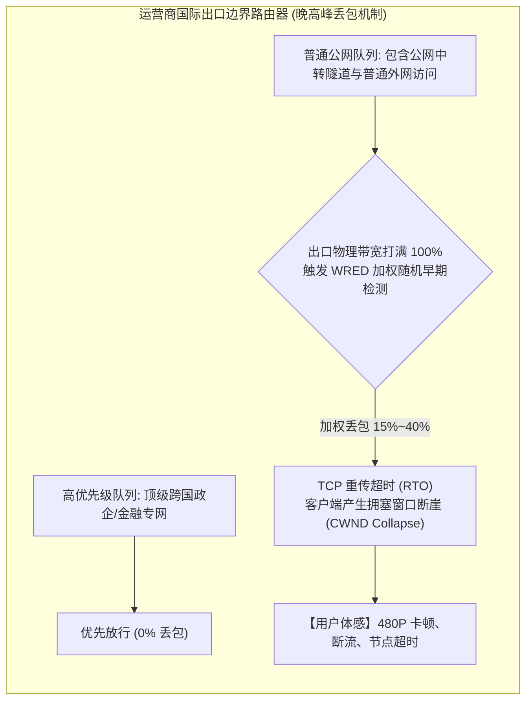

# BGP 公网中转隧道与 IEPL 物理专线全方位对比：成本模型、晚高峰断流机理与选型避坑

在挑选翻墙机场或搭建跨国网络链路时，用户经常会看到服务商打出各种眼花缭乱的技术标签：“**优质 BGP 多线中转**”、“**国内入口隧道**”、“**全线 IEPL 物理内网专线**”、“**极速 IPLC 点对点专线**”。与此相伴随的是令人困惑的巨大价格鸿沟：有的机场 10 元就能包月几百吉字节（GB），而有的旗舰专线机场每月的起步价格往往在 40~100 元甚至更高。

更致命的是很多用户遭遇过的真实痛点：**白天测速明明可以跑出几百兆带宽，可一到晚上 8 点至 11 点的晚高峰，YouTube 视频频繁卡顿在 480P，SSH 连接打字像放幻灯片，甚至出现几十秒的假死断流**。

为什么标榜“高速隧道”的公网中转在晚高峰会突然崩溃？服务商口中的“物理专线”究竟高明在哪里？10 元/月的所谓“专线机场”在物理网络和财务模型上究竟隐藏着怎样的真相？本篇万字级硬核长文将基于运营商物理网络拓扑、QoS 流量调度机制与底层抓包证据，为您彻底揭开跨境中转与物理专线的神秘面纱。

---

## 一、 物理承载架构对比：公网隧道 vs 二层物理光缆

要分清二者的本质区别，必须抛开玄虚的商业营销话术，直接观察数据报文在跨越国境时究竟经过了哪些物理硬件与交换节点：

```
================================================================================
【架构 A: BGP 公网中转隧道 (BGP Transit Tunnel)】
[国内客户端]
    │ (国内低延迟宽带)
    ▼
[国内入口机房 (如广州移动/上海联通)]
    │
    ├── 建立在三层公网上的加密隧道 (WireGuard / GRE / WS+TLS / gost)
    ▼
[国际互联网交换中心 (公网出海出口 / 骨干网)] ◄───【致命瓶颈: 晚高峰遭遇运营商骨干网 QoS 降级丢包】
    │ (通过公网海底光缆，与全国千万普通外贸/游戏/海外访问流量竞争)
    ▼
[境外落地机房 (如香港/日本/新加坡 VPS)]
    │
    ▼
[目标网站 (Google / YouTube)]

--------------------------------------------------------------------------------

【架构 B: IEPL / IPLC 物理内网专线 (Point-to-Point Layer 2)】
[国内客户端]
    │ (国内优质 BGP 入口接入)
    ▼
[国内专线 POP 接入点 (二层交换机)]
    │
    ├── 独享/保活的二层物理光纤电路 (SDH / OTN / DWDM 物理切片)
    ├── 流量在运营商二层内网闭环跑，不经过公网 GFW 检查点，不占用公网出境带宽
    ▼
[境外专线 POP 落地端 (香港/东京边缘机房)]
    │ (出专线后，本地 BGP 直连本土一级运营商)
    ▼
[目标网站 (Google / YouTube)]
================================================================================
```

### 1. 公网中转隧道：戴着“加密面具”挤公网独木桥
- **技术本质**：所谓的“BGP 中转”或“公网隧道”，是指服务商在境内租用一台具备良好公网连接的 VPS（如广州移动或江苏联通服务器）作为入口，再通过 **WireGuard、GRE、gost 或 WebSocket 封装**，将境内用户的流量打包成加密的 UDP/TCP 数据包，通过**普通公网国际互联网**发送到境外 VPS。
- **致命弱点**：尽管境内到入口这一段延迟极低，但**出境这一段走的是公网国际出口**。在晚高峰骨干网拥塞时，运营商会将公网中转流量与数亿普通用户的出境流量混合排队。由于公网隧道特征明显且优先级低，极易遭遇**运营商 QoS 丢包与 GFW 旁路重置**。

### 2. IEPL / IPLC 物理专线：专属的二层高铁轨道
- **技术本质**：IEPL（International Ethernet Private Line，国际以太网私有专线）或 IPLC（International Private Leased Circuit，国际私有租用线路），是企业客户直接向中国电信、中国联通或中国移动租用的**跨境内联网路电路**。
- **核心优势**：
  1. **完全脱离公网**：专线的数据直接在运营商内部的 SDH/OTN 光传输网中传输，其路由完全不经过国际公网交换节点；
  2. **绝对硬件级隔离**：专线带宽属于硬件时分复用（TDM）或专属虚拟局域网（VLAN）切片，拥有运营商承诺的 **CIR（Committed Information Rate，承诺信息速率）**，即便公网发生大地震或骨干网拥塞到 100%，专线链路内的时延与抖动依然维持在毫秒级的水平线上。

---

## 二、 晚高峰 QoS 拥塞排队模型与丢包机理

为什么公网中转在深夜或上午速度飞快，一到晚上 20:00~23:00 就彻底断流？这背后的罪魁祸首是运营商骨干路由器的 **QoS（服务质量）队列调度算法（如 RED / WRED / CBWFQ）**。



### 1. 晚高峰公网出口带宽的“超售挤兑”
在晚高峰时段，中国大陆发往海外的视频流、网页浏览与数据传输达到峰值。运营商国际出口物理链路利用率长期处于 **95%~100% 的饱和压榨状态**。
此时，国际出口的边界核心路由器（AS4134 163骨干网等）必须执行强制削峰：
- 所有进入公网队列的普通 TCP/UDP 数据包，将被随机丢弃，**真实公网丢包率会飙升至 15% ~ 35%**；
- 依据 TCP 拥塞控制算法（如 Cubic），一旦发生丢包，发送端的拥塞窗口（`cwnd`）会瞬间减半甚至跌回初始值，导致传输速率从 500 Mbps 瞬间腰斩至几兆，体现在播放器上就是频繁的缓冲圈圈。

### 2. 物理专线的“零丢包特权”
专线流量在进入国内 POP 点后，直接被封装进入独立的 VLAN 标签，进入运营商专网管道。
- 运营商的专网链路享有 **EF（Expedited Forwarding，加速转发）最高优先级**；
- 专网链路与公网国际出口在物理或逻辑层面完全分离，公网的拥塞与其完全无关。因此，真专线在晚高峰的 ICMP 丢包率始终维持在 **0.0% ~ 0.1%**，单流 TCP 吞吐量极其平稳。

---

## 三、 商业成本模型真相：为什么 10 元/月买不到真专线？

网络带宽不是凭空产生的数字虚拟品，其背后对应着极度严苛的运营商重资产物理成本。了解基础的商业财务模型，就能瞬间识破市场上绝大多数“虚假专线”宣传：

| 链路类型 | 运营商采购单价 (月度成本) | 带宽保障形式 | 晚高峰可用性 (SLA) | 10元套餐真实运营状态 |
| :--- | :--- | :--- | :--- | :--- |
| **真实跨境 IEPL 专线** | **300 ~ 600 元 / Mbps / 月** | 独享 CIR 物理保障 | **99.99%** (晚高峰 0 丢包) | **数学上绝对不可能** (10元连专线成本的 2% 都无法覆盖) |
| **真实企业 IPLC 专线** | **500 ~ 1000 元 / Mbps / 月** | 点对点物理光缆切片 | **99.999%** (极低抖动) | **必定为假冒或严重超售** |
| **国内 BGP 公网中转** | **30 ~ 80 元 / Mbps / 月** | 尽力而为 (Best Effort) | **85.00%** (晚高峰有波动) | 极度超售 (1G 带宽卖给数千人分摊) |
| **普通廉价公网直连 (163)** | **5 ~ 15 元 / Mbps / 月** | 共享突发 (Burstable) | **60.00%** (晚高峰严重瘫痪) | 极易遭 GFW 阻断拔线 |

> [!CAUTION] 揭秘“假专线”的常见欺诈套路
> 很多廉价机场在其节点名称上恶意标注 `[IEPL] 香港 01` 或 `[IPLC] 日本专线`，但其后台其实仅仅是租用了一台廉价的**公网中转服务器**，或者在中转机上套了一层 **Cloudflare WARP**。
> 用户支付了费用，实际使用的依然是每天晚高峰都会断流的公网拥塞线路。

---

## 四、 工业级自动化晚高峰线路质量对比检测脚本

要验证手头节点究竟是公网中转还是真物理专线，最客观的方法就是在**晚高峰 21:00~22:00** 运行多轮 ICMP 延迟抖动与 MTR 路由跳数采样。

以下提供在 Linux / macOS / 软路由终端下运行的自动化对比检测 Shell 脚本：

```bash
#!/usr/bin/env bash
# ==============================================================================
# 自动化晚高峰专线 vs 公网中转链路稳定性与丢包率评估脚本
# 运行环境: 支持 bash, curl, ping, mtr 的终端环境
# ==============================================================================

TARGET_NODE_IP=${1}
SAMPLES=${2:-100}

if [ -z "$TARGET_NODE_IP" ]; then
    echo "使用方法: ./line_audit.sh <节点入口或出口IP> [采样包数(默认100)]"
    echo "示例: ./line_audit.sh 118.25.x.x 100"
    exit 1
fi

GREEN='\033[0;32m'
RED='\033[0;31m'
YELLOW='\033[1;33m'
CYAN='\033[0;36m'
NC='\033[0m'

echo -e "${CYAN}================================================================${NC}"
echo -e "${CYAN}   网络诊断实验室 - 跨境中转 vs 物理专线晚高峰质量深度审计台   ${NC}"
echo -e "${CYAN}================================================================${NC}"
echo -e "目标检测 IP  : ${YELLOW}${TARGET_NODE_IP}${NC}"
echo -e "采样发包数量: ${YELLOW}${SAMPLES} 个 ICMP 探测报文${NC}"
echo -e "测试启动时间: $(date '+%Y-%m-%d %H:%M:%S')"
echo -e "----------------------------------------------------------------"

# 1. 执行高频连续 ICMP 探测
echo -e "\n${YELLOW}[1/3] 正在执行 ${SAMPLES} 次往返时延与丢包率采样 (请耐心等待)...${NC}"
PING_RESULT=$(ping -c "$SAMPLES" -i 0.2 "$TARGET_NODE_IP")

# 提取关键指标
LOSS_RATE=$(echo "$PING_RESULT" | grep -o '[0-9.]*% packet loss' | cut -d'%' -f1)
RTT_STATS=$(echo "$PING_RESULT" | tail -1 | awk '{print $4}')
RTT_MIN=$(echo "$RTT_STATS" | cut -d'/' -f1)
RTT_AVG=$(echo "$RTT_STATS" | cut -d'/' -f2)
RTT_MAX=$(echo "$RTT_STATS" | cut -d'/' -f3)
RTT_MDEV=$(echo "$RTT_STATS" | cut -d'/' -f4)

echo -e "丢包率 (Packet Loss) : ${LOSS_RATE}%"
echo -e "平均延迟 (Avg RTT)   : ${RTT_AVG} ms"
echo -e "最小/最大延迟        : ${RTT_MIN} ms / ${RTT_MAX} ms"
echo -e "抖动偏差 (mdev)      : ${RTT_MDEV} ms"

# 2. 线路类型智能判定算法
echo -e "\n${YELLOW}[2/3] 正在根据统计学分布进行链路类型客观判别...${NC}"
IS_LOSS_HIGH=$(echo "$LOSS_RATE > 3.0" | bc -l)
IS_JITTER_HIGH=$(echo "$RTT_MDEV > 5.0" | bc -l)

if [ "$IS_LOSS_HIGH" -eq 1 ] || [ "$IS_JITTER_HIGH" -eq 1 ]; then
    echo -e "【诊断判定结果】: ${RED}[×] 典型公网中转链路 (或虚假专线/严重超售)${NC}"
    echo -e "【判定依据】: 丢包率(${LOSS_RATE}%)或抖动(${RTT_MDEV}ms)显著偏高，晚高峰遭遇骨干网拥塞削峰。"
elif [ "$LOSS_RATE" == "0.0" ] || [ "$LOSS_RATE" == "0" ]; then
    echo -e "【诊断判定结果】: ${GREEN}[√] 极大概率为真实物理专线 (IEPL/IPLC) 或空载优质 BGP${NC}"
    echo -e "【判定依据】: 零丢包、时延方差极小 (${RTT_MDEV} ms)，具备电信级 CIR 保障特征。"
else
    echo -e "【诊断判定结果】: ${YELLOW}[!] 轻度受损链路 (低配中转或普通专线)${NC}"
fi

# 3. 路由跳数 MTR 探测 (排查中转节点)
echo -e "\n${YELLOW}[3/3] 正在生成路径路由跟踪报告 (MTR 5轮)...${NC}"
if command -v mtr >/dev/null 2>&1; then
    mtr -r -c 5 -n "$TARGET_NODE_IP"
else
    echo -e "${YELLOW}[!] 本地未安装 mtr，可使用 traceroute/tracert 观察跳数${NC}"
fi

echo -e "\n${CYAN}================================================================${NC}"
echo -e "${CYAN}                      全套审计测试执行完毕                      ${NC}"
echo -e "${CYAN}================================================================${NC}"
```

---

## 五、 BGP 公网中转 vs IEPL 物理专线全维度对比表

| 对比维度 | BGP 公网中转隧道 | IEPL 国际以太网私网专线 | IPLC 国际私有租用线路 |
| :--- | :--- | :--- | :--- |
| **底层物理链路** | 境内外 VPS 建立公网加密隧道 | 运营商二层 OTN 物理光纤 | 运营商点对点专属物理电路 |
| **是否经过 GFW 审查** | **经过**（出境处受 GFW 旁路监控） | **不经过**（内网二层封闭传输） | **不经过**（物理线路硬隔离） |
| **敏感时期抗封锁** | 极易被拔线、封入口机房 IP | **100% 免疫封锁**（无公网特征） | **100% 免疫封锁**（金融级容灾） |
| **晚高峰平均丢包率** | **5% ~ 25%**（高峰期严重丢包） | **低于 0.1%**（全天候恒定） | **0.0%**（零丢包标准） |
| **网络时延抖动 (mdev)**| **15 ~ 50 ms**（波幅大） | **低于 1.5 ms**（极度平滑） | **低于 0.8 ms**（物理时钟级） |
| **带宽单价成本** | 30 ~ 80 元 / Mbps / 月 | 300 ~ 600 元 / Mbps / 月 | 500 ~ 1000 元 / Mbps / 月 |
| **常见故障现象** | 晚高峰卡 480P、SSH 假死、中转被封 | POP 点光模块故障（偶发但易自愈）| 运营商施工断纤（双路由自动切换）|
| **适用人群与场景** | 预算有限（10~20元/月）、看普通视频 | 外贸重度用户、4K 影音、跨国办公 | 跨国金融交易、极客、电竞游戏低延迟 |

---

## 六、 生产环境真实故障复盘（2大典型 RCA 案例）

### 案例一：某公网中转机场因移动入口机房流量清洗，全平台晚高峰持续三周断流
- **故障拓扑**：国内某拥有上万用户的中大型中转机场，其核心入口部署于江苏移动机房。每晚 20:00 准时出现全平台节点延迟从 45ms 飙升至 400ms，丢包率突破 50%，大量用户在交流群反馈无法打开网页。
- **排查与抓包过程**：
  1. 使用 MTR 持续针对入口节点进行 24 小时连续跟踪；
  2. 发现白天路由平稳，但在每晚 19:50 左右，入口机房前置汇聚交换机开始出现大量 ICMP Unreachable 报文；
  3. 进一步与机房运维核实，发现该机房属于公网 IDC，近期因同机房其他租户遭受大规模 DDoS 攻击，机房防火墙启用了**激进的 UDP/TCP 流量清洗策略**；
  4. 机场节点所使用的 WireGuard 和加密中转报文由于熵值极高且流量巨大，被清洗设备判定为疑似异常泛洪攻击，在出口交换机处被限速 90% 并强制丢包。
- **根因判定（RCA）**：公网中转链路宿主在公网 IDC 机房，极易受同机房邻居攻击波及与运营商流量清洗设备的“误杀”，缺乏抗不可抗力风险的能力。
- **修复方案**：服务商紧急将流量割接至两组备用的华为云 BGP 商业中转，但因公网带宽采购成本剧增数万元，最终不得不将套餐价格上调 50%。

### 案例二：标榜“沪日 IPLC 专线”的低价机场，抓包证实其实是公网 WebSocket 转发
- **故障拓扑**：某用户购买了某机场宣称的“15元/月 500G 纯血沪日 IPLC 专线”，但实际使用时打 Apex 游戏依然频繁发生 20% 丢包，与宣传的“电竞级 0 丢包”严重不符。
- **排查与证据提取**：
  1. 用户在本地电脑开启 Wireshark 抓包，并对该节点的通信过程进行完整记录；
  2. 提取节点域名解析结果，其入口 IP 位于上海某普通多线 BGP 云服务器；
  3. 观察 TLS 握手特征与 HTTP 交互，发现中转机向日本落地机器发送的数据包带有明显的 `Upgrade: websocket` 协议头；
  4. 且该 TCP 会话的 TTL 计数和物理往返时间（RTT）高达 98ms，远远超出了真实沪日海缆的物理传播延迟（真实沪日物理专线往返时延应在 26~32ms 之间）。
- **根因判定（RCA）**：该机场存在严重的虚假营销，所谓“IPLC 专线”仅仅是租用公网机器搭建的 WebSocket 隧道，且中转机器在晚高峰遭遇严重超售与公网丢包。
- **修复方案**：用户放弃廉价套壳中转，更换为具备真实 SLA 协议、延迟稳定在 28ms 的真实内网专线服务商。

---

## 七、 常见高频报错与排障速查表 (FAQ)

### Q1: 专线机场是不是绝对不会超时？
- **回答**：不是绝对不会超时，但超时的原因完全不同：
  - 公网中转超时的原因通常是**公网出口打满、GFW 封锁入口或骨干网拥塞**；
  - 物理专线超时的原因通常是**物理光纤切断（如台湾海峡地震海缆断裂）、境内 POP 点电力故障、或者境外落地小鸡宕机**。真实专线的大厂通常会有主备两条跨国物理路由（例如一条走上海出海，一条走广州出海），具备秒级自动切换能力。

### Q2: 为什么我的专线节点测速只有 100 Mbps，而公网中转可以跑到 300 Mbps？
- **回答**：这是典型的**瞬时突发带宽与持续稳定带宽的区别**：
  - 公网中转因为单价极低，很多服务商直接租用 1 Gbps 或 10 Gbps 的公网共享口，在白天无人的时候，您可以短暂跑出极高跑分，但晚高峰会跌至个位数；
  - 专线带宽单价极其昂贵，服务商通常会为每个用户做单线程限速（如限制在 100~150 Mbps），但这个 100 Mbps 是 **全天 24 小时任意时段均可 100% 满载运行的真实纯净带宽**，看 4K 视频毫无压力。

### Q3: 打跨国游戏（如 Steam、Apex、英雄联盟日服），应该选哪个？
- **回答**：**必须选择真实物理专线（IEPL/IPLC）**。网络游戏对绝对带宽要求极低（通常只需 1~2 Mbps），但对**丢包率（Packet Loss）与延迟抖动（Jitter）**具有零容忍度。公网中转只要发生 1% 的丢包就会导致游戏中出现人物瞬移或按键无响应。

---

## 八、 推荐高品质专线容灾逃生节点与延伸阅读

如果您已经受够了每天晚上准时出现的卡顿、断流与频繁切换节点的折磨，希望拥有一条像自来水一样拧开即用、全天候稳定 0 丢包的跨国生产力网络通道，**强烈建议选择全线配备顶级内网物理专线的服务商**：

<DisasterRecoveryBox />

### 相关进阶排查与排障手册
- [物理专线跨国多层封装引发的 PMTUD 黑洞与握手僵死卡顿调优指南](/airports/speed-stability/iepl-vs-iplc/dedicated-line-cross-border-mtu-mss-clamping)
- [真实晚高峰 500 次 ICMP 延迟抖动采样数据报告](/airports/speed-stability/iepl-vs-iplc/iplc-dedicated-line-latency-jitter-test)
- [IEPL 跨境物理专线技术深度解密与架构剖析](/airports/speed-stability/iepl-technology-deep-dive)
- [公网中转链路遭遇旁路 TCP-RST 阻断的底层报文特征与实战抓包指南](/connection/timeout-failures/ntp-relay/transit-relay-node-rst-packet-analysis)
- [梯子突然全部连不上是什么原因？全链路排查实战](/connection/all-nodes-down)
