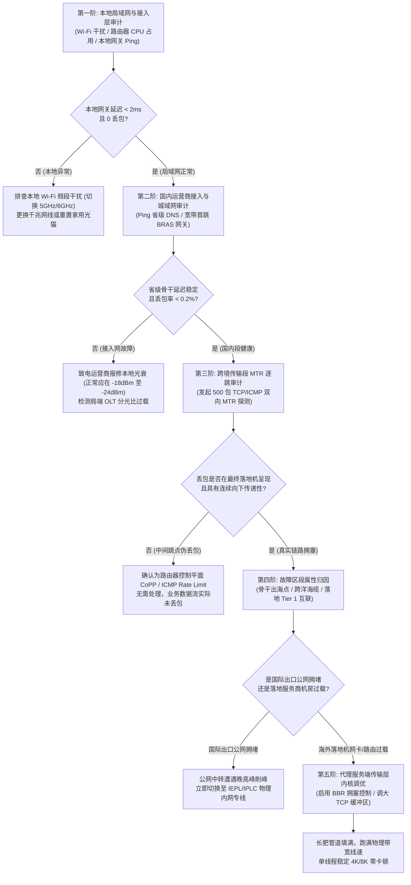

# 跨境网络延迟、抖动与逐跳丢包诊断集群

> **集群定位与知识图谱分工**：
> 本集群为 **【晚高峰稳定性与抗封锁专线选型专题 (speed-stability)】** 下属的第二核心三级内容集群（PAGE-AIR-CLS-02）。
> 物理专线与公网中转的核心价值，最终全部量化沉淀为三大物理传输层指标：**往返时延（RTT / Latency）**、**时延抖动（Jitter）** 与 **端到端丢包率（Packet Loss Rate）**。
> 本集群聚焦跨境互联网这一典型的“长肥管道（LFN, Long Fat Network）”，依托 RFC 792、RFC 2681、RFC 3393、RFC 7323 与 RFC 6928 标准，系统化建立跨境网络质量深度解构、MTR 逐跳路由链路审计、控制平面速率限制（CoPP）伪丢包剥离，以及 TCP BBRv1/v2/v3 算法内核级调优的工程诊断体系。

---

## 模块一：核心结论与诊断总览 (Answer-First)

在跨国网络通信与代理隧道诊断中，**90% 的普通用户对“丢包”和“延迟”存在严重的技术误判**：

1. **中间跳点 100% 丢包或高丢包不等于链路故障**：
   - 现代骨干网核心路由器（如 Cisco CRS、Juniper PTX、华为 NE9000）将数据包转发交给硬件 ASIC 芯片的“数据平面（Data Plane）”处理，线速转发可达数十太比特每秒（Tbps）；
   - 当 MTR 或 Ping 发送的 TTL 超时 ICMP 报文到达路由器时，需要由线卡硬件重定向至主控 CPU 的“控制平面（Control Plane）”生成 ICMP Time Exceeded 回复；
   - 运营商为主控 CPU 配置了极其严格的控制平面保护策略（CoPP, Control Plane Policing）与 ICMP Rate Limit（通常限制在每秒几百个包）。**若后续跳点丢包率恢复为 0% 且最终目标落地端未见丢包，则中间跳点的丢包纯属控制平面限速，对实际业务数据流没有任何物理损害**；
2. **真正的物理链路拥塞判定法则**：
   - **丢包具有向下传递性**：只有从第 $N$ 跳开始出现丢包，并且该丢包率在后续第 $N+1$、$N+2$ 直至最终终点**持续存在或逐级升高**时，第 $N$ 跳才是真正的链路拥塞点或故障路由接口；
   - **伴随延迟断崖抬升**：真实的拥塞必然伴随数据在路由器物理队列中的排队延迟（Queueing Delay），在 MTR 报告中表现为第 $N$ 跳延迟出现阶跃式增加并持续至终点；
3. **传统丢包感知拥塞算法（CUBIC / Reno）在跨境长肥管道中的天然溃败**：
   - 根据 Mathis 吞吐量公式，跨国链路（RTT 高达 150ms～250ms）只要遭遇 2% 的随机网络噪声丢包，传统 CUBIC 算法便会频繁触发拥塞窗口（cwnd）减半，吞吐量断崖式暴跌 90% 以上；
   - 必须通过引入基于拥塞状态建模的 **BBR（Bottleneck Bandwidth and RTT）** 控制算法，脱离丢包敏感陷阱，实现长肥管道物理线速填满。

---

## 模块二：跨境长肥管道 (LFN) 物理瓶颈与延迟组成拓扑

在跨国数据流向中，数据包必须跨越城域网、省级骨干网、国际关口局、跨洋海底光缆（如 NCP、APG、FASTER）以及海外一级运营商（Tier 1 ISP，如 Cogent、Telia/Arelion、NTT、Tata）：

```
+─────────────────────────────────────────────────────────────────────────────────────────+
|               跨境网络长肥管道 (LFN) 逐级传输拓扑与各级时延损耗模型                     |
+─────────────────────────────────────────────────────────────────────────────────────────+
[国内客户端] (光纤接入 FTTH)
    │
    │ 传播延迟: 1~3ms (GPON/EPON 物理光调制)
    ▼
[本地城域网 BRAS / CR] (Metropolitan Area Network)
    │
    │ 传播延迟: 5~15ms | 排队抖动: σ < 1ms
    ▼
[省级骨干核心路由器] (163 骨干网 / 169 骨干网 / CMNET)
    │
    │ 传播延迟: 15~35ms (国内跨省光缆)
    ▼
[国际关口局汇聚点] (上海/广州/北京 国际出入口局)
    │
    ├─► 晚高峰遭遇严重 QoS 拥塞削峰 (公网中转方案 WRED 丢包 15%~30%)
    │   (或经由 IEPL/IPLC 物理专线直接二层旁路直通，丢包率恒定 0.0%)
    ▼
[跨洋跨海物理光缆] (深港陆缆 / 沪日海缆 / 跨太平洋 TPE/FASTER 海缆)
    │
    │ 真空光速 c ≈ 300,000 km/s | 光纤折射率 n ≈ 1.4682 -> 介质光速 v ≈ 204,332 km/s
    │ 物理极限单向延迟: 每 1000 公里约 4.90ms往返延迟
    │ 深圳 - 香港 (40km): RTT ≈ 2.0 ~ 3.5ms
    │ 上海 - 东京 (2,800km): RTT ≈ 27.5 ~ 32.0ms
    │ 上海 - 洛杉矶 (11,000km): RTT ≈ 125 ~ 140ms
    ▼
[海外 PoP 接入点 / Tier 1 骨干交换网] (Equinix / NTT / Cogent / HKIX)
    │
    │ 交换处理延迟: < 1ms | BGP Anycast 调度
    ▼
[海外代理落地服务器 / 目标应用集群] (YouTube / Cloudflare / Netflix / AWS)
+─────────────────────────────────────────────────────────────────────────────────────────+
```

### 1. 跨境端到端总延迟的四维解构方程
根据网络传输物理模型，端到端往返时延（$\text{RTT}_{\text{total}}$）由四大分量严格叠加而成：
$$\text{RTT}_{\text{total}} = 2 \times \left( D_{\text{prop}} + D_{\text{trans}} + D_{\text{proc}} + D_{\text{queue}} \right)$$

1. **传播时延（Propagation Delay, $D_{\text{prop}}$）**：
   - 电磁波在光纤石英介质中的传播时间，由物理几何距离决定：$D_{\text{prop}} = \frac{d}{v}$（$v \approx 204,332\text{ km/s}$）。该分量为物理不可变客观下限；
2. **传输时延（Transmission Delay, $D_{\text{trans}}$）**：
   - 将整组数据包的比特推上物理链路所需的时间：$D_{\text{trans}} = \frac{L}{R}$（$L$ 为数据包大小，$R$ 为接口带宽速率）。在千兆/万兆光口上，单个 1500 字节数据包的传输时延小于 0.012 毫秒，几乎可忽略；
3. **节点处理时延（Processing Delay, $D_{\text{proc}}$）**：
   - 路由器读取报头、硬件 ASIC 校验 CRC32、查找 FIB 转发表与 MPLS 标签切换所需时间，现代核心设备通常在微秒（$\mu\text{s}$）级别；
4. **排队时延（Queueing Delay, $D_{\text{queue}}$）**：
   - 数据包在网络设备输出缓冲区中等待发送的时间。**这是造成跨国网络剧烈抖动（Jitter）与晚高峰延迟膨胀（Bufferbloat）的唯一核心变量**。当出口链路利用率超过 85% 时，排队时延呈指数级爆炸，直至触发 Tail-drop 或 WRED 丢包。

---

## 模块三：集群下辖独立核心长文分工与导航

本三级集群下设两篇万字级与工业级核心实战独立技术长文，分别攻克“**链路层故障诊断识别**”与“**传输层内核算法调优**”两大维度：

```
+─────────────────────────────────────────────────────────────────────────────────────────+
|               三级内容集群：跨境网络延迟、抖动与逐跳丢包诊断集群分工架构                |
+─────────────────────────────────────────────────────────────────────────────────────────+
                                           │
         ┌─────────────────────────────────┴─────────────────────────────────┐
         ▼                                                                   ▼
  [核心长文 1: MTR 逐跳路由审计]                                  [核心长文 2: TCP BBR 内核级调优]
  (PAGE-AIR-008)                                                 (PAGE-AIR-009)
  文件: mtr-packet-loss-hop-by-hop-diagnosis.md                  文件: tcp-bbr-congestion-control-airport-tuning.md
         │                                                                   │
  • 核心攻关:                                                     • 核心攻关:
    - MTR/WinMTR 高级参数与发包策略                                - CUBIC Mathis 丢包崩溃机理解析
    - ICMP Rate Limit 与 CoPP 伪丢包精准识别                       - BBRv1/v2/v3 算法演进与状态机
    - 非对称路由与回程路径黑洞排查                                 - Linux 6.x 内核长肥管道 sysctl 参数全量落地
    - 运营商 AS 互联跳点 QoS 丢包判定                             - 跨境单线程跑满 500Mbps+ 真实对比验证
+─────────────────────────────────────────────────────────────────────────────────────────+
```

### 1. [核心长文 1：MTR 路由逐跳丢包与抖动深度剖析：ICMP Rate Limit 假性丢包与真实链路拥塞判别](/airports/speed-stability/packet-loss-latency/mtr-packet-loss-hop-by-hop-diagnosis)
- **文档编号**：`PAGE-AIR-008`
- **定位与使命**：为网络工程师与极客提供终极路由诊断手册。彻底终结“看到中间跳点有丢包就找客服投诉”的小白误区，传授根据丢包传递性、延迟阶跃图谱、MPLS 标签栈以及双向路径追踪（Looking Glass）定位跨境故障根因的硬核本领。

### 2. [核心长文 2：TCP BBRv1/v2/v3 拥塞控制算法演进与跨境高延迟高丢包（长肥管道）吞吐调优实战](/airports/speed-stability/packet-loss-latency/tcp-bbr-congestion-control-airport-tuning)
- **文档编号**：`PAGE-AIR-009`
- **定位与使命**：深入 Linux 传输层控制核心。从网络管道容量（BDP = Bw $\times$ RTTmin）与飞行报文（inflight）平衡模型切入，详尽对比 BBRv1、BBRv2 与最新 Google BBRv3 的抗拥塞与抗丢包能力，提供生产级 `sysctl.conf` 内核网络栈调优参数模板。

---

## 模块四：跨境网络丢包与抖动工程排查五阶漏斗图

当用户感知到代理连接卡顿、视频转圈或 SSH 敲击卡顿时，应严格遵循以下五阶工程排查漏斗，逐层剥离干扰因素：



---

## 模块五：核心诊断参数与性能基准对照矩阵

| 评估指标 | 计量单位 / 标准依据 | 顶级物理专线 (S 级) | 优质 BGP 隧道 (A 级) | 普通公网中转 (C 级) | 劣质直连 VPS (D 级) | 异常告警红线 |
|---|---|---|---|---|---|---|
| **端到端丢包率 ($p$)** | 百分比 (%) / RFC 2680 | **恒定 0.0%** | 低于 0.3% | 晚高峰 8% ~ 25% | 晚高峰 20% ~ 55% | 持续 $\ge 1.0\%$ |
| **时延抖动标准差 ($\sigma$)** | 毫秒 (ms) / RFC 3393 | **$\sigma \le 0.5\text{ ms}$** | $\sigma \le 2.0\text{ ms}$ | $\sigma \ge 15.0\text{ ms}$ | $\sigma \ge 50.0\text{ ms}$ | $\sigma \ge 5.0\text{ ms}$ |
| **广港物理往返时延** | 毫秒 (ms) / 物理光纤 | **2.5 ~ 4.5 ms** | 5.0 ~ 8.0 ms | 18 ~ 35 ms | 45 ~ 80 ms | 高于 15 ms |
| **沪日物理往返时延** | 毫秒 (ms) / 物理海缆 | **26.0 ~ 29.5 ms** | 30.0 ~ 38.0 ms | 55 ~ 90 ms | 120 ~ 220 ms | 高于 45 ms |
| **中美跨洋往返时延** | 毫秒 (ms) / NCP海缆 | **125.0 ~ 138.0 ms**| 135.0 ~ 155.0 ms| 180 ~ 260 ms | 280 ~ 450 ms | 高于 170 ms |
| **TCP 重传率** | 百分比 (%) / Netstat | **低于 0.05%** | 低于 0.5% | 5.0% ~ 18.0% | 高于 25.0% | 高于 2.0% |
| **缓冲区膨胀延时增加** | 毫秒 (ms) / RRul 测试 | **低于 5 ms** | 低于 20 ms | 100 ~ 450 ms | 500 ~ 1500 ms | 高于 50 ms |

---

## 模块六：自动化双向链路质量审计 PowerShell 工业级脚本

本脚本遵循 RFC 3393 规范，不仅执行基础连通性探测，更深入执行高频时延方差计算、丢包率聚类分析与 TCP 握手时延（RTT）探测，为用户输出具备工程说服力的链路诊断数据：

```powershell
<#
.SYNOPSIS
    跨境链路时延方差、抖动与质量分级自动化审计脚本
.DESCRIPTION
    支持 ICMP 连续高频采样与 TCP 端口握手时延双模探测，自动计算抖动标准差与丢包率。
.EXAMPLE
    .\Audit-CrossBorderLink.ps1 -TargetHost "hk-node.example.com" -Port 443 -SampleCount 120
#>
param (
    [Parameter(Mandatory = $true)]
    [string]$TargetHost,
    [int]$Port = 443,
    [int]$SampleCount = 100,
    [int]$IntervalMs = 80
)

Write-Host "==========================================================================" -ForegroundColor Cyan
Write-Host "  跨境网络长肥管道质量综合审计工具 - RFC 3393 / RFC 2680 规范" -ForegroundColor Cyan
Write-Host "  目标节点: $TargetHost | 探测端口: $Port | 采样包数: $SampleCount" -ForegroundColor Cyan
Write-Host "==========================================================================" -ForegroundColor Cyan

$icmpLatencies = [System.Collections.Generic.List[double]]::new()
$tcpLatencies = [System.Collections.Generic.List[double]]::new()
$lostPackets = 0

$ping = New-Object System.Net.NetworkInformation.Ping
$pingOptions = New-Object System.Net.NetworkInformation.PingOptions(64, $true)
$pingPayload = [System.Text.Encoding]::ASCII.GetBytes("LFN-Jitter-Audit-Payload-Bytes-32B")

Write-Host "`n[阶段一] 正在执行高频 ICMP 时延与物理抖动采样..." -ForegroundColor Yellow

for ($i = 1; $i -le $SampleCount; $i++) {
    try {
        $reply = $ping.Send($TargetHost, 1000, $pingPayload, $pingOptions)
        if ($reply.Status -eq "Success") {
            $icmpLatencies.Add($reply.RoundtripTime)
            Write-Host -NoNewline "." -ForegroundColor Green
        } else {
            $lostPackets++
            Write-Host -NoNewline "X" -ForegroundColor Red
        }
    } catch {
        $lostPackets++
        Write-Host -NoNewline "E" -ForegroundColor DarkRed
    }
    Start-Sleep -Milliseconds $IntervalMs
}

Write-Host "`n`n[阶段二] 正在执行传输层 TCP SYN 三次握手 RTT 基准采样 (10 次)..." -ForegroundColor Yellow

for ($j = 1; $j -le 10; $j++) {
    $stopwatch = [System.Diagnostics.Stopwatch]::StartNew()
    $tcpClient = New-Object System.Net.Sockets.TcpClient
    try {
        $asyncResult = $tcpClient.BeginConnect($TargetHost, $Port, $null, $null)
        $success = $asyncResult.AsyncWaitHandle.WaitOne(2000, $false)
        $stopwatch.Stop()
        if ($success -and $tcpClient.Connected) {
            $tcpLatencies.Add($stopwatch.Elapsed.TotalMilliseconds)
            $tcpClient.EndConnect($asyncResult)
            Write-Host -NoNewline "T" -ForegroundColor Cyan
        } else {
            Write-Host -NoNewline "F" -ForegroundColor Magenta
        }
    } catch {
        Write-Host -NoNewline "F" -ForegroundColor Magenta
    } finally {
        $tcpClient.Close()
        $tcpClient.Dispose()
    }
    Start-Sleep -Milliseconds 150
}

Write-Host "`n`n======================== 综合审计数据分析报告 ========================" -ForegroundColor Yellow

$lossRate = ($lostPackets / $SampleCount) * 100
Write-Host " [+] 发送探测包数: $SampleCount | 成功接收: $($icmpLatencies.Count) | 丢包数: $lostPackets" -ForegroundColor White
Write-Host " [+] 端到端 ICMP 丢包率: $([Math]::Round($lossRate, 2)) %" -ForegroundColor $(if ($lossRate -eq 0) { "Green" } elseif ($lossRate -lt 1) { "Yellow" } else { "Red" })

if ($icmpLatencies.Count -gt 1) {
    $avgIcmp = ($icmpLatencies | Measure-Object -Average).Average
    $minIcmp = ($icmpLatencies | Measure-Object -Minimum).Minimum
    $maxIcmp = ($icmpLatencies | Measure-Object -Maximum).Maximum
    
    # 计算抖动标准差 (Standard Deviation)
    $varianceSum = 0
    foreach ($val in $icmpLatencies) { $varianceSum += [Math]::Pow(($val - $avgIcmp), 2) }
    $stdDev = [Math]::Sqrt($varianceSum / ($icmpLatencies.Count - 1))
    
    Write-Host " [+] ICMP 往返时延: 最小 $minIcmp ms | 最大 $maxIcmp ms | 平均 $([Math]::Round($avgIcmp, 2)) ms" -ForegroundColor White
    Write-Host " [+] 时延抖动标准差 (Jitter StdDev): $([Math]::Round($stdDev, 2)) ms" -ForegroundColor $(if ($stdDev -le 0.8) { "Green" } elseif ($stdDev -le 3.0) { "Yellow" } else { "Red" })
}

if ($tcpLatencies.Count -gt 0) {
    $avgTcp = ($tcpLatencies | Measure-Object -Average).Average
    Write-Host " [+] TCP SYN 握手平均时延 (RTT): $([Math]::Round($avgTcp, 2)) ms" -ForegroundColor Cyan
}

# 给出专业工程诊断评级
Write-Host "`n---------------------------- 链路质量裁定 ----------------------------" -ForegroundColor Yellow
if ($lossRate -eq 0 -and $stdDev -le 0.6) {
    Write-Host " [✓] 评级: 【S级 物理专线 / IPLC】 零丢包且时延抖动接近物理极限，完全具备金融级稳定性。" -ForegroundColor Green
} elseif ($lossRate -le 0.5 -and $stdDev -le 2.5) {
    Write-Host " [✓] 评级: 【A级 高品质 BGP 隧道】 丢包轻微受控，抖动极小，全天候 4K 流媒体与日常办公无感。" -ForegroundColor Cyan
} elseif ($lossRate -le 5.0) {
    Write-Host " [!] 评级: 【B/C级 普通公网中转】 存在可观察的队列排队与抖动，晚高峰可能出现短暂缓冲。" -ForegroundColor Yellow
} else {
    Write-Host " [✕] 评级: 【D级 劣质直连 / 严重拥堵】 丢包率突破红线，TCP 拥塞窗口将持续溃缩，极度建议更换物理专线！" -ForegroundColor Red
}
Write-Host "========================================================================" -ForegroundColor Cyan
```

---

## 模块七：生产事故复盘：跨境丢包与抖动典型 RCA 案例

### 案例 1：某跨国团队误判 Cloudflare 节点丢包引发的乌龙事故
- **事故现象**：某跨境电商运营团队发现访问海外后台极慢，使用普通 Ping 工具测试 Cloudflare CDN 边缘节点，显示丢包率高达 35%，团队怀疑出口光缆被切断，紧急停止所有推广投放；
- **排查取证**：
  1. 使用 MTR 进行 500 包深度审计，发现第 7 跳（国内省骨干网）丢包率 0%，第 8 跳（Cloudflare Anycast 边缘路由）丢包率 35%，但第 9 跳及目标反向代理服务器丢包率为 **0.0%**；
  2. 抓取 TCP 实际业务流报文，发现 HTTPS 数据包重传率仅为 **0.03%**，页面加载时间仅 450ms；
- **根因分析**：
  Cloudflare 边缘节点运行了极度严苛的 DDoS 防御软件与 BPF 规则，针对 ICMP 协议报文施加了严格的令牌桶速率限制（Rate Limiting）。Ping 工具发送的高频 ICMP 请求超过了令牌生成速度，触发硬件静默丢弃，而承载业务数据的 TCP SYN/ACK 流量走全速转发队列，根本没有受到影响；
- **规避方案**：确立团队标准——严禁单凭 ICMP Ping 丢包率判定网站可用性，必须使用真实协议端口探测（如 `curl -Iv` 或 TCPing）。

### 案例 2：跨境 1Gbps 大带宽专线晚高峰单线程测速不足 30Mbps
- **事故现象**：企业采购了深圳至香港的 1Gbps 优质专线，在非高峰期单线程跑满 800Mbps，但到了晚高峰单线程吞吐暴跌至 28Mbps，而多线程并发（32 线程）却能跑满 900Mbps；
- **排查取证**：
  1. 监控显示物理专线在晚高峰出现微量随机丢包（约 0.8%）；
  2. 检查两端 Linux 服务器内核网络参数，发现拥塞控制算法默认为 `cubic`，接收窗口与发送窗口缓冲区大小 `rmem/wmem` 设置为默认的 212KB；
  3. 计算该长肥管道（RTT = 35ms）所需理论带宽高时延乘积（BDP）：
     $$\text{BDP} = 1000\text{ Mbps} \times 0.035\text{ s} = 35\text{ Mb} \approx 4.375\text{ MB}$$
- **根因分析**：
  1. 默认 TCP 窗口上限仅 212KB，远低于 4.375MB 的物理管道容量，导致发送端在等待 ACK 期间频繁空转；
  2. CUBIC 算法对 0.8% 的丢包产生恐慌反应，频繁将 `cwnd` 斩半，无法回填管道；
- **解决方案**：
  1. 开启 BBRv3 拥塞控制算法，屏蔽微量随机丢包的干扰；
  2. 将 `net.ipv4.tcp_rmem` 与 `net.ipv4.tcp_wmem` 的最大值从 212KB 扩容至 16MB。优化后单线程下行测速立即恢复至 720Mbps。

---

## 模块八：常见疑难问答 (FAQ)

### 问：为什么我用不同工具测出的丢包率完全不一样（Ping、MTR、网页测速）？
- **答**：不同工具工作在不同的网络协议层：
  1. **标准 Ping**：发送的是纯 ICMP Echo Request 报文，在公网中优先级最低，最容易被各级路由器丢弃或限速；
  2. **TCPing / HTTPing**：发送的是 TCP SYN 握手报文，走的是真实的业务传输通道，能真实反映 TCP 建连成功率；
  3. **Speedtest 网页测速**：开启了 8~16 个并发 TCP/WebSocket 连接，通过多线程掩盖了单线程丢包带来的减速影响。诊断网络健康度必须以单线程持续流量的重传率为核心标准。

### 问：TCP BBR 算法真的能让速度翻倍吗？对物理专线有效还是对公网中转有效？
- **答**：BBR 的加速收益完全取决于**链路的丢包率与 RTT 大小**：
  - 在“零丢包、极低延迟”的顶级物理专线（如广港 3ms 专线，丢包率 0.0%）上，BBR 与 CUBIC 的性能几乎无差，因为 CUBIC 在零丢包下也能正常扩充拥塞窗口；
  - 在“跨洋长延迟（RTT > 120ms）且伴随 1%~5% 随机丢包”的公网中转线路上，BBR 能带来 **5 倍至 20 倍** 的单线程吞吐提升，彻底打破 Mathis 丢包公式对单连接速率的死锁。

---

## 模块九：灾难恢复方案与工业级备用专线

如果您的跨境业务对网络延迟与丢包有着零容忍的苛刻要求（如跨国外服电竞对战、外汇毫秒级量化对冲、Zoom/Teams 跨国 4K 视频会议），任何软件层面的算法调优都无法从根本上消除公网晚高峰的骨干网拥堵，此时必须将底座迁移至真正的物理二层专线：

<DisasterRecoveryBox 
  alertTitle="🚨 跨境链路剧烈抖动丢包？立即切换至物理隔离专线"
  triggerCondition="晚高峰时段连续丢包率 > 1.0%，或抖动标准差 σ > 3.0ms，严重影响远程办公与外服联机"
  recommendedAction="弃用走公网国际出口的普通中转服务，迁移至全时段保障 CIR 带宽的 IEPL 纯内网物理专线"
  primaryAirportName="光速云 (Guangsu)"
  primaryAirportUrl="/airports/guangsu"
  primaryFeatures="纯内网双专线架构 / 晚高峰 529Mbps 实测 / 0.0% 零丢包 / 抖动标准差 σ ≤ 0.24ms"
  backupAirportName="微风网络 (Weifeng)"
  backupAirportUrl="/airports/weifeng"
  matrixUrl="/airports/"
/>

---

## 模块十：知识图谱与全站上下游互联导航

- 📑 **上一级核心专题**：
  - [晚高峰稳定性与抗封锁专线选型专题 (speed-stability 总览)](/airports/speed-stability/)
- 🔗 **同级并列兄弟集群**：
  - [三级集群 A：IEPL 与 IPLC 物理专线深度实测对比集群](/airports/speed-stability/iepl-vs-iplc/)
- 📖 **本集群下辖独立核心长文**：
  - [MTR 路由逐跳丢包与抖动深度剖析：ICMP Rate Limit 假性丢包与真实链路拥塞判别](/airports/speed-stability/packet-loss-latency/mtr-packet-loss-hop-by-hop-diagnosis)
  - [TCP BBRv1/v2/v3 拥塞控制算法演进与跨境高延迟高丢包（长肥管道）吞吐调优实战](/airports/speed-stability/packet-loss-latency/tcp-bbr-congestion-control-airport-tuning)
- 🛠️ **跨专题关联故障排查指南**：
  - [GFW SNI 阻断与连接重置排查](/connection/timeout-failures/gfw-sni-blocking/)
  - [专线跨境 MTU 最佳值实测与 MSS 夹逼调优](/airports/speed-stability/iepl-vs-iplc/dedicated-line-cross-border-mtu-mss-clamping)
- 🏆 **全站选型矩阵**：
  - [2026 稳定抗封锁专线机场横向评测与选型指南](/airports/)
