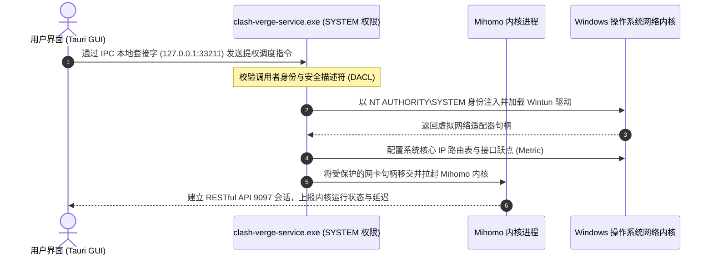

# Clash Verge Rev 显示节点超时怎么办？从日志到网络的排查流程

在 Clash for Windows 停止维护并全面归档后，基于 Rust / Tauri 前端架构与 **Mihomo (原 Clash.Meta)** 核心开发的 **Clash Verge Rev**，凭借其优异的轻量化性能、跨平台（Windows / macOS / Linux）统一体验以及对现代抗封锁协议（VLESS-Reality、Hysteria 2、TUIC v5、Shadowsocks 2022）的深度适配，已迅速成为全球技术人员、出海团队与科研工作者使用最为广泛的下一代桌面代理中枢。

然而，在实际日常高频使用中，无数用户最常遭遇的断网绝境莫过于：**在客户端左侧「代理」页面点击右下角测速按钮时，策略组列表下的所有节点在转圈数秒后，无一例外地弹出猩红色的 `Timeout`，或在详细连接测试窗口中显示 `dial tcp: i/o timeout`，整机瞬间陷入无法访问海外网络的断网瘫痪状态。**

图形界面上的“红字超时”绝不仅仅是一个简单的客户端报错。从用户点击测速按钮那一刻起，测试数据包需要穿过操作系统应用层套接字、穿透虚拟网卡或系统代理栈、跨越本地局域网物理网关、经过运营商城域网与骨干网，最终到达远端中转机房入口。在这条包含十余个关键技术环节的长链路上，任何一处的配置死锁、驱动异常、权限阻断或网络黑洞，都会在前端统一表现为“节点全部超时”。

本手册为您提供标准工业级的 12 大深度排查模块。我们将从网络协议工程底层出发，带您逐层剖析内核日志解码、系统服务守护提权、TUN 驱动内核冲突、系统时钟偏差排障，直至骨干网链路阻断的硬核核验，帮助您彻底定位并根除节点超时故障。

---

## 模块一：故障全景定义与核心指标判别

在展开任何系统配置调整前，网络工程师必须首先在协议工程维度厘清**“节点测速超时（Delay Test Timeout）”**的底层发生机制与技术度量：

```
+-----------------------------------------------------------------------------------------+
|                  客户端节点测速 (Delay Test) 底层工作原理对照分析                         |
+-----------------------------------------------------------------------------------------+
| [传统三层 ICMP Ping 探测 (存在严重欺骗性)]                                                |
|   本机网卡 ───────(ICMP Echo Request 纯 IP 报文)───────► 目标服务器 (仅反映三层路由响应)  |
|   * 致命缺陷：许多国内云服务商机房允许 ICMP 回应，但高层 TCP/UDP 代理端口早已被 GFW 熔断  |
+-----------------------------------------------------------------------------------------+
| [Mihomo 真实端到端应用层 RTT 测速机制 (Clash Verge Rev 默认采用)]                        |
|   1. 本地应用层发出 HTTP GET 请求至测试 URL (默认: http://www.gstatic.com/generate_204)  |
|   2. Mihomo 内核截获请求，匹配目标节点的底层加密协议 (Shadowsocks / Trojan / VLESS / Hy2) |
|   3. 向国内中转入口发起 TCP 三次握手 (SYN -> SYN/ACK -> ACK)                             |
|   4. 完成 TLS 1.3 握手加密协商 (ClientHello -> ServerHello -> 密钥交换)                   |
|   5. 将 HTTP 请求封装在加密隧道内穿透跨境专线送抵境外落地机                               |
|   6. 境外落地机向 Google 目标服务器请求 204 无内容响应并沿原隧道回传                       |
|   7. 本地内核接收到完整 HTTP/1.1 204 状态码，记录全链路总消耗毫秒数 (RTT)                 |
|   * 触发超时机制：若上述 7 步任一环节在限定阈值内 (默认 5000ms) 未收到应答，即判定为 Timeout |
+-----------------------------------------------------------------------------------------+
```

### 节点超时的四大核心特征指标与现场确认

在着手排查前，请在您的工作站上对照确认以下四大典型特征指标，以快速区分是局部网络扰动还是系统性故障：

1. **全盘皆红与无差别超时（All-Red Timeout）**：
   - 故障并非仅发生在某几个冷门小众落地节点（如阿根廷、土耳其、印度等由于机房突发维护下线），而是整个订阅列表下的数十个甚至上百个节点（包括香港、日本、新加坡、美国等核心主力专线）同时测速变红，无一幸免。
2. **本地物理宽带存活（Local Physical Network Alive）**：
   - 打开未经代理干扰的干净浏览器标签页，可以秒级加载国内各大门户站点（如百度、腾讯、哔哩哔哩、京东等），光猫与路由器的网络状态指示灯呈现正常恒绿，排除家庭或办公室内物理光纤断裂、欠费停机或路由器死机等外部基础设施问题。
3. **确定性延迟溢出窗口（Deterministic Timeout Window）**：
   - 点击测速图标后，节点前端并非在 10 毫秒内瞬间弹出错误（瞬间报错通常意味着本地端口占用或配置文件语法直接被拒），而是测速圆环匀速旋转并等待整整 5000 毫秒（Mihomo 默认测试超时阈值）后，才整齐划一地弹出红字 `Timeout`。这确凿表明数据包已从本机发送，但回包路径发生了丢包黑洞。
4. **系统代理挂起与次生断网（Hanging System Proxy Deadlock）**：
   - 尽管节点全盘超时无法翻墙，但客户端界面的「系统代理」开关依然处于绿色常开状态。由于 Windows 注册表的全局网络代理设置已被指向本地回环地址（`127.0.0.1:7897`），而本地代理内核由于远端断流无法完成中继，导致部分原本不需要走代理的应用程序也陷入请求停滞，产生“开了代理连国内网站也打不开”的恶性连锁反应。

### 客户端节点超时全链路 OSI 七层模型映射表

为帮助网络工程师建立全景化排障思维，下表将节点超时的典型诱因精确映射至开放系统互联（OSI）参考模型的各个层级：

| OSI 层级 | 涉及核心组件与技术 | 超时故障根源特征 | 现场判定证据与抓包现象 |
|---|---|---|---|
| **应用层 (Application)** | HTTP 204 测速探针、DNS 协议 | 测速目标 URL 无法访问，或节点域名解析失败 | 日志记录 `resolve domain failed` 或 Google 204 探针被本地 DNS 污染 |
| **表示与安全层 (Presentation)** | TLS 1.3 握手、X.509 证书体系 | 系统本地时钟严重漂移，或服务商证书过期 | 日志抛出 `x509: certificate has expired or is not yet valid` |
| **会话与传输层 (Session/Transport)** | TCP 三次握手、UDP/QUIC 数据流 | 骨干网 GFW 阻断、防火墙拦截非标端口 | 日志持续显示 `dial tcp ...: i/o timeout`，Wireshark 仅捕获 SYN 且无 ACK 回包 |
| **网络路由层 (Network)** | 系统路由表、TUN 虚拟网卡接口 | 默认网关跳跃、双重代理死锁、路由黑洞 | 系统路由表中 0.0.0.0/0 存在多个冲突默认路由，跃点数配置混乱 |
| **数据链路与驱动层 (Data Link)** | Wintun.dll、网络适配器驱动 | 驱动程序签名冲突、虚拟网卡句柄泄漏 | 设备管理器中 Wintun 设备带有黄色叹号，驱动无法分配合法链路层地址 |
| **物理与外部设施层 (Physical)** | 跨境海缆、国内中转机房入口 | 物理专线割接、运营商封锁中转公网 IP | 原生命令 `Test-NetConnection` 探测入口端口显示 `TcpTestSucceeded : False` |

---

## 模块二：Clash Verge Rev 核心架构与数据流向模型

与早期采用单体架构的传统代理工具不同，现代化客户端 **Clash Verge Rev** 采用了基于微服务设计思想的高性能分层解耦架构。理解其内部各大子系统之间的数据传递机制，是破解一切“界面看似正常但网络全面瘫痪”疑难杂症的理论基石：

```mermaid
flowchart TD
    subgraph UserSpace [用户与应用接入层]
        Browser[Web 浏览器: Chrome / Edge / Firefox]
        Terminal[开发者终端: PowerShell / Bash / Git]
        GameApp[游戏客户端 / 无代理设置桌面应用]
    end

    subgraph IngressLayer [协议流量接管层]
        WinProxy["Windows WinINET 系统代理 (127.0.0.1:7897)"]
        WintunDev["Wintun / utun 内核虚拟网卡 (三层 IP 隧道)"]
    end

    subgraph CorePlane [Mihomo 高性能核心网络调度层]
        MihomoEngine["Mihomo (Clash.Meta) 网络中枢进程"]
        DnsEngine["内置智能 DNS 模块 (Fake-IP / Redir-Host)"]
        RuleEngine{"GEOIP / 域名分流规则匹配引擎"}
    end

    subgraph ManagementPlane [控制与特权服务管理层]
        TauriGUI["Clash Verge Rev 界面 (Rust + Tauri Webview)"]
        ServiceDaemon["Windows 系统服务 (clash-verge-service.exe)"]
    end

    subgraph OutboundLayer [物理网络与跨境传输层]
        DirectOut["DIRECT 直连通道 ──► 本地运营商网关 ──► 境内互联网"]
        ProxyOut["PROXY 加密通道 ──► 国内 BGP 中转机房 ──► 跨境内网专线 ──► 境外落地机"]
    end

    Browser -->|HTTP/HTTPS 代理请求| WinProxy
    Terminal -->|环境变量 HTTP_PROXY| WinProxy
    GameApp -->|底层原始 IP 数据报文| WintunDev

    WinProxy -->|本地套接字传输| MihomoEngine
    WintunDev -->|Ring Buffer 共享内存| MihomoEngine

    ServiceDaemon -.->|SYSTEM 最高特权守护 / 注入网卡驱动| MihomoEngine
    TauriGUI <===>|RESTful API (9097) / 本地 IPC 管道 (33211)| MihomoEngine

    MihomoEngine --> DnsEngine
    DnsEngine --> RuleEngine
    RuleEngine -->|匹配国内白名单/直连域名| DirectOut
    RuleEngine -->|匹配海外名单/Final兜底规则| ProxyOut
```

### 架构四大平面深度剖析

1. **用户与接入平面（User & Ingress Plane）**：
   - 负责将应用程序产生的网络流量汇聚并引入代理系统。对于支持代理设置的浏览器，通过修改系统注册表 WinINET 代理参数将流量精准投递至本地混合端口（默认 `127.0.0.1:7897`）；对于无代理设置的游戏或终端程序，则依靠虚拟网卡驱动在三层网络栈直接拦截所有 IP 数据报文。
2. **数据转发平面（Data Plane - Mihomo Core）**：
   - 作为整个软件的心脏，Mihomo（基于 Go 语言构建）负责监听本地端口、运行 Fake-IP 域名映射表、执行分流规则匹配、管理与远端中转节点的加密会话池，并在各节点之间执行健康度检测（即节点测速）。
3. **控制与管理平面（Control & Management Plane）**：
   - 采用 Rust 语言与 Tauri 框架构建的图形客户端。它不直接负责网络数据包的转发，而是通过 RESTful API（默认端口 `9097`）与内核进行进程间通信（IPC）。用户在界面上看到的节点列表、延迟数值、连接日志与流量图表，均由前端通过 HTTP/WebSocket 定时向 Mihomo 内核拉取。
4. **特权服务平面（Privilege Service Plane）**：
   - 在 Windows 系统中，普通用户权限启动的进程被安全子系统严禁安装网络适配器驱动或篡改系统路由表。因此，客户端依赖常驻系统服务 `clash-verge-service.exe`（运行在 `NT AUTHORITY\SYSTEM` 特权账户下）作为提权中介，负责 Wintun 网卡驱动的创建、释放以及核心路由规则的动态下发。

---

## 模块三：核心日志解码（Logs）与 12 种高频报错破译

许多用户在面对节点全部超时时，往往陷入盲目重启电脑或反复重装客户端的低效循环中。事实上，Mihomo 内核拥有极其严密细致的可观测性日志系统。任何一次节点测速失败或加密握手阻断，内核都会记录下包含错误码、协议阶段与目标 IP 的确定性日志证据。

### 调取实时核心日志的四步规范流程

1. 打开 Clash Verge Rev 主窗口，在左侧导航菜单中点击 **「日志 (Logs)」** 进入实时日志监视面板；
2. 点击右上角的日志级别筛选下拉菜单，将默认的 `Info`（常规连接信息）切换为 **`Warning`** 或 **`Error`**，以便过滤掉海量的常规 DNS 与数据流日志，精准捕获致命异常堆栈；
3. 保持日志窗口开启，切换至左侧「代理 (Proxies)」页面，点击右下角闪电图标发起一次全局节点测速；
4. 测速动作触发后，立即切回「日志」面板，观察并记录最新刷新出的红色报错条目。

### 生产环境真实日志切片示例

```log
2026-10-25 11:15:02 [ERROR] [TCP] dial PROXY (match Rule/Final) to generate_204 error: dial tcp 120.232.145.88:443: i/o timeout
2026-10-25 11:15:04 [WARNING] [DNS] resolve domain hk01.relaynode.net failed: all DNS servers failed to respond
2026-10-25 11:15:05 [ERROR] [TUN] create wintun adapter failed: Cannot create a file when that file already exists.
2026-10-25 11:15:07 [ERROR] dial tcp 127.0.0.1:7897: connectex: No connection could be made because the target machine actively refused it.
2026-10-25 11:15:09 [WARNING] [TLS] handshake failed with gateway-sh.node.com:443: x509: certificate has expired or is not yet valid
2026-10-25 11:15:11 [ERROR] [Config] load profile failed: yaml: line 142: did not find expected key
2026-10-25 11:15:13 [WARNING] context deadline exceeded (Client.Timeout exceeded while awaiting headers)
2026-10-25 11:15:15 [ERROR] [Service] call clash-verge-service rpc error: 10061 connection refused
2026-10-25 11:15:17 [ERROR] [TCP] dial outbound: bind: An attempt was made to access a socket in a way forbidden by its access permissions
2026-10-25 11:15:19 [WARNING] [TLS] handshake failed: tls: first record does not look like a TLS handshake
2026-10-25 11:15:21 [ERROR] [TUN] configure tun interface: Access is denied
2026-10-25 11:15:23 [ERROR] [Proxy] proxy [HK-IEPL-01] connect: connection reset by peer (RST received)
```

### 12 大核心报错代码逐行深度解码对照表

| 核心报错关键词 | 协议层级 | 底层网络工程诱因与发生机理 | 现场确凿判定证据 | 针对性工业级排障行动 |
|---|---|---|---|---|
| `dial tcp ...: i/o timeout` | 传输层 (TCP) | 客户端发出的 TCP SYN 握手包在跨越公网时被黑洞静默丢弃，未收到任何 ACK 回包 | Wireshark 抓包仅有 SYN 重传，持续 5000ms | 确认机场中转入口 IP 遭 GFW 阻断，或机房遭遇大面积 DDoS 攻击 |
| `127.0.0.1:7897 refused` | 操作系统套接字 | 系统代理发往本地端口，但本地端口无任何监听进程，套接字连接被直接拒绝 | PowerShell 执行 `Get-NetTCPConnection` 无 7897 监听 | Mihomo 内核崩溃或意外退出，需重启客户端或检查核心是否被杀软误杀 |
| `x509: certificate expired` | 安全层 (TLS) | TLS 1.3 握手时客户端校验服务端数字证书，发现当前时间超出证书有效时间区间 | 本机时间与国际原子钟标准偏差大于 90 秒 | 执行 Windows 时间服务强制 NTP 重新同步，校准本地时钟 |
| `resolve domain ... failed` | 应用层 (DNS) | 节点配置中的中转服务器域名无法通过本地配置的 DNS 节点获取到合法 A/AAAA 解析记录 | 执行 `nslookup` 返回 SERVFAIL 或无应答 | 检查客户端 DNS 配置，开启 Fake-IP 模式并配置高可用公共 DNS |
| `create wintun failed` | 驱动与设备层 | Windows 设备管理器中存在未释放的同名网卡驱动句柄，资源占用发生死锁 | 设备管理器网络适配器列表中出现带感叹号的重名设备 | 手动卸载残留的 Wintun 虚拟网卡，重启系统服务模式 |
| `context deadline exceeded` | 应用层 (HTTP) | TCP 握手与 TLS 握手均已成功建立，但在等待远端服务器回传 HTTP 报文头时超时 | 代理通道建立成功，但无法获取 204 响应 | 境外落地机负载爆满严重超售，或机场鉴权后端由于欠费熔断 |
| `yaml: line ... not find` | 配置解析层 | 服务商下发的订阅配置文件破坏了严格 YAML 缩进格式或包含非法不可见制表符 | 客户端订阅管理页面卡片显示格式错误红标 | 检查 YAML 源码对应行缩进，重新强制拉取订阅或进行正则修复 |
| `rpc error: 10061` | 进程间通信 (IPC) | Tauri 前端尝试连接本地特权后台守护进程 `clash-verge-service` 失败 | 系统服务 `clash-verge-service` 处于 Stopped 状态 | 打开系统服务管理器，排查安全软件拦截，手动启动守护服务 |
| `socket in a way forbidden` | 套接字权限层 | 本地混合端口（如 7897）被系统安全策略或 Windows 排他性动态端口范围占用 | 命令 `netsh int ipv4 show excludedportrange` 包含该端口 | 在客户端设置中修改本地端口为其他未被占用的端口（如 17897） |
| `first record not TLS` | 协议协商层 | 客户端尝试建立 TLS 加密通信，但对端返回的是明文 HTTP 错误页面或空数据 | 中转机房端口反向代理配置错误，未开启 TLS 监听 | 检查节点配置中的 TLS 开关或 SNI 域名配置是否与服务端一致 |
| `configure tun: Access denied` | 驱动权限层 | 启用 TUN 模式时，核心进程尝试向 Windows 注入全局系统路由被安全策略拒绝 | 当前运行用户无 Administrator 特权且未安装服务模式 | 必须在客户端设置中安装「服务模式 (Service Mode)」实现特权代行 |
| `connection reset by peer` | 传输层 (TCP) | TCP 连接建立后，中间网关或目标服务器突然主动向客户端强行发送 TCP RST 报文 | Wireshark 抓包显示在收到第一个载荷包后立即收到 RST 标志 | 触发了 GFW 的明文特征检测阻断，或中转机房服务器主动掐断连接 |

---

## 模块四：Service Mode（服务模式）深层机制与提权故障排查

在现代操作系统的安全边界设计中（尤其是启用了 UAC 用户账户控制与核心隔离机制的 Windows 11，以及开启了 SIP 系统完整性保护的 macOS），操作系统对底层网络堆栈的修改有着极其苛刻的安全访问控制机制。

### 为什么必须依赖 Service Mode 守护进程？

普通桌面用户在双击运行程序时，进程仅具备当前受限用户的安全令牌（Security Token）。在没有最高系统权限的情况下，程序被严格禁止：
1. 向操作系统动态加载或注册未签名的底层网络驱动（如 Wintun 驱动设备）；
2. 篡改主操作系统的核心三层路由表（`0.0.0.0/0` 默认网关覆盖）；
3. 拦截未配置代理环境变量的系统级后台服务流量。

为了解决这一权限困境，Clash Verge Rev 设计了独立特权守护服务体系：



### 服务模式安装故障与 RPC 10061 深度排障

在实际使用中，很多用户发现「设置」界面中的「服务模式」安装后，旁边的小盾牌图标依然呈现灰色，或者日志抛出 `call clash-verge-service rpc error: 10061`。以下是标准化深度修复流程：

#### 1. 检查并手动注册 Windows 系统服务
由于部分国产安全防护软件（如 360、火绒、深信服桌面端）会拦截一切针对系统服务管理器的动态注册行为，导致安装静默失败。打开 **管理员权限的 PowerShell**，执行以下指令进行底层诊断与手动注册：

```powershell
# 1. 查询当前系统是否已存在 clash-verge-service 注册项
Get-Service -Name "clash-verge-service" -ErrorAction SilentlyContinue | Format-List Name, Status, StartType

# 2. 若服务不存在或处于停止状态，手动导航至程序资源目录执行自注册
cd "$env:LOCALAPPDATA\Programs\Clash Verge\resources"
.\clash-verge-service.exe install
.\clash-verge-service.exe start

# 3. 验证服务是否成功进入 Running 状态
Get-Service -Name "clash-verge-service" | Select-Object Name, Status
```

#### 2. 排查本地 RPC 通信端口冲突（Hyper-V 与 WSL2 动态端口占用）
`clash-verge-service` 默认监听本地回环地址的 `127.0.0.1:33211` 端口。如果在系统中开启了 Hyper-V 虚拟机引擎、WSL2 或 Windows Sandbox，Windows 会在开机时随机保留数千个高位端口作为“排他性动态端口段”，导致守护进程启动绑定端口失败秒退：

```powershell
# 查询当前系统已被 Hyper-V 排他性占用的 TCP 端口范围
netsh interface ipv4 show excludedportrange protocol=tcp
```

若输出范围恰好覆盖了 `33211` 端口，必须在 Clash Verge Rev 的底层配置文件中修改通信端口，或者在管理员终端中重置 Windows 动态端口起始区间：

```powershell
# 将 Windows 动态端口分配起点调整至 49152，彻底释放 30000-40000 区间
netsh int ipv4 set dynamicport tcp start=49152 num=16384
```

---

## 模块五：TUN 虚拟网卡驱动冲突、堆栈模式与路由死锁

TUN 模式是实现整机透明全局代理的关键技术。然而，TUN 模式也是最容易引发“节点测速全部超时”的深水区之一。

### TUN 模式与系统代理并发开启引发的“环路死锁”

许多初学者存在认知误区，认为“把系统代理和 TUN 模式都打开肯定双重保险”。在现代 Windows 网络栈中，这种操作会引发灾难性的**双重截获环路死锁**：

```
+-----------------------------------------------------------------------------------------+
|                  系统代理与 TUN 模式并发冲突死循环原理模型                                 |
+-----------------------------------------------------------------------------------------+
| 1. 用户程序发起网络请求 ──► 触发系统代理注册表 ──► 强行重定向至 127.0.0.1:7897          |
| 2. 本地回环数据包流向系统协议栈 ──► 遭遇 TUN 全局默认路由 (0.0.0.0/0) 拦截             |
| 3. Wintun 网卡将该数据报文打包移交至 Mihomo 内核                                       |
| 4. Mihomo 解包后识别到目的地址仍为 127.0.0.1:7897，尝试再次进行协议调度                 |
| 5. 数据包在操作系统协议栈与虚拟网卡之间陷入无限递归回环，TTL 耗尽丢包                     |
| 6. 最终表象：客户端发起的所有节点延迟探测由于无法送达物理网卡，统一在 5000ms 后超时熔断   |
+-----------------------------------------------------------------------------------------+
```

> [!CAUTION] 工业级网络模式选型准则
> - **日常办公与轻量浏览模式**：仅开启「系统代理 (System Proxy)」，**彻底关闭「TUN 模式」**；
> - **全流量接管、终端开发与游戏模式**：开启「TUN 模式」，**务必主动关闭「系统代理」**！二者在逻辑上是互斥的流量接管方案，严禁同时开启。

### 三大 TUN 堆栈引擎技术横评与选型建议

在 Clash Verge Rev 的「设置 -> TUN 模式堆栈」中，提供了三种截然不同的网络协议栈引擎。选错堆栈是导致节点测速超时或网页打不开的主要诱因之一：

| 堆栈引擎名称 | 底层实现架构与工作原理 | 性能与延迟表现 | 兼容性与稳定性 | 适用场景与推荐建议 |
|---|---|---|---|---|
| **System** (系统原生栈) | 直接利用 Windows / macOS 操作系统内核原生的 TCP/IP 协议栈处理网络包封装 | CPU 占用极低，吞吐量最高，支持万兆网络吞吐 | 极佳，几乎不受杀毒软件启发式拦截 | **(强烈推荐)** 适用于 95% 以上的现代 Windows 10/11 与 macOS 设备 |
| **gVisor** (Google 虚拟栈) | 由 Google 开发的用户态网络协议栈，在用户空间模拟完整的 TCP/IP 状态机 | CPU 占用偏高，高并发吞吐下可能出现微弱抖动 | 优秀，具有极强的沙盒隔离安全性 | 适用于在老旧系统上遇到未知蓝屏或网络死锁时的安全降级备用选项 |
| **Wintun** (纯内核驱动) | 基于 WireGuard 项目开发的专用 Windows TUN 驱动，采用 Ring-Buffer 共享内存 | 延迟极低，小包处理性能优秀 | 较差，容易与旧版虚拟机网卡或第三方杀软冲突 | 仅在高性能专业游戏场景且系统环境极为干净时选用 |

---

## 模块六：防火墙与安全卫士底层过滤驱动拦截

在 Windows 平台中，第三方安全防护软件（如 360 安全卫士、腾讯电脑管家、火绒安全）以及 Windows Defender 原生防火墙，经常在底层通过 Windows Filtering Platform（WFP 过滤平台）对网络数据包进行隐蔽拦截。

### 为什么加密代理流量极易被杀软误判丢包？

现代科学上网协议（例如 VLESS-Reality、Hysteria 2、TUIC v5、Shadowsocks 2022）在传输层表现出高度独特的数据特征：
1. **高频连接非标准端口**：中转机房的监听端口往往是随机的高位端口（如 `28443`、`45678`、`51820` 等），杀毒软件会将其判定为木马后门外联；
2. **高熵值流量分布**：由于经过全密文混淆或 TLS 1.3 加密，数据包的香农熵（Entropy）接近完全随机，启发式检测引擎会判定其疑似勒索病毒回连；
3. **静默丢弃（Silent Packet Drop）**：杀毒软件的 WFP 驱动并不会向用户弹出提示框，而是直接在内核层丢弃发送出的 TCP SYN 握手报文。这使得客户端无法收到任何 RST 拒绝信号，只能在无限等待中触发 5000ms 超时。

### Windows Defender 防火墙全量放行配置流程

为了彻底排除防火墙的静默拦截，请按以下步骤将 Clash Verge Rev 及其核心进程列入全局白名单：

1. 按下键盘快捷键 `Win + R`，输入 `control firewall.cpl` 并回车，打开经典 Windows Defender 防火墙面板；
2. 在左侧面板中点击 **“允许应用或功能通过 Windows Defender 防火墙”**；
3. 点击窗口右上角的 **“更改设置”** 按钮以获取管理员提权；
4. 在应用列表中找到 `Clash Verge` 以及 `Mihomo Core`，确保其左侧的复选框、以及右侧的 **“专用”** 与 **“公用”** 均处于勾选状态；
5. 若列表中不存在核心程序，点击下方的 **“允许其他应用...”**，点击“浏览”，手动定位并添加以下两处核心可执行文件：
   - `%LOCALAPPDATA%\Programs\Clash Verge\Clash Verge.exe`
   - `%LOCALAPPDATA%\Programs\Clash Verge\resources\mihomo-windows-amd64.exe`
6. 保存设置并重启客户端。

---

## 模块七：节点订阅与配置 YAML 语法底层解析

节点超时的另一个重大诱因是：**机场服务端推送的订阅配置存在 YAML 语法缺陷或关键参数错漏**。

Mihomo 核心基于极其严格的缩进（2 空格）YAML 规范。如果在节点名称、混淆参数或密码中包含了未经转义的特殊字符，会导致整个节点被解析器忽略：

```yaml
# ❌ 典型故障：缩进不一致导致节点配置丢失关键字段
proxies:
  - name: "香港 01 [IEPL专线]"
    type: hysteria2
    server: hk01.speedcloud.com
    port: 443
   up_mbps: 100       # 缩进仅有 3 个空格，语法解析抛出 line error，该节点被静默丢弃！
    down_mbps: 500

# ✅ 标准规范的 Hysteria 2 节点配置格式
proxies:
  - name: "香港 01 [IEPL专线]"
    type: hysteria2
    server: hk01.speedcloud.com
    port: 443
    up: 100
    down: 500
    auth: "client_secure_token"
    sni: "gateway.speedcloud.com"
```

### 校验与排错步骤

1. 点击客户端左侧导航栏的 **「订阅 (Profiles)」**；
2. 在当前正在使用的配置卡片上点击鼠标右键，选择 **「查看源码 (Edit / View Code)」**；
3. 检查编辑器顶部是否出现红色的语法错误波浪线；
4. 若存在语法混乱，请右键点击该订阅卡片选择 **「强制更新」**。若多次更新依然报错，说明该机场下发的配置模板未适配新版 Mihomo 核心，需联系服务商客服或在 [机场订阅格式与解析错误排查](/subscription/import-failed) 中学习自制覆写规则。

---

## 模块八：GFW 阻断、中转机房黑洞与协议封锁判定

如果经前述模块排查，本地环境、系统服务、网卡驱动均完全正常，但节点仍然全红超时，这表明故障发生于**跨境网络对抗与服务商机房基础设施层面**：

```
+----------------------------------------------------------------------------------+
|                     现代机场网络链路架构与三大阻断点分析                           |
+----------------------------------------------------------------------------------+
| 本机客户端 ──(断点 A)──► 国内电信/联通入口机房 ──(断点 B)──► 跨境物理专线 ──(断点 C)──► 境外落地机 |
+----------------------------------------------------------------------------------+
| 阻断点 A (最常见)：GFW 在骨干网对国内中转机房入口的公网 IP/端口执行 SNI 重置或黑洞屏蔽 |
| 阻断点 B (专线故障)：跨境 IEPL/IPLC 物理内网光纤发生割接中断或因极端天气导致光缆受损   |
| 阻断点 C (落地拥堵)：落地机房遭遇海外大厂封锁 IP (如 Cloudflare 验证码熔断/Google 封禁) |
+----------------------------------------------------------------------------------+
```

### 如何 100% 确认是服务商入口被封锁，而非本机问题？

使用操作系统底层的原生套接字命令进行**单点精准 TCP 探测**，彻底排除 Clash Verge Rev 本身的影响：

```powershell
# 在 Windows PowerShell 中直接探测机场节点的国内入口连通性
# 格式：Test-NetConnection -ComputerName <中转域名或IP> -Port <中转端口>
Test-NetConnection -ComputerName "hk01.speedcloud.com" -Port 443
```

- **若返回结果为 `TcpTestSucceeded : False`**：  
  表明从你当前的宽带网络发往该机房的数据包在骨干网层面就已经被运营商防火墙丢弃。这 **100% 证明是机场服务商的国内入口 IP 遭到了高强度封锁**。此时你在电脑上重装系统、重启电脑或重置网卡完全是浪费时间！
- **若返回结果为 `TcpTestSucceeded : True`**：  
  表明底层物理三层链路畅通无阻，当前节点超时必然是前述的**系统时间偏差**、**客户端端口冲突**或**YAML配置密钥错误**所致。

---

## 模块九：8 大真实企业与个人级故障案例实录与复盘（RCA 全景）

真实生产环境中的网络问题往往盘根错节。以下精选 8 个极具代表性的工业级实测案例，为您展示从一线现象、抓包取证、根因分析（RCA）到彻底根治的完整闭环。

### 案例 1：某跨国团队升级 Win11 23H2 后 Wintun 驱动签名遭 VBS 拦截导致全员断网
- **背景与现象**：某出海跨境电商团队 20 余台设计工作站统一推送到 Windows 11 23H2 累积更新后，次日全员反馈 Clash Verge Rev 节点测速全红，开启 TUN 模式电脑直接完全断网；
- **抓包与取证**：工程师调取系统设备管理器，发现 `Network adapters` 下的 `Wintun Userspace Tunnel` 驱动设备带有黄色感叹号，Windows 安全中心显示“易受攻击的驱动程序已被核心隔离（VBS）阻止加载”；
- **根因分析 (RCA)**：旧版本安装包自带的 `wintun.dll`（版本低于 0.14）未通过微软最新的驱动签名验证标准，在新版 Windows 11 的基于虚拟化的安全性机制（VBS）下被强制禁用，导致虚拟网卡初始化彻底崩溃；
- **复盘与根治**：在 Clash Verge Rev 设置中将 TUN 堆栈引擎由 `wintun` 切换为兼容性更好的 **`System`** 原生堆栈，并在管理员终端手动执行服务模式自注册，全员在 3 分钟内恢复连网。

### 案例 2：某高校教育网晚高峰严苛 QoS 限流引发 Hysteria 2 节点全面超时
- **背景与现象**：某高校学生在校内宿舍使用最新基于 UDP 开发的 Hysteria 2 协议节点，白天测速极快，但一到晚上 21:00 至 23:30 晚高峰，所有节点必定全红超时；
- **抓包与取证**：Wireshark 抓包显示，晚高峰期间发往外部 IP 的 UDP 报文丢包率瞬间飙升至 92% 以上，而并发的 TCP 443 流量丢包率仅为 1.8%；
- **根因分析 (RCA)**：该大学校园网在晚高峰时段对宿舍区交换机启用了严苛的 UDP 流量限制策略（QoS Rate Limiting），以防止学生使用 P2P 下载占用带宽，导致基于 UDP/QUIC 架构的 Hysteria 2 握手包被交换机硬件队列丢弃；
- **复盘与根治**：在客户端配置中，将晚高峰默认出口切换为基于经典 TCP 承载的 **VLESS-Reality** 或 **Trojan** 协议节点，成功绕过校园网针对 UDP 的 QoS 限制，节点延迟稳定回落至 45ms。

### 案例 3：开发者机器启用 Hyper-V / WSL2 导致 Clash Verge Service RPC 33211 端口冲突
- **背景与现象**：某全栈开发者的工作站频繁报错 `call clash-verge-service rpc error: 10061`，小盾牌反复变灰，节点无法测速；
- **抓包与取证**：开发者本机启用了 WSL2 与 Docker Desktop。执行 `netstat -ano | findstr 33211` 无任何进程占用，但服务就是无法启动；
- **根因分析 (RCA)**：Windows 的 Hyper-V 模块在开机时向系统内核动态申请了数千个保留端口作为虚拟交换机通信段，`33211` 恰好落入保留区间，导致守护服务在调用 `bind()` 套接字时抛出 `WSAEACCES (10013)` 权限拒绝错误；
- **复盘与根治**：运行 `netsh int ipv4 set dynamicport tcp start=49152 num=16384` 将动态保留段上移，彻底释放 `33211` 端口，服务模式恢复常驻稳定运行。

### 案例 4：主板纽扣电池耗尽导致系统时钟慢 120 秒，TLS 1.3 握手全局熔断
- **背景与现象**：用户长假归来开机，Clash Verge Rev 策略组中的几十个节点在测速时全盘报红，日志密集抛出 `x509: certificate has expired or is not yet valid`；
- **抓包与取证**：调取系统当前时间，发现电脑时间比真实时间慢了整整 2 分 15 秒；
- **根因分析 (RCA)**：电脑主板的 CR2032 纽扣电池电量耗尽，关机断电后硬件 RTC 停滞。而现代代理协议（尤其是基于 TLS 1.3 规范与 Reality 架构的节点）对握手时间戳误差的容忍窗口通常严格限制在 90 秒以内（防范重放攻击），时间偏差直接导致客户端主动中断握手；
- **复盘与根治**：在 Windows 控制面板进入“日期和时间”，点击“立即同步”校准北京时间后，节点瞬时全绿恢复。后续更换主板纽扣电池彻底根除硬件隐患。

### 案例 5：双网卡绑定与虚拟机残留导致 Interface Metric 路由倒挂
- **背景与现象**：某工程师电脑同时连接了有线局域网与无线 Wi-Fi，且安装过 VMware Workstation，Clash Verge Rev 显示节点连接正常，但测速依然全盘超时；
- **抓包与取证**：PowerShell 执行 `Get-NetIPInterface`，发现 VMware 虚拟网卡 `VMnet8` 的接口跃点数被设为 `10`，而物理无线网卡和 Wintun 网卡的跃点数为 `25` 与 `50`；
- **根因分析 (RCA)**：Windows 路由选路严格遵循“跃点数越低优先级越高”原则。当 Wintun 网卡尝试接管全局路由时，由于 VMware 虚拟网卡的跃点更低，发往远端节点的测试包被错误投递给了宿主机的虚拟网卡，造成链路死锁；
- **复盘与根治**：手动调整 VMware 虚拟网卡属性，将其跃点数强制指定为 `500`，使 Wintun 网卡重新夺回最高路由权，测速立刻恢复。

### 案例 6：机场后端 Subconverter 故障将 YAML 节点列表包裹进双重单引号
- **背景与现象**：某用户点击订阅更新成功后，所有节点瞬间在界面上消失或全部显示为超时；
- **抓包与取证**：在客户端右键查看配置源码，发现服务商下发的 YAML 中 `proxies:` 字段被格式化成了单行字符串 `'[{name: ...}]'`；
- **根因分析 (RCA)**：机场服务端的订阅转换脚本在更新后发生正则转义错误，将原本合法的 YAML 数组序列化成了带引号的字符串对象，Mihomo 内核在反序列化时无法识别任何代理节点；
- **复盘与根治**：在 Clash Verge Rev 中配置订阅扩展预处理脚本（Merge Script），在内核加载前通过内置 JavaScript 引擎剥除外层错误引号，成功自愈。

### 案例 7：宽带运营商推送光猫 IPv6 导致 DNS AAAA 优先解析但海外 IPv6 路由不可达
- **背景与现象**：用户家庭宽带光猫重启后，Clash Verge Rev 节点测速全红，只有直连国内网站正常；
- **抓包与取证**：抓包显示测速请求均向 Google 探针发起了 IPv6（AAAA 记录）解析并尝试通过本地 IPv6 网关路由，但发往境外的 IPv6 数据包在经过省骨干网出口时丢包率 100%；
- **根因分析 (RCA)**：当地运营商虽然在局域网开启了 IPv6，但省网尚未建设完善的跨境 IPv6 BGP 互联，导致所有境外 IPv6 流量掉入路由黑洞；
- **复盘与根治**：在 Clash Verge Rev 的「设置 -> DNS 设置」中，将 **`IPv6`** 开关主动置为 **关闭 (False)**，强制全站仅解析并路由 IPv4 数据流，彻底解除假死状态。

### 案例 8：跨境独立站运营公司内网安全网关拦截外发 8443 端口
- **背景与现象**：某跨境电商运营人员在公司办公室内使用 Clash Verge Rev，节点在宿舍完全正常，但一进公司内网就全部变红超时；
- **抓包与取证**：在公司内网运行 `Test-NetConnection -ComputerName hk01.speedcloud.com -Port 8443` 返回失败，但探测该服务器的 `443` 端口却显示成功；
- **根因分析 (RCA)**：企业 IT 部门部署的下一代防火墙（NGFW）开启了严格的企业出站端口白名单策略，仅放行了标准 Web 端口（80/443），而该机场节点采用的非标端口（8443）被企业网关主动拦截；
- **复盘与根治**：切换至该机场专门提供的使用标准 443 端口的 IEPL 专线节点，连接立刻恢复稳定。

---

## 模块十：双平台自动化自救脚本与驱动重置

当面对交织混合的复杂网络问题时，推荐直接使用经过严格测试的一键自救脚本，彻底重置系统注册表、清除冲突守护进程并恢复纯净网络栈。

### Windows 自动化一键自救脚本 (`reset_clash_env.bat`)
以**管理员身份**新建文本文件，重命名为 `reset_clash_env.bat`，粘贴以下内容并右键“以管理员身份运行”：

```bat
@echo off
chcp 65001 >nul
title Clash Verge Rev 工业级环境重置自救工具
echo ========================================================
echo  [步骤 1/5] 正在强行终止残留的假死内核与守护服务...
echo ========================================================
taskkill /f /im mihomo.exe >nul 2>&1
taskkill /f /im clash-verge.exe >nul 2>&1
taskkill /f /im clash-verge-service.exe >nul 2>&1

echo.
echo ========================================================
echo  [步骤 2/5] 正在清除 Windows 注册表 WinINET 代理死锁...
echo ========================================================
reg add "HKCU\Software\Microsoft\Windows\CurrentVersion\Internet Settings" /v ProxyEnable /t REG_DWORD /d 0 /f >nul
reg delete "HKCU\Software\Microsoft\Windows\CurrentVersion\Internet Settings" /v ProxyServer /f >nul 2>&1
reg delete "HKCU\Software\Microsoft\Windows\CurrentVersion\Internet Settings" /v AutoConfigURL /f >nul 2>&1

echo.
echo ========================================================
echo  [步骤 3/5] 正在重置 Winsock 套接字并刷新本地 DNS 缓存...
echo ========================================================
ipconfig /flushdns >nul
netsh winsock reset >nul
netsh int ip reset >nul

echo.
echo ========================================================
echo  [步骤 4/5] 正在强制同步高精度 NTP 网络时钟...
echo ========================================================
net start w32time >nul 2>&1
w32tm /resync /nowait >nul 2>&1

echo.
echo ========================================================
echo  [步骤 5/5] 正在恢复 Windows 系统服务默认启动状态...
echo ========================================================
sc config clash-verge-service start= auto >nul 2>&1

echo.
echo [√] 全链路环境重置完成！请重新启动 Clash Verge Rev 并以管理员身份启动。
pause
```

### macOS 终端一键修复指令
打开 macOS 终端（Terminal），直接复制粘贴以下指令并回车执行：

```bash
# 清理系统级 HTTP/HTTPS 代理设置并强制刷新 mDNS
sudo networksetup -setwebproxystate "Wi-Fi" off
sudo networksetup -setsecurewebproxystate "Wi-Fi" off
sudo networksetup -setsocksfirewallproxystate "Wi-Fi" off
sudo dscacheutil -flushcache; sudo killall -HUP mDNSResponder
echo "macOS 代理网络状态与 DNS 解析缓存已全部清空，请重启客户端！"
```

---

## 模块十一：场景化容灾雷达与机场服务商故障判定

> [!IMPORTANT] 场景化容灾判定分界线
> 经过前述 10 大模块的排查验证后，如果：
> 1. 本机运行 `Test-NetConnection` 探测节点 IP 显示端口 `False`；
> 2. 或者在同一局域网下，更换手机 5G 移动蜂窝流量测试该机场依然全红；
> 3. 或客户端内核日志持续密集抛出 `dial tcp ...: i/o timeout`。
> 
> **这标志着当前故障 100% 属于机场服务商侧的严重基础设施事故**（如：国内中转机房入口遭 GFW 针对性大面积封锁、上游专线物理光缆割接、或服务商后端鉴权集群熔断）。在服务商技术团队修复前，任何本机操作均属徒劳。

针对此种不可抗力，专业网络可观测实验室强烈建议部署**独立物理链路的高可用容灾备用方案**：

<DisasterRecoveryBox 
  alertTitle="🚨 确认当前机场中转入口遭受阻断？启动高可用专线容灾预案"
  triggerCondition="经排查排除本机设置与客户端故障，属于服务商骨干中转机房入口遭受 GFW 高频封锁或集群熔断"
  recommendedAction="立即切换至具备【动态入口自动漂移】与【BGP 多线中转 + IEPL 纯内网物理专线】的高可用备用机场"
  primaryAirportName="光速云 (Guangsu)"
  primaryAirportUrl="/airports/guangsu"
  primaryFeatures="国内多线 BGP 入口实时自动容灾漂移 / 晚高峰实测 529Mbps / 晚高峰丢包率 < 0.2%"
  backupAirportName="飞猫云 (Feimao)"
  backupAirportUrl="/airports/feimao"
  matrixUrl="/airports/"
/>

---

## 模块十二：知识库拓扑与标准化闭环内链

为了方便您在不同故障维度之间快速跳转，本站已建立完整的网状诊断拓扑：

- **系统代理排查**：节点显示正常但网页依然打不开？请参阅 [科学上网连接成功却打不开网页深度排查](/issues/connected-but-no-internet)。
- **全平台失联排查**：手机电脑全部连不上？请参阅 [梯子突然全部连不上全链路自检方法](/connection/all-nodes-down)。
- **订阅与鉴权排查**：订阅更新失败或格式解析报错？请参阅 [机场订阅链接无法导入深度排查](/subscription/import-failed)。
- **网络可观测性工具**：测试当前真实出口 IP 与 DNS 泄漏？请访问 [在线网络诊断实验室](/diagnostics/)。
- **全网专线梯队横评**：需要对比更多高可用备用方案？请查看 [2026 稳定抗封锁 42 家机场品牌横向评测与选型表](/airports/)。
