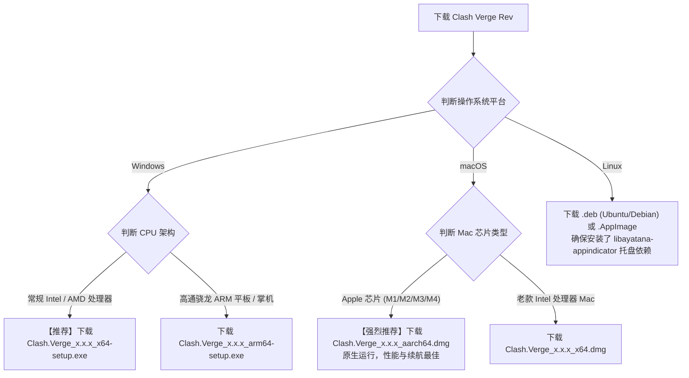

# 2026 最新 Clash Verge Rev (Mihomo) 桌面端标准操作手册：从安装配置、TUN 模式到扩展配置 Merge 语法实战

在跨平台桌面代理工具生态中，伴随着早期经典工具（如 Clash for Windows）的停更与历史退场，**Clash Verge Rev** 凭借其基于 Rust 语言构建的 **Tauri 现代轻量化架构**、对 **Mihomo (原 Clash.Meta)** 新一代内核的深度集成、以及对海量新一代混淆协议（VLESS-Reality、Hysteria 2、TUIC v5）的完美适配，迅速成为了 Windows、macOS 与 Linux 三大操作系统上绝对的主力客户端。

相比于过去内存动辄飙升到 800MB 的旧式 Electron 客户端，Clash Verge Rev 将后台待机内存骤降至 **60MB ~ 90MB**，并原生支持现代化的 WebUI 仪表盘（Metacubexd、Yacd）、开箱即用的高性能 Wintun 虚拟网卡驱动、以及极为优雅的 **订阅覆写（Merge & Script）机制**——让用户无需手动修改机场订阅源文件，即可自动持久化注入私有规则与 Fake-IP 配置。

本文将从客户端系统架构、跨平台安装选型、日常订阅管理、TUN 虚拟网卡服务模式配置，到高阶 Merge 脚本编写，为您提供一套覆盖生产环境的万字级标准操作手册（SOP）与故障排除指南。

---

## 一、 核心架构解剖：Tauri 跨平台模型与 Mihomo 双轨流量引擎

要真正发挥 Clash Verge Rev 的极致性能，首先必须理清其在操作系统底层的运行管线：

```
================================================================================
【Clash Verge Rev 现代化分层运行架构】
[用户操作界面: Tauri GUI (基于 Rust + Webview 原生轻量化渲染)]
        │ 
        ├── 相比旧版 Electron: 启动速度提升 300%，内存开销骤降 75%
        ├── 负责订阅拉取、Merge 语法覆写注入、调用 RESTful API 控制内核
        ▼
[底层路由引擎: Mihomo Core (clash-meta.exe / mihomo-alpha)]
        │ 
        ├── 监听本地统一混合端口 (Mixed Port): 127.0.0.1:7897 (支持 HTTP/Socks5)
        ├── 规则流水线匹配: DOMAIN -> GEOSITE -> IP-CIDR -> GEOIP -> MATCH
        │
        ├── 流量出口通道 A: 系统代理注册表 (WinINet / macOS 偏好设置)
        │      └── 覆盖对象: Chrome, Edge, Safari 等标准遵循代理的浏览器
        │
        └── 流量出口通道 B: TUN 虚拟网卡驱动 (Wintun / utun)
               └── 覆盖对象: 终端命令行、Git、Steam 联机游戏、全系统 UDP 报文
================================================================================
```

### 1. 为什么必须认准“Rev”分支？
原版 Clash Verge 项目早已停止功能性迭代，目前活跃维护并享有极高声誉的是社区独立接盘的 **Clash Verge Rev (Rev 分支)**：
- 原生内置了最新的 **Mihomo Alpha / Stable** 核心；
- 修复了旧版在 Windows 11 23H2/24H2 下虚拟网卡崩溃与内存泄漏的严重隐患；
- 提供了更加模块化的订阅覆写工作台。

---

## 二、 平台安装与架构选型 Checklist

很多用户在下载安装时因“选错芯片架构”，导致软件打开后提示“应用不兼容”或后台内核闪退。请严格按照下述矩阵下载对应版本：



---

## 三、 从零到一：订阅导入与科学上网全流程标准化实操

### 1. 订阅导入与自动更新设置
1. 打开客户端，在左侧导航栏点击 **「订阅 (Profiles)」**；
2. 在顶部输入框粘贴机场服务商提供的 **Clash 订阅链接**；
3. 点击右侧 **「导入 (Import)」**；
4. **激活配置**：导入成功后，**单击该配置卡片**，确保卡片左侧亮起蓝色或紫色的激活标记；
5. **设置静默自动更新**：右键点击该订阅卡片，选择“编辑配置信息”，将“自动更新间隔”设置为 **`1440` 分钟（24 小时）**，确保每天自动静默同步最新可用节点。

### 2. 节点选择与分流模式决策
1. 点击左侧导航栏的 **「代理 (Proxies)」**；
2. **顶部模式选择黄金法则**：
   - **`Rule (规则模式)`**：**【日常唯一推荐】** 仅被封锁的境外网站走代理，百度、淘宝、B站等国内服务 100% 本地直连；
   - **`Global (全局模式)`**：所有流量强行绕道境外，极易导致国内应用卡顿与账号异地风控；
   - **`Direct (直连模式)`**：完全不经过代理；
3. 展开代理策略组（通常名为 `PROXY` 或 `节点选择`），点击右上角的“雷电图标（延迟测速）”；
4. 挑选一个延迟低且稳定的绿色节点（如香港或新加坡专线）；
5. 点击左侧导航栏左下角的 **「系统代理 (System Proxy)」** 开关，使其变为激活状态。打开浏览器访问 Google，即可顺畅上网。

---

## 四、 进阶核心：开启 TUN 模式与服务模式 (Service Mode)

如果您经常在 Windows 下使用 Git 拉取代码、在终端中运行 Python/Node.js 爬虫、或者玩 Apex/Steam 等联机游戏，**传统的系统代理根本无法接管这些三层流量**。

必须开启基于 Wintun 驱动的 **TUN 虚拟网卡模式**：

```
+─────────────────────────────────────────────────────────────────────────────+
|                         TUN 模式与服务模式两阶段配置 SOP                     |
+─────────────────────────────────────────────────────────────────────────────+
| 阶段 1: 安装服务模式 (Service Mode)                                         |
|   1. 进入客户端「设置 (Settings)」页面                                      |
|   2. 找到「服务模式 (Service Mode)」，点击右侧「安装 (Install)」              |
|   3. 在 Windows UAC 提权弹窗中点击「是」                                    |
|   4. 确认服务状态图标呈现【绿色盾牌】 (代表后台提权守护进程已就绪)          |
+─────────────────────────────────────────────────────────────────────────────+
| 阶段 2: 激活 TUN 虚拟网卡                                                   |
|   1. 在「设置」中找到「TUN 模式 (TUN Mode)」开关，点击开启                  |
|   2. 点击 TUN 设置旁边的齿轮图标，进行关键参数调优:                         |
|      - 堆栈模式 (Stack): 推荐选择 mixed 或 gvisor (兼容性最佳)              |
|      - 严格路由 (Strict Route): 建议开启 (防止物理网卡发生路由跃点泄漏)     |
|      - 自动设置全局路由 (Auto Route): 开启                                  |
+─────────────────────────────────────────────────────────────────────────────+
```

---

## 五、 终极生产力工具：订阅覆写 (Merge) 语法实战

很多进阶用户最痛苦的一点是：**“每次机场更新订阅，自己辛辛苦苦在配置文件里手写的微信直连规则、私有 DNS 模板全被新配置覆盖冲掉了！”**

Clash Verge Rev 提供了工业级的 **订阅覆写（Merge）** 功能。它会在每次订阅更新拉取到本地后，自动将您的自定义规则“动态缝合”进最终配置，实现持久化生效。

### 1. 创建 Merge 覆写文件：
1. 点击左侧导航栏 **「订阅 (Profiles)」**；
2. 点击右上角的 **「新建 (New)」** 按钮，类型选择 **`Merge`**；
3. 命名为 `Personal-Optimization` 并保存；
4. 右键点击新建的 Merge 卡片，选择 **「编辑文本」**。

### 2. 标准工业级 Merge 覆写模板：
将以下经过严格验证的配置片段完整粘贴进编辑器中：

```yaml
# ==============================================================================
# Clash Verge Rev 工业级 Merge 持久化覆写模板
# 功能: 1. 注入防跨国调度错位的双轨 DNS; 2. 强制国内办公/下载工具直连白名单
# ==============================================================================
prepend-rules:
  # [最高优先级白名单: 办公通讯与内网协作强制直连]
  - PROCESS-NAME,WeChat.exe,DIRECT
  - PROCESS-NAME,Feishu.exe,DIRECT
  - PROCESS-NAME,DingTalk.exe,DIRECT
  - PROCESS-NAME,TencentMeeting.exe,DIRECT

  # [大流量下载工具强制直连，防止偷跑机场专线流量]
  - PROCESS-NAME,Thunder.exe,DIRECT
  - PROCESS-NAME,qbittorrent.exe,DIRECT
  - PROCESS-NAME,BaiduNetdisk.exe,DIRECT

  # [国内金融与税务直连]
  - DOMAIN-SUFFIX,alipay.com,DIRECT
  - DOMAIN-SUFFIX,taobao.com,DIRECT
  - DOMAIN-SUFFIX,jd.com,DIRECT

# 覆写内核 DNS 配置，开启 Fake-IP 降低解析延迟
dns:
  enable: true
  listen: 0.0.0.0:1053
  ipv6: false
  enhanced-mode: fake-ip
  fake-ip-range: 198.18.0.1/16
  nameserver:
    - 223.5.5.5
    - 119.29.29.29
  fallback:
    - https://dns.google/dns-query
    - https://1.1.1.1/dns-query
```

5. 保存后，**右键该 Merge 卡片选择「启用」**。此后无论机场订阅更新多少次，上述直连白名单与双轨 DNS 永远会自动生效！

---

## 六、 现代 WebUI 仪表盘切换与控制台选型

Clash Verge Rev 内置了多个备受好评的现代化 Web 控制台，用户可以在「设置」中根据视觉习惯自由切换：

| 仪表盘名称 | 界面风格与视觉特征 | 核心优势与适用人群 |
| :--- | :--- | :--- |
| **Metacubexd** | **【推荐默认】** 极客深色系，现代响应式卡片流 | 原生为 Mihomo 定制开发，支持 Sniffer 流量嗅探追踪、一键测试策略组延迟 |
| **Yacd-meta** | 极简扁平化，明快配色风格 | 节点卡片极其小巧紧凑，适合节点数量破百的大型订阅快速浏览 |
| **Razord** | 历史经典复古风格 | 偏向早期 Clash 控制台，占用资源最少，适合极低配机器 |

---

## 七、 生产环境真实故障复盘（2大典型 RCA 案例）

### 案例一：开启 TUN 模式后，局域网共享打印机与 NAS 无法访问
- **故障拓扑**：某科技公司办公室内网，所有员工电脑均需连接内网 IP `192.168.1.200` 的网络打印机。某工程师在开启 Clash Verge Rev 的 TUN 模式后，电脑立刻无法向打印机发送打印任务，ping 局域网网关超时。
- **排查与路由追踪**：
  1. 打开 CMD 执行 `route print` 观察路由表；
  2. 发现 TUN 虚拟网卡接管了 `0.0.0.0/0` 的默认路由；
  3. 检查其配置文件，未在规则顶层声明 `GEOIP,private,DIRECT`；
  4. 导致发往私有局域网网段（RFC 1918 `192.168.0.0/16`）的数据包全部被虚拟网卡强塞给了境外代理节点，境外节点由于无法路由局域网私网 IP，直接丢弃报文。
- **根因判定（RCA）**：TUN 虚拟网卡未配置私网直连白名单，导致局域网通信发生路由泄露。
- **修复方案**：在上述 Merge 模板中添加 `- GEOIP,private,DIRECT,no-resolve` 规则，并在 TUN 高级设置中勾选“自动排除局域网路由”。修复后局域网打印机与外网代理同时稳定并发。

### 案例二：Windows 更新后提示 `Clash Core Exited Abnormally` 且无法启动
- **故障拓扑**：某用户电脑在自动完成 Windows 11 累积更新重启后，双击打开 Clash Verge Rev 界面弹出一行红字 `Clash Core Exited Abnormally`，托盘图标变灰。
- **排查与内核日志审计**：
  1. 查看客户端日志目录 `AppData/Roaming/clash-verge/logs/`；
  2. 发现日志赫然记录：`fatal error: can't create wintun adapter: access denied`；
  3. 检查发现系统更新后，Windows 安全中心将服务模式的 `clash-core-service.exe` 守护服务静默重置了启动权限。
- **根因判定（RCA）**：系统底层安全组策略在更新后吊销了第三方后台服务的网卡驱动安装权限。
- **修复方案**：进入「设置」→「服务模式」，点击“卸载”，随后重新点击“安装”并授权 UAC 弹窗。重新开启 TUN 模式后彻底自愈。

---

## 八、 常见高频报错与排障速查表 (FAQ)

### Q1: 节点测速全部超时（Timeout）且延迟全部标红怎么解决？
- **回答**：请按以下标准排查链路定位：
  1. 检查电脑系统时间是否准确（偏差 > 90 秒会引发 TLS 握手断开）；
  2. 检查本地是否有其他软件抢占了 `7897` 端口；
  3. 详细排障请参阅：[Clash Verge Rev 显示节点超时 12 模块深度排查](/clients/clash-verge-rev-timeout)。

### Q2: 软件退出后电脑打不开任何网页（断网）怎么办？
- **回答**：这是因为软件异常退出时未优雅释放 Windows 注册表中的系统代理参数。
- **对策**：重新打开 Clash Verge Rev，手动将左下角的“系统代理”开关点亮，然后再点击关闭；或者使用我们的万能一键修复脚本彻底清除注册表死锁：[Windows 系统代理注册表死锁修复手册](/issues/connection-failures/proxy-dns/wininet-pac-registry-deadlock-repair)。

### Q3: 为什么看 YouTube 很流畅，但是打不开 ChatGPT？
- **回答**：因为 OpenAI 对机房数据中心（Hosting）的 IP 实施了严格封锁。切换至风控纯净的原生住宅专线节点即可解决。详细检测请参阅：[流媒体原生解锁与 AI 平台 IP 纯净度检测全流程](/diagnostics/streaming-unlock-netflix-chatgpt-testing)。

---

## 九、 推荐高可用专线容灾逃生节点与延伸阅读

当您经过上述标准化配置将 Clash Verge Rev 调优完毕后，若节点依然在晚高峰期间频繁超时，通常是因为所使用服务商的跨境出口带宽在骨干网遭遇了超售丢包。**强烈建议在日常桌面主力环境中接入具备企业级物理内网保障的顶级专线服务商**：

<DisasterRecoveryBox />

### 相关进阶排查与排障手册
- [Clash Verge Rev 显示节点超时 12 模块排查长文](/clients/clash-verge-rev-timeout)
- [Mihomo 核心内核提权与 TUN 模式 Wintun 网卡深度修复](/clients/clash-verge/mihomo-service/tun-mode-wintun-troubleshooting)
- [Mihomo 二进制内核 Alpha 升级与降级最佳实践指南](/clients/clash-verge/mihomo-service/mihomo-core-alpha-upgrade-guide)
- [全节点大面积超时瘫痪根因判定与容灾逃生机制](/connection/all-nodes-down)
- [2026 稳定抗封锁 42 家专线机场综合横评与选型大横表](/airports/)
