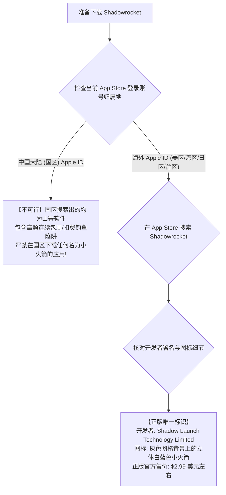

# Shadowrocket (小火箭) 完整配置与高阶实战手册：从美区安装、节点导入到规则分流与 HTTPS 模块配置

作为苹果 iOS 与 iPadOS 生态圈中装机量稳居首位、知名度最高且历经十年检验的现象级代理应用，**Shadowrocket**（中文圈通称“小火箭”）以其极具触屏直觉的 UI 设计、近乎全能的协议兼容矩阵（全面支持 Shadowsocks、VMess、VLESS-Reality、Trojan、Hysteria 2、TUIC、WireGuard）、以及极致的系统资源优化，成为了绝大多数 iPhone 用户初涉科学上网的启蒙与主力工具。

然而，在享受 iOS 系统原生流畅体验的同时，许多用户在实际操作中频频踩坑：**“在国区 App Store 搜索下载到了扣费山寨软件”**；或者**“导入节点后开启代理，发现微信图片无法加载、国内网页极其卡顿”**；更甚者，**“盲目开启 MitM 证书解密后，导致招商银行与微信断网”**。

从计算机网络与苹果操作系统架构来看，**Shadowrocket 依托的是 iOS 底层的 `NetworkExtension` 框架（特别是 `NEPacketTunnelProvider` 核心 API）运行，它在内核层创建点对点虚拟隧道，不受国产安卓系统激进后台杀手（LMK）的干扰，能够在极低电量损耗下实现 7×24 小时常驻保活。**

本篇万字级实战手册将从正版获取鉴真、订阅与单节点导入、全局路由四维分流模型、到进阶 MitM 证书解密与脚本模块编写，为您提供一套完整的工业级苹果端使用指南。

---

## 一、 核心架构解剖：iOS NetworkExtension 与沙盒运行模型

要彻底搞懂小火箭的运行机制，必须了解数据包在 iPhone 内部是如何被转发的：

```
================================================================================
【Shadowrocket 在 iOS 系统的底层运行拓扑】
[应用层 App (Safari / YouTube / Twitter / 微信)]
        │ 发起网络 Socket 请求
        ▼
[iOS 原生内核网络驱动: NetworkExtension (tun0 虚拟接口)]
        │ 强制截取三层 IP 报文 (受苹果沙盒强力保护，零应用可绕过)
        ▼
[Shadowrocket 主程序引擎: PacketTunnelProvider]
        │
        ├── 判定 A: 全局路由模式 (配置 Config / 代理 Proxy / 直连 Direct)
        ├── 判定 B: 域名/IP 规则匹配 (DOMAIN-SUFFIX, geosite:cn 走本地直连)
        ├── 判定 C: MitM 模块与 URL Rewrite 正则重写
        │
        ▼ (封装为 VLESS-Reality / Hysteria 2 加密流量)
[物理接口: Wi-Fi (en0) 或 5G 蜂窝移动网络 (pdp_ip0)] ──► 运营商基站 ──► 境外节点
================================================================================
```

### 1. 为什么 iOS 平台代理几乎不会“掉后台”？
不同于 Windows 依赖用户态注册表、Android 频繁面临杀后台；iOS 系统将 `NetworkExtension` 进程归类为**系统核心网络拓展**，其进程优先级甚至高于大部分前台应用。只要用户不手动在系统设置中拔掉 VPN 开关，小火箭可以在 iPhone 锁屏待机数十天的情况下维持后台长连接会话，功耗仅占整机不到 2%。

---

## 二、 正版获取与防骗鉴别 Checklist

由于政策与合规原因，Shadowrocket 早已从中国大陆（国区）App Store 下架。这导致国内搜索引擎与国区应用商店中充斥着海量以假乱真的山寨钓鱼甚至恶意扣费软件。



### 鉴真防骗三大铁律：
1. **开发者全称必须为**：**`Shadow Launch Technology Limited`**（其他任何形如“XXX Studio”、“VPN Limited”全为山寨假冒）；
2. **正版为一次性买断制**（通常为 2.99 美元），**绝无任何“每周续费 48 元”的流氓订阅协议**；
3. **获取海外 Apple ID 的安全路径**：建议自行前往苹果官网注册一个免免税州的美区 Apple ID，并通过美区支付宝或正规苹果礼品卡（Apple Gift Card）兑换充值购买。

---

## 三、 节点导入与网络测速标准化操作流程

小火箭提供了移动端最为流畅的节点收录与管理体验：

### 1. 方式一：一键扫码导入（最符合触屏直觉）
1. 在电脑或另一台设备上打开机场后台，调出节点二维码；
2. 打开 Shadowrocket，点击主界面**左上角形似方框的「扫描」图标**；
3. 对准二维码扫描，所有节点瞬间秒级批量入库。

### 2. 方式二：订阅链接一键拉取（日常维护首选）
1. 复制机场提供的「小火箭订阅链接」或「通用 Base64 订阅链接」；
2. 打开 Shadowrocket，点击右上角 **「+」** 号图标；
3. 将第一行的“类型 (Type)”从默认的 Shadowsocks 切换为 **`Subscribe` (订阅)**；
4. 在 **「URL」** 一栏中粘贴长链接，在 **「备注 (Remarks)」** 中输入机场名字（如“光速云专线”）；
5. 点击右上角 **「完成」**，软件会自动向云端发起握手并拉取最新节点列表。

### 3. 正确的测速姿势：连通性测试 (Connectivity Test)
在节点列表中，千万不要只看第一列的数字：
1. 点击列表下方的 **「连通性测试 (Test Connectivity)」**；
2. 此时小火箭会通过每个节点真正向 Apple / Cloudflare 发起端到端 HTTP GET 探测；
3. **观察返回结果**：
   - 绿色数字（如 `38 ms`）：健康可用节点；
   - 红色 `Timeout`：机房失联或已被封锁；
4. 点击选中延迟最低的专线节点（左侧出现小圆点），滑动最顶部的 **「未连接」主开关**，在弹出的系统对话框中验证 Face ID / Touch ID，即可瞬间开启全局科学上网。

---

## 四、 全局路由四大核心模式深度拆解

在 Shadowrocket 首页中央，有一项极其关键的设置项——**「全局路由 (Global Routing)」**。

```
+─────────────────────────────────────────────────────────────────────────────+
|                       Shadowrocket 全局路由四大模式对比                      |
+─────────────────────────────────────────────────────────────────────────────+
| 模式 1: 配置 (Config) - 【生产环境 100% 推荐日常默认选项】                    |
|   - 底层逻辑: 智能规则分流。内置超大国内域名与 IP 数据库                     |
|   - 业务表现: 打开 Google/YouTube 走代理，打开微信/淘宝/网银走本地 5G 直连     |
|   - 收益: 国内零延迟、不卡顿、杜绝异地登录封号、节省 70% 机场流量             |
+─────────────────────────────────────────────────────────────────────────────+
| 模式 2: 代理 (Proxy) - 【严禁日常开启，仅供应急测试】                        |
|   - 底层逻辑: 强制全局模式。无论访问什么网站，所有流量全部强塞给海外节点      |
|   - 灾难后果: 微信图片收发迟缓、美团外卖定位跑去美国、国内 App 频繁弹验证码   |
+─────────────────────────────────────────────────────────────────────────────+
| 模式 3: 直连 (Direct)                                                        |
|   - 底层逻辑: 所有网络通信 100% 绕过代理，直接通过手机卡物理网络发出         |
+─────────────────────────────────────────────────────────────────────────────+
| 模式 4: 场景 (Scene)                                                         |
|   - 底层逻辑: 高级自动化模式。可针对不同 Wi-Fi SSID 自动切换代理策略         |
+─────────────────────────────────────────────────────────────────────────────+
```

---

## 五、 进阶黑科技：HTTPS 解密 (MitM) 与重写 (Rewrite) 模块规范

小火箭支持强大的 **中间人解密（Man-in-the-Middle, MitM）** 与 **URL 重写模块**，能够实现移动端去广告、解锁特定网页、修改 API 返回体等极客功能。

> 🚀 **MitM 证书解密故障专项手册**：若开启解密后导致金融 App 无法联网或系统提示证书未受信任，请直接参阅本站独立攻坚长文：[《Shadowrocket 小火箭 MitM 证书解密与 HTTPS URL 重写排障指南》](/clients/shadowrocket-certificate-mitm-rewrite-guide)。

### 根证书安装与信任标准两阶段 SOP：
1. **阶段一：生成与安装描述文件**：
   - 进入小火箭底部「配置」→ 点击正在使用的配置文件后的「i」图标；
   - 找到「HTTPS 解密」→ 打开开关，点击「生成新的 CA 证书」；
   - 点击「安装证书」，系统会自动调用 Safari 提示“此网站正在尝试下载配置描述文件”，点击 **「允许」**。
2. **阶段二：在 iOS 核心层完全信任根证书（最易漏掉的死锁步骤）**：
   - 打开 iPhone 系统「设置」→「通用」→「VPN 与设备管理」→ 找到并点击刚刚下载的 CA 描述文件完成安装；
   - **关键死锁修复**：返回 iPhone 系统「设置」→「通用」→ **「关于本机」** → 滑动到最底部点击 **「证书信任设置」**；
   - 找到刚刚安装的根证书名称，**手动打开绿色信任开关**！
   - 只有完成阶段二，iOS 底层网络栈才会允许小火箭解密 HTTPS 数据流。

---

## 六、 生产环境真实故障复盘（2大典型 RCA 案例）

### 案例一：iPhone 刚出门切成 5G 蜂窝网络，科学上网瞬间彻底断网
- **故障拓扑**：上海某金融分析师，在家里 Wi-Fi 环境下使用小火箭一切正常。只要一走出家门切成中国电信 5G 蜂窝流量，小火箭顶部开关虽然保持开启，但所有海外网页与 Bloomberg 终端全部报 `无法连接到互联网`。
- **排查与系统权限审计**：
  1. 检查节点连通性，在 5G 下测试全部节点超时；
  2. 打开 iPhone 系统「设置」→ 下拉找到「Shadowrocket」；
  3. **数据发现**：该应用底下的 **「无线数据」权限被勾选成了“仅无线局域网 (WLAN Only)”**；
  4. 这是因为国行 iPhone 首次打开新安装 App 时，系统会弹出权限询问弹窗，用户随手点击了“仅限 WLAN”。
- **根因判定（RCA）**：国行 iOS 特有的蜂窝网络网络授权被误关，导致切网后应用程序无法向移动基站发起任何数据套接字通信。
- **修复方案**：将「无线数据」权限修改为 **「无线局域网与蜂窝数据」**。切换 5G 后瞬间恢复高速连接。

### 案例二：开启小火箭后电量尿崩，手机发热严重
- **故障拓扑**：某用户反馈在 iPhone 15 Pro 上开启小火箭后台挂机，半天耗电高达 40%，且手机背板明显发热。
- **排查与配置审计**：
  1. 打开小火箭主界面，发现该用户将全局路由设置为了 **`代理 (Proxy)`**；
  2. 且在底部「设置」中开启了 **「DNS 覆写」** 与全量本地抓包日志（Logging Level: Debug）；
  3. 用户的微信、抖音、小红书后台频繁拉取大体积视频切片，原本应该走 5G 直连的超大数据流全部被小火箭在本地进行高强度的加密解密处理，导致 A17 芯片的 CPU 核心长期满负荷运转。
- **根因判定（RCA）**：全局代理模式叠加大流量国内应用后台运行，引发移动端 CPU 加解密过载与物理发热。
- **修复方案**：将全局路由改回 **「配置 (Config)」**，关闭详细调试日志，并在配置规则中确认启用本地直连。手机待机功耗骤降至 1% 以下，发热彻底消除。

---

## 七、 常见高频报错与排障速查表 (FAQ)

### Q1: 小火箭开关打开后，为什么立即自动弹回断开？
- **回答**：这通常是因为 iOS 系统内部的 VPN 描述文件发生了损坏或权限死锁。
- **解决对策**：打开 iPhone 系统「设置」→「通用」→「VPN 与设备管理」，找到名为“Shadowrocket”的配置，点击右侧感叹号将其彻底删除。返回小火箭重新滑动主开关，系统会重新请求添加 VPN 配置，验证密码后即可恢复正常。

### Q2: 为什么有些国内 App 打开提示“禁止使用代理访问”？
- **回答**：部分国内数字政务、交管 12123、或者特定防作弊游戏（如网易游戏）在启动时调用了底层系统 API 检测当前是否存在活动中的虚拟 VPN 接口。
- **解决对策**：在小火箭底部「配置」中编辑正在使用的规则文件，在 `[Rule]` 顶层将该软件的域名指定为 `DIRECT`；若软件通过检测系统网卡名强杀，则使用该 App 时需临时断开小火箭。

### Q3: 为什么订阅更新后，所有节点延迟都比电脑端测出来的偏高？
- **回答**：因为小火箭的“连通性测试”默认使用的是应用层端到端握手测试，测试结果包含了**手机与运营商基站延迟 + 专线往返延迟 + 目标服务器 TLS 握手延迟**的全流程总耗时，相比电脑端单纯的 ICMP Ping（门票响应）更加真实客观。

---

## 八、 推荐高品质专线容灾逃生节点与延伸阅读

当您经过上述配置将小火箭调试完毕后，若节点在晚高峰依然频繁超时，问题核心在于服务商跨境出口带宽的抗拥塞能力。**强烈建议在 iPhone 上接入具备全线二层内网保障与原生 IP 落地的高端服务商**：

<DisasterRecoveryBox />

### 相关进阶排查与排障手册
- [Shadowrocket 二级专题中心：iOS 核心架构与进阶总览](/clients/shadowrocket/index.md)
- [Shadowrocket 三级内容集群：MitM 解密与重写脚本集群](/clients/shadowrocket/mitm-rewrite/index.md)
- [Shadowrocket CA 证书安装与信任链故障排查指南](/clients/shadowrocket/mitm-rewrite/mitm-ca-certificate-trust-chain-troubleshooting.md)
- [Shadowrocket URL 重写与脚本规则语法全解指南](/clients/shadowrocket/mitm-rewrite/url-rewrite-script-rule-syntax-guide.md)
- [Shadowrocket 小火箭 MitM 证书解密与重写实战指南](/clients/shadowrocket-certificate-mitm-rewrite-guide)
- [手机能连但电脑完全不能连？跨设备网络栈深度排错](/connection/phone-works-pc-fails)
- [全节点大面积超时瘫痪根因判定与容灾逃生机制](/connection/all-nodes-down)
- [2026 稳定抗封锁 42 家专线机场综合横评与选型大横表](/airports/)
- [流媒体原生解锁与 AI 平台 IP 纯净度检测全流程](/diagnostics/streaming-unlock-netflix-chatgpt-testing)
