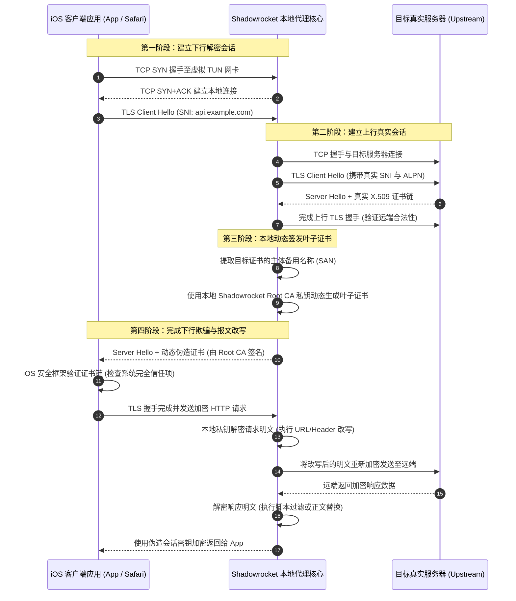
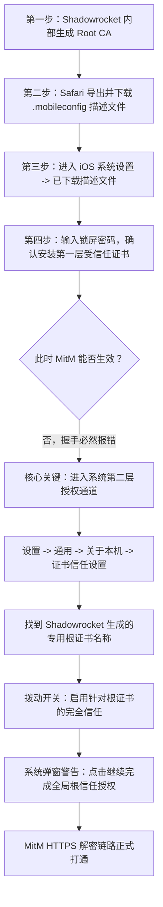
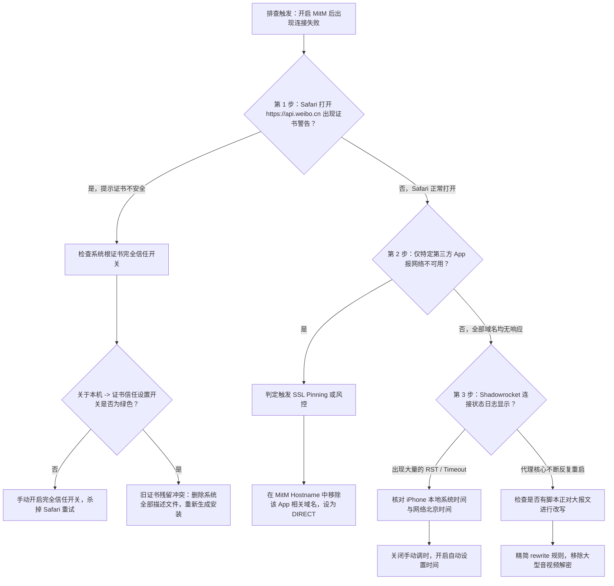

# Shadowrocket iOS MitM CA 证书安装与信任链故障排查指南

在 iOS 平台的网络调试与规则重写体系中，HTTPS 流量的解密与改写依赖于 MitM（Man-in-the-Middle，中间人代理）技术。Shadowrocket（俗称“小火箭”）通过在本地构建伪随机 CA 证书机构，对客户端与目标服务器之间的 TLS 会话进行劫持与动态签发。然而，由于 Apple 操作系统对安全信任链（Security Trust Framework）具有严格的沙盒限制与证书规范，大量工程师和高级用户在开启 MitM 功能时，频繁遭遇应用网络中断、Safari 证书不受信任警告（`kSecTrustResultFatalTrustFailure`）以及银行与金融类应用因 SSL Pinning 机制崩溃等严峻问题。

本文由网络诊断实验室资深安全与网络架构团队编撰，深入剖析 Shadowrocket 在 iOS NetworkExtension 环境下实施 HTTPS 解密的底层运行机制，梳理从 X.509 v3 根证书生成、iOS 两阶段受信任设置、动态叶子证书生成到 SSL Pinning 冲突绕过的完整工程闭环，为移动端抓包调试与深度规则定制提供工业级排障指南。

---

## 1. 适用场景与技术定位

Shadowrocket 的 HTTPS 解密功能运行在 iOS 的 PacketTunnel 虚拟网卡之上，其本质是在本地建立起环回代理透明服务。理解其适用边界与限制是确保网络稳定的第一准则。

### 核心适用场景
- **移动端 HTTP/HTTPS 调试与报文嗅探**：捕获移动端应用的 API 请求载荷与返回结构，用于接口联调、API 性能分析与逆向分析。
- **URL 深度重写与资源重定向**：在客户端本地实现 HTTPS 请求的 302/307 临时重定向，例如将应用内特定 API 重定向至本地镜像或代理服务。
- **动态响应体篡改（Script Response Body）**：通过 JavaScript 引擎动态修改服务端返回的 JSON/HTML 报文结构，实现屏蔽弹窗通知、去广告、修改应用界面字段等高级定制。
- **Header 标头篡改与身份模拟**：动态删除或注入 HTTP Header（如 `User-Agent`、`Cookie`、`Authorization`）。

### 绝对禁用与风险边界
- **银行、证券与支付金融应用**：支付宝、微信支付、各类商业银行 App 严禁纳入 MitM 解密范围。此类应用强制启用 SSL Pinning 或自定义双向证书认证，开启 MitM 将直接触发网络熔断。
- **系统底层通信与推送服务**：Apple 官方服务（`*.apple.com`、`*.icloud.com`、APNs 推送端口 5223）严禁开启 MitM，否则将导致 App Store 无法下载应用、iCloud 同步故障或系统推送彻底失效。
- **高吞吐二进制视频流解密**：4K/8K 视频流、大文件 OTA 下载等流媒体媒体切片包含庞大报文体，进行 MitM 加解密会瞬间耗尽 iOS 系统分配给网络扩展进程的内存配额，直接引发 Jetsam 内存溢出崩溃。

---

## 2. 架构拓扑与报文时序

Shadowrocket 的 MitM 运行机制与常规正向代理截然不同，它由两段完全独立且相互隔离的 TLS 会话组合而成。



在上述报文时序中，系统的核心安全卡点在于**步骤 11**。iOS 系统的 `Security.framework` 会严格校验该动态叶子证书的签发者（Issuer）。如果 Shadowrocket 生成的根证书没有被安装到系统描述文件中，或者没有在系统“关于本机”中勾选“完全信任”，握手将在第 11 步瞬间中断，客户端抛出 `SSL_ERROR_BAD_CERT_DOMAIN` 或握手重置 RST 报文。

---

## 3. 根证书生成与双层信任机制

iOS 系统拥有全球移动操作系统中最严密的证书管理体系。自 iOS 10.3 引入双层信任保护机制以来，仅仅下载并安装描述文件并不能使 CA 根证书生效，必须经过严格的人工二次授权。



### 关键操作细节与系统陷阱

1. **证书生成命名规范**：在 Shadowrocket 的“配置” -> 点击当前配置右侧小感叹号 -> “HTTPS 解密”中，勾选“HTTPS 解密”开关，点击“生成新的 CA 证书”。建议在生成后，务必在证书详情中记录其“通用名称（Common Name）”以及“序列号”，以便在系统证书列表中准确识别。
2. **描述文件安装**：点击“安装证书”，系统会自动拉起 Safari 浏览器并提示“此网站正在尝试下载一个配置描述文件”。务必点击“允许”。若提示在其他浏览器打开，会导致描述文件无法自动挂载进 iOS 设置。
3. **第二层开关遗漏之痛**：90% 以上的使用故障均源于用户完成了描述文件安装后，遗漏了“设置” -> “通用” -> “关于本机” -> 最底部“证书信任设置”这一隐藏菜单。在该界面中，所有用户手动安装的根证书默认均处于“未完全信任（False）”状态，必须手动将其开关切换至绿色开启状态。

---

## 4. X.509 v3 根证书属性与 Apple 严格规范

自 iOS 13 与 macOS Catalina 起，Apple 对系统信任的所有 TLS 服务器证书与本地自签发 CA 证书执行业界最苛刻的规范（RFC 5280 与 Apple 专属 CA Policy）。如果自建或第三方客户端生成的根证书不符合以下规范，iOS 会静默丢弃证书或直接拒绝握手。

| X.509 证书属性字段 | 规范强制标准 | 不合规导致的系统错误现象 | 备注说明 |
| :--- | :--- | :--- | :--- |
| **Basic Constraints** | `critical, CA:TRUE` | 系统直接判定非 CA 机构，无法用于签名 | 必须明确声明为根签发实体 |
| **Key Usage** | `critical, Certificate Sign, CRL Sign` | `SecTrustResultFatalTrustFailure` | 必须具备为下游动态颁发证书的权限 |
| **公钥加密算法与长度** | RSA 2048 位或更高，或 ECDSA P-256 | iOS 强制切断握手，提示密钥长度不足 | 不得使用 1024 位过时密钥 |
| **摘要签名算法** | SHA-256 / SHA-384 / SHA-512 | 拒绝建立安全会话，握手重置 | 彻底废弃 MD5 与 SHA-1 |
| **Subject Alternative Name** | 动态签发证书必须包含 SAN 扩展项 | 域名不匹配，Safari 报证书名错误 | 仅包含 Common Name 会被 iOS 彻底拒认 |
| **证书有效期限制** | 自 2020 年起，叶子证书有效期不得超过 398 天 | Safari 提示证书过期或不安全 | Shadowrocket 动态签发周期通常设定为 180 天 |

在动态生成叶子证书时，Shadowrocket 会实时解析目标远端服务器实际返回的 X.509 证书，严格克隆其 SAN（Subject Alternative Name）扩展列表（包含所有通配符与附加域名），并附带相同的 Key Usage，随后通过本地 Root CA 进行动态 SHA-256 签名。若目标站点的 SAN 过度庞大（例如某些云服务聚合证书包含超过 100 个域名），签发算法在极端情况下会出现局部字段溢出，表现为特定域名握手卡死。

---

## 5. SSL Pinning 冲突与金融/社交应用白名单跳过

即便本地根证书已获得 iOS 系统的全局完全信任，依然有大量应用在开启 MitM 后无法联网，其根本原因在于应用开发者部署了 **SSL Pinning（公钥固定 / 证书绑定）** 机制。

### SSL Pinning 的对抗机理
常规操作系统在校验服务端证书时，只要该证书是由系统信任库内的任意一个合法 CA（包括用户手动信任的本地根 CA）层层签名而来的，即可通过验证。然而，高安全等级应用（如微信、支付宝、网银、Twitter/X 等）在应用代码内部硬编码了目标服务器公钥的 SHA-256 哈希值或权威机构证书指纹：

$$\text{PinningCheck} = \left( \text{Hash}(\text{RemotePublicKey}) \stackrel{?}{=} \text{HardcodedPin} \right)$$

当 Shadowrocket 介入并替换为本地根证书签发的叶子证书时，叶子证书的公钥必然发生变化。应用内部的安全断言校验失败，立即主动调用底层网络框架切断连接，抛出 SSL Handshake Failed 异常。

### 工业级跳过与豁免配置策略

为了杜绝关键应用因 SSL Pinning 瘫痪，必须在 Shadowrocket 的 MitM 模块与路由分流体系中建立多重防护白名单。

#### 1. MitM Hostname 仅列入白名单（严格采用白名单模式）
切勿使用 `*` 通配所有域名！应当仅将需要调试与改写的确切域名加入 MitM 主机名列表：

```ini
[MITM]
enable = true
ca-p12 = base64_ca_cert_data_here
ca-passphrase = your_password
# 仅对目标域名进行解密，其余流量一律透传
hostname = api.weibo.cn, *.iqiyi.com, test-debug.mycompany.com
```

#### 2. 在 Hostname 列表中声明强制排除规则
如果由于历史原因必须使用较宽范围的通配符，必须在特定敏感域名前添加前缀负向排除标识（减号 `-`）：

```ini
[MITM]
enable = true
# 针对 apple.com 域下的普通域名解密，但绝对排除认证与支付子域
hostname = *.mycompany.com, -*.apple.com, -*.icloud.com, -*.alipay.com, -*.tenpay.com, -*.wechat.com
```

#### 3. 底层路由规则强制直连与跳过 TUN
针对使用自定义网络安全协议的银行和券商 App，仅仅在 MitM 中排除仍可能因 TUN 网卡报文重组引起反作弊风控。应在路由规则中将其 IP 段或域名设为 `DIRECT` 并加入 `skip-proxy`：

```ini
[General]
# 忽略不需要接管的本地通信与高风险内网环境
skip-proxy = 127.0.0.1, 192.168.0.0/16, 10.0.0.0/8, 172.16.0.0/12, localhost, *.local, passenger.t3go.cn

[Rule]
# 银行类金融业务强行直连不解密
USER-AGENT, Bank*, DIRECT
DOMAIN-SUFFIX, alipay.com, DIRECT
DOMAIN-SUFFIX, pay.weixin.qq.com, DIRECT
DOMAIN-KEYWORD, ccb.com, DIRECT
DOMAIN-KEYWORD, cmbchina, DIRECT
```

---

## 6. 证书链常见故障与特征码速查

当 MitM 出现异常时，依据客户端日志与抓包特征可以精准定位故障根源：

| 故障现象与报错特征码 | 根本原因 (RCA) | 影响范围 | 快速定位与解决方案 |
| :--- | :--- | :--- | :--- |
| `kSecTrustResultFatalTrustFailure` | iOS 未开启“针对根证书的完全信任” | 全局所有纳入 MitM 的 HTTPS 流量 | 前往系统“通用 -> 关于本机 -> 证书信任设置”勾选开关 |
| `NSURLErrorServerCertificateUntrusted` | 根证书描述文件未安装，或证书已过期 | Safari 浏览目标网页提示不受信任 | 重新在配置中生成 CA 并在已下载描述文件中安装 |
| `SSL_ERROR_SYSCALL` / `ECONNRESET` | 应用启用了 SSL Pinning，主动熔断握手 | 微信支付、支付宝、各商业银行客户端 | 在 MitM Hostname 列表中剔除对应域名，配置强制透传 |
| `ERR_CERT_COMMON_NAME_INVALID` | 动态叶子证书 SAN 未覆盖目标子域名 | 特殊二级子域名或使用泛解析的 Web 站点 | 清除 Shadowrocket 缓存，检查 MitM Hostname 通配符层级 |
| `Date/Time Mismatch` / `Bad Clock` | 移动设备本地时钟与远端服务器相差过大 | 客户端所有 TLS 握手均因时间有效性被毙 | 进入 iOS 设置校准网络时间（NTP 自动对齐） |
| `Memory Resource Limit (Jetsam Crash)` | MitM 脚本缓存超大响应体导致内存超标 | Shadowrocket 后台进程被 iOS 系统强行杀死 | 优化 Script 脚本，避免缓冲大型媒体文件与图片 |

---

## 7. 故障排查标准作业程序 (SOP)

当终端用户反馈开启 HTTPS 解密后“网页打不开”、“软件联网报错”时，严格按照以下标准化时序进行逐步排障：



---

## 8. 双端对比与参数基准表

主流 iOS 代理与调试工具在 HTTPS MitM 与证书处理机制上的技术参数对比如下：

| 特性维度 | Shadowrocket | Quantumult X | Surge iOS | Loon |
| :--- | :--- | :--- | :--- | :--- |
| **CA 根证书私钥生成算法** | RSA 2048 位 | RSA 2048 位 | ECC (P-256) / RSA 2048 可选 | RSA 2048 位 |
| **动态证书签发响应开销** | 约 15 ~ 25 ms | 约 10 ~ 18 ms | 约 5 ~ 12 ms (ECC 模式极低) | 约 12 ~ 20 ms |
| **SSL Pinning 保护跳过语法** | `-domain.com` 负向声明 | `skip-server-cert-verify` 参数 | `skip-vif-route` + `hostname-skip` | `skip-proxy` + 负向 Hostname |
| **内存防崩保护机制** | 基础水位警告 | 严格沙盒限制 | 独家轻量级 Streaming 解析 | 脚本缓存大小限制 |
| **证书导出与跨设备迁移** | 支持 `.p12` 密码备份导出 | 支持直接复制 base64 串 | 支持 iCloud 跨设备自动私有同步 | 支持本地 `.p12` 导出 |
| **HTTP/2 & HTTP/3 兼容度** | 自动降级为 HTTP/1.1 或 H2 | 支持原生 H2 解密 | 完整支持 H2/H3 (QUIC) 嗅探 | 支持原生 H2 解密 |

---

## 9. 生产环境实战故障排查案例

### 案例一：开启 MitM 后微信小程序与支付接口全局瘫痪

#### 故障现场与工单描述
某前端测试工程师在 iOS 设备上使用 Shadowrocket 调试自家公司商城小程序的 API 响应数据，在“HTTPS 解密”中配置了通配符 `*.com` 与 `*.cn`。开启后，不仅公司业务接口抓包异常，手机上的微信群聊图片无法发送，点击小程序支付或钱包时弹出“网络连接失败，请稍后重试”，日志中记录大量 `TLS Handshake Error: -9807 (errSSLX509CertVerify)` 错误。

#### 排查与根因分析
1. 调取 Shadowrocket 连接记录，发现微信底层网络通信使用自研的 MMTLS 协议，并针对特定支付接口（`tenpay.com`、`pay.weixin.qq.com`）部署了强加密公钥固定。
2. 由于工程师在 Hostname 中草率配置了极其宽泛的 `*.com` 与 `*.cn`，导致所有微信支付链路被强行纳入本地 MitM 代理。
3. 微信客户端内置证书安全校验逻辑检测到签发者为本地 Shadowrocket Root CA 而非腾讯官方绑定的权威 CA，立即中断握手并启动客户端风控阻断。

#### 修复与配置变更
彻底废除宽泛通配符，在 Hostname 中精准定义测试域名，并显式对微信所有支付与核心服务实施强制剔除：

```ini
[MITM]
enable = true
# 仅解密公司商城的专属测试域名，强制排除微信与常用支付通道
hostname = test-api.mycompany.com, mall.mycompany.com, -*.wechat.com, -*.tenpay.com, -*.qq.com, -*.weixin.qq.com
```
修改完成后，彻底强退微信后台并重新启动，支付通道瞬间恢复正常，业务测试接口解密抓包功能运行稳定。

---

### 案例二：重装 CA 证书后 Safari 仍频繁报证书公共名无效

#### 故障现场与工单描述
某跨国网络测试员因旧证书过期，在 Shadowrocket 内点击了“重新生成 CA 证书”，重新下载并安装了新描述文件并在“关于本机”中勾选了完全信任。然而在访问测试站 `https://dev-proxy.lab` 时，Safari 依然频繁抛出警告页面：“此连接并非私密连接。由于 dev-proxy.lab 提供的证书存在问题，Safari 无法建立安全连接”，错误代码提示 `ERR_CERT_COMMON_NAME_INVALID`。

#### 排查与根因分析
1. 使用抓包诊断工具查看 Safari 与本地代理的交互，发现 Shadowrocket 返回给 Safari 的叶子证书签名者竟然依然是“已删除的旧 CA 证书的 Common Name”。
2. 调取 iOS 系统的配置描述文件管理列表，发现系统中存在两个同名不同序列号的 Shadowrocket 证书描述文件。
3. 原因为：重新生成证书后，iOS 系统密钥链（Keychain）中保留了旧根证书的公钥指纹。当客户端请求接入时，系统安全校验由于存在命名相同的证书项，优先命中了尚未清除但已被应用废弃的旧证书链条，导致签名校验失效。

#### 修复与配置变更
1. **清理系统残留**：进入 iOS “设置” -> “通用” -> “VPN 与设备管理”，找到所有历史 Shadowrocket 描述文件，逐一点击“移除描述文件”。
2. **清除 Safari HSTS 缓存**：进入“设置” -> “Safari 浏览器” -> “高级” -> “网站数据”，彻底清除历史站点的缓存记录。
3. **闭环重建**：在 Shadowrocket 中彻底重新生成干净的 CA，重新下载安装描述文件，进入“关于本机 -> 证书信任设置”单选开启该新证书的完全信任。
4. 重新访问目标站点，Safari 握手顺利通过，安全绿锁正常点亮。

---

## 10. 自动化证书诊断与健康度巡检脚本

为了在批量调试环境或 CI/CD 测试手机集群中快速验证本地导出的 Shadowrocket CA 根证书是否合规，团队编写了基于 Python 与 OpenSSL 的自动化证书合规性校验脚本。该脚本可离线检测证书有效期、密钥长度、Basic Constraints 与 SAN 支持情况。

```python
#!/usr/bin/env python3
"""
Shadowrocket CA 根证书与叶子证书合规性离线诊断工具
适用于 macOS / Linux / Windows 调试终端
依赖: pip install cryptography
"""

import sys
from datetime import datetime, timezone
from cryptography import x509
from cryptography.hazmat.backends import default_backend
from cryptography.x509.oid import ExtensionOID

def diagnose_certificate(cert_path: str):
    print(f"[*] 正在分析证书文件: {cert_path}")
    try:
        with open(cert_path, "rb") as f:
            cert_data = f.read()
            # 兼容 PEM 与 DER 格式
            if b"-----BEGIN CERTIFICATE-----" in cert_data:
                cert = x509.load_pem_x509_certificate(cert_data, default_backend())
            else:
                cert = x509.load_der_x509_certificate(cert_data, default_backend())
    except Exception as e:
        print(f"[-] 证书读取解析失败: {e}")
        return False

    now = datetime.now(timezone.utc)
    print("\n--- [1. 基础身份与签发者信息] ---")
    print(f"主题 (Subject): {cert.subject.rfc4514_string()}")
    print(f"签发者 (Issuer): {cert.issuer.rfc4514_string()}")
    print(f"证书序列号 (Serial Number): {hex(cert.serial_number)}")

    print("\n--- [2. 有效期与时钟合规性检测] ---")
    print(f"生效时间 (Not Before): {cert.not_valid_before_utc}")
    print(f"失效时间 (Not After):  {cert.not_valid_after_utc}")
    
    if now < cert.not_valid_before_utc:
        print("[!] 严重警告: 证书尚未生效！请检查本地系统时钟 NTP 是否准确。")
    elif now > cert.not_valid_after_utc:
        print("[!] 严重警告: 证书已过期！iOS 将直接阻断所有 TLS 握手。")
    else:
        remaining_days = (cert.not_valid_after_utc - now).days
        print(f"[+] 证书状态正常，剩余有效天数: {remaining_days} 天")

    print("\n--- [3. Apple 安全规范核心扩展检测] ---")
    # 检查 Basic Constraints
    try:
        bc_ext = cert.extensions.get_extension_for_oid(ExtensionOID.BASIC_CONSTRAINTS)
        is_ca = bc_ext.value.ca
        print(f"[+] Basic Constraints: CA = {is_ca} (Critical={bc_ext.critical})")
        if not is_ca:
            print("[-] 不合规: 该证书未能标记为 CA 根机构，无法在 iOS 下用于签发动态证书！")
    except x509.ExtensionNotFound:
        print("[-] 严重缺失: 证书缺少 Basic Constraints 扩展项！")

    # 检查 Key Usage
    try:
        ku_ext = cert.extensions.get_extension_for_oid(ExtensionOID.KEY_USAGE)
        ku = ku_ext.value
        print(f"[+] Key Usage: 签名权限={ku.key_cert_sign}, CRL权限={ku.crl_sign}")
        if not ku.key_cert_sign:
            print("[-] 不合规: 证书未授予 keyCertSign 权限，无法签发叶子证书！")
    except x509.ExtensionNotFound:
        print("[!] 注意: 根证书建议显式包含 Key Usage 声明")

    print("\n--- [4. 密钥长度与签名摘要强度] ---")
    pub_key = cert.public_key()
    if hasattr(pub_key, "key_size"):
        print(f"[+] 密钥算法: RSA, 密钥长度: {pub_key.key_size} bits")
        if pub_key.key_size < 2048:
            print("[-] 严重不合规: 密钥长度低于 2048 位，iOS 将拒绝安装此描述文件！")
    else:
        print(f"[+] 密钥算法: 椭圆曲线 (ECC)")

    sig_hash = cert.signature_hash_algorithm.name.upper()
    print(f"[+] 签名哈希算法: {sig_hash}")
    if sig_hash in ["MD5", "SHA1"]:
        print("[-] 严重违规: 采用废弃弱哈希算法，iOS 强行阻断连接！")

    print("\n[*] 诊断完毕。\n")

if __name__ == "__main__":
    if len(sys.argv) < 2:
        print("用法: python check_cert.py <ca_cert.crt / ca_cert.cer>")
        sys.exit(1)
    diagnose_certificate(sys.argv[1])
```

---

## 11. 灾难恢复与白名单安全兜底原则

<DisasterRecoveryBox />

当在生产或日常主力机上启用 MitM 功能时，中间人根证书相当于授予了该客户端窥探全部通信报文的“万能钥匙”。一旦私钥泄露，任何处于同一局域网下的恶意攻击者均可通过伪造叶子证书发起无感嗅探攻击。

### 核心安全治理三原则
1. **私钥隔离保护**：生成 CA 证书时必须设置高强度密码保护，切勿将包含私钥的 `.p12` 备份文件上传至公共云盘或代码托管仓库。
2. **调试完毕及时熄火**：在完成 API 分析或规则测试后，养成随手关闭 Shadowrocket “HTTPS 解密”全局总开关的习惯。日常使用模式下无需长期保持解密状态。
3. **紧急一键重置方案**：若设备遭遇不明流量重定向或频繁提示证书异常，立即执行灾难重置三步法：
   - 步骤一：进入 Shadowrocket 设置，关闭“HTTPS 解密”并删除当前 CA 证书。
   - 步骤二：进入 iOS “设置 -> 通用 -> VPN 与设备管理”，清空所有已安装的 CA 描述文件。
   - 步骤三：进入“设置 -> 通用 -> 传输或还原 iPhone -> 还原 -> 还原网络设置”，清除本地 DNS 缓存与路由映射。

---

## 12. 关联技术集群与延伸阅读

要构建完整高效的 iOS 规则改写体系，单靠证书信任仅完成了基础底座搭建。推荐结合以下工业级实战指南深入探索：

- **二级专题中心**：[Shadowrocket 核心配置与实战指南](/clients/shadowrocket/index.md) —— 全面掌握小火箭规则编写、内核性能与路由分流。
- **三级内容集群**：[MitM 解密与重写脚本集群](/clients/shadowrocket/mitm-rewrite/index.md) —— 掌握重写语法结构与高阶防崩架构。
- **并行深度进阶**：[URL 重写与脚本规则语法全解指南](/clients/shadowrocket/mitm-rewrite/url-rewrite-script-rule-syntax-guide.md) —— 深入剖析 302/307 重定向与 Response Body 脚本改写实战。
- **底层安全关联**：[DNS 泄漏防护与 DoH 测速对比](/diagnostics/dns-leak-prevention/webrtc-doh/index.md) —— 解决解密之外的 DNS 隐私外泄隐患。
- **分流规则定制**：[自定义分流规则与白名单直连优化](/tutorials/rule-modes/custom-rules/index.md) —— 从路由层彻底隔离金融高危流量。
