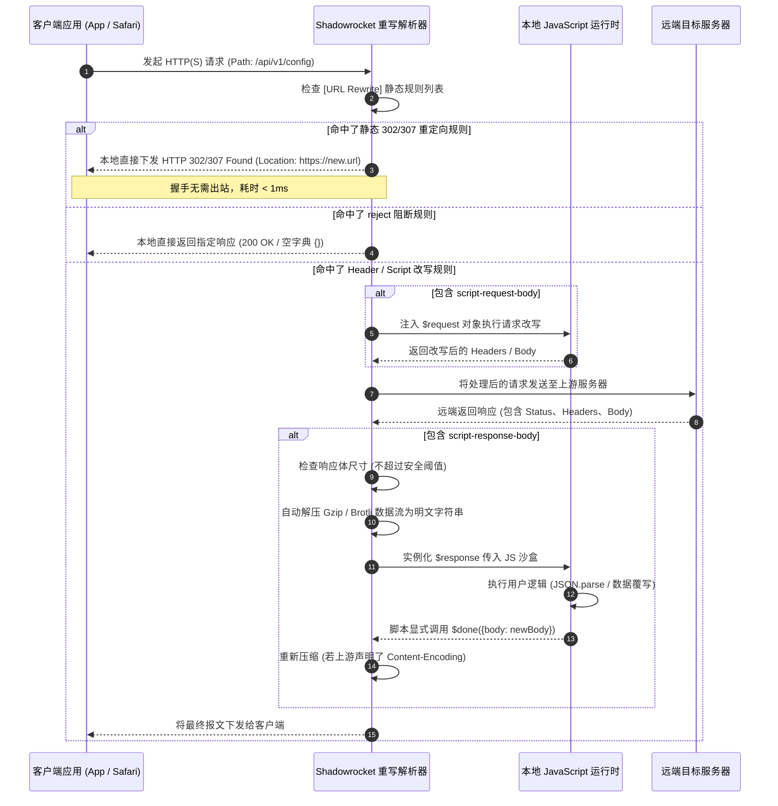
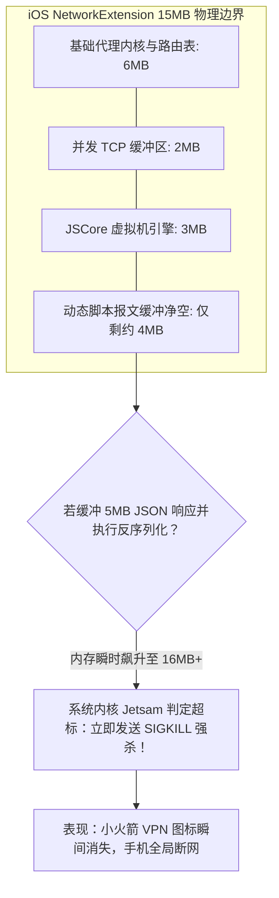
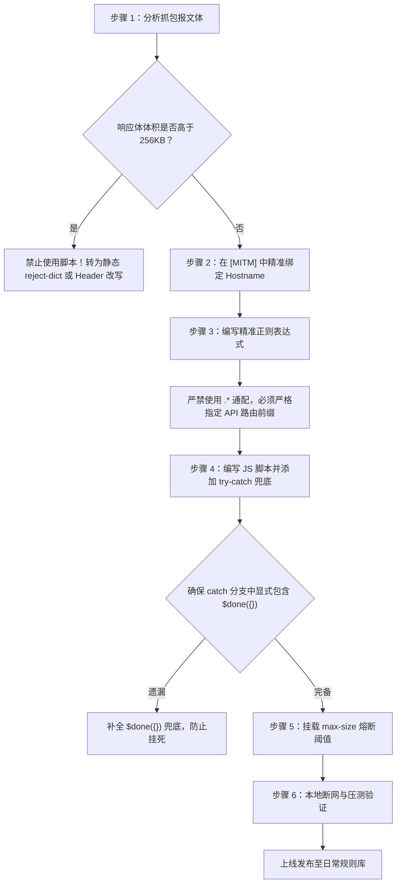

# Shadowrocket URL 重写与脚本规则语法全解指南

在 iOS 平台的网络重构与流量治理体系中，Shadowrocket（小火箭）的 URL Rewrite（URL 重写）与 Scripting（脚本引擎）代表了客户端可编程网络代理的最高形态。通过在本地协议栈注入高性能正则表达式匹配器与轻量级 JavaScript 运行沙盒，用户不仅能实现跨协议重定向（如强制 HTTP 升级至 HTTPS）、动态修改 HTTP 请求标头，还能深入报文载荷层，对 JSON、HTML 及 XML 等动态响应体进行实时反序列化与精准重构。

然而，在 iOS 严格的沙盒与进程资源调度体系下，作为 `NEPacketTunnelProvider` 网络扩展运行的 Shadowrocket 进程，面临着全系统最苛刻的硬件限制——**15MB 物理内存上限（Jetsam 机制）**。不当的正则表达式回溯（ReDoS）、对大型二进制报文体的全量内存缓冲、未闭合的异步回调 `$done()`，都会瞬间导致 VPN 进程被系统直接 `SIGKILL` 强杀，引发全局断网与连接重置。

本文由网络诊断实验室核心安全团队编撰，系统化拆解 Shadowrocket 重写与脚本引擎的底层执行管线，全面解析重写指令语法、JavaScript 上下文规范、Jetsam 防崩准则与自动化离线压测方法，为高级网络工程与移动端自动化注入提供工业级实战参考。

---

## 1. 适用场景与技术定位

URL 重写与脚本规则位于 Shadowrocket 路由体系的“报文处理顶层”。它要求流量首先被判定进入代理内核，并在需要改写载荷时完成 HTTPS 解密（MitM）。

### 核心功能矩阵定位
- **本地零开销重定向（302 / 307 Redirect）**：将指向特定域名的 HTTP/HTTPS 请求在本地拦截，直接构造 HTTP 302/307 报文返回给浏览器或应用，无需向上游真实服务器发起握手（例如将维基百科移动端自动重定向至桌面端，或将 Google 搜索区域重定向至无干扰节点）。
- **静态资源本地拦截阻断（Reject 族语法）**：在本地直接向请求方返回 404/403、空图片（`reject-img`）、空字典（`reject-dict`）或空 200 响应（`reject-200`），避免应用因收到网络阻断 RST 报文而出现“网络错误”异常弹窗，保障用户界面渲染完整。
- **请求/响应标头篡改（Header Modification）**：动态删除、替换或注入 HTTP 报文头（如伪造 `User-Agent` 实现绕过移动端浏览器检测，或提取 `Cookie` 令牌并存入本地持久化存储）。
- **动态载荷改写（Script Request / Response Body）**：拉起本地 JavaScript 解释器，读取请求体或响应体，完成反序列化、属性修改、序列化并交由后续管线发出。

### 严苛的技术限制与禁区
- **禁止处理大于 2MB 的流媒体或安装包载荷**：严禁在 `script-response-body` 中挂载视频流切片（.ts / .mp4）或应用安装包（.ipa / .apk），否则瞬间冲破 15MB 内存限制。
- **单次脚本执行时间硬限制（1000ms）**：iOS 系统对网络扩展线程的阻塞极其敏感，单个 JS 脚本执行若超过 1 秒未触发 `$done()`，代理引擎将强制抛出脚本超时异常并终止该请求。
- **无法直接解析未解密的 HTTPS 流量**：若目标域名未在 `[MITM]` 模块的 `hostname` 列表中列出并完成根证书信任，所有针对 HTTPS 路径的重写与脚本匹配将全部静默失效。

---

## 2. URL 重写底层运行架构与报文时序

当一条 HTTP(S) 请求穿透 iOS 虚拟 TUN 网卡时，Shadowrocket 重写引擎按照严格的流水线顺序对报文实施解析：



在整个执行时序中，**步骤 11 至 14（响应体脚本修改）**是整个架构中计算开销最大、内存最脆弱的环节。如果应用未能在 JS 脚本中正确处理 `$done()`，连接将挂死直至客户端超时。

---

## 3. 基础与高阶重写语法全览

Shadowrocket 的重写规则部署在配置文件中的 `[URL Rewrite]` 与 `[Script]` 两个关键段落中。

### 1. `[URL Rewrite]` 静态重写段落

静态重写用于高效处理无需执行复杂计算的正则替换：

```ini
[URL Rewrite]
# 1. HTTP 302 / 307 临时重定向 (语法: 正则表达式 目标URL 类型)
# 作用: 访问百度百科强制跳转维基百科
^https?:\/\/baike\.baidu\.com\/item\/(.+) https://zh.wikipedia.org/wiki/$1 302

# 2. 静态拦截与伪装 (Reject 族)
# reject: 直接掐断连接
^https?:\/\/ad\.example\.com\/api reject

# reject-200: 返回 HTTP 200 状态码但正文为空 (防止客户端重试)
^https?:\/\/log\.tracking\.com\/v1\/event reject-200

# reject-img: 返回 1x1 像素透明 GIF 图像 (防止网页图片破碎图标)
^https?:\/\/images\.tracker\.net\/banner\.gif reject-img

# reject-dict: 返回空 JSON 字典 {} (针对现代移动 App 接口最友好)
^https?:\/\/analytics\.app\.com\/config reject-dict

# 3. HTTP 标头修改 (Header Rewrite)
# header-del: 删除特定敏感请求头
^https?:\/\/.*\.telemetry\.com\/ header-del User-Agent

# header-add: 强行追加请求头
^https?:\/\/api\.myinternal\.com\/ header-add X-Forwarded-Client Shadowrocket

# header-replace: 正则替换已有标头内容
^https?:\/\/m\.site\.com\/ header-replace User-Agent iPhone iPad
```

### 2. `[Script]` 脚本引擎挂载段落

当需要读取或篡改动态报文体时，必须将规则注册于 `[Script]` 段落：

```ini
[Script]
# 修改响应体 (script-response-body)
# 语法: 规则标识 = type=script-response-body,pattern=正则匹配式,script-path=脚本路径,requires-body=1,max-size=262144
AdBlockJson = type=script-response-body,pattern=^https?:\/\/api\.app\.com\/v2\/feed,script-path=scripts/clean_feed.js,requires-body=1,max-size=262144

# 修改请求体 (script-request-body)
# 语法: 用于在客户端报文发出前修改参数
InjectPayload = type=script-request-body,pattern=^https?:\/\/api\.app\.com\/v1\/auth,script-path=scripts/inject_token.js,requires-body=1

# 仅捕获分析不修改 (script-analyze-echo-response)
EchoLogger = type=script-echo-response,pattern=^https?:\/\/api\.app\.com\/status,script-path=scripts/logger.js

# 定时任务执行 (cron 表达式)
DailyCheckin = type=cron,cronexp="0 8 * * *",script-path=scripts/daily_checkin.js,timeout=60
```

> [!IMPORTANT]
> 在配置 `script-response-body` 时，强烈建议显式声明 `max-size=262144`（即 256KB）。该参数会强制 Shadowrocket 在上游报文体超过设定阈值时放弃拉起 JS 虚拟机，直接放行原始数据，从而彻底免疫因后台拉取大型固件或视频引发的内存崩溃！

---

## 4. 正则表达式灾难性回溯 (ReDoS) 规避与引擎深度调优

Shadowrocket 的重写引擎在底层依赖 WebKit 的 JavaScriptCore 正则编译器。许多工程师在编写匹配规则时，倾向于使用看似简短实则极度危险的贪婪嵌套通配符。

### 灾难性回溯的产生机理
当使用如 `^(a+)+$` 或 `^https?:\/\/.*\/api\/.*` 这样包含多个嵌套通配符的正则表达式时，若请求 URL 的尾部存在轻微不匹配，正则引擎将尝试所有可能的排列组合分支进行状态回退。

$$\text{TimeComplexity} = O(2^n)$$

对于一个长度仅为 50 个字符的特殊恶意 URL，灾难性回溯的计算步数可高达数千亿次，直接导致移动端 CPU 核心单核占用率瞬时达到 100%，引发手机剧烈发热、界面掉帧并在 1 秒后被 iOS 看门狗（Watchdog）判定为未响应强行终止。

### 生产级正则安全设计规范
1. **绝不使用前导泛匹配通配符**：严禁书写形如 `.*\.domain\.com` 的正则，而应明确锚定协议前缀：`^https?:\/\/([a-zA-Z0-9-]+\.)?domain\.com\/`。
2. **使用独占字符集代替任意匹配点号**：在匹配 URL 路径片段时，使用 `[^/?#]+` 代替 `.*`。例如匹配 `/user/12345/profile` 时，严谨写法为 `^https?:\/\/api\.example\.com\/user\/[0-9]+\/profile$`。
3. **消除嵌套量词**：杜绝出现形如 `(a+)*`、`(.*)+` 的嵌套量词结构，确保状态机为确定性有限自动机（DFA）或线性回溯非确定性自动机（NFA）。

---

## 5. HTTP/2 多路复用与 HTTP/3 (QUIC) 协议层对改写引擎的冲击

随着移动互联网全面拥抱 HTTP/2 二进制分帧与基于 UDP 的 HTTP/3 (QUIC) 协议，客户端代理在实施报文解密与改写时面临更为复杂的协议栈环境。

### 1. HTTP/2 二进制帧流式重构
在传统 HTTP/1.1 中，请求与响应采用明文 ASCII 文本按序串行收发，重写引擎只需解析出 `Content-Length` 或等待 `Transfer-Encoding: chunked` 结束即可重构报文。然而在 HTTP/2 中，多个不同 API 请求的 `DATA` 帧和 `HEADERS` 帧通过单条 TCP 连接交错并行传输。

- **HPACK 头部压缩状态机维系**：Shadowrocket 在解密并篡改 HTTP/2 请求头时，必须同步维护下行（客户端至本地代理）与上行（本地代理至服务端）两个独立的动态 HPACK 索引表。一旦某一条脚本篡改了标头内容而未同步更新动态表索引，后续复用该连接的所有请求都将发生二进制解码错位（`COMPRESSION_ERROR`），导致整个连接被对端发送 `GOAWAY` 帧强行拆除。
- **Stream RST 风险**：若某个包含复杂脚本的流被客户端主动中断（例如用户快速滑动界面取消了请求），客户端会发送 `RST_STREAM` 帧。Shadowrocket 必须迅速感知该事件并强行终止后台排队中的 JS 脚本，防止已销毁流的回调向已关闭的连接写入数据导致内核 Crash。

### 2. HTTP/3 (QUIC) 穿透与降级策略
目前绝大多数移动端代理工具对 HTTP/3 的用户态解析与重写改写支持仍处于试验阶段。由于 QUIC 基于 UDP 并深度集成了 TLS 1.3 握手，直接在 TUN 虚拟网卡层嗅探并重构 QUIC 报文需要消耗巨大的加解密算力。

```ini
[General]
# 建议在包含重写规则的配置中禁用 UDP 443 端口以强制降级为 HTTP/2
# 阻止客户端直接走 QUIC 协议绕过 MitM 规则审查
[Rule]
AND,((DEST-PORT,443),(PROTOCOL,UDP)),REJECT-NO-DROP
```

通过配置上述阻断规则，当客户端尝试发起针对目标服务器的 QUIC 握手时会遭遇 ICMP 不可达，系统网络底层将根据 RFC 规范自动优雅降级回基于 TCP 的 HTTP/2 握手，从而确保所有 URL 重写与脚本规则无缝生效。

---

## 6. 15MB Jetsam 内存防崩策略与流式处理限制

在 iOS 生态中，Apple 对所有基于 `NetworkExtension` 的网络提供者扩展（Network Packet Tunnel Provider）实施严酷的守护进程监控（Jetsam）。

### Jetsam 触发机制与物理天花板
普通 iOS 应用程序（如微信、Safari、游戏）在前台运行时可消耗高达 1GB 至 2GB 的物理内存，但网络扩展进程作为常驻后台服务，**其 RSS（Resident Set Size，常驻内存集）硬性上限仅为 15MB 到 20MB（因 iOS 版本微调）**。一旦扩展进程内存瞬时飙升穿透 15MB，系统内核将发出 `EXC_RESOURCE -> RESOURCE_TYPE_MEMORY` 信号，立即向进程投递 `SIGKILL` 信号强杀。

$$\text{Memory}_{\text{Extension}} = \text{BaseMemory}_{\text{Core}} + \text{BufferSize}_{\text{TCP}} + \text{V8/JSCore}_{\text{Runtime}} + \text{Payload}_{\text{Body}} \le 15\text{MB}$$

其中：
- Shadowrocket 核心自身及基础路由表常驻消耗约 6MB ~ 8MB。
- 每一个并发 TCP 会话的环回收发缓冲区消耗约 1MB ~ 2MB。
- **留给 JavaScriptCore 运行时与字符串报文缓冲区的动态净空仅剩不到 5MB！**



### 工业级防崩三大黄金准则
1. **严格使用 `reject-dict` 代替脚本置空**：如果某个接口的目的是拦截广告或阻止弹窗，并且该接口只需返回 `{}`，绝对不要编写 JS 脚本去 `JSON.parse` 然后将 `data` 数组置空。直接在 `[URL Rewrite]` 中使用一行 `^https://... reject-dict`，由内核 C 语言底层在 0.1ms 内生成空字典返回，内存消耗几乎为 0。
2. **永远挂载 `max-size` 内存熔断保护**：为所有挂载脚本配置 `max-size=131072`（128KB）或 `max-size=262144`（256KB）。绝不在未经大小限制的规则下运行脚本。
3. **及时释放局部变量与避免全局闭包**：在 JS 脚本中，避免在全局作用域定义大型缓存数组，执行完序列化后让对象迅速脱离作用域进入垃圾回收。

---

## 7. 脚本运行沙盒与 API 上下文深度解析

Shadowrocket 基于 WebKit 的 `JavaScriptCore` 框架构建沙盒，为脚本提供了简洁的全局上下文对象、网络客户端与异步回调钩子。

### 1. 全局内置变量表
- **`$request`**：包含当前触发请求的元数据。
  - `$request.url` (string)：完整的请求 URL 地址。
  - `$request.method` (string)：HTTP 请求动词（`GET`, `POST`, `PUT`, `DELETE` 等）。
  - `$request.headers` (object)：键值对形式的 HTTP 请求头。
  - `$request.body` (string / optional)：当配置了 `requires-body=1` 时的请求体字符串。
- **`$response`**：在 `script-response-body` 中可用。
  - `$response.status` (number)：上游返回的 HTTP 状态码（如 200, 304, 404）。
  - `$response.headers` (object)：上游返回的 HTTP 响应头。
  - `$response.body` (string)：解压后的响应体文本字符串。
- **`$persistentStore`**：本地轻量级持久化键值存储。
  - `$persistentStore.write(data, key)`：将字符串数据写入本地沙盒。
  - `$persistentStore.read(key)`：读取此前写入的持久化字符串。
- **`$notification`**：向系统横幅发送本地通知。
  - `$notification.post(title, subtitle, message)`：推送系统通知。
- **`$httpClient`**：在脚本内部发起二次子请求的底层客户端。
  - 支持 `$httpClient.get(options, callback)` 与 `$httpClient.post(options, callback)`。

### 2. 生命周期终结函数 `$done()`
`$done()` 是脚本引擎向宿主代理进程交付处理结果的**唯一通道**。如果脚本结束但未显式调用 `$done()`，请求将一直等待直到触发超时被丢弃。

```javascript
// 1. 正常修改响应体并返回
$done({ body: JSON.stringify(modifiedObj) });

// 2. 同时修改状态码与标头
$done({
    status: 200,
    headers: { ...$response.headers, "X-Modified-By": "Shadowrocket" },
    body: JSON.stringify(modifiedObj)
});

// 3. 不作任何改动，直接原样放行 (开销最小)
$done({});

// 4. 主动阻断连接
$done();
```

### 3. 高健壮性响应体改写生产级模板

以下为工业级高容错的脚本代码模板，内置了异常捕获、大小预检与 JSON 解析熔断机制：

```javascript
/**
 * 生产级 Response Body 安全改写模板
 * 具备自动异常捕获、类型检查与兜底放行机制
 */

function modifyResponseBody() {
    // 1. 预检响应体是否存在
    if (typeof $response === 'undefined' || !$response || !$response.body) {
        $done({});
        return;
    }

    try {
        // 2. 反序列化 JSON 载荷
        let data = JSON.parse($response.body);

        // 3. 业务逻辑处理：例如安全移除广告数组与弹窗开关
        if (data && typeof data === 'object') {
            if (data.ads) {
                data.ads = [];
            }
            if (data.popup) {
                data.popup = null;
            }
            if (data.data && Array.isArray(data.data.banners)) {
                data.data.banners = [];
            }
            // 业务自定义字段覆写
            if (data.data && data.data.vip_info) {
                data.data.vip_info.is_vip = 1;
                data.data.vip_info.expire_time = 4102415999;
            }
        }

        // 4. 重新序列化并提交
        $done({ body: JSON.stringify(data) });
    } catch (err) {
        // 5. 关键容错：若解析失败（例如遇到非标准 JSON 或压缩错乱），绝对不能抛出未捕获异常！
        // 必须通过 $done({}) 原样放行，确保客户端业务网络不中断！
        $done({});
    }
}

// 启动执行
modifyResponseBody();
```

---

## 8. 常见错误特征与语法速查表

在编写与调试重写规则时，以下是最高频出现的语法与运行期错误特征速查：

| 错误特征与报错日志 | 触发原因 (Root Cause) | 影响与严重等级 | 纠正方案与排查手段 |
| :--- | :--- | :--- | :--- |
| `SyntaxError: Unexpected token < in JSON` | 上游返回了 HTML 错误页，脚本直接 `JSON.parse` | 请求失败，脚本报错中断 | 在解析前加入 `if (!body.startsWith('{'))` 判断 |
| `Script execution timeout after 1000ms` | 脚本代码进入死循环，或忘记显式调用 `$done()` | 严重，请求持续挂起直至失败 | 确保所有逻辑分支（包括异常分支）均调用 `$done()` |
| `Jetsam: EXC_RESOURCE (Memory Limit 15MB)` | 脚本未加 `max-size` 缓冲了数十 MB 的媒体文件 | 致命，Shadowrocket 全局断流重启 | 规则添加 `max-size=262144`，排除多媒体域名 |
| `Pattern compile error: Invalid regex` | 正则表达式未转义特殊字符（如 `/` 或 `?`） | 启动失败，规则全量失效 | 使用标准正则转义：`^https?:\/\/api\.com\/` |
| `Content-Encoding mismatch / garbled text` | 手动覆写了 body 但未同步剔除或重算 content-length | 页面乱码、传输截断 | 删除 `$response.headers['Content-Length']` 交由核心重算 |
| `MitM bypassed, rewrite never matched` | 目标域名未加入 `[MITM]` 模块的 `hostname` 列表 | 规则毫无反应，静默穿透 | 在 `[MITM]` 中添加该域名并确保证书双层完全信任 |

---

## 9. 脚本调优标准作业程序 (SOP)

为保障客户端规则库的长期稳定性，编写与上线任何一条脚本规则必须严格遵循以下 SOP 标准作业流程：



---

## 10. 重写性能基准与跨客户端语法对照表

各大主流代理工具在重写引擎与脚本运行时设计上存在语法差异，以下为工程转换与性能指标对照：

| 特性指标 / 语法维度 | Shadowrocket | Quantumult X | Surge iOS | Loon |
| :--- | :--- | :--- | :--- | :--- |
| **基础 302 重定向语法** | `pattern target 302` | `pattern url 302 target` | `pattern target 302` | `pattern target 302` |
| **空字典拦截语法** | `pattern reject-dict` | `pattern url reject-dict` | 需通过 Mock 脚本实现 | `pattern reject-dict` |
| **响应体脚本声明** | `type=script-response-body` | `script-response-body ...` | `type=http-response ...` | `type=http-response ...` |
| **响应体内存保护配置** | `max-size=262144` | 内置阈值自动熔断 | `max-size=...` 参数 | `max-size=...` 参数 |
| **单请求正则匹配耗时** | 约 0.05 ~ 0.12 ms | 约 0.04 ~ 0.09 ms | 约 0.03 ~ 0.06 ms | 约 0.05 ~ 0.10 ms |
| **JS 沙盒初始化冷启动** | 约 3.5 ~ 6.0 ms | 约 2.8 ~ 4.5 ms | 约 1.5 ~ 3.0 ms | 约 3.0 ~ 5.0 ms |
| **网络扩展内存常驻** | 约 8MB ~ 12MB | 约 9MB ~ 13MB | 约 7MB ~ 10MB | 约 8MB ~ 11MB |

---

## 11. 生产环境实战故障排查案例

### 案例一：高并发电商搜索接口无响应与客户端请求持续挂死

#### 故障现场与现象
某用户在使用 Shadowrocket 挂载了一套社区流行的精简去广告规则后，在手机端使用某主流电商 App 搜索商品时，搜索列表始终处于“白屏加载圆圈”状态。等待约 30 秒后，App 抛出“网络连接超时，请检查网络设置”错误。然而切换为直连或关闭小火箭后，搜索功能瞬间秒开。

#### 诊断排查过程
1. 查看 Shadowrocket 实时日志与连接监控，发现搜索 API（`https://api.mall.com/search/v3`）的状态持续显示为 `Processing (1000ms+)`。
2. 检查对应的脚本文件 `clean_search.js`，核心代码逻辑如下：
   ```javascript
   let body = $response.body;
   let obj = JSON.parse(body);
   if (obj.data && obj.data.items) {
       obj.data.items = obj.data.items.filter(item => !item.is_ad);
       $done({ body: JSON.stringify(obj) });
   }
   // 严重缺陷：当 obj.data 为空，或者上游接口更新返回异常格式时，没有任何分支调用 $done()！
   ```
3. 当搜索某些无结果关键词或遇上游返回限流数据时，`obj.data.items` 为 `undefined`。执行引擎未命中 `if` 块，脚本函数直接返回，未向宿主进程通知 `$done()`。
4. Shadowrocket 引擎按照规定挂起该连接等待回调，直到 1000ms 强制超时，导致电商 App 的内部连接池耗尽，后续所有网络通信彻底瘫痪。

#### 修复与闭环代码
在代码末尾补全兜底释放逻辑，确保所有条件分支均有出口：

```javascript
try {
    let body = $response.body;
    if (body) {
        let obj = JSON.parse(body);
        if (obj && obj.data && Array.isArray(obj.data.items)) {
            obj.data.items = obj.data.items.filter(item => !item.is_ad);
            $done({ body: JSON.stringify(obj) });
            return;
        }
    }
} catch (e) {
    // 捕获异常，准备兜底放行
}
// 兜底出口：确保任何异常与边缘情况都能立即原样交回系统
$done({});
```
更新脚本后，搜索列表恢复毫秒级秒开，彻底消除请求挂死现象。

---

### 案例二：开启视频客户端解密导致小火箭 VPN 图标闪烁崩溃

#### 故障现场与现象
某测试员在 Shadowrocket 中配置了某长视频 App 的响应体改写脚本，试图去除视频播放开头的静态弹窗。但在实际使用中，每次点击一部高清电视剧，手机顶部的 VPN 图标就会闪烁消失，随后几秒内全手机断网，紧接着 Shadowrocket 重新拉起连接。在控制台调取 iOS 系统崩溃日志，发现大量带有 `JetsamEvent` 与 `reason: scene-create (memory-limit)` 的日志。

#### 诊断排查过程
1. 分析测试机在崩溃瞬间的内存快照，发现 Shadowrocket 进程的内存占用瞬间跃升至 28.4MB，远超 15MB 硬件红线。
2. 检查 `[Script]` 中的规则定义：
   ```ini
   VideoAd = type=script-response-body,pattern=^https?:\/\/.*\.video\.com\/.*,script-path=scripts/video.js,requires-body=1
   ```
3. 分析发现该正则 `^https?:\/\/.*\.video\.com\/.*` 极其草率，不仅匹配了文字配置接口，还将长视频的分片索引 `.m3u8` 以及高清视频的 TS 数据分片（每个分片体积高达 4MB ~ 8MB）全部卷入了 `requires-body=1` 的重写管线！
4. 当 App 同时并发拉取 3 个视频分片时，Shadowrocket 内存中同时缓冲了超过 18MB 的二进制数据，瞬间触发 iOS 系统的 Jetsam 强杀机制。

#### 修复与规整方案
1. **收紧正则作用域**：严格限制匹配路径，绝不放行多媒体后缀：
   ```ini
   VideoAd = type=script-response-body,pattern=^https?:\/\/api\.video\.com\/v\d\/ad\/popup,script-path=scripts/video.js,requires-body=1,max-size=131072
   ```
2. **在规则中强行加上 `max-size=131072`**（128KB 熔断阈值）。任何超过 128KB 的报文直接穿透不做 JS 处理。
3. 调整后视频秒播，内存占用始终稳稳维持在 7.8MB 左右，Jetsam 闪退彻底消失。

---

### 案例三：Brotli (br) 压缩未正确识别引发页面乱码与解析崩溃

#### 故障现场与现象
某跨境电商测试员在抓包并修改某欧美电商平台的商品详情页时，发现虽然 MitM 证书已经信任，但脚本读取到的 `$response.body` 呈现为一堆乱码字符（类似于 `\x1b\x03...`）。随后脚本执行 `JSON.parse` 失败，触发页面渲染崩溃，控制台频繁抛出 `SyntaxError: Unexpected token in JSON at position 0`。

#### 诊断排查过程
1. 使用抓包工具比对真实服务器返回的报文头，发现上游服务器支持现代高效压缩标准，返回了标头：
   ```http
   Content-Encoding: br
   ```
2. Shadowrocket 较早版本或在某些非标准网络协商下，默认仅对 `gzip` 和 `deflate` 进行透明解压缩，对于高阶的 Brotli (`br`) 算法，内核在特定编译模式下会将其直接原样以二进制字符串交付给 JavaScriptCore 运行时。
3. JavaScriptCore 试图将压缩后的二进制 Brotli 流作为 UTF-8 字符串读取，导致文本乱码且无法反序列化。

#### 修复与规整方案
在请求发出前通过静态标头重写（Header Rewrite）强制剥离客户端对 `br` 算法的声明，降级为服务端普遍兼容且代理内核完美支持透明解压的 `gzip`：

```ini
[URL Rewrite]
# 将 Accept-Encoding 中的 br 算法剔除，强制服务器返回 gzip 明文或压缩流
^https?:\/\/api\.globalmall\.com\/ header-replace Accept-Encoding gzip,deflate
```
配置后，服务端自动返回标准的 `gzip` 编码流，Shadowrocket 内核在进入脚本沙盒前成功将其透明解码为明文 JSON 文本，脚本反序列化恢复 100% 成功率。

---

## 12. 自动化脚本语法与性能校验器

在将复杂的重写脚本部署到移动端之前，建议在本地环境中使用 Node.js 离线模拟器进行静态语法与内存性能验证。以下提供轻量级自动化测试沙盒代码：

```javascript
/**
 * Shadowrocket 脚本本地沙盒测试器 (Node.js 运行)
 * 用法: node test_script.js <script_path> <mock_response.json>
 */

const fs = require('fs');
const vm = require('vm');

function runTest(scriptPath, mockResponsePath) {
    console.log(`[*] 正在载入待测脚本: ${scriptPath}`);
    const scriptCode = fs.readFileSync(scriptPath, 'utf-8');
    const mockResponseBody = fs.readFileSync(mockResponsePath, 'utf-8');

    let isDoneCalled = false;
    let finalOutput = null;

    // 构造模拟的 iOS Shadowrocket 沙盒上下文
    const sandbox = {
        $request: {
            url: "https://api.example.com/v1/feed",
            method: "GET",
            headers: { "Content-Type": "application/json" }
        },
        $response: {
            status: 200,
            headers: { "Content-Type": "application/json" },
            body: mockResponseBody
        },
        $persistentStore: {
            read: (k) => null,
            write: (v, k) => true
        },
        $notification: {
            post: (title, sub, msg) => console.log(`[Notification] ${title}: ${msg}`)
        },
        $done: function(result) {
            isDoneCalled = true;
            finalOutput = result;
        },
        console: console
    };

    const context = vm.createContext(sandbox);

    const startTime = process.hrtime.bigint();
    const startMem = process.memoryUsage().heapUsed;

    try {
        vm.runInContext(scriptCode, context, { timeout: 1000 });
    } catch (err) {
        console.error(`[-] 脚本运行期抛出未捕获异常: ${err.message}`);
        process.exit(1);
    }

    const endTime = process.hrtime.bigint();
    const endMem = process.memoryUsage().heapUsed;

    const execMs = Number(endTime - startTime) / 1e6;
    const memDeltaKb = (endMem - startMem) / 1024;

    console.log("\n--- [测试结果评估报告] ---");
    console.log(`执行耗时: ${execMs.toFixed(3)} ms (安全标准: < 100ms)`);
    console.log(`内存波动估算: ${memDeltaKb.toFixed(2)} KB`);

    if (!isDoneCalled) {
        console.error("[-] 严重失败: 脚本执行完毕但未调用 $done() 回调，将导致客户端永久超时！");
        process.exit(1);
    } else {
        console.log("[+] 回调检测: $done() 成功触发。");
        if (finalOutput && finalOutput.body) {
            console.log(`[+] 输出载荷大小: ${finalOutput.body.length} 字节`);
        } else {
            console.log("[+] 输出载荷: 原样放行 (空参数)");
        }
    }
    console.log("[*] 离线测试顺利通过。\n");
}

if (process.argv.length < 4) {
    console.log("用法: node test_runner.js <script.js> <mock_body.json>");
    process.exit(0);
}
runTest(process.argv[2], process.argv[3]);
```

---

## 13. 灾难恢复与白名单安全兜底原则

<DisasterRecoveryBox />

当自定义重写脚本或第三方规则集引发全手机网络瘫痪时，必须具备明确的灾难自救与兜底恢复策略。

### 降级与恢复操作三阶梯
1. **紧急一键脱困（切换配置模式）**：
   - 当发现特定应用或全网无法建立连接时，打开 Shadowrocket 首页，将“全局路由”从“配置”瞬间切换为“直连（Direct）”或“代理（Proxy）”。在非配置模式下，所有 `[URL Rewrite]` 与 `[Script]` 会被内核全部旁路跳过。
2. **规则快速禁用**：
   - 进入“配置” -> 点击当前配置文件 -> 选择“重写（Rewrite）”，直接拨动顶部的全局重写开关将其临时停用，观察故障是否消除。
3. **安全编写白皮书准则**：
   - 规则文件严格实施版本控制，每次仅修改一条正则或一个脚本。
   - 绝不直接远程挂载未经验证的第三方未经脱敏的 URL 脚本链接，防止脚本作者服务器被劫持后向用户注入恶意重定向。

---

## 14. 关联技术集群与延伸阅读

重写规则与脚本修改是网络深度定制的高阶环节，建议搭配以下核心模块构筑坚实知识链条：

- **二级专题中心**：[Shadowrocket 核心配置与实战指南](/clients/shadowrocket/index.md) —— 纵览小火箭全套网络调试配置与内核拓扑。
- **三级内容集群**：[MitM 解密与重写脚本集群](/clients/shadowrocket/mitm-rewrite/index.md) —— 掌握重写语法体系架构与集群导航。
- **前置依赖指南**：[MitM CA 证书安装与信任链故障排查](/clients/shadowrocket/mitm-rewrite/mitm-ca-certificate-trust-chain-troubleshooting.md) —— 为 HTTPS 重写扫清证书信任与 SSL Pinning 障碍。
- **路由分流配合**：[自定义分流规则与白名单直连优化](/tutorials/rule-modes/custom-rules/index.md) —— 在路由层实现精细化流量过滤与直连加速。
- **DNS 泄露防范**：[WebRTC 穿透与 DoH 安全排查](/diagnostics/dns-leak-prevention/webrtc-doh/index.md) —— 消除客户端隐私层面的泄露盲区。
