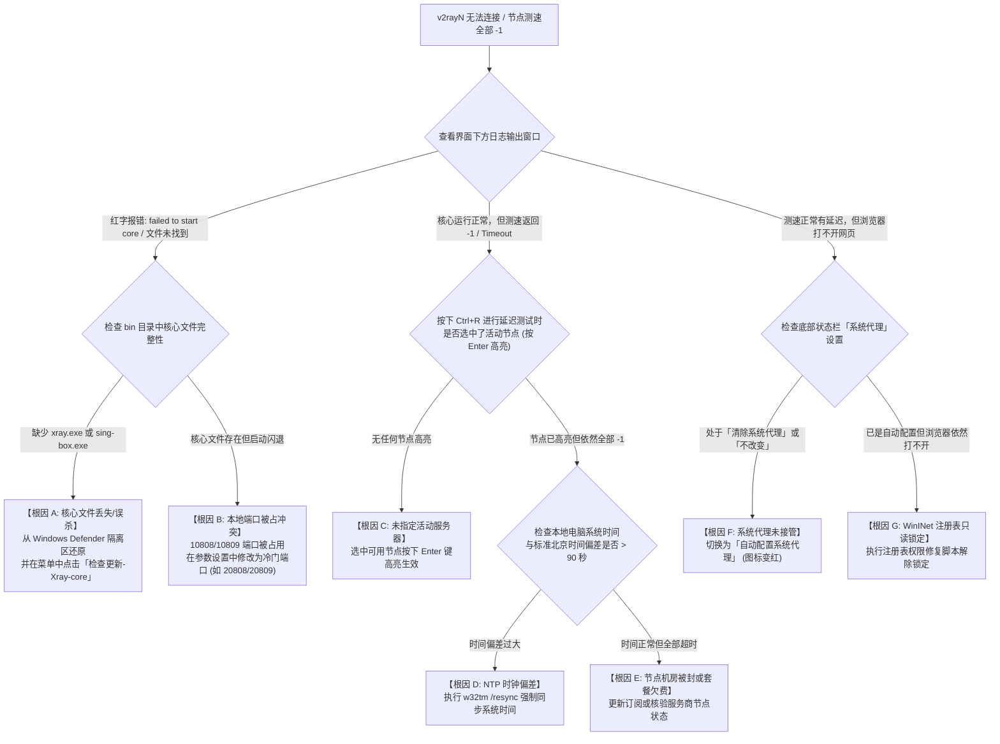

# v2rayN 无法连接与启动报错：从 Xray 内核闪退、PAC 模式废弃到 WinINet 注册表只读锁定深度排障

作为 Windows 平台上覆盖用户量数以百万计的经典老牌科学上网客户端，**v2rayN** 凭借其开放的多内核架构（同时兼容 Xray-core、v2fly-core、sing-box 与 mihomo）以及对海量底层协议（VMess、VLESS-Reality、Trojan、Shadowsocks、Hysteria 2、TUIC）的极致兼容，一直是许多网络工程师与进阶用户的装机必备工具。

然而，“功能强大、自由度极高”的背面往往是极高的排错门槛。许多用户在日常使用中频繁遭遇令人抓狂的假死现象：**“底部托盘图标已经由蓝变红，但浏览器死活打不开 Google，页面报 `ERR_CONNECTION_REFUSED`”**；或者**“右键点击真连接延迟测试，全列表节点清一色返回 `-1 ms` 或 `Timeout`”**；更甚者，**“打开软件 3 秒内日志窗口疯狂狂刷红字报错，提示 `failed to start core` 或进程瞬间闪退”**。

从计算机系统工程与 Windows 进程架构来看，**v2rayN 本质上是一个基于 C# .NET WPF 构建的用户界面（GUI）外壳，它并不直接处理网络加密与数据包转发，而是通过匿名管道（IPC）调用后台独立的二进制转发核心（`xray.exe` 或 `sing-box.exe`），并向 Windows 底层的 WinINet 注册表动态写入代理参数。**

当网络连接失败时，问题可能发生在 .NET 进程树拉起、套接字端口绑定、Windows 安全中心拦截、或是系统注册表只读锁死的任意环节。本文将自顶向下拆解 v2rayN 的运行管线，提供标准排查决策树与自动化修复脚本。

---

## 一、 v2rayN 架构解耦与三层流量调用模型

要迅速定位故障，必须建立起清晰的进程级与协议栈视野：

```
================================================================================
【v2rayN 进程树与数据流动管线】
[用户操作界面: v2rayN.exe (.NET WPF GUI)]
        │ 
        ├── 1. 读取 guiConfigs/config.json 拼装核心启动参数
        ├── 2. 通过 Process.Start() 在后台拉起二进制核心
        ▼
[底层转发核心: bin/Xray/xray.exe 或 bin/sing-box/sing-box.exe]
        │ 
        ├── 3. 尝试向操作系统申请绑定并监听本地回环端口
        │      ├── Socks 端口: 127.0.0.1:10808
        │      └── HTTP/HTTPS 端口: 127.0.0.1:10809
        ▼
[Windows 操作系统网络层: WinINet 注册表]
        │
        ├── 4. v2rayN 写入 HKCU\Software\Microsoft\Windows\CurrentVersion\Internet Settings
        │      ├── ProxyEnable = 1
        │      └── ProxyServer = "http=127.0.0.1:10809;https=127.0.0.1:10809"
        ▼
[应用程序/浏览器 (Chrome / Edge)] ──► 通过 127.0.0.1:10809 握手 ──► Xray 核心 ──► 境外节点
================================================================================
```

### 1. 脆弱的组件耦合格局
在上述管线中，任何一个微小的系统级异常都会导致全链路崩溃：
- **阶段一（核心启动失败）**：若 `xray.exe` 被 Windows Defender 当成木马删除，v2rayN 界面看似正常，但后台根本没有核心在监听端口；
- **阶段二（端口冲突死锁）**：若迅雷、虚拟机或残留的旧代理进程占用了 `10808` 或 `10809` 端口，Xray 启动时会触发 `bind: address already in use` 异常崩溃退出；
- **阶段三（注册表权限死锁）**：若第三方安全管家锁定了 Windows 注册表，v2rayN 即使将图标变为红色，操作系统底层的 `ProxyEnable` 依然是 `0`，浏览器完全不知道代理的存在。

---

## 二、 v2rayN 故障排查决策树（Mermaid 状态机）

当 v2rayN 无法连接或节点测试报错时，请严格按照以下层级排查：



---

## 三、 五大核心根因深度技术剖析

### 1. 根因一：Xray/sing-box 二进制核心被杀软误杀或权限拒绝
- **底层机理**：v2rayN 解压包中的 `bin/Xray/xray.exe` 或 `bin/sing-box/sing-box.exe` 包含高频跨国打洞、TLS 伪装以及自制协议解密特征。
- **典型报错特征**：
  ```text
  [Error] 无法启动核心: 系统找不到指定的文件。 (Exception from HRESULT: 0x80070002)
  [Warning] core exited with code: 0xc0000005 (Access Violation)
  ```
- **排查路径**：打开 Windows 安全中心，进入“病毒和威胁防护”的“保护历史记录”，检查是否有被拦截的 `Trojan:Win32/Wacatac` 或 `Heur` 记录。务必将其恢复并设置为“在设备上允许”。

### 2. 根因二：本地回环端口竞态绑定冲突 (`bind: address already in use`)
- **底层机理**：TCP 套接字在操作系统层面具有排他性。如果电脑此前异常退出了旧版 v2rayN，残留的孤儿进程 `xray.exe` 依然在后台霸占 `10809` 端口；或者安装了其他占用高位端口的软件（如 Charles、Fiddler、迅雷加速服务）。
- **验证指令**：
  ```powershell
  # 在管理员 PowerShell 中查看是谁在监听 10808 和 10809
  Get-NetTCPConnection -LocalPort 10808, 10809 -ErrorAction SilentlyContinue | Select-Object LocalAddress, LocalPort, OwningProcess, State
  ```
  如果发现 `OwningProcess` 对应的 PID 并不是当前运行的 v2rayN 所拉起的进程，Xray 在初始化调用 `bind()` 系统调用时就会抛出不可恢复的致命异常并立即退出。

### 3. 根因三：已废弃的 PAC 模式死锁与 AutoConfigURL 残留
在早期的 v2rayN 版本中，支持“PAC 模式（基于脚本的自动分流）”。
- **技术现状**：随着现代互联网 CDN 与动态域名的爆发，PAC 脚本因维护繁琐且无法支持 UDP 与复杂规则，在最新版 v2rayN 中已全量废弃，改用内核原生路由（`bypass cn`）；
- **故障遗留**：若用户电脑曾开启过旧版 PAC，Windows 注册表中可能永久残留了 `AutoConfigURL = "http://127.0.0.1:10809/pac"`。浏览器每次发起连接都会强行向 `10809` 请求 `pac` 文件，而新版核心根本不再提供 PAC 服务，导致浏览器挂起 20 秒后报 `ERR_PROXY_CONNECTION_FAILED`。

### 4. 根因四：WinINet 注册表只读锁定与安全管家劫持
部分用户安装了“360 安全卫士”、“火绒安全”或企业内网监控软件，这些防护软件开启了“浏览器主页与代理防篡改保护”：
- 当 v2rayN 尝试调用 Windows API 写入系统代理注册表时，修改请求被安全软件底层驱动静默拦截；
- 此时在 v2rayN 界面上观察，托盘图标虽然从蓝色变成了红色（软件以为自己写成功了），但打开 Windows 系统设置中的“代理”页面，系统代理开关依然处于关闭状态；
- 这正是“图标变红却无法翻墙”的最主要诱因。

### 5. 根因五：活动节点未设定或核心多线程路由死锁
v2rayN 允许导入数十个机场订阅与上千个节点，但其设计逻辑与 Clash（自动策略组轮询）完全不同：
- **v2rayN 依赖用户显式指定单个主活动节点**；
- 若用户批量测速后，原先选中的节点失效被删除、或者误触了空白区域，会导致当前**没有指定任何活动服务器**；
- 此时发往 Xray 的数据包在通过路由分发引擎时，因找不到出口标签（Outbound Tag），Xray 直接在控制台丢弃报文并打印 `failed to find an available destination`。

---

## 四、 工业级自动化一键诊断与修复脚本 (PowerShell)

为了彻底终结 v2rayN 复杂的配置与系统环境问题，以下提供可在管理员身份下运行的专用排障与一键修复脚本：

```powershell
<#
.SYNOPSIS
    v2rayN 客户端环境、WinINet 注册表与多内核全自动排障与重置脚本
.DESCRIPTION
    1. 彻底终结后台孤儿残留的 xray.exe 与 sing-box.exe 僵尸进程
    2. 清理注册表中残留的 PAC 脚本 (AutoConfigURL) 并修复代理键值
    3. 校验并放行本地监听端口 (10808, 10809)
    4. 自动修复系统时间 (NTP 同步)
#>

Write-Host "==========================================================" -ForegroundColor Cyan
Write-Host "  网络诊断实验室 - v2rayN 运行环境与 Windows 协议栈深度修复  " -ForegroundColor Cyan
Write-Host "==========================================================" -ForegroundColor Cyan

# 1. 终结孤儿核心进程，释放端口占用
Write-Host "`n[Step 1/5] 清理后台可能残留的孤儿代理核心进程..." -ForegroundColor Yellow
$coreProcesses = @("xray", "sing-box", "v2ray", "wv2ray")
foreach ($proc in $coreProcesses) {
    $running = Get-Process -Name $proc -ErrorAction SilentlyContinue
    if ($running) {
        $running | Stop-Process -Force
        Write-Host "[+] 成功杀死残留的僵尸进程: $proc (PID: $($running.Id))" -ForegroundColor Green
    }
}

# 2. 清理注册表死锁与残留 PAC
Write-Host "`n[Step 2/5] 修复 WinINet 系统代理注册表死锁..." -ForegroundColor Yellow
$regPath = "HKCU:\Software\Microsoft\Windows\CurrentVersion\Internet Settings"

try {
    # 强制关闭代理开关并重置标准代理服务器地址
    Set-ItemProperty -Path $regPath -Name ProxyEnable -Value 1 -Type DWord
    Set-ItemProperty -Path $regPath -Name ProxyServer -Value "127.0.0.1:10809" -Type String
    
    # 清理残留的 PAC 自动配置脚本
    if (Get-ItemProperty -Path $regPath -Name AutoConfigURL -ErrorAction SilentlyContinue) {
        Remove-ItemProperty -Path $regPath -Name AutoConfigURL -Force
        Write-Host "[+] 已彻底清除残留的 AutoConfigURL PAC 脚本" -ForegroundColor Green
    }
    Write-Host "[+] 成功将注册表 ProxyServer 重置为标准端口: 127.0.0.1:10809" -ForegroundColor Green
} catch {
    Write-Error "[-] 注册表写入受阻，请检查杀毒软件是否锁定了代理配置!"
}

# 3. 检查本地回环端口监听状态
Write-Host "`n[Step 3/5] 检查本地代理端口连通性..." -ForegroundColor Yellow
$testPorts = @(10808, 10809)
foreach ($p in $testPorts) {
    $conn = Test-NetConnection -ComputerName 127.0.0.1 -Port $p -WarningAction SilentlyContinue
    if ($conn.TcpTestSucceeded) {
        Write-Host "[√] 端口 $p 正在正常监听中 (内核正在运行)" -ForegroundColor Green
    } else {
        Write-Host "[-] 端口 $p 当前未被监听 (若 v2rayN 尚未启动属正常现象)" -ForegroundColor DarkGray
    }
}

# 4. 强制 Windows NTP 时间高精度对时
Write-Host "`n[Step 4/5] 正在执行系统时钟与国家授时中心高精度对齐..." -ForegroundColor Yellow
try {
    w32tm /config /manualpeerlist:"ntp.aliyun.com,0x1 time1.cloud.tencent.com,0x1" /syncfromflags:manual /reliable:YES /update | Out-Null
    Restart-Service w32time -ErrorAction SilentlyContinue
    w32tm /resync /force | Out-Null
    Write-Host "[+] 系统本地时钟同步成功! 当前精确时间: $(Get-Date)" -ForegroundColor Green
} catch {
    Write-Host "[!] NTP 自动同步受阻，请在 Windows 设置中手动点击'立即同步'" -ForegroundColor Yellow
}

# 5. 刷新系统 DNS 缓存
Write-Host "`n[Step 5/5] 刷新系统 DNS 缓存..." -ForegroundColor Yellow
Clear-DnsClientCache
Write-Host "[+] 本地 DNS 解析缓存已清空" -ForegroundColor Green

Write-Host "`n[完成] v2rayN 本地协议栈修复完毕! 请重新启动 v2rayN，选中节点并按 Enter 设为活动服务器。" -ForegroundColor Cyan
```

---

## 五、 v2rayN 核心故障与排查处置对照表

| 故障现象 | 对应网络层级 | 根本诱因分析 | 官方标准处置对策 (SOP) |
| :--- | :--- | :--- | :--- |
| **日志提示 `failed to start core`** | L7 应用宿主层 | 杀软误杀或 `bin` 目录下缺少 `xray.exe` | 在菜单点击「检查更新-Xray-core」重新拉取，并在杀软添加信任 |
| **启动提示 `bind: address in use`** | L4 传输层 | `10808` 或 `10809` 端口被迅雷/旧进程占用 | 执行上述脚本杀掉残留进程，或在「参数设置」将端口改为 `20809` |
| **节点真连接延迟全部显示 `-1`** | L6 安全会话层 | 系统时间快慢超 90 秒，或订阅已过期 | 点击「参数设置」核对时间，并点击「订阅-更新当前订阅」 |
| **托盘变红但浏览器无法联网** | L7 系统代理层 | 注册表写入受阻，或残留了失效的 PAC 脚本 | 在底部状态栏重新切换一次「清除系统代理」再切回「自动配置」 |
| **网页提示 `ERR_CONNECTION_REFUSED`** | L4 本地回环 | 核心已闪退，浏览器请求 `10809` 无任何程序应答 | 查看界面下方日志，修复导致核心崩溃的语法或端口错误 |
| **提示 `failed to find an destination`** | L7 路由分发层 | 没有任何节点处于激活选中状态 | 鼠标选中一个可用节点，**按下键盘上的 Enter 键** 使其高亮加粗 |

---

## 六、 生产环境真实故障复盘（2大典型 RCA 案例）

### 案例一：研究生科研电脑更新 v2rayN 7.x 后，全列表节点全红显示 -1
- **故障拓扑**：某高校工科硕士生，使用 v2rayN 查阅 IEEE 论文与下载 GitHub 开源代码。某日将客户端从 6.x 跨大版本解压升级至 7.x 后，原先正常的全部 45 个专线节点在进行“真连接延迟测试”时，全部瞬间返回 `-1 ms`，无法连接。
- **排查与日志分析**：
  1. 查看控制台日志，发现 Xray 核心成功拉起，本地端口正常监听；
  2. 观察控制台输出的微观报错：
     ```text
     [Warning] [1428571] app/proxies/vless/encoding: failed to read response header > io: read/write on closed pipe
     ```
  3. 执行 `w32tm /query /status` 检查本地时钟，发现电脑主板 CMOS 纽扣电池电量耗尽，系统时间停留在 3 天前；
  4. VLESS-Reality 与 VMess 协议在建立加密会话时，协议设计包含**防重放攻击（Anti-Replay Attack）时间戳校验机制**，服务端在比对客户端的时间戳时，发现时差高达 72 小时（远远超出了 90 秒的安全宽限期），依据协议安全设计在握手阶段直接下发 RST 断开连接。
- **根因判定（RCA）**：本地操作系统时钟严重漂移，触发了现代代理协议底层的抗重放攻击防御，导致握手被服务端静默熔断。
- **修复方案**：更换主板电池并在系统设置中开启“自动设置时间”，执行 `w32tm /resync` 瞬间校准。再次测试延迟全部恢复为 28ms 极速绿字。

### 案例二：360 安全卫士强行锁定代理，导致 v2rayN 托盘变红但全局断网
- **故障拓扑**：某跨境电商业务员电脑，Windows 10 系统安装了 360 安全卫士。启动 v2rayN 并点击“自动配置系统代理”，右下角托盘图标成功变为红色，但 Chrome 打开 Google 提示 `ERR_CONNECTION_REFUSED`。
- **排查与抓包过程**：
  1. 打开 CMD 执行 `netstat -ano | findstr 10809`，证实 `xray.exe` 正在正常监听 `127.0.0.1:10809`；
  2. 使用 PowerShell 查询注册表：
     ```powershell
     Get-ItemProperty -Path 'HKCU:\Software\Microsoft\Windows\CurrentVersion\Internet Settings' | Select-Object ProxyEnable, ProxyServer
     ```
  3. 发现 `ProxyEnable` 居然为 `0`，且 `ProxyServer` 为空；
  4. 查看 360 安全防护日志，发现 360 的“系统防篡改防护”功能误将 v2rayN 修改注册表的操作当成了“流氓软件劫持系统代理”，在驱动层静默拒绝了写入操作。
- **根因判定（RCA）**：第三方安全软件的注册表防护拦截了 v2rayN 的合法代理注入，造成 GUI 状态（显示红灯）与系统真实网络状态（未开代理）发生严重状态不一致。
- **修复方案**：在 360 安全卫士中关闭“锁定浏览器系统代理”开关，并在信任区中添加整个 v2rayN 文件夹。重新点击“自动配置系统代理”后，注册表成功写入，网络瞬间恢复畅通。

---

## 七、 常见高频报错速查表 (FAQ)

### Q1: v2rayN 中的“测试服务延迟”和“测试真连接延迟”有什么区别？
- **回答**：**两者的测试深度完全不同**：
  - **测试服务延迟（Ping / RTT）**：仅仅向节点服务器发送一个 ICMP 或 TCP 握手包，测试的是本地到机房入口的响应，**无法验证节点是否真的能科学上网**（哪怕节点被封锁或服务器配置错误，Ping 依然可能是绿的）；
  - **测试真连接延迟（True Latency, Ctrl+R）**：**【强烈推荐】** 客户端真的通过该节点向 Google 发起一次端到端的微型 HTTP 请求。只有真连接返回绿字毫秒数，才 100% 代表该节点当前能够顺畅打开外网。

### Q2: 为什么我的 v2rayN 路由模式只有“绕过大陆”和“全局”，没有特定应用分流？
- **回答**：v2rayN 主要是面向轻量级与通用场景设计的。如果您需要按 Windows 进程名（如微信走直连、游戏走专线、Cursor 走代理）进行精细化隔离，建议使用支持进程级分流的高级客户端。详细配置请参阅：[分应用代理与特定程序绕行配置指南](/tutorials/first-time-setup/client-modes/sub-app-proxy-split-tunneling)。

### Q3: v2rayN 启动时提示缺少 `.NET 6.0 Desktop Runtime` 怎么办？
- **回答**：新版 v2rayN 是基于微软 .NET 6.0/8.0 框架编写的。若精简版 Windows 系统缺少运行库，软件将无法打开。请前往微软官网下载并安装 **“.NET Desktop Runtime 6.0.x (x64)”** 桌面运行时库即可正常启动。

---

## 八、 推荐高可用专线容灾逃生节点与延伸阅读

如果您在日常使用中排除了本地客户端软件与注册表故障后，节点依然大面积超时，通常是因为所使用的服务商跨境公网中转遭遇了封锁或晚高峰断流。**强烈建议在多端办公环境中配置具备企业级 SLA 保障的二层内网物理专线**：

<DisasterRecoveryBox />

### 相关进阶排查与排障手册
- [v2rayN 核心 PAC 废弃与多内核调用排障](/clients/v2rayn-core-pac-xray-troubleshooting)
- [v2rayN 电脑客户端全面使用保姆级指南](/clients/v2rayn)
- [科学上网连接成功却打不开网页排查步骤](/issues/connected-but-no-internet)
- [全节点大面积超时瘫痪根因判定与容灾逃生机制](/connection/all-nodes-down)
- [Windows 系统代理注册表死锁与万能修复](/issues/connection-failures/proxy-dns/wininet-pac-registry-deadlock-repair)
