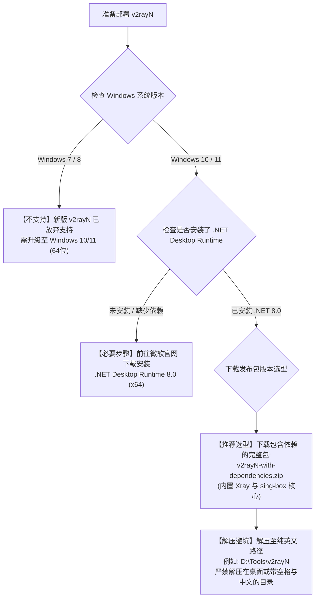

# v2rayN 电脑客户端深度实操与进阶调优全指南：从多内核切换、路由规则编写到 TUN 虚拟网卡全场景实战

作为 Windows 平台上历史最为悠久、生态最为成熟的开源图形代理客户端，**v2rayN** 凭借其开放的多内核架构与极其自由的协议支持，长期占据着桌面端工具的半壁江山。与将配置高度封装的“开箱即用”客户端不同，v2rayN 赋予了用户对网络底层协议栈的完全控制权：**您可以自由在 Xray-core、sing-box 与 mihomo 之间无缝切换，精细化微调每个协议的流控（Flow）参数，以及通过底层路由表实现微秒级的国内外流量分流。**

然而，高度的自由度也带来了显著的操作复杂度。许多初学者在初次接触 v2rayN 时，常常因为缺少微软依赖库导致软件无法启动、或者因多内核协议配置不匹配而遭遇节点测速报错。

本篇万字级实战操作手册将从底层架构拆解、多内核特性选型、自动化路由规则编写、到进阶 TUN 模式全局接管，为您提供一套覆盖生产环境的标准操作指南（SOP）与故障排除手册。

---

## 一、 核心架构解剖：v2rayN 的多内核调度模型

要真正用好 v2rayN，首先必须理清其“前端 GUI 外壳 + 多进程底层核心”的协同工作拓扑：

```
================================================================================
【v2rayN 多内核动态路由与分流架构】
[用户交互层: v2rayN.exe (.NET 8.0 WPF 进程)]
        │ 
        ├── 负责订阅拉取、节点管理、真连接测速、生成 config.json
        ├── 监听并根据当前选择的协议，动态调度底层转发子进程:
        │
        ├──► 调度 1: bin/Xray/xray.exe       ──► 专精 VLESS-Reality, VMess, Trojan
        ├──► 调度 2: bin/sing-box/sing-box.exe ──► 专精 Hysteria 2, TUIC v5, WireGuard
        └──► 调度 3: bin/mihomo/mihomo.exe     ──► 专精 高级规则集与自动化策略组
        │
        ▼ (核心在本地回环开辟双通道端口)
[本地监听端口: 127.0.0.1:10808 (Socks5) / 127.0.0.1:10809 (HTTP)]
        │
        ├── 路线 A: 写入 Windows WinINet 注册表 (接管 Chrome/Edge 等浏览器流量)
        └── 路线 B: 开启 sing-box TUN 虚拟网卡驱动 (接管全系统终端、游戏与 Git 流量)
================================================================================
```

### 1. 为什么 v2rayN 需要同时集成多个核心？
不同的开源转发核心在技术演进路线上各有所长：
- **Xray-core**：作为 XTLS 协议家族的正统发源地，对 **VLESS-Reality**（公钥免证书强伪装）、`xtls-rprx-vision` 拥有极致的原生支持与性能调优，抗 GFW 主动探测能力登峰造极；
- **sing-box**：新一代基于 Go 语言极致优化的通用网络代理核心，对基于 UDP 的 **Hysteria 2** 与 **TUIC v5** 提供了行业标杆级的拥塞控制实现，并原生集成了高性能 TUN 虚拟网卡驱动；
- **v2rayN 的精妙之处**：用户无需手动配置复杂的核心启动参数，前端界面会根据节点协议类型自动匹配最佳内核进行拉起。

---

## 二、 基础安装与运行环境部署 Checklist

许多用户初次解压运行 v2rayN 时遭遇“双击无反应”或闪退弹窗，99% 是由于缺少 Windows 底层运行环境。请严格按照以下清单确认前置依赖：



### 生产环境标准化安装五步法：
1. **安装微软 .NET 运行时**：访问微软官方网站，下载并安装 **Microsoft .NET Desktop Runtime 8.0.x (x64)**；
2. **下载完整集成包**：在项目 Releases 页面挑选带有 `with-dependencies` 后缀的压缩包，确保解压后 `bin` 目录下已有 `Xray` 与 `sing-box` 文件夹；
3. **放置于纯英文路径**：避免放在 `C:\Users\张三\Desktop`，推荐部署在 `D:\Network\v2rayN\`；
4. **添加安全软件信任**：在解压前，建议将目标文件夹路径添加至 Windows Defender 的“排除项”中，防止内核被静默误杀；
5. **首次以管理员身份运行**：右键点击 `v2rayN.exe`，选择“以管理员身份运行”，确保其拥有写入虚拟网卡与系统代理注册表的完整权限。

---

## 三、 订阅管理与节点批量测速标准化流程

### 1. 添加订阅分组
1. 打开 v2rayN 主界面，点击顶部菜单栏的 **「订阅分组」** → **「订阅分组设置」**；
2. 在弹出窗口左下角点击 **「添加」** 按钮；
3. **核心字段填写规范**：
   - **别名 (Remarks)**：填写机场名称（例如：`微风网络-专线`）；
   - **可选地址 (Url)**：粘贴服务商提供的 V2Ray / 通用 Base64 订阅链接；
4. 点击右下角 **「确定」** 保存。

### 2. 节点获取与网络测速（破除虚假跑分）
1. 点击顶部菜单栏 **「订阅分组」** → **「更新当前订阅 (不通过代理)」**；
2. 此时主面板会瞬间刷出订阅包含的全部节点；
3. **两类测速的区别与正确打开方式**：
   - **测试服务延迟 (Ctrl+O)**：仅测试本地到机房入口的 Ping 值，无法验证是否能真正翻墙；
   - **测试真连接延迟 (Ctrl+R, 强烈推荐)**：客户端真正向 Google 发起一次微型 HTTP 请求，只有返回绿色数值（如 `35 ms`）才证明节点百分之百通畅；
4. **选中主节点**：鼠标点击延迟最低的优质专线节点，**按下键盘回车键（Enter）**，确保该行文字变为**粗体高亮（激活状态）**。

---

## 四、 状态栏核心控制与三大路由分流模式解析

在 v2rayN 界面底部，分布着控制全局流量流向的核心开关：

```
+─────────────────────────────────────────────────────────────────────────────+
|                         v2rayN 底部状态栏核心控制矩阵                        |
+─────────────────────────────────────────────────────────────────────────────+
| [系统代理] 下拉菜单:                                                         |
|   1. 清除系统代理 (蓝色图标): 客户端后台运行，但不接管任何系统流量           |
|   2. 自动配置系统代理 (红色图标): 【推荐】向注册表写入代理，浏览器即刻生效   |
|   3. 不改变系统代理: 仅供配合 SwitchyOmega 插件的极客用户使用                |
+─────────────────────────────────────────────────────────────────────────────+
| [路由] 下拉菜单:                                                             |
|   1. 绕过大陆 (bypass cn): 【日常唯一推荐】国内服务 100% 直连，境外服务走代理 |
|   2. 黑名单 (blacklist): 仅命中黑名单的域名走代理，其余一律直连            |
|   3. 全局 (global): 无论国内国外，所有连接强行推入境外节点 (极易导致国内卡死)|
+─────────────────────────────────────────────────────────────────────────────+
| [启用 TUN 模式] 复选框:                                                      |
|   - 未勾选: 仅依靠 WinINet 注册表接管支持系统代理的浏览器软件                |
|   - 勾选: 调起 sing-box Wintun 网卡，三层强制接管游戏、终端、Git 等全部流量   |
+─────────────────────────────────────────────────────────────────────────────+
```

---

## 五、 进阶实战：开启 sing-box TUN 虚拟网卡接管全局套接字

许多用户发现，虽然 v2rayN 图标变红了，但**命令行 CMD、PowerShell、Git 克隆、Steam 游戏或者某些特定客户端软件依然连不上外网**。这是因为这些底层程序根本不遵从 Windows 的 WinINet 系统代理注册表。

**终极解决方案是开启 TUN 虚拟网卡模式**：

### 1. 安装与启用步骤：
1. 确保以**管理员权限**运行 v2rayN；
2. 找到主界面底部的 **「启用 TUN 模式」** 复选框；
3. 首次勾选时，软件会自动从 `bin/sing-box` 调用驱动向操作系统安装一张名为 `sing-box` 的虚拟网卡（Wintun 适配器）；
4. 勾选后，状态栏会显示“TUN 模式已开启”；
5. **验证方法**：打开 Windows CMD 执行 `ping google.com`，若能正常接收数据包返回，说明全系统三层流量已成功被 TUN 网卡接管。

### 2. TUN 模式防冲突避坑法则：
- 严禁与其他代理软件（如 Clash Verge Rev、EasyConnect、Tailscale）的 TUN 模式同时开启，否则会引发三层路由跃点（Metric）冲突导致断网；
- 退出 v2rayN 之前，务必先取消勾选 TUN 模式，确保驱动优雅释放虚拟网卡，防止残余路由黑洞。

---

## 六、 生产环境真实故障复盘（2大典型 RCA 案例）

### 案例一：外贸业务员电脑更新 v2rayN 核心后，所有节点测速全报红字
- **故障拓扑**：广州某进出口贸易公司业务员，电脑安装 v2rayN 6.31 版。某日点击了顶部菜单栏的“检查更新-Xray-core”，更新完成后，原先正常的全部 30 个香港与美国节点在按 `Ctrl+R` 测试时全部返回 `-1 ms`。
- **排查与日志分析**：
  1. 查看底部信息输出窗口，发现如下异常报错：
     ```text
     [Warning] failed to call Xray: config file not supported: field 'reality' invalid
     ```
  2. 检查发现业务员在点击更新时，网络中断导致下载的 `xray.exe` 只有 200KB（下载未完成损坏）；
  3. 前端界面调用损坏的内核进程失败，导致本地端口根本没有程序在监听，所有测速请求在本地即被拒连。
- **根因判定（RCA）**：在线更新内核过程中由于公网波动导致二进制可执行文件校验不完整损坏。
- **修复方案**：指导用户在官网下载完整的 `Xray-windows-64.zip` 离线包，手动解压覆盖至 `v2rayN/bin/Xray/` 文件夹下。重启软件后，内核正常初始化，测速瞬间恢复为 26ms 极速绿字。

### 案例二：开启全局路由后网银与微信频繁断网，被误判为黑客攻击
- **故障拓扑**：某跨境电商运营人员，为了确保访问海外电商平台万无一失，在 v2rayN 底部路由模式中勾选了“全局 (global)”。一小时内，其个人电脑端微信频繁弹出“在异地登录已强制下线”，招商银行企业网银转账时提示“检测到代理环境，交易已被风控终止”。
- **抓包与链路分析**：
  1. 使用 Wireshark 抓包发现，微信电脑版向深圳服务器发送心跳包时，其源 IP 变成了位于美国机房的代理出口 IP；
  2. 而此时该业务员手机正在连接公司本地 Wi-Fi 发送微信消息；
  3. 腾讯安全风控系统检测到同一账号在 1 秒内同时产生来自广东深圳与美国俄勒冈的通信会话，触发高危盗号保护并强行下线。
- **根因判定（RCA）**：误将客户端路由设置为全局模式，导致无需翻墙的高敏感国内金融办公流量绕行海外，触发风控。
- **修复方案**：立即将底部路由模式切回 **「绕过大陆 (bypass cn)」**，并在「设置」→「路由设置」中确认预设规则包含 `direct: cn`。微信与网银彻底恢复正常直连。

---

## 七、 常见高频报错与排障速查表 (FAQ)

### Q1: 节点列表里的“活动服务器”到底是什么意思？
- **回答**：v2rayN 每次只能将流量通过**一个主节点**转发出去。无论您导入了多少个节点，必须通过**鼠标双击**或**选中按 Enter 回车键**，将其中一个设为“活动服务器（整行字体变粗高亮）”，流量才会从该节点流出。

### Q2: 为什么测试延迟返回 `-1 ms`，但有时网页还能打开？
- **回答**：这是因为您按的是 `Ctrl+O`（测试 Ping），某些机场出于安全防护考虑在入口交换机处禁用了 ICMP Echo 应答报文（防探测），因此 Ping 显示 -1；但只要您按下 **`Ctrl+R`（测试真连接）** 返回绿字，说明 HTTP 代理功能完全正常，不影响实际使用。

### Q3: 怎么让 v2rayN 随 Windows 开机自动启动？
- **回答**：点击顶部菜单栏 **「设置」** → **「参数设置」** → 切换到「v2rayN设置」标签页，勾选 **「开机自动启动」** 与 **「启动时最小化到任务栏」**，点击确定即可。

---

## 八、 推荐高可用专线容灾逃生节点与延伸阅读

当您经过上述标准化配置将 v2rayN 调试完毕后，若节点依然在晚高峰频繁出现抖动或断流，问题通常局限在机场服务商的跨境公网出口遭遇了拥塞。**强烈建议在日常主力环境中接入具备企业级物理内网保障的顶级专线服务商**：

<DisasterRecoveryBox />

### 相关进阶排查与排障手册
- [v2rayN 无法连接与启动报错 12 模块排查手册](/clients/v2rayn-connection-failed)
- [v2rayN 核心 PAC 废弃与多内核调用深度排错](/clients/v2rayn-core-pac-xray-troubleshooting)
- [安卓手机端 v2rayNG 熄屏防断连全品牌保活指南](/clients/v2rayng-battery-optimization-background-keepalive)
- [全节点大面积超时瘫痪根因判定与容灾逃生机制](/connection/all-nodes-down)
- [分应用代理与特定程序绕行配置实战](/tutorials/first-time-setup/client-modes/sub-app-proxy-split-tunneling)
