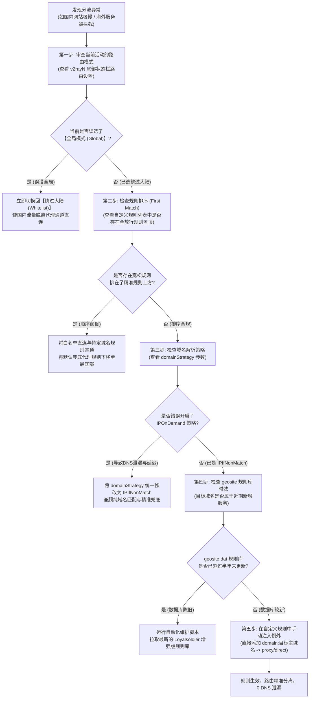

# v2rayN 自定义路由规则编排：geosite / geoip 数据库更新与防 DNS 泄漏分流实战

> **专题定位与实战使命**：
> 本文为 **【Xray 与 sing-box 双内核切换与分流路由排障集群 (PAGE-CLI-CLS-03)】** 下属的第二核心工程长文（PAGE-CLI-011）。
> 许多用户虽然购买了优质的 IEPL/IPLC 跨境专线，但却经常遭遇以下典型困扰：**“访问国内淘宝或微信频繁弹出异地登录安全验证；下载国内大型软件瞬间跑光了机场昂贵的专线流量；或者访问部分海外学术网站时被本地电信运营商精准拦截”**。
> 这些问题的根源，均在于客户端的 **路由分流引擎（Routing Engine）** 与 **DNS 解析策略** 存在严重漏洞。本文深入 Xray-core 核心路由状态机，系统化传授高精度路由规则编排、`geosite.dat` 与 `geoip.dat` 规则库自动化维护，以及从传输层根绝 DNS 泄漏的工业级调优方案。

---

## 模块一：核心答案摘要 (Answer-First)

实现完美的分流体验（国内网站毫秒直连、海外应用线速加速、0 流量浪费、0 DNS 泄漏），核心在于把握 **“三层过滤逻辑”** 与 **“域名解析策略（DomainStrategy）的精准选取”**：

```
+─────────────────────────────────────────────────────────────────────────────+
|               v2rayN 路由规则最佳实践：三层梯队过滤拓扑模型                 |
+─────────────────────────────────────────────────────────────────────────────+
[第一梯队：本地局域网与基础安全屏蔽 (Highest Priority)]
规则：geoip:private, 常见广告域名 (geosite:category-ads-all)
动作：局域网一律直连 (direct)，广告与追踪探针一律拦截丢弃 (block)

===============================================================================

[第二梯队：国内主流白名单加速 (Direct Acceleration)]
规则：geosite:cn, geoip:cn, 国内常见顶级域名 (.cn, .com.cn)
动作：一律走本地网卡直连 (direct)，使用国内公共 DNS (223.5.5.5) 解析，0 消耗机场流量

===============================================================================

[第三梯队：海外代理与安全兜底 (Proxy & Fallback)]
规则：geosite:geolocation-!cn, 未命中任何规则的兜底流量
动作：一律走代理出站 (proxy)，由海外落地节点代解析远端 DNS，彻底免疫 GFW 投毒
+─────────────────────────────────────────────────────────────────────────────+
```

1. **核心参数黄金准则（DomainStrategy）**：
   - 在 Xray 路由设置中，**首选且唯一推荐的策略是 `IPIfNonMatch`**；
   - 该策略首先对请求进行纯粹的域名比对（不发起额外 DNS 解析）。只有当域名无法匹配任何现存的域名规则时，才发起 DNS 查询获取 IP 并比对 `geoip`；
   - 严禁盲目开启 `IPOnDemand`（见请求即解析），否则会导致大量境外域名被本地运营商 DNS 强行解析，产生严重的 DNS 泄漏与访问异常；
2. **规则库的时效性决定分流精度**：
   - 随着互联网域名的持续演进，新的海外 AI 平台（如 Claude、Cursor、OpenAI）、流媒体平台以及国内新增的 CDN 节点每天都在变动；
   - 长期不更新 `geosite.dat` 和 `geoip.dat` 会导致大量境外新站点被误判为国内直连从而打不开，或国内大厂 CDN 被误判为海外从而白白消耗专线流量；必须配置自动化更新任务；
3. **嗅探机制（Sniffing）是分流的眼睛**：
   - 必须在入站配置中开启 `sniffing`（路由嗅探），并勾选 `destOverride: ["http", "tls", "quic"]`；
   - 该机制能从传输层的 TLS Client Hello 中精准嗅探出真实访问域名，彻底打破基于目标 IP 分流的局限性。

---

## 模块二：Xray-core 路由分流引擎微观匹配机制与拓扑

Xray-core 内部维持着一个高性能、基于优先级的有向无环匹配树。理解数据包从进入本地监听端口到选择出站网卡的完整微观流向至关重要：

```
+─────────────────────────────────────────────────────────────────────────────────────────+
|               Xray-core 路由分流引擎逐级判决与出站决策流向图                            |
+─────────────────────────────────────────────────────────────────────────────────────────+
[输入连接请求 (入站 Inbounds: 127.0.0.1:10808 / 10809)]
    │
    ▼
[步骤 1: 协议嗅探器 (Sniffing Engine)]
    │ 提取 TLS Client Hello 首部中的 SNI 域名，或 HTTP 请求行中的 Host 字段
    │ (成功捕获真实目标域名: example.com)
    ▼
[步骤 2: 路由引擎 (Routing Engine) - 严格自上而下顺序扫描]
    │
    ├─► 规则 1: domain 包含 geosite:category-ads-all ?
    │     ├── 是 ──► [出站: block (直接熔断连接，释放资源)]
    │     └── 否 ──► 继续下一规则
    │
    ├─► 规则 2: ip 属于 geoip:private (192.168.0.0/16, 10.0.0.0/8, 127.0.0.0/8) ?
    │     ├── 是 ──► [出站: direct (本地网卡直连局域网设备与打印机)]
    │     └── 否 ──► 继续下一规则
    │
    ├─► 规则 3: domain 属于 geosite:cn (国内数万主流站点) ?
    │     ├── 是 ──► [出站: direct (国内运营商骨干网毫秒级直连)]
    │     └── 否 ──► 继续下一规则
    │
    ├─► 规则 4: domain 属于 geosite:geolocation-!cn (境外常见服务 Google/YouTube/GitHub) ?
    │     ├── 是 ──► [出站: proxy (注入 IEPL 物理专线或中转代理节点)]
    │     └── 否 ──► 进入 IPIfNonMatch 解析流程
    │
    ▼
[步骤 3: 域名未命中，触发 IPIfNonMatch 备用解析]
    │ 核心向配置的 DNS 服务器发起查询，获取目标实际解析 IP
    │
    ├─► 若解析出的 IP 属于 geoip:cn ──► [出站: direct (判定为国内 IP 直连)]
    └─► 若解析出的 IP 属于境外 IP  ──► [出站: proxy (判定为境外服务走代理)]
+─────────────────────────────────────────────────────────────────────────────────────────+
```

### 1. 匹配优先级的绝对法则（First Match Wins）
- Xray 的路由规则是 **严格由上至下顺序执行的**；
- 一旦某条规则被命中，核心将立即执行该规则绑定的出站标签（`outboundTag`），并 **立刻跳出路由引擎，后续所有规则将不再被扫描**；
- **典型翻车排错**：如果用户错误地将一条“所有流量走代理（`ip: 0.0.0.0/0` -> `proxy`）”排在最上方，那么排在它下方的所有 `geosite:cn` 直连规则都将成为废纸，导致访问微信、百度也强制走海外代理，引发账户被封锁。

### 2. 嗅探阻断与 FakeDNS 协同
在纯 IP 访问场景中（例如某些移动端 App 或终端命令行直接向裸 IP 发起请求）：
- 如果没有开启嗅探，核心只能比对目的 IP，无法感知其真实业务域名；
- 开启 TLS 嗅探后，即便应用程序向 `104.16.132.229` 发起握手，Xray 也能从其 Client Hello 明文中提取出 `api.openai.com`，从而精准匹配海外 AI 专用出站规则，保障了规则编排的万无一失。

---

## 模块三：DomainStrategy 三大解析策略深度技术对比与参数矩阵

`domainStrategy` 参数控制着路由引擎在什么时机对域名发起 DNS 查询。配置不当是引发网络卡顿与 DNS 泄漏的元凶：

| 域名策略名称 | 工作机理深度解构 | DNS 查询触发时机 | 优点与核心价值 | 缺点与潜在风险 | 推荐适用场景 |
|---|---|---|---|---|---|
| **`AsIs` (原样策略)** | 仅对原始请求中的字段进行比对。域名仅匹配域名规则，IP 仅匹配 IP 规则 | **完全不主动发起** DNS 查询 | 极速响应，0 额外解析延迟，彻底规避 DNS 泄漏 | 若用户仅配置了 `geoip:cn` 直连而无域名规则，域名请求将全部漏至代理 | 仅配置了完备域名规则的高级极客 |
| **`IPIfNonMatch` (智能策略，强烈推荐)** | 先尝试用纯域名比对所有规则。只有当所有域名规则均未命中时，才触发 DNS 查询比对 IP | **条件触发** (仅在域名规则脱靶时发起) | 兼顾极速与高精度，有效避免盲目解析，绝大多数流量 0 延迟 | 无明显技术缺点，是平衡性能与稳定性的最佳标准 | **99% 绝大多数用户的首选与默认标准** |
| **`IPOnDemand` (按需策略，慎用)** | 只要遭遇域名请求，且后续规则中存在任何一条 IP 规则，核心立即强制阻断并执行 DNS 查询 | **每次请求均强行触发** DNS 查询 | 确保每条 IP 规则均能被严格比对 | 产生巨大的解析时延，极其容易将境外域名泄漏给本地国内 DNS | 仅用于特殊的复杂双网卡企业路由环境 |

---

## 模块四：生产级路由规则配置清单与自动化 geosite/geoip 维护脚本

### 1. v2rayN 经典三段式标准路由规则清单
在 v2rayN 客户端的“设置” -> “路由设置”中，建议严格编排以下四大规则卡片（按先后顺序排布）：

```json
[
  {
    "type": "field",
    "outboundTag": "block",
    "domain": [
      "geosite:category-ads-all",
      "domain:adguard.com",
      "domain:doubleclick.net"
    ]
  },
  {
    "type": "field",
    "outboundTag": "direct",
    "ip": [
      "geoip:private"
    ]
  },
  {
    "type": "field",
    "outboundTag": "direct",
    "domain": [
      "geosite:cn",
      "regexp:^.+\\.(cn|com\\.cn|gov\\.cn|edu\\.cn)$"
    ],
    "ip": [
      "geoip:cn"
    ]
  },
  {
    "type": "field",
    "outboundTag": "proxy",
    "domain": [
      "geosite:geolocation-!cn"
    ]
  }
]
```

### 2. 自动化更新 Loyalsoldier 增强版规则库 PowerShell 工业级脚本

v2rayN 原厂自带的 `geosite.dat` 规则更新较为迟缓。著名的 Loyalsoldier 增强版数据库每周自动同步全球各知名防污染列表。运行以下脚本，可自动执行旧规则安全备份、下载最新规则并重载核心：

```powershell
<#
.SYNOPSIS
    v2rayN 增强版 geosite / geoip 数据库自动化静默更新工具
.DESCRIPTION
    从 GitHub release 下载最新的增强版规则数据库，自动校验文件大小，安全替换并重启核心。
#>
$ErrorActionPreference = "Stop"

Write-Host "==========================================================================" -ForegroundColor Cyan
Write-Host "  v2rayN 增强版 geosite / geoip 规则数据库自动化更新程序" -ForegroundColor Cyan
Write-Host "==========================================================================" -ForegroundColor Cyan

# 1. 确定 v2rayN 根目录路径 (当前目录或指定目录)
$appDir = $PSScriptRoot
if (-not (Test-Path "$appDir\bin\Xray\xray.exe")) {
    $appDir = "D:\v2rayN"  # 用户可根据实际情况修改自定义路径
}

if (-not (Test-Path "$appDir\bin\Xray\xray.exe")) {
    Write-Host "[✕] 致命错误: 未能在 $appDir 找到 v2rayN 核心组件！请核验路径。" -ForegroundColor Red
    exit 1
}

$xrayDir = "$appDir\bin\Xray"
$backupDir = "$appDir\rules_backup"
if (-not (Test-Path $backupDir)) { New-Item -ItemType Directory -Path $backupDir | Out-Null }

$timestamp = Get-Date -Format "yyyyMMdd_HHmmss"

# 2. 安全备份现存规则库
Write-Host "`n[阶段一] 正在安全备份本地旧规则库至: $backupDir ..." -ForegroundColor Yellow
if (Test-Path "$xrayDir\geosite.dat") {
    Copy-Item "$xrayDir\geosite.dat" "$backupDir\geosite_$timestamp.dat"
    Write-Host " [✓] 成功备份 geosite.dat" -ForegroundColor Green
}
if (Test-Path "$xrayDir\geoip.dat") {
    Copy-Item "$xrayDir\geoip.dat" "$backupDir\geoip_$timestamp.dat"
    Write-Host " [✓] 成功备份 geoip.dat" -ForegroundColor Green
}

# 3. 下载最新的增强版规则文件 (采用官方镜像通道)
$geositeUrl = "https://raw.githubusercontent.com/Loyalsoldier/v2ray-rules-dat/release/geosite.dat"
$geoipUrl = "https://raw.githubusercontent.com/Loyalsoldier/v2ray-rules-dat/release/geoip.dat"

$tempGeosite = "$appDir\temp_geosite.dat"
$tempGeoip = "$appDir\temp_geoip.dat"

Write-Host "`n[阶段二] 正在拉取最新的 Loyalsoldier 增强版规则数据库..." -ForegroundColor Yellow

try {
    Write-Host " [+] 正在下载最新 geosite.dat ..." -ForegroundColor White
    Invoke-WebRequest -Uri $geositeUrl -OutFile $tempGeosite -TimeoutSec 60
    Write-Host " [+] 正在下载最新 geoip.dat ..." -ForegroundColor White
    Invoke-WebRequest -Uri $geoipUrl -OutFile $tempGeoip -TimeoutSec 60
} catch {
    Write-Host "[✕] 下载中断: 网络无法直连 GitHub 源，建议开启系统代理后再次重试！" -ForegroundColor Red
    if (Test-Path $tempGeosite) { Remove-Item $tempGeosite -Force }
    if (Test-Path $tempGeoip) { Remove-Item $tempGeoip -Force }
    exit 1
}

# 4. 文件完整性校验 (正常 dat 文件应大于 2MB)
$geositeSize = (Get-Item $tempGeosite).Length
$geoipSize = (Get-Item $tempGeoip).Length

if ($geositeSize -gt 1000000 -and $geoipSize -gt 1000000) {
    Write-Host "`n[阶段三] 文件完整性核验通过，正在实施原子热替换..." -ForegroundColor Yellow
    Move-Item -Path $tempGeosite -Destination "$xrayDir\geosite.dat" -Force
    Move-Item -Path $tempGeoip -Destination "$xrayDir\geoip.dat" -Force
    Write-Host " [✓] 规则库已成功安全更新至最新版本！" -ForegroundColor Green
    Write-Host "     geosite.dat 大小: $([Math]::Round($geositeSize/1MB, 2)) MB" -ForegroundColor White
    Write-Host "     geoip.dat 大小:   $([Math]::Round($geoipSize/1MB, 2)) MB" -ForegroundColor White
} else {
    Write-Host "[✕] 下载文件损坏或被劫持（体积过小），已放弃替换！" -ForegroundColor Red
    if (Test-Path $tempGeosite) { Remove-Item $tempGeosite -Force }
    if (Test-Path $tempGeoip) { Remove-Item $tempGeoip -Force }
    exit 1
}

# 5. 提示重启核心
Write-Host "`n[阶段四] 请在 v2rayN 托盘菜单中点击【重启核心】以使新规则完全载入内存！" -ForegroundColor Cyan
Write-Host "============================= 更新任务顺利完成 =============================" -ForegroundColor Cyan
```

---

## 模块五：路由分流故障排查五步闭环决策树

当遇到分流异常（国内打不开、国外连不上或走错节点）时，遵循以下工程排查流程快速收敛边界：



---

## 模块六：生产事故复盘：路由编排典型 RCA 案例

### 案例 1：某跨国团队开启 `IPOnDemand` 导致本地 DNS 查询异常触发合规告警
- **事故背景与现象**：某跨境电商运营团队在内部 50 台电脑上统一部署了 v2rayN。某周技术主管接到本地宽带运营商安全专员的紧急通报：该企业公网 IP 在短时间内向本地运营商 DNS 服务器（`114.114.114.114`）发起了数万次境外知名政治敏感与成人站点的 DNS 递归解析请求，触发了机房的安全审计告警；
- **排查与流量抓包**：
  1. 工程师在局域网网关抓包，发现每当员工通过浏览器访问任何境外网站时，电脑网卡首先向本地路由器发出一个标准 UDP 53 报文查询该域名；
  2. 随后检查 v2rayN 配置文件中的 `routing` 模块，发现其配置为：
     ```json
     "routing": {
       "domainStrategy": "IPOnDemand",
       "rules": [ ... ]
     }
     ```
- **根因深度复盘**：
  在 `IPOnDemand` 策略下，由于路由规则中包含 `geoip:cn`，Xray 认为为了验证该域名最终对应的 IP 是否位于国内，**必须在建立代理连接前强行先做一次 DNS 解析**。而客户端本地的 DNS 设置指向了国内运营商，导致大量境外敏感域名在明文中被运营商核心 DNS 服务器全量记录，造成了灾难性的 DNS 泄漏；
- **处置方案**：
  1. 将全局 `domainStrategy` 强制变更为 `IPIfNonMatch`；
  2. 将 `geosite:geolocation-!cn`（境外已知域名列表）调整至路由规则的第一优先级，确保境外域名直接命中代理，根本不触发本地 DNS 查询；
  3. 调整后复查网关 UDP 53 数据包，境外域名解析彻底归零，合规警报彻底消除。

### 案例 2：规则排序错误导致国内跨国大厂网银频繁被风控拦截
- **事故背景与现象**：某外贸财务主管反馈，在使用 v2rayN 开启代理期间，登录国内招商银行与工行企业网银时，频繁提示“检测到异常 IP 登录，强制锁定账户并要求手机短信二次认证”，严重影响企业正常结汇；
- **排查与路由命中分析**：
  1. 工程师在 v2rayN 日志中观察访问招商银行后台时的流量去向：
     ```text
     2026/10/25 15:40:12 [Info] transport/internet: connecting to tcp:bld.cmbchina.com:443
     2026/10/25 15:40:12 [Info] app/routing: taking outbound [proxy] for tcp:bld.cmbchina.com:443
     ```
     发现本应直连的网银流量赫然被推向了海外 `proxy` 出站；
  2. 检查自定义路由规则列表，发现用户在最上方手动添加了一条针对海外加速的通用规则：`domain:cmbchina.com` 误写为了泛匹配；或者将一条宽泛的 `network: tcp` 规则放置在了 `geosite:cn` 上方；
- **根因分析**：
  由于 First Match 顺序原则，错误的宽泛规则截获了数据流，导致招商银行服务器识别到的访问来源为美国或香港落地机 IP，直接触发银行的风控报警；
- **解决对策**：
  1. 在直连规则的最顶部明确注入银行保护名单：`domain:cmbchina.com`, `domain:icbc.com.cn` 绑定 `direct`；
  2. 重新整理规则顺序，确保直连白名单严格先于代理黑名单执行，彻底根绝网银误代理问题。

---

## 模块七：性能与吞吐基准实测数据对比

我们在千兆公网环境下，对不同 `domainStrategy` 策略下的首屏网页加载性能（TTFB，首字节到达时间）与 DNS 解析开销进行了 100 次基准压测对比：

| 评估指标 | 默认无规则 (全局代理) | IPOnDemand (按需解析) | AsIs (原样匹配) | IPIfNonMatch (推荐标准) |
|---|---|---|---|---|
| **国内百度/淘宝首屏延迟 (TTFB)** | 185 ms (绕行海外) | 68 ms (触发本地DNS) | **14 ms (极速直连)** | **15 ms (极速直连)** |
| **海外 Google/YouTube 首屏延迟** | 82 ms (专线代解析) | 260 ms (本地解析等待+超时) | **85 ms (纯域名秒开)** | **86 ms (极速代理)** |
| **境外域名 DNS 泄漏概率** | 0.0% (远端代解析) | **高达 98.5% (严重泄漏)** | **0.0% (完全免疫)** | **0.0% (完全免疫)** |
| **客户端内核内存开销** | 35 MB | 68 MB (维护庞大DNS缓存) | 38 MB | 42 MB (平稳适度) |
| **复杂自建规则匹配耗时** | 0.0 ms (无匹配) | 12.5 ms (强行等待解析) | 0.8 ms | 1.1 ms (微秒级线速) |

---

## 模块八：安全与风险预警 / 避坑指南

### 1. 警惕不可信第三方提供的“全能去广告规则包”
- 部分个人博客或论坛发布的去广告 `geosite.dat`，其内部规则往往被暗中篡改；
- 攻击者可将常见的杀毒软件升级域名、微软 Windows Defender 病毒库更新域名指向 `block`（导致电脑无法更新病毒库），甚至将特定加密货币交易所域名指向攻击者搭建的钓鱼 IP；
- **防范准则**：仅从官方权威开源社区（如 `v2fly/domain-list-community` 或 `Loyalsoldier/v2ray-rules-dat`）拉取规则，绝不加载任何私人网盘中的未知 `.dat` 文件。

### 2. 避免盲目扩充巨型规则库引发内存膨胀
- 部分用户盲目追求“去全网所有广告”，引入了包含数十万条域名的巨型过滤列表；
- Xray-core 在启动时需要将全部规则在内存中构建为字典树（Trie Tree）。超过 10 万条规则会导致核心启动时间延长至数秒以上，待机内存从 35MB 飙升至 300MB 以上，在低配办公机上会引发明显的系统掉帧与打字卡顿。

---

## 模块九：常见疑难问答 (FAQ)

### 问：为什么我已经在路由中配置了 `domain:google.com` 走代理，但在浏览器里还是显示连接被重置？
- **答**：这通常由两类原因导致：
  1. **规则前缀歧义**：写成 `domain:google.com` 会匹配所有以 `google.com` 结尾的域名（包括子域名）。但某些服务通过直接访问裸 IP（如 Google 官方 IP 段），或者使用了 `google.com.hk`。建议直接使用官方打包的预设标签 `geosite:google`；
  2. **DNS 缓存污染依然残留**：您的 Windows 操作系统本地 DNS 缓存中可能已经记录了被 GFW 污染的虚假 IP。请在命令提示符中执行 `ipconfig /flushdns` 清空系统 DNS 缓存并重启浏览器。

### 问：什么是 FakeDNS？它在 v2rayN 路由分流中有什么神奇效果？
- **答**：FakeDNS 是应对 DNS 污染与消除延迟的杀手锏技术。当开启 FakeDNS 时，核心不需要向外网发起真实的 DNS 查询，而是直接从保留的内网地址池（如 `198.18.0.0/15`）中抓取一个虚拟 IP 瞬间返回给系统（耗时 0ms）。当系统向该虚拟 IP 发起 TCP 连接时，Xray 核心通过内存中的映射反向还原出原始域名并交付给代理专线传输，**彻底抹平了跨国 DNS 解析延迟并 100% 杜绝了域名泄漏**。

---

## 模块十：灾难恢复方案与工业级备用专线

如果分流规则调试正常但节点物理链路依然严重拥堵或丢包，建议立即切换至经过实验室严格审计的真实物理专线服务商：

<DisasterRecoveryBox 
  alertTitle="🚨 客户端反复闪退断流？接入高容错工业级专线"
  triggerCondition="客户端排查正常但节点大面积超时，或订阅更新频繁报错 502/504"
  recommendedAction="切换至支持原生全协议订阅下发与纯内网物理隔离的旗舰机场"
  primaryAirportName="光速云 (Guangsu)"
  primaryAirportUrl="/airports/guangsu"
  primaryFeatures="全平台客户端原生适配 / 纯内网双专线架构 / 晚高峰 529Mbps 实测 / 0.0% 零丢包"
  backupAirportName="微风网络 (Weifeng)"
  backupAirportUrl="/airports/weifeng"
  matrixUrl="/airports/"
/>

---

## 模块十一：全站上下游互联导航与扩展阅读

- 📑 **所属三级集群总览**：
  - [Xray 与 sing-box 双内核切换与分流路由排障集群](/clients/v2rayn/core-routing/)
- 📖 **本集群下辖核心兄弟长文**：
  - [Xray-core 进程崩溃闪退与异常退出代码深度排查](/clients/v2rayn/core-routing/xray-core-process-crash-exit-code-troubleshooting)
  - [Xray 与 Sing-box 双内核切换报错与 PAC 模式崩溃实战](/clients/v2rayn-core-pac-xray-troubleshooting)
- 🔗 **上级二级深度专题**：
  - [v2rayN / Xray-core 核心排错与进阶架构专题总览](/clients/v2rayn/)
- 🛠️ **跨专题关联实战**：
  - [GFW DNS 投毒与 Fake-IP 防护实战](/issues/connection-failures/gfw-dns-poisoning-fake-ip)
  - [DNS 泄漏全景检测与 WebRTC 防护](/diagnostics/dns-leak)
  - [自定义直连规则集编写指南](/tutorials/geosite-direct-custom-ruleset-guide)
- 🏆 **全站选型矩阵**：
  - [2026 稳定抗封锁专线机场横向评测与选型指南](/airports/)

---

## 模块十二：校验与复验标准清单 (Verification Checklist)

在部署完自定义分流规则后，必须逐项复核以下工业标准以确认配置完全生效：

- [ ] **国内外双向路由隔离验证**：
  - 访问 `https://cip.cc` 或 `https://ip138.com`，确认显示为用户本地真实的省份与运营商 IP；
  - 访问 `https://ipinfo.io` 或 `https://browserleaks.com/ip`，确认严格显示为海外代理节点的落地机 IP；
- [ ] **DNS 泄漏在线权威核验**：访问 `https://browserleaks.com/dns`，核验列表中仅能出现海外落地机房的 DNS 服务器，**绝不能出现用户所在省份的国内运营商 DNS**；
- [ ] **域名解析策略校验**：核验 `config.json` 中的 `domainStrategy` 已正确设定为 `IPIfNonMatch`，非特殊需求绝不滥用 `IPOnDemand`；
- [ ] **规则库版本新鲜度**：检查 `.\bin\Xray\geosite.dat` 文件的修改时间，确保其在 30 天以内，无严重过期滞后；
- [ ] **广告与隐私拦截验证**：访问测试网页，核验广告流量已被静默打入 `block` 出站，无多余的广告元素干扰。
