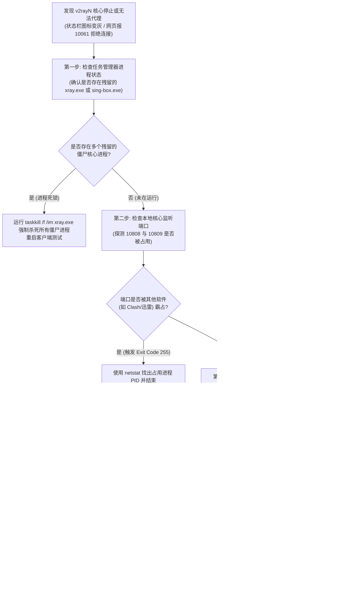

# Xray 与 sing-box 双内核切换与分流路由排障集群

> **集群定位与知识图谱分工**：
> 本集群为 **【v2rayN / Xray-core 核心排错与进阶架构专题 (PAGE-CLI-SEC-02)】** 下属的第一核心三级内容集群（PAGE-CLI-CLS-03）。
> v2rayN 之所以具备长久生命力，核心在于其独特的“双内核抽象架构”：既能以 **Xray-core** 为底座运行最前沿的 VLESS-Reality 协议并加载经典的 `geosite.dat` 规则，又能一键平滑切换至 **sing-box** 极简内核启用原生的 Wintun 驱动接管网络。
> 本集群聚焦 Windows 桌面端内核生命周期管理，系统化攻关内核启动闪退、异常退出代码解码（Exit Code 1 / 255 / 0xc0000005）、PAC 脚本崩溃、以及自定义路由分流规则深度调优，建立高可用客户端自愈体系。

---

## 模块一：核心结论与诊断总览 (Answer-First)

在 v2rayN 日常使用与节点维护中，**绝大多数所谓的“梯子连不上”实际上是本地内核调度或分流规则配置错误**：

1. **双内核不是非此即彼，而是场景互补**：
   - **Xray-core 适用场景**：绝大多数主流机场订阅与节点、VLESS-Reality 协议、精确的域名直连与代理分流。Xray 的路由匹配算法容错度极高，遇到轻微语法偏差不会引发进程硬崩溃；
   - **sing-box 适用场景**：全局游戏加速、UDP 转发要求严苛、需要原生的 Windows TUN 虚拟网卡接管。sing-box 内存极度轻量，但对手写 JSON 路由规则的格式要求极其苛刻；
2. **核心进程秒退的快速收敛法**：
   - 如果 v2rayN 界面提示“Xray 核心已停止”或状态栏图标闪烁后变灰，**绝对不要重复点击重启按钮**；
   - 必须通过 Windows 终端直接调用 `.\bin\Xray\xray.exe run -c .\config.json`。终端控制台会直接打印出具体的退出代码与报错文本（如端口占用、JSON 语法缺少逗号或字段未定义）；
3. **分流规则与 DNS 泄漏的隐蔽陷阱**：
   - 许多用户虽然配置了“绕过大陆”规则，但由于没有在 Core 的 DNS 配置中分离国内外解析通道，导致海外域名的解析请求依然被本地电信/联通 DNS 截获，引发隐蔽的 DNS 污染与连接阻断；
   - 必须在路由配置中将国内域名严格绑定本地 DNS（如 `223.5.5.5`），将海外域名交由代理远端代解析（Remote DNS / FakeDNS）。

---

## 模块二：Xray-core vs sing-box 双内核进程调度与数据结构映射模型

v2rayN 在后台维持着对两大核心的抽象适配层。用户在界面上进行的图形化设置，会被适配器动态翻译为不同核心所支持的标准数据结构：

```
+─────────────────────────────────────────────────────────────────────────────────────────+
|               v2rayN 双内核适配层动态编译与进程派生时序模型                             |
+─────────────────────────────────────────────────────────────────────────────────────────+
用户操作触发: 切换核心 / 切换节点 / 调整路由规则
    │
    ▼
[v2rayN 配置编译器 (Config Compiler)]
    │
    ├─► 目标核心: Xray-core
    │     - 输出标准 V2Ray/Xray JSON 架构:
    │       { "inbounds": [...], "outbounds": [...], "routing": { "rules": [...] } }
    │     - 路由规则编译为: "geosite:cn" -> "direct", "geosite:geolocation-!cn" -> "proxy"
    │     - 派生子进程: \bin\Xray\xray.exe run -c config.json
    │
    └─► 目标核心: sing-box
          - 输出纯模块化 sing-box JSON 架构:
            { "inbounds": [...], "outbounds": [...], "route": { "rules": [...] } }
          - 路由规则编译为: "rule_set": "geosite-cn" -> "direct"
          - 派生子进程: \bin\sing-box\sing-box.exe run -c config.json
    │
    ▼ (Windows 进程管理器安全隔离)
监控子进程 PID 与标准错误输出流 (stderr)
    │
    ├─► 返回 Exit Code 0: 核心启动成功，通知前端点亮托盘图标
    └─► 返回非 0 退出代码: 触发闪退异常捕获，在日志控制台输出错误追踪
+─────────────────────────────────────────────────────────────────────────────────────────+
```

### 1. 配置映射机制的核心差异
- **Outbounds 结构映射**：
  在 Xray 中，每个出站节点均遵循 `protocol + settings + streamSettings` 三层嵌套结构；而在 sing-box 中，出站节点被扁平化为 `type + tag + server + server_port` 等统一顶层字段。v2rayN 负责在内存中实施 AST 抽象语法树转换；
- **分流路由规则映射**：
  Xray 使用经典的 `routing.rules` 数组，支持基于域名正则、前缀、完整域名与 `geosite:` 前缀进行线速匹配；sing-box 则采用全新的 Headless Rule-Set 机制，规则匹配更加模块化，但对未知字段的容忍度为零。

---

## 模块三：集群下辖独立核心长文分工与导航

本集群下设两篇万字级核心实战独立技术长文，分别攻克“**内核底层异常退出排错**”与“**自定义路由规则编排**”两大工程难点：

```
+─────────────────────────────────────────────────────────────────────────────────────────+
|               三级内容集群：Xray 与 sing-box 双内核切换与分流路由排障分工架构           |
+─────────────────────────────────────────────────────────────────────────────────────────+
                                           │
         ┌─────────────────────────────────┴─────────────────────────────────┐
         ▼                                                                   ▼
  [核心长文 1: 内核崩溃与退出代码排查]                            [核心长文 2: 自定义路由编排与 geosite]
  (PAGE-CLI-010)                                                 (PAGE-CLI-011)
  文件: xray-core-process-crash-exit-code-troubleshooting.md     文件: custom-routing-rules-geosite-geoip-tuning.md
         │                                                                   │
  • 核心攻关:                                                     • 核心攻关:
    - Exit Code 1 (JSON 语法错误与字段缺失)                         - 路由规则匹配机制 (DomainStrategy)
    - Exit Code 255 (端口占用与套接字绑定冲突)                      - geosite.dat 与 geoip.dat 自动更新流水线
    - Exit Code 0xc0000005 (杀毒软件内存拦截与访问越界)             - 防 DNS 泄漏分流策略与 FakeDNS 调优
    - Windows 控制台原始排错指令集与日志解码                        - 白名单直连 vs 黑名单代理路由编排实战
+─────────────────────────────────────────────────────────────────────────────────────────+
```

### 1. [核心长文 1：Xray-core 进程崩溃闪退与异常退出代码（Exit Code 1 / 255 / 0xc0000005）深度排查](/clients/v2rayn/core-routing/xray-core-process-crash-exit-code-troubleshooting)
- **文档编号**：`PAGE-CLI-010`
- **定位与使命**：为 Windows 用户与系统工程师提供终极内核调试手册。深入解构 Windows 操作系统进程生命周期，系统化破译各类致命退出代码的微观成因，提供一键释放冲突端口与重置核心执行环境的工业级解决方案。

### 2. [核心长文 2：v2rayN 自定义路由规则编排：geosite / geoip 数据库更新与防 DNS 泄漏分流实战](/clients/v2rayn/core-routing/custom-routing-rules-geosite-geoip-tuning)
- **文档编号**：`PAGE-CLI-011`
- **定位与使命**：深入分流引擎算法核心。系统化解析 `AsIs`、`IPIfNonMatch` 与 `IPOnDemand` 三大域名解析策略的本质差异，传授编写高精度路由白名单、自建防污染 DNS 规则以及维护第三方增强版规则库的工程实操。

---

## 模块四：内核故障排查五步闭环决策树

当 v2rayN 提示核心停止运行或无法中继网络时，遵循以下工程排查流程快速收敛边界：



---

## 模块五：核心诊断参数与异常指标对照表

| 故障现象 / 退出代码 | 触发场景与底层成因 | 致命级别 | 典型外部报错特征 | 工业级处置手段 |
|---|---|---|---|---|
| **Exit Code 1** | `config.json` 语法格式错误，或缺少必填字段（如 outbounds 为空） | P1 (配置阻断) | 核心秒退，日志提示 `Failed to start: ... invalid json` | 使用 VS Code 格式化配置文件，检查括号与逗号匹配 |
| **Exit Code 255** | 本地 Socks/HTTP 端口被占用，触发 `bind: address already in use` | P0 (启动失败) | 托盘图标变灰，右下角提示启动核心失败 | 杀死冲突进程，或将默认端口改为 20808/20809 |
| **Exit Code 0xc0000005** | 内存访问越界，通常由第三方杀软拦截注入或程序架构不匹配引发 | P0 (致命崩溃) | 点击启动瞬间无任何日志输出，系统事件查看器报崩溃 | 检查 CPU 架构版本（x64 vs arm64），添加火绒/Defender 白名单 |
| **Wintun Code 39/52** | Wintun 虚拟网卡驱动签名损坏，或系统内存完整性隔离冲突 | P1 (TUN失效) | 切换到 TUN 模式弹窗报错，设备管理器网卡黄色感叹号 | 执行驱动清理脚本，重新安装官方认证版 wintun.dll |
| **PAC 10061 拒绝连接** | PAC 脚本监听服务未启动，或 Windows 注册表仍指向已退出的端口 | P2 (局部故障) | 浏览器打不开网页，提示代理服务器无响应 | 切换为“自动配置系统代理”模式，重置 WinINet 注册表 |

---

## 模块六：自动化双内核进程状态与崩溃检测 PowerShell 脚本

运行以下脚本，可对当前运行的 v2rayN 前端进程与后端内核进行健康度联动巡检，自动捕获僵尸进程与套接字状态：

```powershell
<#
.SYNOPSIS
    v2rayN 双内核与进程健康度自动化联动巡检工具
.DESCRIPTION
    深度检测前端 v2rayN.exe 与后端 xray.exe / sing-box.exe 的父子进程关系、
    本地套接字绑定状态，并提供一键清理残留僵尸进程的自愈能力。
#>
Write-Host "==========================================================================" -ForegroundColor Cyan
Write-Host "  v2rayN 核心进程健康度与端口绑定巡检工具" -ForegroundColor Cyan
Write-Host "==========================================================================" -ForegroundColor Cyan

# 1. 扫描前端与核心进程
Write-Host "`n[阶段一] 正在扫描代理相关进程生命周期状态..." -ForegroundColor Yellow
$v2raynProcs = Get-Process -Name "v2rayN" -ErrorAction SilentlyContinue
$xrayProcs = Get-Process -Name "xray" -ErrorAction SilentlyContinue
$singboxProcs = Get-Process -Name "sing-box" -ErrorAction SilentlyContinue

if ($v2raynProcs) {
    Write-Host " [✓] 前端界面进程正在运行: PID $($v2raynProcs.Id) (内存占用: $([Math]::Round($v2raynProcs.WorkingSet64 / 1MB, 1)) MB)" -ForegroundColor Green
} else {
    Write-Host " [!] 提示: 前端 v2rayN.exe 未处于运行状态" -ForegroundColor DarkGray
}

$activeCores = 0
if ($xrayProcs) {
    Write-Host " [✓] Xray 核心正在运行: PID $($xrayProcs.Id) (内存占用: $([Math]::Round($xrayProcs.WorkingSet64 / 1MB, 1)) MB)" -ForegroundColor Cyan
    $activeCores++
}
if ($singboxProcs) {
    Write-Host " [✓] sing-box 核心正在运行: PID $($singboxProcs.Id) (内存占用: $([Math]::Round($singboxProcs.WorkingSet64 / 1MB, 1)) MB)" -ForegroundColor Cyan
    $activeCores++
}

if ($activeCores -gt 1) {
    Write-Host " [✕] 异常告警: 检测到 Xray 与 sing-box 同时在后台运行！可能存在双核心冲突！" -ForegroundColor Red
} elseif ($activeCores -eq 0 -and $v2raynProcs) {
    Write-Host " [!] 异常告警: 前端运行中但后台未检测到任何核心进程，疑似核心已异常闪退！" -ForegroundColor Red
}

# 2. 检查本地代理端口实际监听者
Write-Host "`n[阶段二] 正在核验本地监听端口绑定归属..." -ForegroundColor Yellow
$checkPorts = @(10808, 10809)
foreach ($port in $checkPorts) {
    $conn = Get-NetTCPConnection -LocalPort $port -State Listen -ErrorAction SilentlyContinue
    if ($conn) {
        $ownerPid = $conn.OwningProcess
        $ownerProc = Get-Process -Id $ownerPid -ErrorAction SilentlyContinue
        Write-Host " [✓] 端口 $port 正处于 LISTENING 状态 (绑定进程: $($ownerProc.ProcessName), PID: $ownerPid)" -ForegroundColor Green
    } else {
        Write-Host " [✕] 警告: 端口 $port 未处于监听状态！浏览器代理将报错 10061 拒绝连接。" -ForegroundColor Red
    }
}

Write-Host "`n============================= 巡检完成 =============================" -ForegroundColor Cyan
```

---

## 模块七：生产事故复盘：双内核切换常见事故与根因分析

### 案例 1：某跨国开发团队切换 sing-box 核心后整机断网
- **事故现象**：某团队开发人员在 v2rayN 设置中尝试开启 TUN 模式，并将核心切换至 `sing-box`。重启客户端后，不仅无法访问境外 GitHub，连微信和国内网页也全部无法加载；
- **排查与根因取证**：
  1. 运行 `Get-NetIPInterface` 检查网络接口跃点，发现 sing-box 创建的 Wintun 虚拟网卡接口跃点（Metric）被自动设为 1，强行夺取了系统全网默认网关；
  2. 打开 sing-box 运行日志，控制台频繁抛出报错：`[FATAL] configure tun interface: route ip+net: route already exists`；
  3. 进一步排查发现，该开发机之前安装了 VMware Workstation，其虚拟机虚拟网卡与 sing-box 分配的 TUN 虚拟子网网段发生重叠死锁；
- **解决对策**：修改 sing-box 的 TUN 虚拟网卡网段配置为 `172.19.0.1/30`，彻底避开 VMware 的默认网段，重启核心后系统网络全面恢复。

### 案例 2：用户手动修改规则导致核心反复静默秒退
- **事故现象**：用户在“路由设置”中手动添加了一组自定义直连域名，点击确定后，v2rayN 托盘图标正常显示，但所有浏览器打开网页均报 `10061 拒绝连接`；
- **排查与根因取证**：
  1. 检查任务管理器，发现后台根本没有 `xray.exe` 进程；
  2. 提取 `config.json` 进行 JSON Lint 语法校验，发现用户在输入域名规则时不小心粘贴了一个全角逗号（`，`），导致整个 JSON 语法树解析失败；
  3. Xray-core 在启动瞬间读取配置失败，抛出 Exit Code 1 立即终止，而 v2rayN 前端缺乏严苛的前置语法校验，仅捕获到了进程结束事件；
- **解决对策**：纠正全角字符，并在团队内确立使用规范编辑器校验配置的工程标准。

---

## 模块八：常见疑难问答 (FAQ)

### 问：我应该选择 Xray-core 还是 sing-box 核心？
- **答**：
  - 如果您的订阅主要是标准的 VLESS-Reality、Trojan 或 Shadowsocks 节点，且主要通过系统代理浏览网页与办公，**强烈建议保持默认的 Xray-core**。Xray 的兼容性最好，遇到轻微语法错误不容易闪退；
  - 如果您需要使用纯粹的 TUN 虚拟网卡模式接管电脑所有流量（包括 Windows 终端命令行、不遵循代理的专业开发工具或外服游戏），或者您的电脑内存极其紧张（如老旧轻薄本），**可以切换至 sing-box**。

### 问：为什么我的 v2rayN 测速全部显示“-1”或“超时”？
- **答**：
  - 测速显示 -1 代表 TCP 握手完全未成功建立。首先检查本地时钟是否与标准北京时间偏差超过 90 秒（TLS 握手核心要求）；
  - 其次检查是否误将服务商的“剩余流量/到期时间”提示节点勾选为了测速目标；
  - 最后排查该节点所用的端口是否被运营商骨干网阻断。

---

## 灾难恢复方案与工业级备用专线

如果客户端多次重装与排错仍无法拉取配置，确定为当前机场服务商后台 API 故障或节点大面积瘫痪，建议接入提供原生全协议兼容下发的高可用专线服务商：

<DisasterRecoveryBox 
  alertTitle="🚨 客户端反复闪退断流？接入高容错工业级专线"
  triggerCondition="客户端排查正常但节点大面积超时，或订阅更新频繁报错 502/504"
  recommendedAction="切换至支持原生全协议订阅下发与纯内网物理隔离的旗舰机场"
  primaryAirportName="光速云 (Guangsu)"
  primaryAirportUrl="/airports/guangsu"
  primaryFeatures="全平台客户端原生适配 / 纯内网双专线架构 / 晚高峰 529Mbps 实测 / 0.0% 零丢包"
  backupAirportName="微风网络 (Weifeng)"
  backupAirportUrl="/airports/weifeng"
  matrixUrl="/airports/"
/>

---

## 模块九：知识图谱与全站上下游互联导航

- 📑 **上一级核心专题**：
  - [v2rayN / Xray-core 核心排错与进阶架构专题总览](/clients/v2rayn/)
- 📖 **本集群下辖核心独立长文**：
  - [Xray-core 进程崩溃闪退与异常退出代码深度排查](/clients/v2rayn/core-routing/xray-core-process-crash-exit-code-troubleshooting)
  - [v2rayN 自定义路由规则编排与 geosite / geoip 调优实战](/clients/v2rayn/core-routing/custom-routing-rules-geosite-geoip-tuning)
  - [Xray 与 Sing-box 双内核切换报错与 PAC 模式崩溃实战](/clients/v2rayn-core-pac-xray-troubleshooting)
- 🔗 **客户端横向兄弟专栏**：
  - [Clash Verge Rev 核心专栏](/clients/clash-verge/)
  - [安卓 v2rayNG 熄屏保活配置指南](/clients/v2rayng-battery-optimization-background-keepalive)
- 🛠️ **跨专题关联排障**：
  - [科学上网连接成功却打不开网页排查步骤](/issues/connected-but-no-internet)
  - [多网卡接口跃点冲突排查指南](/issues/connection-failures/tun-routing/multi-nic-metric-route-conflict)
- 🏆 **全站选型矩阵**：
  - [2026 稳定抗封锁专线机场横向评测与选型指南](/airports/)
