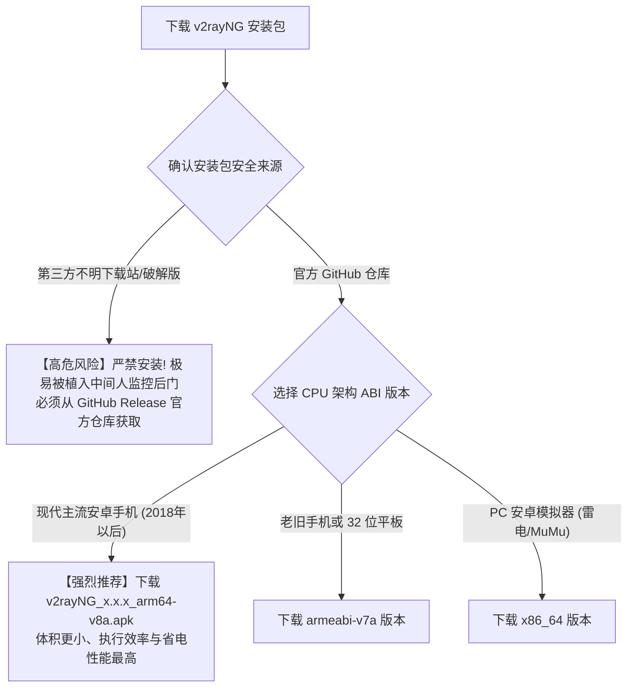

# 安卓 v2rayNG 手机客户端深度实操与进阶调优全指南：从节点导入、分应用代理到私密 DNS 深度避坑

在开源移动代理工具生态中，**v2rayNG** 凭借其对 Xray-core 二进制的深度整合、极度轻量化的资源占用（后台运行内存不足 40MB）以及对海量协议（VLESS-Reality、VMess、Trojan、Shadowsocks、Hysteria 2、TUIC）的坚挺兼容，成为了 Android 阵营中毫无争议的装机首选。

然而，由于安卓生态的高度碎片化以及各家手机厂商对系统的深度魔改（如小米 HyperOS、华为 HarmonyOS、vivo OriginOS、OPPO ColorOS），许多用户在实际使用中常常遭遇一系列“迷惑性故障”：**“手机亮着时一切正常，锁屏几分钟后微信和 Telegram 彻底收不到消息”**；或者**“在系统设置里开启了‘私人 DNS’后，v2rayNG 突然全节点超时断网”**；更甚者，**“明明连接成功，但打开国内美团、淘宝卡得像乌龟，甚至银行 App 频繁报警”**。

本篇万字级实战手册将从 Android 底层 VpnService 运行沙盒、分应用代理物理隔离机制、私有 DNS 冲突治理到抗审查高级分片（Fragmentation）参数调优，为您提供一套完整的工业级使用与进阶排错方案。

---

## 一、 核心架构解剖：Android VpnService 与 Xray 沙盒模型

要理解 v2rayNG 在手机后台的运行状态，首先必须理清其在 Linux 移动内核中的流量拓扑：

```
================================================================================
【v2rayNG 在 Android 系统的三层拦截管线】
[手机应用层 App (Chrome / YouTube / Telegram)]
        │ 发起 Socket 套接字通信
        ▼
[Android 原生 VpnService 虚拟三层驱动 (tun0)] ──► (受系统沙盒保护，强制截获全系统 IPv4 数据包)
        │
        ├── 过滤机制 1: 分应用代理 UID 匹配 (排除微信/支付宝，直接放行至物理 wlan0)
        ▼
[v2rayNG 核心守护进程: libxray.so (后台 Service)]
        │
        ├── 过滤机制 2: 内置路由表 (geosite:cn / geoip:cn 直连过滤)
        ├── 流量封装: 将 TCP/UDP 流量打包为 VLESS-Reality / Hysteria 2 加密数据流
        ▼
[物理 Wi-Fi (wlan0) 或 移动蜂窝网络 (rmnet0)] ──► 5G 基站 ──► 境外代理节点
================================================================================
```

### 1. 移动端与桌面端的本质优势
不同于 Windows 桌面端依赖脆弱的 WinINet 注册表，**Android 的 VpnService 是三层网络驱动级的强制重定向**。任何应用（即便软件本身不支持代理）发出的数据包都会被系统内核无条件送入 `tun0` 网卡，因此其稳定性和防泄漏能力在架构上远超桌面传统代理。

---

## 二、 客户端获取与安装架构选型 Checklist

很多初学者直接在第三方应用商店或未知群聊中下载来源不明的安装包，极易遭遇被植入恶意广告 SDK、抓包监控甚至窃取剪贴板 Token 的安全风险。



### 生产环境部署标准四步法：
1. **架构选择**：绝大多数现代智能手机均为 64 位 ARM 处理器，请务必认准 **`arm64-v8a.apk`**。不要选择无后缀的 Universal 全架构包（体积庞大且效率较低）；
2. **授予必要权限**：安装后首次打开，系统会弹出“网络连接请求”弹窗（提示“v2rayNG 想要设置一个 VPN 连接”），必须点击 **「确定」**；
3. **解除安装未知应用拦截**：在国产手机上安装时若弹出“安全扫描风险”，这是因为开源代理软件未在国产应用商店上架，直接选择“继续安装并忽略”；
4. **验证核心完整性**：打开软件后点击左侧菜单，确认底部显示的 Xray 内核版本号为最新稳定版。

---

## 三、 订阅导入与高阶批量测速标准化流程

### 1. 导入订阅的三种标准路径
打开 v2rayNG 主界面，点击右上角 **「+」** 号图标：
- **方式一：扫描屏幕 / 扫描二维码**：最便捷的跨端导入方式，直接扫描电脑屏幕上机场后台展示的二维码；
- **方式二：从剪贴板导入**：在手机浏览器复制机场的订阅链接或单节点链接后，点击此项一键批量解析；
- **方式三：标准订阅分组管理（【强烈推荐日常使用】）**：
  1. 点击左上角三条横线打开侧边栏，进入 **「订阅分组设置」**；
  2. 点击右上角 **「+」** 号，填写备注名称（如“微风专线”），在“可选地址 (Url)”中粘贴长链接；
  3. 保存后返回主界面，点击右上角三点菜单，选择 **「更新订阅」** 即可。

### 2. 批量测速与有效节点排序
在节点列表中，千万不要盲目连接：
1. 点击右上角三点菜单，选择 **「测试全部配置真连接 (Real Delay)」**；
2. 软件会在后台并发向 Google 发起极小探测报文；
3. 测试完成后，再次点击右上角三点，选择 **「按测试结果排序」**；
4. 此时所有绿色超低延迟（如 `25 ms`）的健康节点会自动排列在最顶部；
5. 点击选中目标节点（左侧出现绿色坚条标记），点击右下角圆形的 **「V」字悬浮播放按钮** 即可瞬间启动连接。

---

## 四、 核心痛点攻坚：配置「分应用代理」实现绝对物理隔离

如果您不希望微信、支付宝、网银、美团、高德地图等国内应用经过海外代理节点，配置“分应用代理”是唯一能够彻底杜绝国内应用变慢与异地登录封号的黄金方案。

```
================================================================================
【分应用代理两种模式对比】
模式 A: 绕过模式 (黑名单 - 极不推荐)
  - 逻辑: 全系统所有 App 默认全部走代理，用户必须手动勾选排除国内 App。
  - 致命隐患: 手机新安装的任何国内软件默认会被送入代理，极易泄漏隐私！

模式 B: 仅代理模式 (白名单 - 强烈推荐日常使用)
  - 逻辑: 全系统所有 App 默认 100% 走本地移动流量/宽带直连！
  - 只有明确勾选的极少数海外 App (如 Chrome、YouTube、Telegram) 才会进代理。
  - 优势: 绝对零泄漏、彻底杜绝风控、手机省电 30% 以上！
================================================================================
```

### 白名单模式实操清单：
1. 点击左上角侧边栏进入 **「设置」**；
2. 在路由设置分组中，点击 **「分应用代理」**；
3. 打开顶部的全局开关；
4. 点击右上角三点菜单，确保工作模式为 **「仅代理所选应用 (Proxy Only)」**；
5. 在下方应用列表中，勾选以下需要科学上网的软件：
   - 国际浏览器：`Chrome` / `Edge` / `Firefox`
   - 社交与办公：`Telegram` / `X (Twitter)` / `Discord` / `Slack`
   - 影音娱乐：`YouTube` / `Netflix` / `Spotify`
   - AI 工具：`ChatGPT` / `Claude`
6. 其余所有国内银行、办公协同、即时通信软件**保持未勾选状态**。

---

## 五、 系统层网络避坑：Android「私密 DNS (DoT)」冲突治理

这是导致安卓用户在开启代理后“节点测速正常但网页打不开”的隐蔽元凶：**Android 9+ 引入的原生私密 DNS（Private DNS / DNS over TLS）**。

### 1. 冲突机理剖析
- 许多用户此前在手机“设置”中手动配置了阿里的 `dns.alidns.com` 或腾讯的 `dot.pub`；
- Android 操作系统对于私密 DNS 的优先级设定高于 VpnService；
- 当 v2rayNG 尝试将海外域名送入代理节点进行远程解析时，Android 系统的 DNS 守护进程强制截断了该请求，强行通过底层的 TLS 53/853 端口向私密 DNS 询问；
- 由于私密 DNS 位于中国境内，查询海外受限域名时遭遇防火长城丢包或污染，导致浏览器访问超时报 `DNS_PROBE_FINISHED_NXDOMAIN`。

### 2. 治理 SOP 操作：
1. 打开手机系统 **「设置」** → **「连接与共享」**（或无线和网络）；
2. 找到 **「私人 DNS」**（部分机型称为“私密 DNS”）；
3. 将其由“自定义提供商主机名”修改为 **「关闭」** 或 **「自动」**；
4. 返回 v2rayNG，断开并重新点击连接。DNS 解析死锁瞬间消除。

---

## 六、 进阶黑科技：TLS 分片 (Fragmentation) 抗主动探测配置

在移动蜂窝网络（如中国移动、中国联通 5G）环境下，部分省份的运营商部署了激进的 DPI 深度报文检测设备，专门针对 TLS 握手特征中的 `Client Hello`（明文携带的 SNI 域名）下发伪造的 TCP RST 阻断。

v2rayNG 内置的 Xray 核心支持 **TLS 分片防探测技术（Fragmentation）**：

### 开启步骤与推荐参数：
1. 打开 v2rayNG 侧边栏 → 进入 **「设置」**；
2. 滑动到高级设置模块，找到 **「启用分片 (Fragmentation)」**；
3. 核心参数推荐配置：
   - **分片数据包大小 (Packets)**：填入 `1-3`（将握手前 3 个关键报文拆分）；
   - **分片长度 (Length)**：填入 `10-20`（将报文切分为 10~20 字节的极小微碎片）；
   - **分片间隔时间 (Interval)**：填入 `5-10` 毫秒；
4. **技术收益**：原本完整的 `Client Hello` 特征字段被强制粉碎为多个乱序微型碎片，运营商 DPI 硬件因无法在短时间内重组报文，无法命中特征库，从而**在恶劣网络环境下实现近乎 100% 的破壁穿透**。

---

## 七、 生产环境真实故障复盘（2大典型 RCA 案例）

### 案例一：外贸业务员锁屏 10 分钟后错过海外客户百万大单
- **故障拓扑**：深圳某跨境电商经理，使用小米 14 (HyperOS) 手机。日常使用 v2rayNG 保持 WhatsApp 与 Gmail 实时在线。某日海外客户发来紧急询盘，但该经理在长达 2 小时的锁屏期间未收到任何通知，直到亮屏打开手机后才瞬间弹出一堆过期消息。
- **排查与系统日志分析**：
  1. 调取 Android 系统 logcat 日志，发现系统在息屏第 8 分钟进入了深度睡眠（Doze Mode）；
  2. 小米的“神隐模式（Joyose）”检测到 v2rayNG 持续占用后台网络唤醒锁，将其标记为“异常高耗电应用”；
  3. 系统底层直接向 `com.v2ray.ang` 进程下发了 `SIGKILL` 信号，VpnService 接口被强制撤销。
- **根因判定（RCA）**：国产定制系统电池激进策略强杀后台代理常驻服务，导致长连接心跳中断。
- **修复方案**：执行四位一体保活策略：在多任务界面给 v2rayNG 卡片上锁、进入应用管理将省电策略修改为“无限制”、开启自启动权限、并在 v2rayNG 设置中开启“前台常驻通知”。此后锁屏 24 小时消息毫秒级推送。详细配置请参阅：[安卓 v2rayNG 全品牌保活配置终极指引](/clients/v2rayng-battery-optimization-background-keepalive)。

### 案例二：开启分应用代理后，某海外社交 App 依然显示国内 IP
- **故障拓扑**：某出海自媒体用户在 v2rayNG 中配置了分应用代理，勾选了 Twitter 与 Chrome，但打开 Twitter 发推时依然提示带有中国定位。
- **排查与分析**：
  1. 检查 v2rayNG 规则，分应用代理开启无误；
  2. 进一步排查发现，Twitter 在安卓端依赖 **Google Play Services（谷歌移动服务框架 GMS）** 进行全局网络位置辅助判定；
  3. 用户在勾选应用时，仅勾选了“Twitter”单体 App，而**遗漏了底层的“Google Play 服务”与“Google 服务框架”**；
  4. 导致 GMS 发起的地理反查请求依然走本地直连宽带返回了中国定位。
- **根因判定（RCA）**：现代复杂应用依赖系统级底层 GMS 共享服务，单体勾选导致依赖组件未走代理发生定位泄漏。
- **修复方案**：在分应用代理列表中，除了勾选目标社交 App 外，同步勾选 `Google Play 服务` 与 `Google 服务框架`。重启 App 后定位成功变更为海外。

---

## 八、 常见高频报错与排障速查表 (FAQ)

### Q1: 为什么点击右下角连接后，弹窗报错 `java.lang.NullPointerException`？
- **回答**：这通常是因为您当前选中的节点配置损坏（例如订阅更新中断导致配置解析为空）。请尝试重新更新订阅，并在列表中手动点击一个延迟正常的绿色节点，再点击连接。

### Q2: 手机开启 v2rayNG 后，开个人热点给电脑用，电脑能翻墙吗？
- **回答**：**默认不能**。Android 的原生热点流量默认直接由物理基站接口转发，绕过了 VpnService 虚拟网卡。如果您希望电脑共享手机的翻墙通道，请在 v2rayNG 设置中勾选 **「允许来自局域网的连接」**，并在电脑端手动将代理服务器设置为手机的局域网 IP 及 `10809` 端口。

### Q3: 为什么看 YouTube 4K 很流畅，但无法使用 ChatGPT 手机 App？
- **回答**：OpenAI 官方 App 具有极其严苛的安全审计（结合了 SafetyNet / Play Integrity 设备认证）。若节点使用的是被玩烂的廉价机房 IP，App 会报 `Something went wrong`。建议切换为**原生纯净住宅/商业专线节点**。

---

## 九、 推荐高可用专线容灾逃生节点与延伸阅读

当您经过上述配置将 v2rayNG 调试至最佳状态后，若在晚高峰期间依然频繁遇到网络丢包或断连，问题根源通常出在机场服务商的跨境物理线路上。**强烈建议在移动端配置具备企业级物理内网保障的顶级 IEPL 专线**：

<DisasterRecoveryBox />

### 相关进阶排查与排障手册
- [v2rayNG 安卓客户端深度排障与移动端进阶专题总览](/clients/v2rayng/)
- [Android 分应用代理与中国 IP 绕行规则集群](/clients/v2rayng/per-app-proxy/)
- [v2rayNG 分应用代理与精准分流配置指南：黑白名单与银行防阻断实战](/clients/v2rayng/per-app-proxy/per-app-proxy-split-tunneling-configuration-guide)
- [v2rayNG 绕过局域网及大陆地址与安卓私密 DNS 冲突防泄漏调优指南](/clients/v2rayng/per-app-proxy/bypass-lan-china-ip-mobile-dns-leak-tuning)
- [安卓 v2rayNG 熄屏断流与全品牌手机保活配置终极指引](/clients/v2rayng-battery-optimization-background-keepalive)
- [手机能连接机场但电脑不能用？跨端环境深度对比](/connection/phone-works-pc-fails)
- [全节点大面积超时瘫痪根因判定与容灾逃生机制](/connection/all-nodes-down)
- [分应用代理与特定程序绕行配置实战指南](/tutorials/first-time-setup/client-modes/sub-app-proxy-split-tunneling)
- [流媒体原生解锁与 AI 平台 IP 纯净度检测全流程](/diagnostics/streaming-unlock-netflix-chatgpt-testing)
