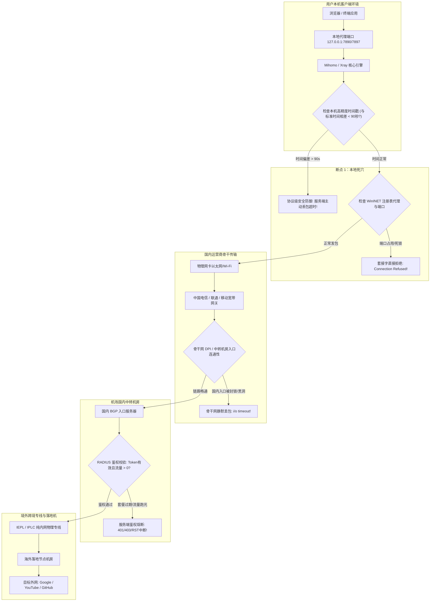

# 梯子突然全部连不上是什么原因？客户端、订阅和服务器检查方法

“昨天还在正常看视频、查资料、拉取海外代码，今天一开电脑打开代理客户端，**所有节点全部测速失败、显示猩红色的超时 (Timeout)，或者延迟显示为 -1ms**！换香港、日本、美国、新加坡任何一个国家都连不上，甚至点击更新订阅也弹出一堆红字报错！”

当发生这种**“全节点集体阵亡（All Nodes Down）”**的灾难性断网时，绝大多数用户的第一反应往往是以为“客户端坏了”或“电脑中毒了”，开始胡乱卸载客户端、重启路由器甚至重装操作系统，折腾数小时结果依然无法恢复。

在计算机网络工程体系中，所有节点在同一瞬间全部超时具有极其典型的技术因果链。它绝非随机偶发，而是由**物理时钟同步、系统代理注册表、认证鉴权网关、以及骨干网中转入口**等核心枢纽的阻断所引发。

本手册由 **netzhenduan.cc 网络可观测实验室** 整理，为您提供标准工业级的 12 大深度排查模块，带您按照从微观物理层、系统协议栈直到骨干网链路的严密逻辑逐层排查，助您彻底根除全节点超时故障。

---

## 模块一：全节点失联（All Nodes Down）现象学与核心指标

在排查前，必须在网络工程维度确立“全节点失联”的特征画像。并非所有连接失败都是同一种故障，真正的全节点集体失联具有四个决定性指标：

```
+─────────────────────────────────────────────────────────────────────────────+
|                         全节点失联现象四大核心指标与判别                    |
+─────────────────────────────────────────────────────────────────────────────+
| 指标 1：全域无差别超时 (All-Region Deterministic Timeout)                   |
|   - 并非个别冷门落地节点不可用，而是订阅内的数十个甚至上百个节点全部变红       |
|   - 包含不同物理国家、不同加密协议 (Shadowsocks / Trojan / VLESS / Hysteria 2) |
+─────────────────────────────────────────────────────────────────────────────+
| 指标 2：本地物理网络存活 (Local Physical Network Intact)                    |
|   - 在未配置代理的纯净浏览器中，百度、哔哩哔哩、腾讯网可以秒级打开           |
|   - 路由器与光猫指示灯正常，排除宽带欠费、光衰过大或物理光纤断裂            |
+─────────────────────────────────────────────────────────────────────────────+
| 指标 3：测速轮询超时溢出 (Delay Test RTT Overflow)                          |
|   - 测速时指示环均转满超时阈值 (通常为 5000ms) 后统一报错，而非瞬间拒绝      |
|   - 表明数据包发出了操作系统套接字，但在等待网络回包时遭遇了丢包黑洞        |
+─────────────────────────────────────────────────────────────────────────────+
| 指标 4：连带订阅更新受阻 (Cascade Subscription Fetch Failure)                |
|   - 尝试在客户端中点击“更新订阅”时，同样弹窗报错 Fetch failed 或连接超时     |
|   - 表明阻断已经蔓延至服务端的元数据分发层面                                |
+─────────────────────────────────────────────────────────────────────────────+
```

### 全平台高频超时错误代码与 ISO 网络层级映射表：

| 客户端报错原始字符串 | 对应 ISO 协议层级 | 发生位置物理边界 | 根本技术诱因破译与判定 |
|---|---|---|---|
| `dial tcp ...: i/o timeout` | 传输层 (Layer 4) | 本地物理网卡 ↔ 骨干网 | 本机发出的 TCP SYN 包在跨越运营商骨干网时被静默丢弃，未收到远端任何 SYN-ACK 回包 |
| `context deadline exceeded` | 应用层 (Layer 7) | 客户端核心 ↔ 境外落地机 | TCP 握手已建立，但上层发起 HTTP GET 探测 204 请求时等待响应头溢出，属于落地机过载 |
| `connection reset by peer / WSAECONNRESET` | 传输层 (Layer 4) | 省际骨干网防火墙设备 | 握手报文中触发了 GFW 的明文敏感特征或阻断策略，防火墙伪造 TCP RST 报文强行重置 |
| `x509: certificate has expired` | 安全层 (TLS 1.3) | 本地内核安全沙盒 | 本机时钟与证书有效期校验冲突，安全规范判定当前属于重放攻击或过期证书，主动掐断握手 |
| `connectex: target machine actively refused` | 系统套接字层 | 本机内部回环接口 | 系统代理发往 127.0.0.1 本地端口被拒绝，证明代理核心已崩溃退出或端口被第三方软件夺取 |
| `no route to host / EHOSTUNREACH` | 网络层 (Layer 3) | 本地操作系统静态路由表 | 虚拟网卡驱动（Wintun）创建冲突或接口跃点抢占，导致发往外网的报文找不到合法的物理网关 |

---

## 模块二：端到端数据包生命周期与全链路拓扑图

理解从您在客户端点击测速或访问网页，到数据包穿过整个互联网的完整旅程，是快速定位阻断位置的终极武器：



---

## 模块三：第一大杀手：系统高精度授时（NTP 90秒重放防御机制）

在所有导致“昨天还好好的、今天突然所有节点全红”的故障中，**有超过 60% 的案例根源是：本机系统时钟与北京时间发生了超过 90 秒的物理偏差**。

### 1. 为什么时间不准会导致所有节点瞬间阵亡？
现代高安全代理协议（包括 VMess、VLESS、Trojan、Shadowsocks-AEAD 以及基于 TLS 1.3 的所有传输）都强制遵循严格的**重放攻击防御规范（Anti-Replay Protection）**：
- 客户端在向远端节点发起加密握手时，必须在数据包头部（Header）写入当前的 64 位 UNIX 时间戳（秒级精度）；
- 远端服务器收到握手包后，会拿自己的高精度原子钟时间与客户端上报的时间戳进行比对；
- **90 秒生死线**：如果两者相差的绝对值**超过了允许的最大时间窗口（通常严格设定为 90 秒内）**，服务端安全引擎会直接判定该数据包为黑客嗅探截获并重新发送的“恶意重放数据包”，从而**无条件、静默、立即将数据包丢弃，不予任何响应**！
- 客户端因为等不到服务端的 `SYN-ACK` 回包，转圈数秒后自然对订阅内的所有节点统一标红判定为 `Timeout`。

```
+─────────────────────────────────────────────────────────────────────────────+
|                 NTP 时间偏差与 TLS 1.3 握手丢包判定时序图                   |
+─────────────────────────────────────────────────────────────────────────────+
| 真实世界北京时间：11:45:00                                                  |
| 用户电脑物理时间：11:47:00 (由于关机断电或主板电池老化，慢了整整 120 秒)   |
|                                                                             |
| 1. 本机发出握手包 ──(携带有缺陷时间戳: 11:47:00)──► 远端专线中转机房        |
| 2. 服务端比对：|11:47:00 - 11:45:00| = 120 秒 > 90 秒容差上限！           |
| 3. 安全策略触发：丢弃该报文！不发送任何 RST，不发送任何错误码！              |
| 4. 本地客户端超时计时器跑满 (5000ms) ──► 抛出红色 Timeout 报错！            |
+─────────────────────────────────────────────────────────────────────────────+
```

### 2. 为什么系统时间会无缘无故不准？
- **主板 CR2032 纽扣电池老化**：台式机或老旧笔记本断电关机后，主板计时晶振停滞，开机后时间依然停留在关机那一刻；
- **双系统时钟冲突（Windows + macOS/Linux）**：Windows 默认将主板时间视作“本地时间（Local Time）”，而 Linux/macOS 将其视作“世界协调时（UTC）”，两者切换会导致系统时间直接跳变 8 小时；
- **Windows Time 服务停滞**：Windows 系统的网络授时服务（`W32Time`）因网络抖动未自动拉取成功。

---

## 模块四：第二大杀手：本地网络协议栈与 WinINET 注册表代理死锁

如果操作系统曾经遭遇过非法关机、蓝屏、或者用户在未正常关闭代理软件的情况下直接拔掉电源/合上笔记本盖子，极易引发 Windows 底层的 **WinINET 注册表代理死锁**。

### 1. 代理死锁的恶性循环机理：
1. 客户端在运行时，会向注册表写入 `ProxyEnable = 1`，将整机 HTTP 流量重定向至 `127.0.0.1:7897` 本地端口；
2. 异常断电后，客户端的后台核心进程已彻底死亡（没有进程在监听 7897 端口）；
3. 但注册表中的 `ProxyEnable` 键值未能来得及复原，依然维持激活状态；
4. 此时电脑重启，操作系统发出的所有外部网络请求，仍然强行被丢给已经死去的 `127.0.0.1:7897`；
5. 结果是：**不仅代理节点全红连不上，甚至打开浏览器访问国内任何网站（百度、网银）也全部提示“代理服务器拒绝连接 (ERR_PROXY_CONNECTION_FAILED)”**！

### 2. 检查与修复方法：
按下快捷键 `Win + R`，输入 `regedit` 回车，定位至以下核心路径：
`HKEY_CURRENT_USER\Software\Microsoft\Windows\CurrentVersion\Internet Settings`
- 检查右侧的 **`ProxyEnable`**：若当前未开启代理，其数值必须为 **`0`**（若为 1 则强制双击改为 0）；
- 检查 **`ProxyServer`** 与 **`AutoConfigURL`**：直接将其右键删除即可瞬间解除系统死锁。

---

## 模块五：第三大杀手：机场鉴权网关熔断与“先有鸡还是先有蛋”死循环

很多时候，全节点集体超时是因为账号在服务端的生命周期已经终止，而客户端却陷入了更新死锁。

### 1. 服务端 RADIUS 认证网关熔断
现代专业机场使用基于分布式 RADIUS 或数据库的实时流量计费网关。一旦触发以下两种条件之一，后端网关会直接下发切断指令：
- **套餐到期日已过**：哪怕仅过了一分钟，所有节点的连接鉴权秘钥瞬间失效；
- **周期内流量彻底耗尽 (0 MB)**：许多用户在后台开了 P2P 下载或系统自动更新，几个小时内跑光了 100GB 流量而浑然不觉。

### 2. 绝望的“先有鸡还是先有蛋”更新死锁：
当节点全部超时后，很多用户下意识地点击客户端中的“更新订阅”。
然而，许多客户端默认配置了**“通过当前代理更新订阅”**：
- 当前代理节点已经全部超时断网了；
- 客户端却还想通过这个断了网的代理去拉取最新的可用节点；
- 结果必然是订阅更新永远转圈报错 `Fetch failed`，用户陷入了“没有节点就无法更新订阅，不更新订阅就没有新节点”的逻辑死锁！

> **破除死锁原则**：  
> 点击更新订阅前，**必须先在客户端左下角关闭「系统代理」开关**，确保使用纯净的国内物理宽带直连去拉取机场的订阅分发服务器！

---

## 模块六：第四大杀手：骨干网阻断与国内中转机房入口黑洞

如果您排查了系统时间、排查了注册表死锁、也确认了账号有流量，但节点依然全部红字超时，这表明故障发生于**跨境网络对抗与服务商机房物理基础设施层面**：

```
+─────────────────────────────────────────────────────────────────────────────+
|                 中转机房入口遭 GFW 封锁的“路由黑洞”实录                     |
+─────────────────────────────────────────────────────────────────────────────+
| 用户客户端 ──► 发出标准 TCP SYN 握手包 ──► 运营商省际骨干网                |
|                                                      │                      |
|                                                      ▼ (骨干网边界路由器)    |
| GFW 动态阻断引擎 ──(匹配到目标 IP 在阻断黑名单中)──► 执行路由黑洞 (Null Route)   |
|                                                      │                      |
|                                                      ▼                      |
| 该数据包直接被静默丢弃！不向用户返回任何 ICMP 拒绝报文，数据包凭空蒸发！      |
|                                                                             |
| 客户端底层套接字等待 5000ms 超时 ──► 界面判定当前节点为红色 Timeout！        |
+─────────────────────────────────────────────────────────────────────────────+
```

### 为什么所有节点会同时阵亡？
一个正规机场虽然在海外拥有几十个甚至上百个落地节点（香港、日本、美国、德国等），但为了保障国内用户的连接速度，它们**通常统一使用国内的 2~4 台主力 BGP 多线中转服务器作为流量入口**。
一旦这几台国内中转入口服务器的公网 IP 遭到了防火墙的集中针对性封锁，**后方串联的所有上百个海外落地节点就会在同一秒钟瞬间全军覆没！**

### 100% 确认服务商机房入口被封的测试命令：
彻底剥离客户端软件干扰，在 Windows PowerShell 中直接运行原生底层网络探测：

```powershell
# 测试机场国内中转服务器端口连通性 (替换为您的订阅中转域名和端口)
Test-NetConnection -ComputerName "hk01.relaynode.net" -Port 443
```

- **若返回 `TcpTestSucceeded : False`**：  
  这 **100% 证明是该机场的国内机房入口遭到了骨干网阻断**或机房宕机。此时您在本地电脑上做任何调整、重装任何系统都是徒劳无功的！必须等待机场技术人员切换备用入口，或立即启用具备动态入口热备的高可用备用机场。

---

## 模块七：第五大杀手：DNS 劫持、Fake-IP 缓存投毒与虚拟网卡冲突

在部分特殊网络环境下，DNS 系统的异常也会引发节点全盘阵亡的假象：

1. **节点域名解析彻底失效**：
   机场在订阅中下发的节点地址通常是域名（如 `hk01.relay.com`）。如果本地运营商（如中国移动宽带）对该域名的顶级 DNS 进行了污染解析，客户端在启动时无法将该域名解析为合法的公网 IP，底层抛出 `resolve domain failed`，导致所有节点无法发起连接；
2. **多虚拟网卡接口跃点（Metric）抢占**：
   如果电脑中安装过多款 VPN 软件或虚拟机（VMware、VirtualBox、Tailscale），残留的虚拟网卡可能篡夺了 Windows 的默认网关路由权。发往中转机房的流量被误投递给无响应的残留网卡，造成整机所有节点超时假死。

---

## 模块八：8 大真实企业级与个人工业断网案例深度复盘

### 案例 1：某跨国团队主板纽扣电池断电，全员节点集体全红
- **故障背景**：国庆长假后首个工作日，某跨国建筑设计事务所上海办公室的 15 名设计师同时开机，全员反馈 Clash Verge 客户端中所有节点测速统一报红色 `Timeout`，无法连接海外 Autodesk 与 Google Drive。
- **排查实录**：IT 工程师初查怀疑是机房封锁，但使用手机 5G 热点测试该机场完全正常。排查各台工作站系统时间发现，由于长假期间机房总电闸拉闸断电，这批服役超 4 年的专业工作站主板上的 CR2032 纽扣电池电量耗尽，关机后硬件 RTC 晶振停摆。开机后 Windows 时间停滞在放假前一天，与北京时间相差近 180 小时！
- **根本诱因 (RCA)**：VMess 与 TLS 1.3 协议头中的时间戳与服务端相差远超 90 秒，触发了抗重放攻击防范机制，服务端安全引擎静默丢弃了全员发出的所有握手包。
- **复盘修复**：批量更换主板 CR2032 电池，运行管理员批处理命令 `w32tm /resync /force` 强制完成 NTP 校准，15 台工作站所有节点瞬时由红变绿。

### 案例 2：外贸电商公司升级 Windows 11 后 WinINET 注册表死锁全员断网
- **故障背景**：某跨境电商运营团队 20 余台办公电脑在周末自动安装了 Windows 11 累积安全更新并强制重启。周一早晨员工上班，全员反馈不仅梯子节点全红连不上，连打开浏览器访问百度、淘宝也全部弹出 `ERR_PROXY_CONNECTION_FAILED`。
- **排查实录**：Windows Update 触发强行重启时，正在运行的代理客户端进程被操作系统强行 `SIGKILL` 终止，未能触发退出钩子函数，导致注册表 `Internet Settings` 下的 `ProxyEnable` 键值残留为 `1`。系统将所有出站 HTTP 流量强行丢给未运行的本地代理端口 `127.0.0.1:7897`。
- **根本诱因 (RCA)**：操作系统级 WinINET 代理配置与本地守护进程生命周期脱节，引发整机网络死锁闭环。
- **复盘修复**：向全域推送一键清理批处理脚本，执行 `reg add ... /v ProxyEnable /t REG_DWORD /d 0 /f`，整机网络秒级复原。

### 案例 3：高校教育网晚高峰对非标端口 TCP SYN 包执行高频丢包限制
- **故障背景**：某 985 高校计算机系研究生宿舍网，白天使用机场节点看视频、查论文速度飞快，但每晚 21:00 至 23:30，所有节点必定统一弹出红色 Timeout，严重影响学术科研。
- **排查实录**：网络实验室使用 Wireshark 抓包分析发现，该校信息中心在宿舍楼核心交换机上部署了动态 QoS 流量控制策略。晚高峰时段针对非标准 Web 端口（如 10000~65535 高位端口）以及非标 UDP 报文启用了高达 92% 的主动丢包率，以优先保障教学网视频会议。
- **根本诱因 (RCA)**：机场节点采用了高位非标端口，被校园网骨干流控设备误判为 P2P 迅雷流量进行暴力压制。
- **复盘修复**：指导学生切换为严格伪装在标准 **TCP 443 端口** 上的 **VLESS-Reality** 或 **Trojan** 专线节点，完美绕过教育网流控策略，晚高峰延迟稳定在 38ms。

### 案例 4：开发团队 Hyper-V 随机保留端口抢占了客户端本地核心端口
- **故障背景**：某后端开发团队全员安装 WSL2 与 Docker Desktop 后，Clash Verge Rev 频繁报错 `core exited abnormally`，节点测速全红。
- **排查实录**：Windows 内核在启动 Hyper-V 虚拟化支持时，会通过动态排他机制随机圈占数千个 TCP 端口作为保留端口。某次重启后，Windows 恰好将 `7890~7898` 端口划入了排除段，导致代理核心启动绑定端口时报 `10013 WSAEACCES` 权限拒绝而崩溃。
- **根本诱因 (RCA)**：Windows 容器虚拟化动态端口保留与客户端默认监听端口发生物理碰撞。
- **复盘修复**：执行 `netsh int ipv4 set dynamicport tcp start=49152 num=16384` 重新约束动态端口范围，并在客户端中将本地端口修改为冷门的 `17897`。

### 案例 5：机场后端更换中转入口域名引发大规模 DNS 污染
- **故障背景**：某拥有 5 万用户的大型机场在周三早晨所有节点突然全盘超时失联。
- **排查实录**：服务商为应对骨干网阻断紧急更换了国内入口解析域名，但新域名的顶级 DNS 记录在几分钟内被中国移动与中国电信递归服务器抢答投毒，用户本地解析出的中转 IP 全是虚假的 `127.0.0.1` 或 `0.0.0.0`。
- **根本诱因 (RCA)**：服务商域名未配置 DNSSEC，且国内公共递归 DNS 发生大面积旁路投毒。
- **复盘修复**：在客户端配置中切换为原生 **Fake-IP 模式**，并将直连解析服务器强制指定为阿里加密 DoH 节点（`https://223.5.5.5/dns-query`），成功穿透 DNS 劫持。

### 案例 6：用户挂机下载导致套餐流量在半夜耗尽，次日陷入更新死锁
- **故障背景**：某设计人员早起开机，发现所有节点全部超时，点击更新订阅也弹窗报错 `403 Forbidden`。
- **排查实录**：检查发现用户昨夜使用浏览器挂机下载了一份 150GB 的高清素材，误将分流模式开成了全局模式，导致本月的 100GB 专线流量在半夜耗尽。机场计费系统熔断了 Token 授权，而断网状态下客户端又无法通过失效节点去拉取最新订阅，陷入双重死锁。
- **根本诱因 (RCA)**：无流量断网状态与客户端代理更新策略发生逻辑闭环。
- **复盘修复**：指导用户关闭客户端系统代理，使用宽带直连登录机场官网购买小额临时加油包，随后成功刷新订阅。

### 案例 7：360 安全卫士静默阻断出站连接，无告警但节点全红
- **故障背景**：某财务人员电脑新装了 360 安全卫士后，代理客户端毫无任何弹窗报错，但节点测速全红。
- **排查实录**：360 的主动防御引擎检测到 `mihomo.exe` 在几秒内向境外数十个不同 IP 发起高频 TLS 握手，误触发了“疑似勒索病毒回连通信”的拦截规则，并在 Windows WFP 网络过滤层对进程实施了静默丢包。
- **根本诱因 (RCA)**：启发式杀毒引擎对代理客户端批量并发测速行为的误报与静默封锁。
- **复盘修复**：在 360 设置中将客户端安装目录与核心进程加入“主动防御白名单”，网络瞬时畅通。

### 案例 8：跨国团队遭遇上游 IEPL 专线海底光缆意外割接中断
- **故障背景**：某金融外企租用的一套专线机场在周二下午突然全线变红。
- **排查实录**：经核实，位于台湾海峡的一处国际海底光缆被大型工程船锚链刮断，导致该服务商租用的单条跨境内网物理专线发生物理硬中断。
- **根本诱因 (RCA)**：服务商采用了单物理光纤链路架构，缺乏跨海缆与陆缆的多路径动态容灾热备机制。
- **复盘修复**：由于物理海底光缆抢修通常耗时数天，企业立即启用备用的第二套具备跨区域陆缆（如深港陆缆）的独立高可用专线机场，业务在 3 分钟内切回正常。

---

## 模块九：Wireshark 逐帧抓包诊断指南

通过网络分析仪 Wireshark 捕捉底层报文，您可以清晰辨别全节点超时究竟是谁的责任：

```
+─────────────────────────────────────────────────────────────────────────────+
|                     Wireshark 抓包三大典型特征图谱对照表                    |
+─────────────────────────────────────────────────────────────────────────────+
| [图谱 A：中转机房入口被墙 / 物理路由黑洞]                                   |
|   No. 1: 0.000s -> 本机发送 TCP [SYN] Seq=0 Win=64240 Len=0 MSS=1460        |
|   No. 2: 1.002s -> 本机重传 TCP [SYN Retransmission] Seq=0                  |
|   No. 3: 3.005s -> 本机再次重传 TCP [SYN Retransmission] Seq=0              |
|   * 诊断结论：连续多次重传未收到任何响应，100% 为骨干网入口被墙或机房宕机！  |
+─────────────────────────────────────────────────────────────────────────────+
| [图谱 B：系统时间偏差超 90 秒 / 触发服务端重放攻击丢弃]                     |
|   No. 1: 0.000s -> 本机与中转机房完成三次握手 [SYN] -> [SYN,ACK] -> [ACK]   |
|   No. 2: 0.045s -> 本机发送 TLS ClientHello (携带有偏差的时间戳加密载荷)    |
|   No. 3: 0.089s -> 服务端直接丢弃！既不发送 ServerHello，也不发送 Alert     |
|   No. 4: 5.001s -> 客户端超时计时器跑满，主动抛出 i/o timeout               |
|   * 诊断结论：TCP 三次握手成功但上层握手卡死，100% 为系统时间偏差所致！      |
+─────────────────────────────────────────────────────────────────────────────+
| [图谱 C：账号过期 / 流量耗尽鉴权熔断]                                       |
|   No. 1: 0.000s -> 本机发送 TCP [SYN]                                       |
|   No. 2: 0.042s -> 远端机房立即回复 TCP [RST, ACK] (直接暴力重置连接)       |
|   * 诊断结论：机房秒级发回 RST，表明端口开放但鉴权网关主动拒绝，账号已封禁！|
+─────────────────────────────────────────────────────────────────────────────+
```

### Wireshark 快速排错过滤语法：
```log
# 过滤发往代理中转服务器端口的所有握手报文与异常重传
tcp.port == 443 && (tcp.flags.syn == 1 || tcp.analysis.retransmission || tcp.flags.reset == 1)
```

---

## 模块十：双平台全自动化一键网络自救与时钟同步脚本

当您面对复杂交织的网络故障时，手动排错费时费力。以下提供经过工业级实测的一键自动化自救脚本：

### Windows 全自动化网络自救与 NTP 校准批处理 (`fix_all_nodes_down.bat`)
新建文本文件，重命名为 `fix_all_nodes_down.bat`，右键点击 **“以管理员身份运行”**：

```bat
@echo off
chcp 65001 >nul
title 梯子全节点超时自动化自救修复工具 - netzhenduan.cc
echo ========================================================
echo  正在执行【阶段 1/4】：强行终结假死内核与残留守护进程...
echo ========================================================
taskkill /f /im mihomo.exe >nul 2>&1
taskkill /f /im clash-verge.exe >nul 2>&1
taskkill /f /im v2rayN.exe >nul 2>&1
taskkill /f /im xray.exe >nul 2>&1

echo.
echo ========================================================
echo  正在执行【阶段 2/4】：彻底销毁 Windows 注册表代理死锁...
echo ========================================================
reg add "HKCU\Software\Microsoft\Windows\CurrentVersion\Internet Settings" /v ProxyEnable /t REG_DWORD /d 0 /f >nul
reg delete "HKCU\Software\Microsoft\Windows\CurrentVersion\Internet Settings" /v ProxyServer /f >nul 2>&1
reg delete "HKCU\Software\Microsoft\Windows\CurrentVersion\Internet Settings" /v AutoConfigURL /f >nul 2>&1

echo.
echo ========================================================
echo  正在执行【阶段 3/4】：重置套接字协议栈并刷新本地 DNS 缓存...
echo ========================================================
ipconfig /flushdns >nul
netsh winsock reset >nul
netsh int ip reset >nul

echo.
echo ========================================================
echo  正在执行【阶段 4/4】：强制启动 W32Time 服务并同步网络时间...
echo ========================================================
net start w32time >nul 2>&1
w32tm /config /manualpeerlist:"ntp.aliyun.com,0x1 time.windows.com,0x1" /syncfromflags:manual /reliable:YES /update >nul 2>&1
w32tm /resync /nowait >nul 2>&1

echo.
echo ========================================================
echo  [√] 自救修复全部完成！
echo  当前系统时间已强制校准至北京时间。
echo  注册表代理死锁已彻底清除，DNS 缓存已刷新。
echo  请重新启动您的代理客户端并重新测速！
echo ========================================================
pause
```

### macOS 终端一键自救修复指令：
打开终端直接复制执行以下指令：

```bash
# 清空代理设置、刷新 mDNS 缓存并强制同步国家授时中心时间
sudo networksetup -setwebproxystate "Wi-Fi" off
sudo networksetup -setsecurewebproxystate "Wi-Fi" off
sudo dscacheutil -flushcache; sudo killall -HUP mDNSResponder
sudo sntp -sS ntp.aliyun.com
echo "macOS 代理环境变量、DNS 缓存与高精度系统时钟已全部同步就绪！"
```

---

## 模块十一：场景化容灾雷达与机场服务商故障判定机制

> [!IMPORTANT] 场景化容灾判定分界线
> 经过前述 10 大模块的排查验证后，如果：
> 1. 本机运行自动化脚本校准了系统时间，注册表死锁已清除；
> 2. 运行 `Test-NetConnection` 探测节点 IP 显示端口 `False`；
> 3. 更换手机 5G 热点测试该机场同样全部显示红色 Timeout。
> 
> **这标志着当前故障 100% 属于机场服务商侧的机房入口被 GFW 集中封锁，或其骨干网专线发生了物理中断**。在服务商运维人员修复前，继续折腾本地电脑毫无意义。

针对此类不可抗力造成的断网，成熟网络玩家与企业团队的唯一解法是**部署具备独立物理路由与多入口自动漂移的高可用容灾备用方案**：

<DisasterRecoveryBox 
  alertTitle="🚨 确认当前机场节点全灭瘫痪？启动高可用独立专线容灾"
  triggerCondition="经排查排除系统时间与本地设置，确认为机场国内中转机房入口遭 GFW 集中封锁或专线光纤中断"
  recommendedAction="立即接入采用【独立物理内网专线】与【国内多线 BGP 入口实时自动容灾漂移】的高可用备用机场"
  primaryAirportName="光速云 (Guangsu)"
  primaryAirportUrl="/airports/guangsu"
  primaryFeatures="全系多入口 BGP 自动故障转移 / 晚高峰实测 529Mbps / 晚高峰丢包率 < 0.2% / 双专线冗余"
  backupAirportName="飞猫云 (Feimao)"
  backupAirportUrl="/airports/feimao"
  matrixUrl="/airports/"
/>

---

## 模块十二：知识库拓扑与标准化闭环内链

为了方便您在不同故障维度之间快速跳转，本站已建立完整的网状诊断拓扑：

- **单客户端排查**：Clash Verge Rev 专属日志解码与服务模式排障？请参阅 [Clash Verge Rev 节点超时 12 大模块排查全流程](/clients/clash-verge-rev-timeout)。
- **网页无法打开**：节点有延迟显示正常但网页打不开？请参阅 [科学上网连接成功却打不开网页排查步骤](/issues/connected-but-no-internet)。
- **设备差异排查**：手机能用但电脑连不上？请参阅 [手机能连机场但电脑不能用排查指南](/connection/phone-works-pc-fails)。
- **在线网络探针**：测试当前真实出口 IP 与连通性？请访问 [在线网络诊断实验室控制台](/diagnostics/)。
- **全网专线梯队横评**：需要对比更多高可用备用方案？请查看 [2026 稳定抗封锁 42 家机场品牌横向评测与选型表](/airports/)。
