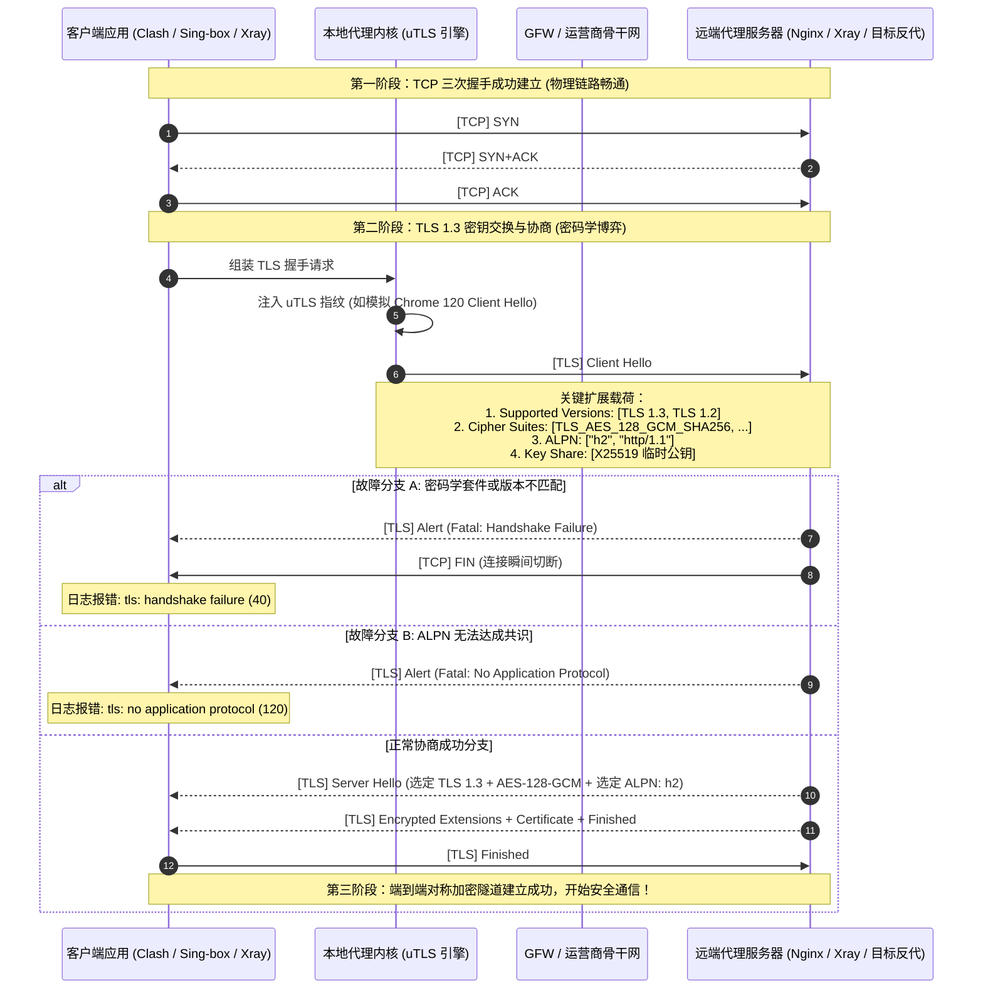
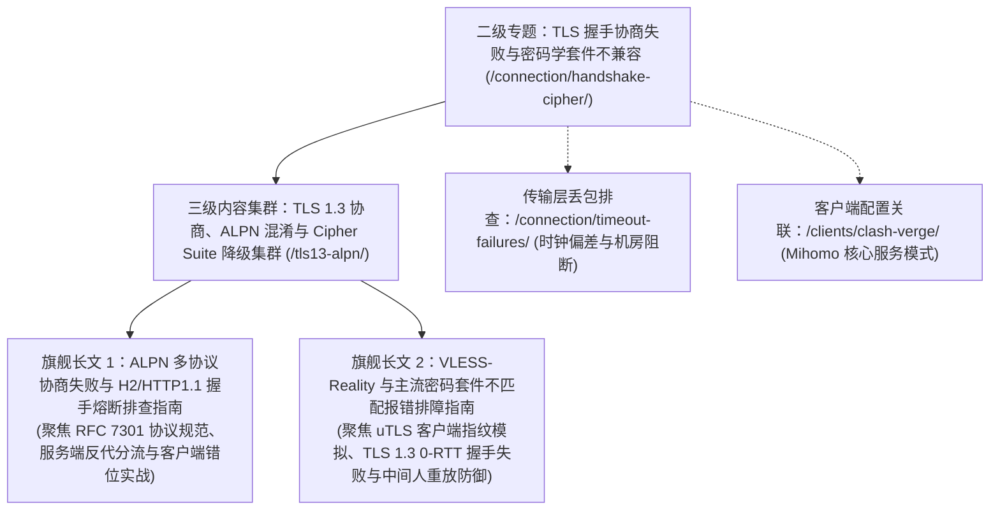
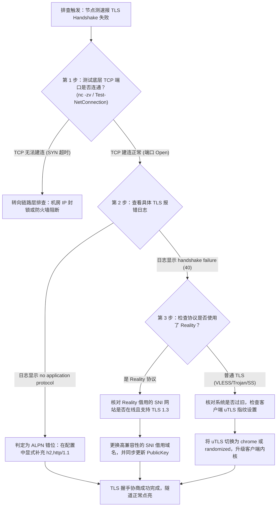

# TLS 握手协商失败与密码学套件不兼容专题

在现代跨境加密传输与代理翻墙体系中，**TLS（传输层安全性协议）握手协商**是决定网络隧道能否成功建立的关键分水岭。许多技术人员在排查“节点连接超时”或“连接瞬间断开”时，往往习惯于将原因归咎于“机房被墙”或“端口被封”。然而，在大量真实运维场景中，底层 TCP 三次握手早已顺利完成，物理链路完全畅通，数据包却在进入 TLS 握手阶段的第 2 或第 3 个往返周期（RTT）被服务端无情切断，日志中频繁喷涌出 `tls: handshake failure`、`tls: no application protocol` 或 `remote error: tls: alert(40)` 等晦涩的密码学报错。

这种“连得上却握手失败”的隐蔽故障，本质源于客户端与代理服务端在**密码学套件兼容性（Cipher Suites）**、**应用层协议协商（ALPN）**、**TLS 1.3 协议版本锁死**以及**客户端 TLS 指纹（uTLS）伪装**等现代密码学特性的严重错位。

本专题由网络诊断实验室联合资深密码学与底层网络架构团队编撰，系统化拆解 TLS 握手协商从 Client Hello 到 Finished 帧的全流程交互细节，梳理 ALPN 协议分流规则与 uTLS 抗探测指纹映射，为终端排障与服务端反代分流提供工业级技术导航。

---

## 1. 适用场景与技术定位

本二级专题在《梯子连不上故障全链路排查大专题》（`/connection/`）中承担“应用层密码学握手诊断中枢”定位。它连接了底层的网络传输层丢包排查（L4）与顶层的应用层代理分流（L7）。

### 核心覆盖故障场景
- **TLS 握手阶段瞬时中断（Handshake Failure）**：TCP 能够建立连接（SYN+ACK 正常），但客户端发送 `Client Hello` 后，服务端立即返回 `Alert (Level: Fatal, Description: Handshake Failure)` 或直接发送 `TCP FIN/RST` 断开连接。
- **ALPN 应用层协议协商熔断（No Application Protocol）**：多协议复用环境（如 Xray、VLESS、Trojan 与 Nginx/Caddy 共享 443 端口）中，因客户端配置的 ALPN 字段与反向代理分流规则不匹配引发协商崩溃。
- **VLESS-Reality 密码套件与指纹冲突**：使用 Reality 偷取目标真实站点证书时，因目标站点 TLS 配置变更、不支持 TLS 1.3 或密码学套件不重合，导致客户端被远端站点无情阻断。
- **老旧设备与系统密码库过时（Cipher Suite Deprecation）**：在 Windows 7、旧版 Android 或未打补丁的嵌入式设备上，由于系统缺少现代 ECC（椭圆曲线）与 AEAD 密码学套件，无法与现代服务端协商会话。

### 禁用与反面模式（Anti-Patterns）
- **盲目在客户端开启 `skip-cert-verify: true`**：该参数仅仅跳过了对服务端 X.509 证书合法性的校验，对密码学套件不匹配（Cipher Mismatch）或 ALPN 协商失败完全没有任何修复作用，反而极大增加了遭遇中间人截获的风险。
- **无脑堆砌非标准 ALPN 字符串**：随意在客户端填写未在服务端显式声明的 ALPN 列表（如随意填写 `h3,h2,http/1.1`），容易直接触发服务端的反代回退（Fallback）机制，将流量错误转发至伪装网站首页。

---

## 2. 架构拓扑与报文时序：TLS 握手协商全景

理解 TLS 1.3 握手时序以及各关键扩展字段的物理位置，是精准定位握手断裂点的前提：



---

## 3. 本专题下辖核心集群与深度长文分工

本二级专题下辖聚焦现代传输层密码学对抗的核心集群，并规划了两篇工业级万字独立长文：



### 两篇旗舰独立长文的核心职能定位
1. **[ALPN 多协议协商失败与 H2 / HTTP1.1 握手熔断排查指南](/connection/handshake-cipher/tls13-alpn/tls-alpn-h2-http11-negotiation-failure.md)**：
   - 深入解构应用层协议协商（ALPN, RFC 7301）扩展字段的二进制编码机理。
   - 彻底解决 Xray/VLESS 与 Nginx/Caddy/HAProxy 共享 443 端口时，由于 `alpn` 参数缺少 `h2` 或声明错位导致的 `no application protocol` 致命中断。
2. **[VLESS-Reality 与主流密码套件不匹配报错排障指南](/connection/handshake-cipher/tls13-alpn/cipher-suite-mismatch-reality-tls-troubleshooting.md)**：
   - 深度剖析新一代抗封锁协议 VLESS-Reality 借用真实借贷站点（Target SNI）证书的物理运行机制。
   - 全面排查 uTLS 指纹模拟（Chrome、Safari、Firefox）与借用目标站点在 Cipher Suites、Key Share 以及 0-RTT 重放保护上的不兼容报错。

---

## 4. 密码套件与 TLS 协商核心基准对照表

评估客户端与服务端的密码学协商健康度，必须对齐以下现代密码学参数基准：

| 协议与密码学维度 | 推荐安全标准（现代主流） | 妥协过渡配置（老旧系统） | 弃用高危配置（严禁使用） | 抓包特征与参数依据 |
| :--- | :--- | :--- | :--- | :--- |
| **TLS 协议版本** | **TLS 1.3 (强制标准)** | TLS 1.2 (扩展回退) | SSLv3, TLS 1.0, TLS 1.1 | `supported_versions: 0x0304` |
| **AEAD 对称加密套件** | `TLS_AES_128_GCM_SHA256`<br>`TLS_CHACHA20_POLY1305_SHA256` | `ECDHE-RSA-AES128-GCM-SHA256` | CBC 模式所有套件 (如 `AES-128-CBC`) | Wireshark 过滤 `tls.handshake.ciphersuite` |
| **密钥交换算法 (KEX)** | `x25519` (Curve25519) | `secp256r1` (NIST P-256) | RSA 静态密钥交换 (无前向安全性) | `supported_groups: 0x001d` |
| **ALPN 协商支持** | `["h2", "http/1.1"]` 双栈自适应 | 仅支持单一 `http/1.1` | 空缺或自定义非法私有字符 | `alpn_protocols: "h2", "http/1.1"` |
| **客户端指纹伪装** | **uTLS: `chrome_120` 或更高** | 原生 Go 原生 TLS 栈 (`utls: none`) | 固定单一特征的特征库 | JA3 / JA4 指纹哈希检测 |
| **前向安全性 (PFS)** | 100% 具备完全前向安全性 | 具备临时会话协商 | 不具备 PFS | 密钥泄露是否危及历史流量 |

---

## 5. 常见握手报错特征码与根因速查表

在各类客户端核心日志中，密码学握手失败往往抛出以下标准化特征码：

| 客户端日志标准化特征码 | 底层技术诱因剖析 (Root Cause) | 影响与严重等级 | 工业级快速修复指导 |
| :--- | :--- | :--- | :--- |
| `remote error: tls: handshake failure (40)` | 客户端提议的全部 Cipher Suites 均被服务端拒绝 | 致命，连接瞬间被服务端切断 | 检查服务端支持的加密算法，升级客户端核心以支持 AEAD 套件 |
| `tls: no application protocol (120)` | ALPN 协商失败，客户端提议的协议列表服务端无一支持 | 致命，多协议分流握手彻底崩溃 | 在客户端配置中显式补全 `alpn: ["h2", "http/1.1"]` |
| `tls: protocol version not supported (70)` | 服务端强制要求 TLS 1.3，而客户端仅支持 TLS 1.2 | 致命，版本协商不匹配 | 在客户端配置中指定 `min-version: 1.3` 或更新系统底层库 |
| `remote error: tls: bad certificate (42)` | 服务端要求双向客户端证书认证（mTLS），或根证书不受信 | 严重，双向鉴权失败 | 确认节点是否需要配套私有证书，或检查系统时钟是否偏离 |
| `tls: internal error (80)` | 服务端在处理 Client Hello 时发生内部异常崩溃 | 严重，服务端程序故障 | 检查服务端 Xray/Nginx 运行日志，核对借用 SNI 证书是否有效 |
| `Reality: target server refused TLS 1.3 connection` | VLESS-Reality 借用的 SNI 目标网站不支持 TLS 1.3 | 致命，Reality 核心无法完成借尸还魂 | 更换支持 TLS 1.3 的大厂合规借用域名（如各大 CDN 或云厂商官网） |

---

## 6. 端到端握手排障决策树

当遇到代理节点连通性测试报 Handshake 错误时，依据以下标准作业程序逐步收敛根因：



---

## 7. 本地自动化 TLS 握手与密码套件探测脚本

为了不依赖图形化客户端快速诊断远端代理节点的 TLS 握手健康度，团队编写了基于 Python 与 `ssl` 模块的自动化握手探针脚本：

```python
#!/usr/bin/env python3
"""
网络诊断实验室 - 节点 TLS 握手与密码套件兼容性快速探针
适用于快速诊断目标节点端口的 TLS 1.2/1.3 支持度、选定 Cipher 与 ALPN 协商结果。
用法: python test_tls_handshake.py <node_ip_or_domain> <port> [sni_name]
"""

import sys
import ssl
import socket

def test_tls_handshake(host, port, sni_domain=None):
    if not sni_domain:
        sni_domain = host
        
    print(f"[*] 正在向目标节点发起 TLS 握手测试: {host}:{port} (SNI: {sni_domain})")
    
    # 构造支持 TLS 1.3 与主流现代密码套件的安全上下文
    context = ssl.create_default_context()
    context.check_hostname = False
    context.verify_mode = ssl.CERT_NONE
    
    # 注入现代 ALPN 协议候选列表
    try:
        context.set_alpn_protocols(["h2", "http/1.1"])
    except NotImplementedError:
        print("[-] 当前 Python 环境 OpenSSL 不支持 ALPN 协商设置！")

    sock = socket.socket(socket.AF_INET, socket.SOCK_STREAM)
    sock.settimeout(5.0)

    try:
        # 1. 验证 TCP 三次握手
        sock.connect((host, int(port)))
        print("  [+] [阶段 1] TCP 三次握手成功建立！物理链路畅通。")
        
        # 2. 包装并执行 TLS 握手
        tls_sock = context.wrap_socket(sock, server_hostname=sni_domain)
        print("  [+] [阶段 2] TLS 密码学握手协商顺利完成！")
        
        # 提取关键协商参数
        version = tls_sock.version()
        cipher = tls_sock.cipher()
        alpn = tls_sock.selected_alpn_protocol()
        
        print("\n--- [TLS 协商成功参数清单] ---")
        print(f"  协商采用协议版本: {version}")
        print(f"  选定对称密码套件: {cipher[0]}")
        print(f"  密码套件密钥强度: {cipher[2]} bits")
        print(f"  选定 ALPN 应用协议: {alpn if alpn else '服务端未返回 ALPN (可能不支持 H2)'}")
        
        if version != "TLSv1.3":
            print("  [!] 提示: 当前连接未协商为 TLS 1.3，可能存在老旧中间件或代理服务端降级风险！")
        else:
            print("  [+] 状态评级: 符合最高安全等级 TLS 1.3 标准！")
            
        tls_sock.close()
        return True

    except ssl.SSLError as e:
        print(f"\n[-] 严重失败: TLS 密码学握手协商崩溃！")
        print(f"    OpenSSL 错误原因: {e.reason}")
        print(f"    异常详细描述:     {e}")
        return False
    except socket.timeout:
        print(f"[-] 连接超时: 目标节点未能响应 TCP 握手或在 Client Hello 后丢包！")
        return False
    except Exception as e:
        print(f"[-] 未知异常: {e}")
        return False
    finally:
        sock.close()

if __name__ == "__main__":
    if len(sys.argv) < 3:
        print("用法: python test_tls_handshake.py <IP/域名> <端口> [SNI域名]")
        sys.exit(1)
        
    target_host = sys.argv[1]
    target_port = sys.argv[2]
    target_sni = sys.argv[3] if len(sys.argv) > 3 else target_host
    
    test_tls_handshake(target_host, target_port, target_sni)
```

---

## 8. 生产环境实战故障排查案例

### 案例一：VLESS-Reality 节点频繁报 Handshake Failure，全节点全红

#### 故障现场与工单描述
某自建 VLESS-Reality 节点的用户在更新客户端配置后，发现节点在测速时频繁报 `remote error: tls: handshake failure`，无法拉取任何数据流。检查 VPS 服务端发现 Xray 核心运行正常，并未被封 IP。

#### 深度复盘与根因分析
1. 查看客户端详细日志，发现客户端在向服务端发送 Client Hello 后，收到了来自远端的标准 Alert 40 阻断帧。
2. 检查客户端 Reality 配置中的 `serverName`（借用的 SNI 网站），发现用户配置的是一个不知名的国外大学网站域名 `www.xxx.edu`。
3. 使用诊断脚本对该大学网站进行探测，发现该校官网服务器在前一日进行了安全维护，**更新了 Web 服务器配置，彻底关闭了 TLS 1.3 支持，且移除了 X25519 椭圆曲线套件**，仅保留了老旧的 RSA 套件。
4. Reality 协议的底层工作原理是：客户端向服务端发送模拟的 Client Hello，服务端将其直接解包并转发给目标真实网站进行预检。由于真实网站拒绝了客户端提议的现代密码套件，返回了 Handshake Failure，Xray 无法完成证书偷取与认证流程，导致客户端连接全量失败。

#### 修复与闭环代码
将 Reality 的借用域名更换为全球主流、永远高可用且完整支持 TLS 1.3 与 X25519 的大型科技企业或 CDN 官方站点（如苹果官网、微软更新或知名开源镜像站），并重新提取对应的公钥：

```json
{
  "streamSettings": {
    "network": "tcp",
    "security": "reality",
    "realitySettings": {
      "show": false,
      "dest": "itunes.apple.com:443",
      "serverNames": [
        "itunes.apple.com"
      ],
      "publicKey": "YourCorrectPublicKeyHere",
      "shortId": "0123456789abcdef",
      "fingerprint": "chrome"
    }
  }
}
```
修改生效后重新测速，TLS 1.3 握手瞬间完成，节点测速恢复几十毫秒满血状态。

---

### 案例二：开启反向代理后提示 `no application protocol` 致命错误

#### 故障现场与工单描述
某企业网管在前端部署了 Nginx 作为 443 端口流量总入口，后端通过 WebSocket 转发挂载 Xray 核心。客户端导入配置后，每次访问网页均弹窗报错 `tls: no application protocol`，所有流量被强制中断。

#### 深度复盘与根因分析
1. 查看客户端 YAML 配置，发现订阅链接中包含了强制声明：`alpn: [h2]`。
2. 客户端在 TLS Client Hello 的 ALPN 扩展中仅声明了自己只接受 `h2`（HTTP/2）。
3. 检查前端 Nginx 的监听配置：
   ```nginx
   server {
       listen 443 ssl;
       server_name proxy.company.com;
       # 关键疏漏：未在此处声明 http2 参数！Nginx 默认仅支持 HTTP/1.1！
   }
   ```
4. Nginx 在收到仅要求 `h2` 的 Client Hello 时，发现自身只能提供 `http/1.1`。根据 RFC 7301 规范，服务端无法在客户端提议的协议列表中找到交集，必须判定为不可恢复的致命错误，立即下发 `Alert (Description: No Application Protocol)` 切断握手。

#### 修复与闭环代码
在 Nginx 监听指令中显式追加 `http2` 支持，并在客户端配置中增加向下兼容的 `http/1.1` 备选：

```nginx
# Nginx 服务端修复：
server {
    listen 443 ssl http2;
    server_name proxy.company.com;
    # ...
}
```
客户端同步增加弹性适配：`alpn: ["h2", "http/1.1"]`。双方握手成功达成 `h2` 共识，错误彻底消除。

---

## 9. 灾难恢复与白名单安全兜底原则

<DisasterRecoveryBox />

当因密码学套件升级或指纹混淆导致重要生产环境出现意外握手中断时，遵循以下应急自愈策略：

### 生产恢复三原则
1. **uTLS 指纹安全回退**：
   若特定自定义指纹（如 `randomized`）导致频繁被机房防火墙识别为异常未知特征拒绝连接，切勿持续尝试，应立即在客户端配置中将指纹重置为经过全球数十亿设备验证的标准指纹：`fingerprint: chrome`。
2. **多协议冗余备份策略**：
   在主力节点使用高阶 TLS 1.3 / Reality 协议的同时，始终在节点列表中保留至少一个基于传统成熟密码套件（如标准 Trojan 或 Shadowsocks-AEAD）的高可用专线备用节点，避免因单点密码学库崩溃引发全网瘫痪。
3. **本地密码学套件排查**：
   Windows 客户端若频繁抛出奇怪的加密解密错误，使用系统更新补丁确保操作系统支持 RFC 8446，必要时通过注册表确认开启了对现代 ECC 曲线与 GCM 算法的支持。

---

## 10. 关联技术集群与延伸阅读导航

要彻底攻克加密握手难题，推荐结合以下纵深专题与核心指南构建知识体系：

- **本专题三级集群**：[TLS 1.3 协商、ALPN 混淆与 Cipher Suite 降级集群](/connection/handshake-cipher/tls13-alpn/index.md) —— 全景纵览集群架构与长文分工。
- **本集群攻坚长文一**：[ALPN 多协议协商失败与 H2/HTTP1.1 握手熔断排查指南](/connection/handshake-cipher/tls13-alpn/tls-alpn-h2-http11-negotiation-failure.md) —— 彻底根治多协议分流环境下的 ALPN 错位崩溃。
- **本集群攻坚长文二**：[VLESS-Reality 与主流密码套件不匹配报错排障指南](/connection/handshake-cipher/tls13-alpn/cipher-suite-mismatch-reality-tls-troubleshooting.md) —— 解决无证书偷取场景下的密码学套件冲突。
- **底层丢包关联**：[中转节点 TCP RST 旁路阻断与单向丢包诊断](/connection/timeout-failures/ntp-relay/transit-relay-node-rst-packet-analysis.md) —— 掌握 TCP 握手期遭遇阻断的诊断技巧。
- **客户端核心配置**：[Clash Verge Rev 核心配置与进阶指南](/clients/clash-verge/index.md) —— 掌握客户端内部 TLS 字段的正确编排方法。
