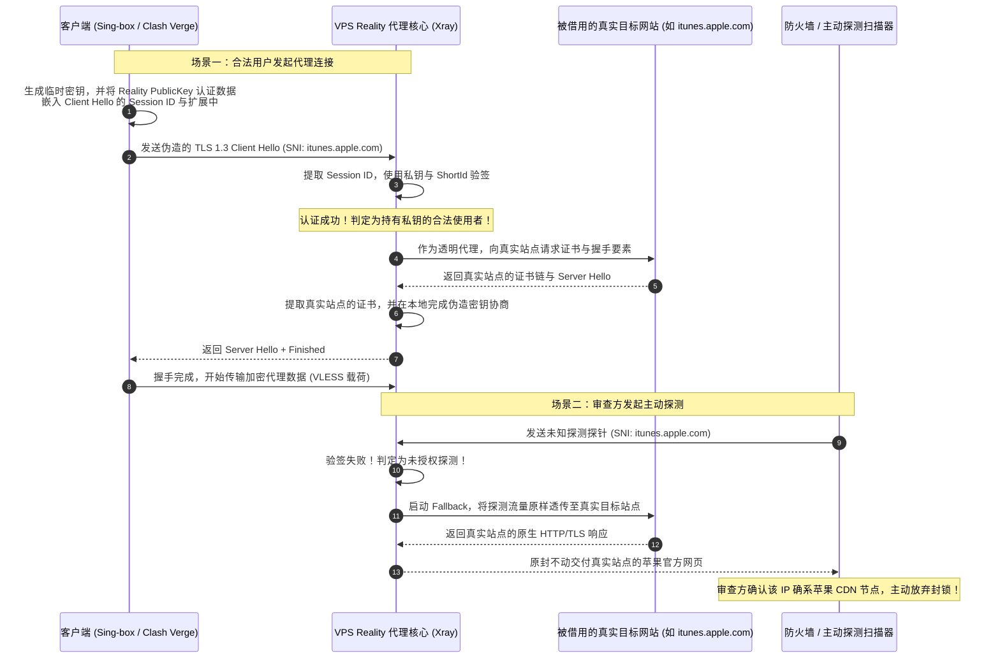

# VLESS-Reality 与主流密码套件不匹配报错排障指南

在科学上网抗封锁技术的演进史中，Xray 团队推出的 **VLESS-Reality** 协议被公认为当代翻墙技术的划时代里程碑。与传统依赖用户自行购买海外域名、搭建伪装网站并向 Let's Encrypt 申请公开证书的 Trojan 或标准 VLESS-TLS 模式不同，Reality 彻底摒弃了“自持证书”的暴露面。它通过在服务端动态“借用”合法的海外顶级大厂真实网站（如苹果、微软、亚马逊或顶级开源社区）的现成 TLS 证书与 SNI 域名，实现了近乎完美的“借尸还魂”伪装。

然而，Reality 的强大建立在对现代密码学规范（特别是 **TLS 1.3、ECDH 临时密钥协商与客户端 TLS 指纹**）的高度依赖之上。在实际部署与日常使用中，海量用户频繁遭遇节点测速全红、日志疯狂报错 `remote error: tls: handshake failure (40)`、`Reality: target server refused connection` 或“连接建立后数秒内静默断流”的顽疾。

本文由网络诊断实验室核心密码学与安全架构团队编撰，系统化解构 VLESS-Reality 协议的物理工作原理，详解目标被借用站点（Dest SNI）的科学筛选标准，深度剖析 uTLS 客户端指纹模拟与 0-RTT 早期数据重放防御，为全平台客户端提供工业级排障实战指南。

---

## 1. 适用场景与技术定位

VLESS-Reality 属于传输层之上的“密码学隧道隐匿技术”。理解其适用场景与限制条件，是避免配置踩坑的第一准则。

### 核心优势与适用场景
- **零域名与零证书运维开销**：无需注册任何个人域名，无需在 VPS 上开放 80 端口验证 ACME 证书，天然免疫“域名被 SNI 阻断”以及“证书透明度日志（CT Logs）被审查方爬取枚举”的风险。
- **物理级抵抗主动探测（Active Probing Immunity）**：当国家级防火墙（GFW）发起未携带合法认证密钥的主动探测握手时，Reality 服务端将其报文一字不差地透明转发给真实的被借用站点。探测方收到的将是来自苹果或微软官方服务器的 100% 真实响应，完全无法实施指纹定性。
- **跨平台现代化客户端原生兼容**：支持 Sing-box、Xray（v2rayN / v2rayNG）、Clash Verge Rev（Mihomo 内核）与 Shadowrocket。

### 核心脆弱点与禁忌边界
- **目标站点强依赖性**：Reality 的握手成败 100% 依赖于所借用的目标外部站点。若目标站点发生网络抖动、证书过期、关闭了 TLS 1.3，或者部署了异常严格的防爬 WAF，所有挂载该域名的 Reality 节点将瞬间全军覆没。
- **不支持任何形式的 CDN 代理中转**：由于握手时流量必须直接抵达运行 Reality 核心的 VPS 物理网卡，因此绝对无法套用 Cloudflare 等 CDN 服务进行 IP 掩护。

---

## 2. 架构拓扑与报文时序：Reality “借尸还魂”全流程

Reality 之所以能在不持有私钥的情况下完成 TLS 握手，依赖于其在 `Client Hello` 中注入的认证标记与精巧的中间人转发机制：



从上述报文时序可见：当且仅当客户端发出的 `Client Hello` 与目标被借用站点支持的密码学特性**完全兼容**时，这套天衣无缝的伪装机制才能成立。任何一个密码套件或协议版本的错位，都会导致真实目标站点向 Reality 服务端抛出 `Handshake Failure`，进而引发客户端连接熔断。

---

## 3. VLESS-Reality 密码学握手与认证原理

深入 Reality 的底层密码学实现，核心在于以下四大要素：

### 1. 公钥（PublicKey）与私钥（PrivateKey）
Reality 在服务端生成一对标准的 `Curve25519` 椭圆曲线非对称密钥。
- 服务端持有 PrivateKey；
- 客户端订阅中配置 PublicKey。客户端在组装 `Client Hello` 时，利用 ECDH（椭圆曲线迪菲-赫尔曼交换）将自身认证凭据加密隐藏在 `Session ID` 字段中。该字段在标准 TLS 1.3 中本就呈现为 32 字节的伪随机字符串，外部审查者无法将其与正常的随机噪声区分开。

### 2. 简短标识符（ShortId）
`ShortId` 是一个用于服务端快速初筛的十六进制字符串（通常为 8 到 16 字符，如 `0123456789abcdef`）。服务端可以配置多个 `shortIds`，用于区分不同客户端用户。若收到的请求中未包含合法的 ShortId，服务端甚至无需动用 CPU 执行复杂的非对称解密，直接将其归类为未知探测实施旁路转发。

### 3. SpiderX 爬虫路径防审查
配置中的 `spiderX` 参数用于模拟正常搜索引擎爬虫对目标站点深层链接的抓取（如 `/` 或 `/download`），在探测流量被重定向时提供极其逼真的回源路径。

---

## 4. 目标借用站点 (Dest SNI) 筛选五大黄金标准

Reality 稳定性的 90% 取决于所挑选的借用目标站点（`dest` 与 `serverNames`）。严禁随意抓取一个境外网页充当目标！合格的目标站点必须同时严格满足以下五大黄金标准：

```
========================================================================================
【VLESS-Reality 目标站点 (Dest SNI) 筛选五大准则】

   [准则 1: 必须原生完整支持 TLS 1.3] ─────────► (绝不允许仅支持 TLS 1.2 的老旧站点)
   [准则 2: 必须原生支持 HTTP/2 (ALPN: h2)] ────► (满足现代代理多路复用与抗指纹要求)
   [准则 3: 必须支持并启用了 OCSP Stapling] ────► (确保证书状态缓存，杜绝客户端证书吊销探测)
   [准则 4: 物理服务器地理延迟与 VPS 极近] ─────► (最好在同一机房同一网段，握手回源耗时 < 5ms)
   [准则 5: 绝对禁止挑选任何境内可备案站点] ─────► (绝对禁止挑选部署了国内 CDN 或反诈拦截的站点)
========================================================================================
```

### 为什么选择仅支持 TLS 1.2 的站点会导致全红崩溃？
若目标站点由于运维保守未开启 TLS 1.3，当客户端发送标明 `supported_versions: 0x0304`（TLS 1.3）的 `Client Hello` 时，目标站点会回退至 TLS 1.2。然而，Reality 的会话加密和抗审查断言是基于 TLS 1.3 的临时密钥派生机理构建的。TLS 1.2 的会话协商无法满足 Reality 核心的安全校验，Xray 核心将直接向客户端发送 `Alert 40 (Handshake Failure)` 终止通信。

---

## 5. uTLS 客户端指纹模拟与 JA3/JA4 对抗深度拆解

在对抗国家级深度包检测（DPI）系统时，客户端指纹的拟真度决定了连接的生死。

### 什么是 JA3 / JA4 指纹？
审查系统在捕获到第一个 TLS `Client Hello` 数据包时，会按照特定顺序提取其中的关键明文字段，并计算 MD5 或 SHA-256 哈希值：

$$\text{JA3} = \text{MD5}(\text{TLSVersion, Ciphers, Extensions, EllipticCurves, EllipticCurvePointFormats})$$

- **Go 原生 TLS 栈的致命破绽**：若客户端使用 Go 标准库发包，其扩展顺序与密码套件列表呈现固定排序，且完全不包含 Chrome 浏览器必备的 **GREASE（用于防止协议僵化的随机填充值，RFC 8701）**。GFW 的机器学习模型可在 1 个数据包内将其判定为“非人类浏览器发起的机械代理流量”并实施静默丢包。
- **uTLS 指纹库的拯救**：现代客户端通过挂载 `uTLS` 库，能够在发包阶段动态将 `Client Hello` 的扩展顺序、密码套件优先级以及 Padding 长度，克隆得与官方真实浏览器 100% 字节级一致。

### 主流客户端指纹配置选型指南
- **`chrome`（强烈推荐，工业级基准）**：模拟全球市场份额最高的 Google Chrome 浏览器（v120+）。适配度最高，各大目标网站与 CDN 白名单普遍无条件放行。
- **`safari`（苹果生态首选）**：模拟 macOS 与 iOS 官方 Safari 浏览器。适合在 iPhone、iPad 上的 Shadowrocket 中使用，避免引起多端指纹异常冲突。
- **`firefox`**：模拟 Mozilla Firefox Gecko 内核指纹。
- **`randomized`（极其危险，严禁盲目使用！）**：许多用户误以为“随机化”最安全。实际上，`randomized` 指纹生成的扩展组合可能出现现实世界中从未存在过的杂交特征（例如 Chrome 的套件混搭 Safari 的私有扩展），直接触发 Cloudflare 等企业级 WAF 的反爬虫异常风控，导致握手被边缘节点就地丢弃。

---

## 6. 0-RTT 早期数据与中间人重放防御

TLS 1.3 引入了 **0-RTT（Zero Round-Trip Time）** 特性，允许客户端在恢复会话时，将应用层请求数据直接随同 `Client Hello` 一同发送，从而将建连耗时压缩至极限的 0 毫秒。

### 0-RTT 的重放攻击（Replay Attack）物理风险
由于 0-RTT 早期数据未经过完整的服务端双向随机数交换，中间人攻击者若在物理线路上捕获了该 0-RTT 数据包，可以不经解密直接将其多次重放给服务端：

$$\text{Attacker} \xrightarrow{\text{Replay Packet}} \text{Server} \implies \text{执行重复扣费或状态污染}$$

### Reality 的双重防重放加固策略
1. **服务端滑动窗口重放过滤器**：Xray 服务端在接收到 0-RTT 请求时，会在内存中维持一个针对 `Session ID` 与时间戳的滑动布隆过滤器（Bloom Filter）。任何在防重放窗口期内重复出现的相同载荷，会被判定为中间人重放探测并直接丢弃。
2. **早期数据降级策略**：若用户所处的网络环境（如部分劣质校园网或跨国高丢包链路）频繁发生数据包乱序，0-RTT 容易导致服务端鉴权错位，日志报错 `remote error: tls: error decrypting message`。遇到此类不稳定网络，应在客户端配置中将 `early-data-header-name` 移除，强制回退为标准的 1-RTT 握手。

---

## 7. 常见报错特征码与排查速查表

在调试 VLESS-Reality 节点时，依据客户端日志与服务端标准输出可以实现极速对症下药：

| 异常报错日志信息 | 底层技术诱因剖析 (Root Cause) | 影响面与严重度 | 工业级快速修复指导 |
| :--- | :--- | :--- | :--- |
| `remote error: tls: handshake failure (40)` | 目标站点（Dest）不支持 TLS 1.3，或密码套件无交集 | 致命，节点全红无法使用 | 运行探测脚本，更换原生支持 TLS 1.3 的借用目标站点 |
| `Reality: target server refused connection` | 目标站点 IP 变更、端口关闭，或目标站宕机 | 致命，回源转发失败 | 检查 `dest` 端口是否为 443，更换全球大厂高可用域名 |
| `x509: certificate is valid for A, not B` | 客户端的 `serverName` 与服务端的 `dest` 域名不一致 | 严重，证书域名校验失败 | 确保客户端的 `serverNames` 必须是服务端 `dest` 的子域或完全一致 |
| `invalid short id` | 客户端配置的 `shortId` 未在服务端的白名单列表中 | 严重，服务端将其判定为未授权探测 | 核对服务端 `shortIds` 数组，将匹配的 ID 填入客户端 |
| `timeout after client hello` | 物理端口被墙，或被 WAF 识别了异常指纹 | 严重，数据包在出站后被黑洞丢弃 | 将客户端指纹从 `randomized` 改回标准的 `chrome`，测试 TCP 端口 |
| `tls: bad record MAC` | 系统时钟存在偏差，或 0-RTT 遭遇中间人数据截断 | 中，连接断续偶发中断 | 校准本地 NTP 时钟，并在客户端配置中关闭 early-data |

---

## 8. 生产环境实战故障排查案例

### 案例一：借用某国企海外官网导致全节点报 Handshake Failure 40

#### 故障现场与工单描述
某用户在部署 Xray Reality 服务端时，为了避开热门的大厂域名，特意挑选了某大型国企驻欧代表处的官方网站（`www.xxx-group.eu`）作为借用目标。配置分发给手机和电脑后，所有客户端连接该节点时，测速全部超时，日志中疯狂刷屏：
```text
[WARNING] [12345678] app/proxies/vless/encoding: failed to read response header > remote error: tls: handshake failure (40)
```

#### 深度复盘与排查过程
1. 在本地通过 OpenSSL 命令行对该目标域名进行底层密码学探测：
   ```bash
   openssl s_client -connect www.xxx-group.eu:443 -tls1_3
   ```
2. 命令行立即报错返回：
   ```text
   SSL alert number 70
   SSL_connect:error in SSLv3/TLS-write client hello: protocol version not supported
   ```
3. 检查发现，该企业官网服务器使用的是极为陈旧的 Windows Server 2012 R2（IIS 8.5），**根本不支持 TLS 1.3**，最高仅支持 TLS 1.2。
4. Reality 核心在接收到客户端提议的现代 TLS 1.3 Client Hello 后，尝试与该企业官网进行回源对接，直接被官网服务器以 `Alert 70` 拒绝。Xray 核心无法完成证书偷取与认证派生，只能向客户端下发 Alert 40 强行切断。

#### 修复与闭环代码
彻底放弃使用不知名的小型或老旧政企网站，将服务端的 `dest` 与 `serverNames` 更换为全球顶级 Anycast、永远支持最新密码学标准的苹果官方服务站点：

```json
{
  "dest": "swdist.apple.com:443",
  "serverNames": ["swdist.apple.com"],
  "privateKey": "YourPrivateKeyHere",
  "shortIds": ["0123456789abcdef"]
}
```
客户端同步更新 `serverName` 为 `swdist.apple.com`，握手瞬间秒过，节点延迟降至 45ms 稳定满血运行。

---

### 案例二：使用 `randomized` 指纹遭遇 Cloudflare 边缘 WAF 拦截

#### 故障现场与工单描述
某出海团队自建了 Reality 节点，借用的目标是知名开源博客。为了追求“更高级的伪装”，管理员在 Sing-box 客户端配置中将指纹设定为：
```json
"tls": {
  "enabled": true,
  "server_name": "target.domain.com",
  "utls": {
    "enabled": true,
    "fingerprint": "randomized"
  }
}
```
在办公室内网测试一切正常，但只要部分员工在出差使用酒店 Wi-Fi 时，节点连接就会频繁遭遇无响应中断，等待 15 秒后超时。

#### 深度复盘与排查过程
1. 抓包比对员工在酒店 Wi-Fi 下发出的 TLS Client Hello 报文，发现 `randomized` 模式生成了一组包含冷门加密套件且未附带特定标准扩展的畸形指纹。
2. 借用的目标博客前置使用了 Cloudflare 企业版。Cloudflare 的 Bot Management（机器人管理）引擎对非常规的 TLS 指纹极度敏感。
3. 当客户端从部分公网 IP 段发出带有杂交指纹的握手包时，Cloudflare 判定其为针对目标站点的自动化漏洞扫描工具，直接在边缘节点返回了验证码阻断（HTTP 403 / 503 Challenge），并未放行握手完成。
4. 客户端由于收不到预期的 Server Hello，持续挂起直至触发超时断流。

#### 修复与闭环代码
将客户端配置中的 `fingerprint` 显式固定为标准的 **`chrome`**：

```json
"utls": {
  "enabled": true,
  "fingerprint": "chrome"
}
```
修改后，客户端发出的握手包与数以亿计的真实 Google Chrome 浏览器毫无二致，顺利穿透 Cloudflare WAF 白名单，故障彻底消除。

---

## 9. 自动化 Reality 借用目标合规性审计脚本

在将任何域名写入 Reality 服务端配置之前，必须运行自动化校验工具进行合规性审计。以下为实验室研发的独立检测脚本：

```python
#!/usr/bin/env python3
"""
网络诊断实验室 - VLESS-Reality 借用目标域名 (Dest SNI) 资格审计工具
用法: python check_reality_target.py <target_domain> [port]
依赖: pip install cryptography
"""

import sys
import ssl
import socket
from datetime import datetime, timezone

def audit_reality_target(domain: str, port: int = 443):
    print(f"[*] 开始对 Reality 候选借用目标实施全项审计: {domain}:{port}")
    
    passed_all = True
    
    # 1. 验证目标域名底层 TCP 可达性
    sock = socket.socket(socket.AF_INET, socket.SOCK_STREAM)
    sock.settimeout(4.0)
    try:
        sock.connect((domain, port))
        print("  [+] [Check 1] TCP 端口连通性: 正常。")
    except Exception as e:
        print(f"  [-] [Check 1] TCP 连接失败: {e} (绝对不可用作 Reality 目标！)")
        return False

    # 2. 验证 TLS 1.3 核心支持度
    ctx_13 = ssl.create_default_context()
    ctx_13.check_hostname = False
    ctx_13.verify_mode = ssl.CERT_NONE
    
    # 强制仅允许 TLS 1.3
    try:
        ctx_13.minimum_version = ssl.TLSVersion.TLSv1_3
        ctx_13.maximum_version = ssl.TLSVersion.TLSv1_3
        with ctx_13.wrap_socket(sock, server_hostname=domain) as s:
            ver = s.version()
            cipher = s.cipher()
            print(f"  [+] [Check 2] TLS 1.3 协议支持: 成功！(协商版本: {ver}, 套件: {cipher[0]})")
    except ssl.SSLError as e:
        print(f"  [-] [Check 2] 严重不合规: 目标站点不支持 TLS 1.3！(原因: {e.reason})")
        print("      结论: 该站点绝对不能用作 Reality 目标，否则客户端必然报 Handshake Failure 40！")
        passed_all = False
        sock.close()
        return False
    except Exception as e:
        print(f"  [-] [Check 2] TLS 1.3 协商异常: {e}")
        passed_all = False
        sock.close()
        return False

    # 3. 验证 HTTP/2 (ALPN: h2) 协商支持
    sock_alpn = socket.socket(socket.AF_INET, socket.SOCK_STREAM)
    sock_alpn.settimeout(4.0)
    try:
        sock_alpn.connect((domain, port))
        ctx_alpn = ssl.create_default_context()
        ctx_alpn.check_hostname = False
        ctx_alpn.verify_mode = ssl.CERT_NONE
        ctx_alpn.set_alpn_protocols(["h2", "http/1.1"])
        
        with ctx_alpn.wrap_socket(sock_alpn, server_hostname=domain) as s:
            selected_alpn = s.selected_alpn_protocol()
            print(f"  [+] [Check 3] ALPN 支持状态: 协商结果为 [{selected_alpn}]")
            if selected_alpn != "h2":
                print("      [!] 警告: 目标站点未首选 h2，可能影响 gRPC 代理的多路复用兼容性！")
    except Exception as e:
        print(f"  [-] [Check 3] ALPN 检查异常: {e}")
    finally:
        sock_alpn.close()

    # 4. 验证证书有效期与签发机构
    sock_cert = socket.socket(socket.AF_INET, socket.SOCK_STREAM)
    sock_cert.settimeout(4.0)
    try:
        sock_cert.connect((domain, port))
        ctx_cert = ssl.create_default_context()
        with ctx_cert.wrap_socket(sock_cert, server_hostname=domain) as s:
            cert = s.getpeercert()
            expire_date_str = cert['notAfter']
            expire_date = datetime.strptime(expire_date_str, "%b %d %H:%M:%S %Y %Z").replace(tzinfo=timezone.utc)
            remaining_days = (expire_date - datetime.now(timezone.utc)).days
            
            print(f"  [+] [Check 4] 证书有效期: 剩余 {remaining_days} 天 (过期时间: {expire_date_str})")
            if remaining_days < 15:
                print("      [!] 警告: 证书即将过期，目标站点若未能自动续签将导致节点失联！")
    except Exception as e:
        print(f"  [*] [Check 4] 证书详情提取受限: {e}")
    finally:
        sock_cert.close()

    print("\n================ [审计总结结论] ================")
    if passed_all:
        print(f"[+] 优选推荐: 域名 [{domain}] 完美符合 VLESS-Reality 借用标准，可放心部署！")
    else:
        print(f"[-] 严禁使用: 域名 [{domain}] 存在严重密码学硬伤，不可作为 Reality 目标！")
    print("================================================\n")
    return passed_all

if __name__ == "__main__":
    if len(sys.argv) < 2:
        print("用法: python check_reality_target.py <目标域名> [端口]")
        sys.exit(1)
    target_d = sys.argv[1]
    target_p = int(sys.argv[2]) if len(sys.argv) > 2 else 443
    audit_reality_target(target_d, target_p)
```

---

## 10. 灾难恢复与白名单安全兜底原则

<DisasterRecoveryBox />

当 Reality 节点由于目标借用站点突发故障导致大面积断联时，遵循以下应急自愈策略：

### 生产恢复三原则
1. **多目标轮换备选池（Target Fallback Pool）**：
   在服务端配置中，避免仅填写单个 `serverNames`。建议利用 Xray 支持多域名的特性，同时配置 2 至 3 个同机房的顶级大厂借用域名，以便在客户端随时切换。
2. **uTLS 指纹一键回滚**：
   若节点突然无法通达，首先在客户端配置中将 `client-fingerprint` 统一重置为 `chrome`，排除指纹风控干扰。
3. **高可用双协议双轨制**：
   对于企业关键业务，始终在节点列表中保留至少一个传统成熟的 Trojan-TLS 专线节点作为应急逃生通道，防范 Reality 上游借用站点突遭网络封锁引发的全网瘫痪。

---

## 11. 关联技术集群与延伸阅读

掌握 Reality 密码学握手是驾驭前沿抗封锁技术的核心能力，建议结合以下模块深入完善知识体系：

- **二级专题中心**：[TLS 握手协商失败与密码学套件不兼容专题](/connection/handshake-cipher/index.md) —— 全景纵览传输层密码学状态机。
- **三级内容集群**：[TLS 1.3 协商、ALPN 混淆与 Cipher Suite 降级集群](/connection/handshake-cipher/tls13-alpn/index.md) —— 深入了解集群设计与两篇学术长文分工。
- **并行攻坚长文**：[ALPN 多协议协商失败与 H2/HTTP1.1 握手熔断排查指南](/connection/handshake-cipher/tls13-alpn/tls-alpn-h2-http11-negotiation-failure.md) —— 彻底根治反代分流环境下的协议错位崩溃。
- **客户端核心集成**：[Clash Verge Rev 核心配置与进阶指南](/clients/clash-verge/index.md) —— 掌握客户端内部 Reality 与 uTLS 字段的正确配置语法。
- **中转链路排查**：[公网中转节点 TCP RST 旁路阻断与单向丢包诊断](/connection/timeout-failures/ntp-relay/transit-relay-node-rst-packet-analysis.md) —— 掌握非对称丢包与旁路重置的抓包依据。
