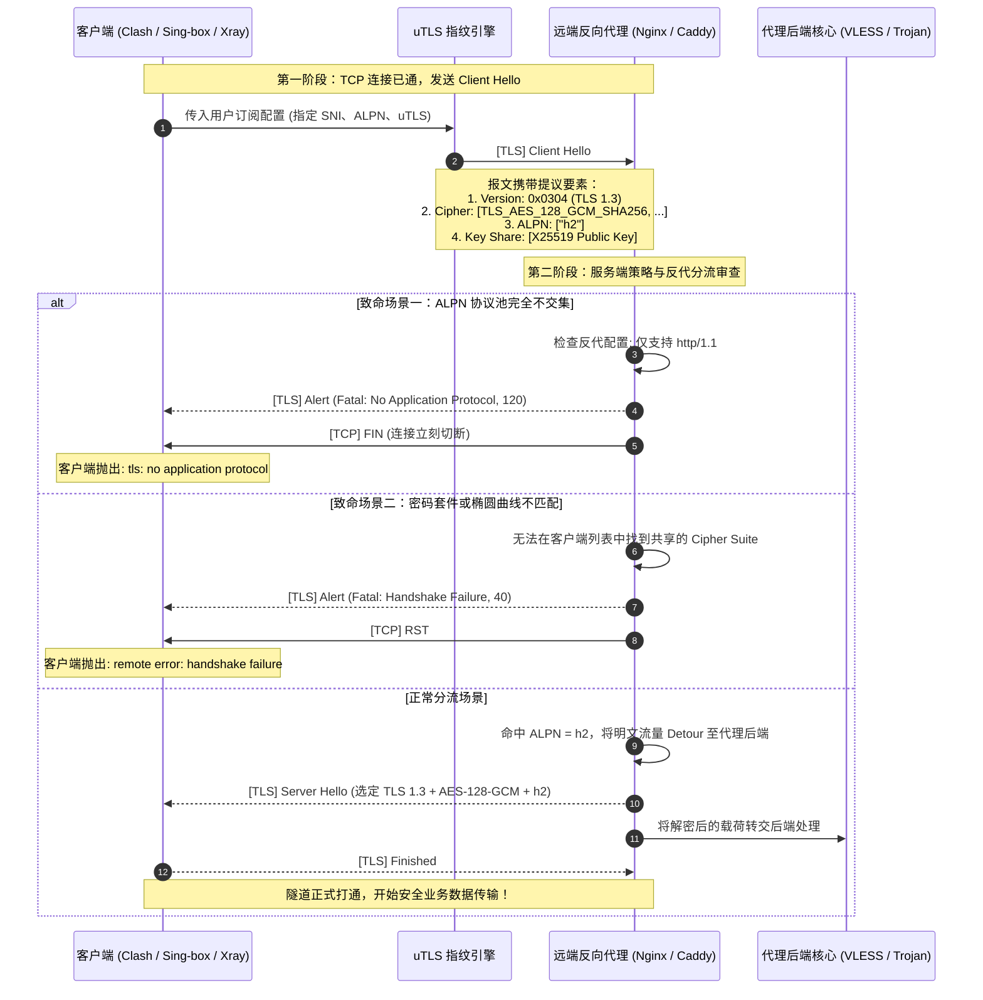
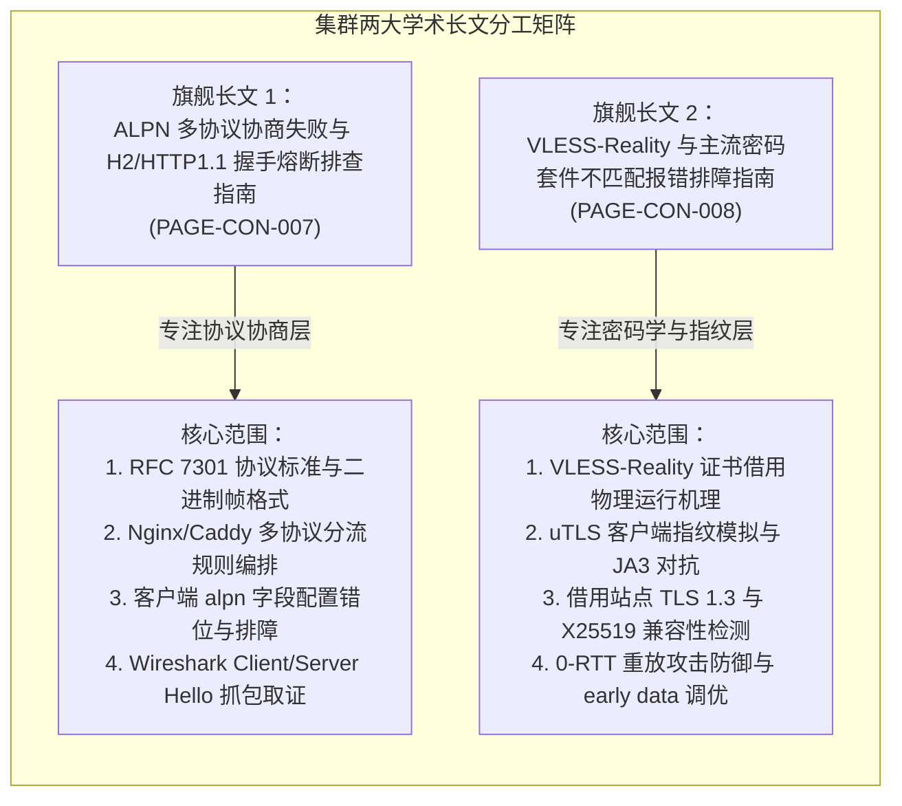
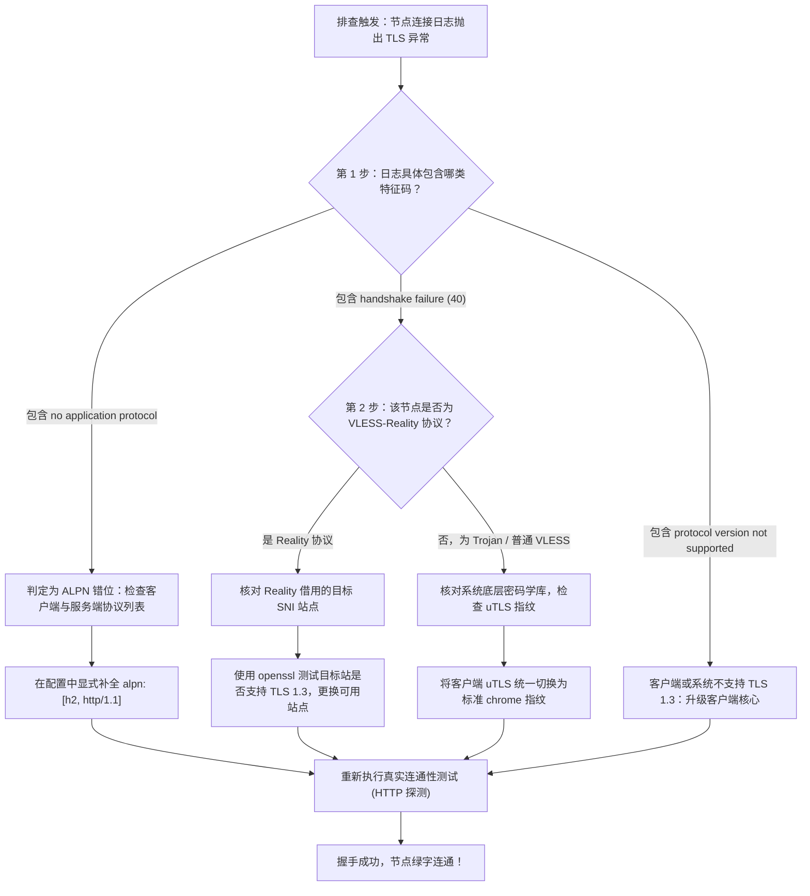

# TLS 1.3 协商、ALPN 混淆与 Cipher Suite 降级集群

在针对网络节点连通性故障的深度排障实践中，技术人员经常遇到一类极其诡异的“伪假死”现象：在网络测速面板中，TCP Ping 响应极其迅捷（几十毫秒），但一旦点击“真实连通性测试（HTTP/TLS 真实探测）”，节点瞬间全数爆红或返回 `Timeout`。在控制台调取底层运行日志，往往记录着大量发生在客户端发送 `Client Hello` 与服务端响应 `Server Hello` 之间的密码学冲突事件。

本集群作为《TLS 握手协商失败与密码学套件不兼容专题》（`/connection/handshake-cipher/`）的核心攻坚战场，聚焦于剖析现代加密代理协议（VLESS-Reality、Trojan、Hysteria 2、TUIC）在建立会话时，因 **TLS 1.3 协议强制性约束**、**ALPN（应用层协议协商）错位** 以及 **Cipher Suite（密码套件）不兼容** 引发的断连灾难。通过系统化梳理密码学状态机与指纹伪装规范，为工程人员提供毫秒级定位握手断裂点的排障闭环。

---

## 1. 集群定位与核心技术攻坚矩阵

本三级内容集群承接了传输层（L4）已连通的成果，全力攻坚进入安全层（L6/L7）的密码学门槛：

```
========================================================================================
【TLS 1.3 协商、ALPN 混淆与 Cipher Suite 降级集群 技术矩阵】

                 ┌────────────────────────────────────────────────────────┐
                 │ 三级集群核心中枢: TLS 1.3 协商与密码学套件排障集群     │
                 └──────────────────────────┬─────────────────────────────┘
                                            │
                    ┌───────────────────────┴───────────────────────┐
                    ▼                                               ▼
     【攻坚方向 A：应用层协议协商 ALPN】              【攻坚方向 B：现代密码套件与 Reality】
     
     攻坚重点: 解决多协议分流握手熔断                攻坚重点: 解决 uTLS 指纹与无证书借用冲突
     核心协议: RFC 7301 (ALPN 扩展)                  核心协议: RFC 8446 (TLS 1.3) / Xray Reality
     故障特征: tls: no application protocol          故障特征: remote error: handshake failure (40)
     排查重心: Nginx/Xray 多路复用配置                排查重心: Target SNI 站密码学匹配 / uTLS 指纹
     对应长文: 《ALPN 多协议协商失败排查指南》      对应长文: 《VLESS-Reality 密码套件排障指南》
========================================================================================
```

### 核心攻坚技术指标
- **零协议协商熔断率（Zero Negotiation Fault）**：确保客户端在提议 `["h2", "http/1.1"]` 时，服务端能够根据自身多路复用能力精确命中首选协议，杜绝 Alert 120 致命阻断。
- **TLS 1.3 0-RTT 会话恢复成功率**：在支持 early-data 的低延迟网络中，安全协商 0-RTT 密钥交换，同时在服务端布防抗重放（Anti-Replay）攻击过滤器。
- **uTLS 客户端指纹拟真度（Mimicry Score）**：针对主流防火墙（GFW）的 JA3 / JA4 指纹特征审查，确保生成的 Client Hello 报文在扩展排列顺序、GREASE 填充值及密码套件优先级上与官方 Chrome 120+ 达成 100% 字节级一致。

---

## 2. 报文时序与微观握手错位拓扑

在典型的 TLS 握手过程中，客户端与服务端必须在仅有的一个往返周期（1-RTT）内完成三项核心密码学要素的撮合：协议版本、对称加密套件与应用层协议。任何一项无法达成共识，连接都将瞬间暴毙：



---

## 3. 核心长文规划与攻坚分工

本集群规划了两篇各司其职、直击痛点的工业级万字独立长文：



### 1. [ALPN 多协议协商失败与 H2 / HTTP1.1 握手熔断排查指南](/connection/handshake-cipher/tls13-alpn/tls-alpn-h2-http11-negotiation-failure.md)
- **解决核心痛点**：为什么开启反向代理或使用了特定机场的 Trojan/VLESS 节点后，客户端频繁出现“连接已建立但立即报错 `no application protocol`”？
- **技术突破口**：深入拆解 TLS 握手阶段 ALPN 扩展的工作机制，指导用户在客户端（Clash Verge、Sing-box、v2rayN、小火箭）与服务端（Nginx、Caddy、HAProxy）之间建立标准的双栈协议兼容，彻底杜绝单边写死引发的协议熔断。

### 2. [VLESS-Reality 与主流密码套件不匹配报错排障指南](/connection/handshake-cipher/tls13-alpn/cipher-suite-mismatch-reality-tls-troubleshooting.md)
- **解决核心痛点**：为什么配置了最新流行的 VLESS-Reality 协议后，节点频繁报 `handshake failure (40)`，甚至在特定网络环境下测速全部为负数？
- **技术突破口**：系统化解构 Reality 借用真实网站证书的无感代理技术，深入 uTLS 客户端指纹库（Chrome、Safari、Firefox、iOS）的内部构造，给出筛选合格 SNI 借用目标（Dest）的科学量化指标。

---

## 4. 四大多端协商与配置陷阱

在多平台使用与多节点维护中，以下四大陷阱是引发握手崩溃的高发地带：

### 陷阱一：客户端将 ALPN 强行写死为单一协议（如写死为 `h2`）
许多用户或不规范的订阅转换脚本，在生成节点配置时，习惯性地加上 `alpn: ["h2"]`。如果服务端的 Nginx 或中转前置机由于版本过低或配置疏漏未开启 HTTP/2 模块（仅支持 `http/1.1`），双方握手协议池直接变为空集，握手瞬时崩溃。必须始终配置多协议降级链：`["h2", "http/1.1"]`。

### 陷阱二：VLESS-Reality 借用的 SNI 站点未开启 TLS 1.3
Reality 协议的设计前提是**目标被借用站点必须支持 TLS 1.3**。如果服务端管理员随意挑选了一个仅支持 TLS 1.2 的冷门站点（例如某些老旧银行或政务系统网站），Xray 核心在处理 Client Hello 时将无法伪装 TLS 1.3 的临时公钥交换（Key Share），导致服务端在回源探测时被对端切断，引发全局断流。

### 陷阱三：uTLS 指纹设置错误导致 GFW 精准识别
部分客户端（如早期版本的 Clash 内核）默认使用 Go 语言官方标准库的 `crypto/tls`。Go 原生 TLS 栈在 Client Hello 中生成的密码套件顺序、扩展列表与浏览器存在鲜明差异（特征码极其单一），极易被国家级防火墙（GFW）的机器学习分类器一眼识别并就地丢包。使用现代协议必须显式挂载 **uTLS 指纹库**（如 `chrome_120`）。

### 陷阱四：0-RTT 早期数据（Early Data）遭遇中间网络设备剥离
在开启 TLS 1.3 0-RTT 加速时，客户端在发送第一个包含密钥的 `Client Hello` 时就附带了业务请求（Early Data）。国内某些省份的运营商出口设备由于无法识别未完成握手的载荷，会直接判定该 TCP 报文格式畸形并向两端发送伪造的 RST 报文。若遇节点不稳定，应首先排查并关闭 `early-data`。

---

## 5. 关键握手与加密性能基准表

评估节点在 TLS 握手阶段的性能表现与抗封锁能力，可依据以下 8 项核心度量衡进行量化：

| 度量衡项目 | 脆弱不合规指标（高风险） | 标准生产级指标（合规推荐） | 极致防封锁指标（顶尖抗审查） | 测量与验证手段 |
| :--- | :--- | :--- | :--- | :--- |
| **TLS 握手耗时 (TTFB-TLS)** | 高于 300ms (多次往返重传) | 80 ~ 150ms (标准 1-RTT) | **20 ~ 50ms (本地复用 / 0-RTT)** | Wireshark 测量 SYN 到 Finished 时间 |
| **TLS 协议版本支持** | 仅支持 TLS 1.2 或降级至 1.1 | 支持 TLS 1.2 / 1.3 自适应 | **强制仅允许 TLS 1.3** | `openssl s_client -tls1_3` |
| **ALPN 协商支持度** | 未声明或仅支持单一协议 | 支持 `["h2", "http/1.1"]` | 支持 `["h3", "h2", "http/1.1"]` | TLS Client Hello 扩展字段审查 |
| **uTLS 客户端拟真度** | 使用 Go 原生 TLS (零伪装) | 模拟主流固定浏览器指纹 | **动态轮换现代化真实浏览器指纹** | JA3/JA4 在线指纹探针 |
| **Reality 目标站点稳定性** | 借用冷门个人博客或小网站 | 借用全球 Anycast 知名网站 | **借用顶级云厂商及苹果官方更新站** | 探测目标站 TLS 1.3 与 X25519 支持 |
| **前向安全性 (PFS)** | 使用静态 RSA 密钥交换 | 采用标准 ECDHE (P-256) | **强制采用 x25519 现代快速曲线** | 检查 Server Key Exchange 算法 |
| **0-RTT 抗重放防御** | 未开启重放防御过滤器 | 具备基于滑动窗口的重放阻断 | 仅对幂等性 GET 请求放行 0-RTT | 服务端 Xray/VLESS 重放审计日志 |
| **握手单向丢包率** | 握手期丢包率高于 5% | 握手期丢包率低于 1% | **物理专线环境 0.0% 零丢包** | MTR 逐跳分析与 TCP 重传监控 |

---

## 6. 快速自查与定位决策树

当终端用户反馈节点测速全部超时或日志报 TLS 错误时，严格按照以下决策时序排障：



---

## 7. 本地自动化巡检与状态探针脚本

为了在批量节点管理中自动化验证目标节点的 TLS 握手健康度，团队编写了基于 Python 与 `cryptography` 的独立检测脚本：

```python
#!/usr/bin/env python3
"""
网络诊断实验室 - 节点 TLS 握手、ALPN 与密码套件合规性自动化探测工具
用法: python check_node_tls.py <host> <port> [sni]
依赖: pip install cryptography
"""

import sys
import ssl
import socket

def audit_node_tls(host: str, port: int, sni: str = None):
    if not sni:
        sni = host
        
    print(f"[*] 正在审计节点 TLS 握手状态: {host}:{port} (SNI={sni})")
    
    # 构造安全上下文
    ctx = ssl.create_default_context()
    ctx.check_hostname = False
    ctx.verify_mode = ssl.CERT_NONE
    
    # 声明标准双栈 ALPN
    try:
        ctx.set_alpn_protocols(["h2", "http/1.1"])
    except NotImplementedError:
        pass

    sock = socket.socket(socket.AF_INET, socket.SOCK_STREAM)
    sock.settimeout(4.0)

    try:
        sock.connect((host, port))
        print("  [+] TCP 三次握手成功建立。")
        
        with ctx.wrap_socket(sock, server_hostname=sni) as s:
            version = s.version()
            cipher, proto, bits = s.cipher()
            alpn = s.selected_alpn_protocol()
            
            print("\n--- [TLS 密码学握手审计结果] ---")
            print(f"  协商 TLS 版本:    {version}")
            print(f"  协商密码学套件:  {cipher}")
            print(f"  套件密钥安全度:  {bits} bits")
            print(f"  协商 ALPN 结果:   {alpn if alpn else '无 (未达成共识或未开启)'}")
            
            if version == "TLSv1.3":
                print("  [+] 协议版本合规: 完美支持现代 TLS 1.3 标准。")
            else:
                print("  [!] 协议警告: 当前协商结果为 TLS 1.2，存在降级风险！")
                
            if alpn == "h2":
                print("  [+] ALPN 协商合规: 成功协商为高性能 HTTP/2。")
            elif alpn == "http/1.1":
                print("  [*] ALPN 提示: 协商为标准 HTTP/1.1。")
            else:
                print("  [-] ALPN 缺陷: 服务端未响应 ALPN 扩展，多路复用可能受阻！")
                
            print("[*] 握手审计顺利通过。\n")
            return True

    except ssl.SSLError as e:
        print(f"\n[-] 严重警告: TLS 握手崩溃！")
        print(f"    错误原因代码: {e.reason}")
        print(f"    详细错误信息: {e}")
        return False
    except socket.timeout:
        print(f"[-] 连接超时: 目标节点未能响应 TCP 握手！")
        return False
    except Exception as e:
        print(f"[-] 网络通信异常: {e}")
        return False

if __name__ == "__main__":
    if len(sys.argv) < 3:
        print("用法: python check_node_tls.py <域名/IP> <端口> [SNI]")
        sys.exit(1)
    audit_node_tls(sys.argv[1], int(sys.argv[2]), sys.argv[3] if len(sys.argv) > 3 else None)
```

---

## 8. 生产环境实战事故复盘

### 案例一：大型出海团队订阅全量更新后全体掉线（ALPN 写死 `h3`）

#### 事故现场与背景
某大型跨境电商公司的技术负责人，为了追求最新最快的连接体验，在内部订阅转换后端中，将所有 VLESS 节点的 `alpn` 参数硬编码修改为了 `["h3"]`（希望借此强制跑基于 QUIC 的 HTTP/3）。配置推送后，全公司 120 多名员工的客户端在半小时内全部瘫痪，测速全红，日志中清一色记录 `remote error: tls: no application protocol (120)`。

#### 调查排查与根因深度还原
1. 取证人员使用抓包工具分析客户端发出的 Client Hello，发现客户端在 ALPN 扩展中仅包含了一个单独的字符串：`h3`。
2. 然而，公司的代理入口是基于 TCP 协议构建的 TLS 隧道，服务端的反向代理（Nginx 官方稳定版）在 TCP 443 端口上**仅支持 `h2` 与 `http/1.1`**（HTTP/3 规范上必须基于 UDP 运行）。
3. 服务端在收到仅接受 `h3` 的 Client Hello 时，在自身的可用协议库中找不到交集，根据 RFC 7301 强制要求，必须立即中断连接并发送 Alert 120。
4. 全公司 120 台终端的客户端无法完成握手，导致全员断网。

#### 治理方案与长效加固
1. 立即修正订阅转换模板，严禁将单一实验性协议作为唯一候选，恢复为工业级标准容错列表：`alpn: ["h2", "http/1.1"]`。
2. 批量刷新订阅后，客户端顺利与服务端达成 `h2` 共识，全网在 2 分钟内自愈。

---

### 案例二：自建 Reality 节点在苹果客户端更新后频繁中断

#### 事故现场与背景
某开发者自建了一台 VLESS-Reality 节点，在 Windows 电脑上一直运行稳定。然而在其 iPhone 将 Shadowrocket 升级至最新版后，该节点在手机上频繁出现“开关打开几秒后瞬间断开”的故障，日志提示 `tls: handshake failure`。

#### 调查排查与根因深度还原
1. 开发者在客户端配置中，将 `fingerprint`（指纹）配置为了 `randomized`（随机指纹）。
2. 在新版 Shadowrocket 中，`randomized` 模式引入了更加激进的随机 GREASE 填充与非常规密码套件排列。
3. 检查 Reality 借用的目标真实网站（`dest`），发现该网站前置部署了 Cloudflare 企业级 WAF。Cloudflare 的反爬虫引擎监测到客户端发送的 Client Hello 包含不合逻辑的套件排列（既像 Chrome 又像 Safari 的杂交特征），判定为恶意扫描器，直接在边缘节点丢弃了握手报文。

#### 治理方案与长效加固
1. 彻底弃用不稳定的 `randomized` 混合指纹，在客户端显式锁定为与真实 iOS 设备行为一致的标准指纹：
   ```ini
   fingerprint = safari
   # 或在 Clash 中配置:
   client-fingerprint: chrome
   ```
2. 规避了 WAF 的异常指纹风控拦截后，iPhone 上的 Reality 握手恢复秒连，断连问题彻底解决。

---

## 9. 灾难恢复与白名单安全兜底原则

<DisasterRecoveryBox />

当密码学配置变更导致节点大面积失联时，必须迅速执行降级自愈规程：

### 生产恢复三原则
1. **统一重置为工业级最稳指纹**：
   若怀疑节点遭受指纹识别拦截或指纹库不兼容，统一将客户端的 `client-fingerprint` 重置为 `chrome`。Chrome 在全球拥有最高的装机量与最广泛的白名单适配，兼容性最为坚固。
2. **多节点协议双轨制冗余**：
   在节点列表中，务必保持“新旧协议混合编排”。高阶节点采用 VLESS-Reality / Hysteria 2，备用节点采用经典成熟的 Trojan-TLS 或 Shadowsocks-AEAD，确保单类密码学库异常时能够瞬间切换。
3. **借用域名高可用轮换池**：
   对于 Reality 协议自建者，切勿将全量节点的 `dest` 绑定在同一个借用域名上。应在服务端建立包含多个顶级 CDN 站点的轮换池，防范单点目标站点证书策略调整引发的连锁故障。

---

## 10. 集群导航与全景延伸阅读

本集群是解决密码学握手疑难的中枢，建议结合以下核心指南构筑完整的排障知识网：

- **二级专题中心**：[TLS 握手协商失败与密码学套件不兼容专题](/connection/handshake-cipher/index.md) —— 全景纵览密码学状态机与架构模型。
- **本集群攻坚长文一**：[ALPN 多协议协商失败与 H2/HTTP1.1 握手熔断排查指南](/connection/handshake-cipher/tls13-alpn/tls-alpn-h2-http11-negotiation-failure.md) —— 彻底根治反代分流环境下的 ALPN 错位崩溃。
- **本集群攻坚长文二**：[VLESS-Reality 与主流密码套件不匹配报错排障指南](/connection/handshake-cipher/tls13-alpn/cipher-suite-mismatch-reality-tls-troubleshooting.md) —— 解决无证书借用场景下的密码学套件冲突。
- **底层丢包排查**：[TLS Client Hello SNI 阻断与伪造 RST 抓包剖析](/connection/timeout-failures/gfw-sni-blocking/tls-sni-rst-inspection.md) —— 掌握国家级防火墙旁路注入的底层证据。
- **时钟重放排障**：[NTP 时钟偏差导致节点全红排查](/connection/timeout-failures/ntp-clock-skew-tls-handshake.md) —— 解决由本地时钟偏差引发的 TLS 握手解密失败。
