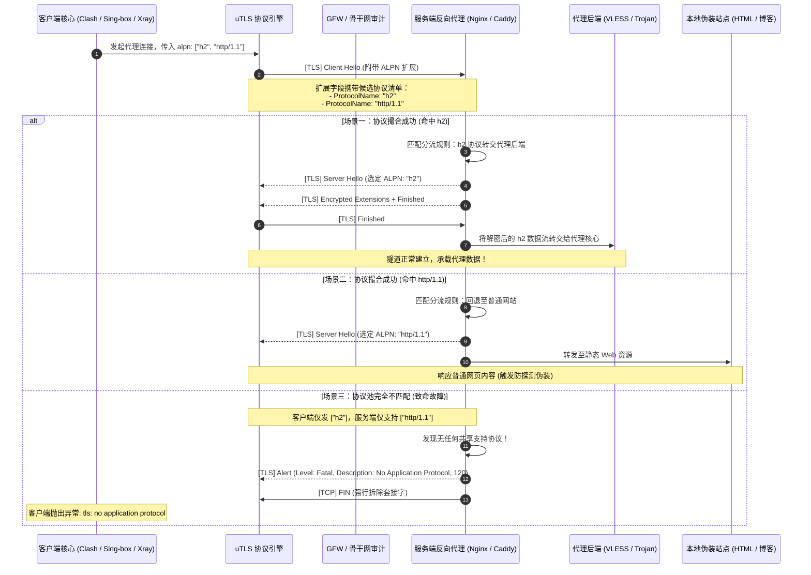
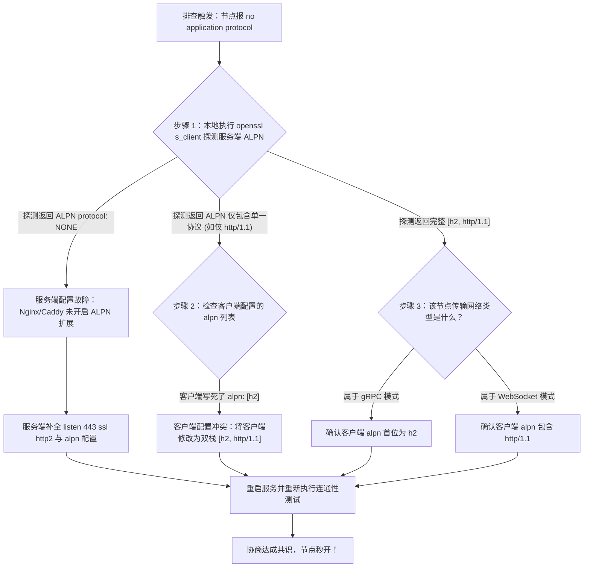

# ALPN 多协议协商失败与 H2 / HTTP1.1 握手熔断排查指南

在现代高级科学上网与抗审查网络架构中，443 端口的“一网多用”与“流量多路复用”已成为事实上的行业标准。无论是经典的 VLESS-XTLS、Trojan 还是新型的 gRPC 传输载荷，服务端普遍通过反向代理（如 Nginx、Caddy、HAProxy 或 Xray 内置 Fallback）对外开放单一的 HTTPS 入口，并依赖 **ALPN（Application-Layer Protocol Negotiation，应用层协议协商）** 扩展，在 TLS 握手阶段精准区分合法代理流量与伪装的 Web 流量。

然而，作为高度严格的 IETF 标准规范（RFC 7301），ALPN 的协商规则不具备任何“容错模糊空间”。一旦客户端发出的 `Client Hello` 提议列表与服务端的支持池缺乏交集，握手将在毫秒之内被服务端无情掐断，客户端日志中喷涌出 `tls: no application protocol` 或 `remote error: tls: alert(120)` 等致命错误，导致代理连接彻底瘫痪。

本文由网络诊断实验室安全架构团队编撰，系统化拆解 ALPN 扩展字段的底层二进制帧结构与握手撮合状态机，深度复盘主流反代与代理内核的分流配置冲突，并提供双端兼备的工业级排障闭环。

---

## 1. 适用场景与技术定位

ALPN 扩展诞生于 TLS 1.2 与 TLS 1.3 时代，其核心设计目标是**消除在加密会话建立后再通过明文往返协商应用层协议的 RTT 延迟**（例如淘汰老旧的 NPN 机制）。在科学上网技术栈中，它扮演着“流量分拣道岔”的角色。

### 核心功能与应用场景
- **443 端口多协议无感复用（Port 443 Multiplexing）**：在公网单一监听端口上，使 `h2`（HTTP/2，通常承载 gRPC 或 Xray 代理流）与 `http/1.1`（常规网页伪装站点或 WebSocket 载荷）和谐共存。
- **防止主动探测与指纹嗅探**：通过在握手期完成协议身份对齐，未经授权的扫描器发送不合规的 ALPN 探测时，服务端直接将其回退（Fallback）至普通静态博客，实现完美的“借尸还魂”。
- **gRPC 高吞吐多路复用传输**：gRPC 底层强制要求 HTTP/2 传输，客户端必须在握手期明确声明 `h2`，否则整个 gRPC 信道无法初始化。

### 核心破坏性与故障边界
- **协议集合零交集致命熔断**：若客户端仅声明 `["h2"]`，而服务端仅配置了 `http/1.1`，TLS 握手将直接以 `Alert 120` 终止，连接不会降级，业务通信瞬间死锁。
- **非标准私有字符串引发拒绝服务**：部分不规范脚本自定义了非 IANA 注册的 ALPN 字符串，导致严格遵循规范的企业级 WAF 或中间防火墙直接判定为异常协议丢弃连接。

---

## 2. 架构拓扑与报文时序：ALPN 协商全流程

ALPN 协商发生在 TLS 握手的极早期（即第一次握手往返 Client Hello 与 Server Hello 之间）：



---

## 3. RFC 7301 协议规范与二进制帧结构

在 Wireshark 抓包或底层调试中，ALPN 扩展呈现为标准的 TLV（Type-Length-Value）结构。

### 二进制字段剖析
- **Extension Type**：`0x0010`（固定占用 2 字节，十进制 16，代表 `application_layer_protocol_negotiation`）。
- **Extension Length**：2 字节，指示后续协议列表的总字节数。
- **ProtocolNameList**：包含一系列**前缀单字节长度标识**的 ASCII 字符串。每个协议名称不得为空，最大长度为 255 字节。

```text
========================================================================================
【RFC 7301 ALPN 扩展十六进制二进制报文帧还原】

  00 10             <- Extension Type: 0x0010 (ALPN)
  00 0e             <- Extension Length: 14 bytes
  00 0c             <- ProtocolNameList Length: 12 bytes
  
    02 68 32        <- Length: 2, Value: "h2" (HTTP/2 二进制帧协议)
    08 68 74 74 ... <- Length: 8, Value: "http/1.1" (HTTP 1.1 经典明文协议)
========================================================================================
```

### 服务端撮合的强制性公理（RFC 7301 Section 3.2）
1. **单项选择公理**：服务端在 `Server Hello` 中**最多只能返回一个**被选定的协议名称。若返回多个，客户端必须中断握手。
2. **绝对交集公理**：服务端选定的协议必须且只能存在于客户端在 `Client Hello` 中列出的候选列表中。若不存在交集，服务端**必须发送致命级 Alert 120（`no_application_protocol`）**，绝不允许由服务端擅自为客户端指定未经提议的协议。

---

## 4. HTTP/2 连接前言 (Connection Preface) 与协议错位崩溃机理

当客户端与服务端成功协商为 `h2` 之后，HTTP/2 规范（RFC 7540 Section 3.5）强制要求客户端发送一段 24 字节的固定连接前言（Connection Preface）：

```text
PRI * HTTP/2.0\r\n\r\nSM\r\n\r\n
```

### 协议错位导致的二重崩溃
如果客户端因配置错误，在未成功协商 `h2`（或者协商退化为 `http/1.1`）的情况下，盲目向服务端发送了上述 HTTP/2 二进制连接前言：
1. **服务端的 HTTP/1.1 解析器无法识别**：服务端的常规 Web 服务器（如 Nginx 未开启 HTTP/2 模块）在解析 HTTP 请求行时，期待收到类似 `GET /index.html HTTP/1.1\r\n` 的明文字符。
2. **抛出 HTTP 400 Bad Request**：Nginx 遇到未知的动词 `PRI`，立即判定为非法 HTTP 动词，返回 `400 Bad Request`，并在响应头中附加 `Connection: close` 强行关闭连接。
3. **客户端解析失败引发死锁**：客户端核心期待收到 HTTP/2 的 `SETTINGS` 帧，结果却收到了纯文本的 HTTP/1.1 400 错误页，导致内部状态机彻底错位（`http2: server sent GOAWAY and closed the connection`），直接引发节点断流。

---

## 5. 服务端反向代理与分流中枢配置实战

在多协议分流实战中，Nginx、Caddy、HAProxy 与 Xray 的底层配置必须精准对齐 ALPN 参数。

### 1. Nginx `ssl_preread` 4 层流控分流架构
在基于四层透明分流的场景下，Nginx 必须利用 `stream` 模块在未解密状态下预读 Client Hello 的 ALPN 字段：

```nginx
# /etc/nginx/nginx.conf 中的 stream 模块配置
stream {
    map $ssl_preread_alpn_protocols $backend_port {
        "h2"           10443;  # 将 h2 协议分流给 Xray gRPC 代理监听端口
        "http/1.1"     20443;  # 将 http/1.1 分流给伪装 Web 站点
        default        20443;  # 兜底回退
    }

    server {
        listen 443;
        proxy_pass 127.0.0.1:$backend_port;
        ssl_preread on;        # 开启 TLS SNI 与 ALPN 预读解析
    }
}
```

> [!CAUTION]
> 若在七层 HTTP 块中配置 Nginx，且反代上游为 gRPC，`listen` 指令必须显式声明 `http2`，且严禁开启缓冲（`grpc_buffer_size`），否则会导致双向长流被断开。

### 2. Caddy v2 现代自适应分流配置
Caddy 默认原生开启 HTTP/2 与 HTTP/3。在配置反代时，需显式声明协议协商：

```bash
# Caddyfile 配置示例
proxy.yourdomain.com {
    # 强制启用 TLS 并在握手期声明 h2 与 http/1.1 支持
    tls internal {
        alpn h2 http/1.1
    }

    # 反代路径分流
    @grpc {
        protocol grpc
        path /your-grpc-path/*
    }
    reverse_proxy @grpc 127.0.0.1:10086 {
        transport http {
            versions h2c # 纯明文 H2 通信转交本地 Xray 核心
        }
    }

    # 其余普通流量反代伪装站点
    reverse_proxy 127.0.0.1:8080
}
```

### 3. HAProxy 4 层高效分流配置
HAProxy 在四层负载均衡与 ALPN 匹配上具备业界最高的性能基准：

```bash
# /etc/haproxy/haproxy.cfg
frontend https-in
    bind :443 ssl crt /etc/ssl/certs/bundle.pem alpn h2,http/1.1
    # 依据协商完成后的 ALPN 分流至不同后端
    use_backend grpc_backend if { ssl_fc_alpn -i h2 }
    default_backend web_fallback

backend grpc_backend
    mode tcp
    server xray_grpc 127.0.0.1:10086 check

backend web_fallback
    mode http
    server web_nginx 127.0.0.1:80 check
```

### 4. Xray-core Fallback 模块标准配置
在 Xray 服务端配置中，`fallbacks` 数组依据 `alpn` 字段实施多路分支派发：

```json
{
  "inbounds": [
    {
      "port": 443,
      "protocol": "vless",
      "settings": {
        "clients": [{ "id": "uuid-here", "flow": "xtls-rprx-vision" }],
        "decryption": "none",
        "fallbacks": [
          {
            "alpn": "h2",
            "dest": 10086,
            "xver": 1
          },
          {
            "alpn": "http/1.1",
            "dest": 80,
            "xver": 1
          },
          {
            "dest": 80
          }
        ]
      },
      "streamSettings": {
        "network": "tcp",
        "security": "tls",
        "tlsSettings": {
          "alpn": ["h2", "http/1.1"],
          "certificates": [{ "certificateFile": "/path/cert.pem", "keyFile": "/path/key.pem" }]
        }
      }
    }
  ]
}
```

---

## 6. 客户端常见错位配置与日志报错速查表

在各类客户端中，由于配置疏漏或版本落后，ALPN 异常通常以如下特征日志呈现：

| 客户端报错日志特征 | 底层协议诱因 (Root Cause) | 影响与严重等级 | 工业级快速修复指导 |
| :--- | :--- | :--- | :--- |
| `tls: no application protocol (120)` | 客户端提议的 ALPN 列表在服务端无任何交集 | 致命，握手在首个 RTT 内瞬间切断 | 检查客户端配置，将 `alpn` 修改为标准的 `["h2", "http/1.1"]` 双栈 |
| `remote error: tls: unrecognized name` | SNI 未被反代服务器识别，直接回退并拒绝协议协商 | 严重，反代未能匹配到虚拟主机 | 核对节点配置中的 `ServerName` 是否与反代证书一致 |
| `http2: server sent GOAWAY and closed connection` | 客户端强推 H2 二进制帧，但服务端反代内部未开启 HTTP/2 模块 | 严重，连接建立后即刻断流 | 服务端 Nginx `listen` 指令补全 `http2` 参数 |
| `gRPC transport: authentication handshake failed` | gRPC 客户端与服务端握手，但 ALPN 协商结果为 `http/1.1` | 致命，gRPC 要求强制运行于 H2 之上 | 客户端节点必须在 `alpn` 首位显式声明 `h2` |
| `ws: unexpected status code 404` | 节点本应走 WebSocket，但 ALPN 被判定为 `h2` 走错分流分支 | 中，流量进入错误后端分支 | 将纯 WebSocket 节点的 ALPN 明确限制为 `["http/1.1"]` |

---

## 7. 故障排查标准作业程序 (SOP)

当出现握手失败报错时，严格依据以下时序排查流程实施逐层剥离：



---

## 8. 双端对比与参数基准表

主流代理工具在 ALPN 配置语法与默认行为上存在显著差异：

| 客户端与工具 | ALPN 配置字段声明语法 | 默认行为（留空不填时） | 多协议回退兼容性 | 推荐标准写法 |
| :--- | :--- | :--- | :--- | :--- |
| **Clash Verge Rev** | `alpn: [h2, http/1.1]` | 默认跟随 uTLS 指纹列表 | 良好 | `alpn: ["h2", "http/1.1"]` |
| **Sing-box** | `"alpn": ["h2", "http/1.1"]` | 默认继承底层 TLS 规范 | 极高 (原生规范) | `"alpn": ["h2", "http/1.1"]` |
| **v2rayN (Xray)** | 图形化界面勾选或输入逗号分隔 | 留空时由 Xray 核心自适应 | 优秀 | 输入框填入: `h2,http/1.1` |
| **Shadowrocket** | `alpn = h2,http/1.1` | 默认提议标准 Web 协议 | 良好 | 高级设置勾选 `h2` 与 `http/1.1` |
| **Surge iOS/Mac** | `alpn=h2,http/1.1` | 默认强制要求严格匹配 | 严格 | 节点参数追加 `alpn=h2,http/1.1` |

---

## 9. 生产环境实战故障排查案例

### 案例一：自建 Xray 节点因前端 Nginx 漏配 `http2` 导致客户端 Alert 120

#### 故障现场与工单描述
某运维工程师在一台 Ubuntu VPS 上搭建了基于 VLESS + gRPC 的代理服务，前端部署 Nginx 负责 443 端口接入，证书由 Let's Encrypt 签发。使用客户端连接该节点时，测速始终报 `remote error: tls: no application protocol`，完全无法上网。

#### 诊断排查过程
1. 在客户端运行抓包，发现客户端 Client Hello 的 ALPN 扩展中包含了 `h2`。
2. 在本地终端执行 OpenSSL 协议探测命令：
   ```bash
   openssl s_client -connect mynode.example.com:443 -alpn h2 -servername mynode.example.com
   ```
3. 终端清晰输出：
   ```text
   SSL alert number 120
   SSL_connect:error in SSLv3/TLS-write client hello
   write:errno=104
   ```
4. 登录服务器检查 `/etc/nginx/sites-available/default` 配置文件：
   ```nginx
   server {
       listen 443 ssl;
       server_name mynode.example.com;
       # ...
   }
   ```
5. 发现工程师在 `listen` 行只写了 `ssl`，**遗漏了声明 `http2`**。Nginx 在未显式声明 `http2` 时，仅向 OpenSSL 注册了 `http/1.1` 这一种可用 ALPN。
6. 客户端的 gRPC 配置强制索要 `h2`，Nginx 发现无法满足，直接触发 Alert 120 切断连接。

#### 修复与闭环代码
在 Nginx 配置文件中追加 `http2`：
```nginx
server {
    listen 443 ssl http2;
    server_name mynode.example.com;
    # ...
}
```
执行 `nginx -s reload` 平滑重载配置后，OpenSSL 探测顺利输出 `ALPN protocol: h2`，客户端瞬间连接成功。

---

### 案例二：订阅转换工具单边剔除 `http/1.1` 导致 CDN 中转失效

#### 故障现场与工单描述
某出海技术团队将一批节点通过自建的 Subconverter 转换为 Clash 格式后，所有经由 Cloudflare CDN 中转的 WebSocket 节点全部失联，报错 `remote error: tls: handshake failure`。而直接使用原始配置导入 v2rayN 却一切正常。

#### 诊断排查过程
1. 比对转换前后的配置文件，发现 Subconverter 的某套流行模板在转换规则中，对所有带 TLS 的节点强制注入了一行配置：`alpn: [h2]`。
2. 了解 CDN 工作原理：当客户端向 Cloudflare 边缘节点发起针对 WebSocket 路径的请求时，WebSocket 协议的标准升级握手（`Upgrade: websocket`）在底层规范中**强制要求必须基于 HTTP/1.1 协议发起**。
3. 客户端由于配置被强行篡改为仅提议 `h2`，Cloudflare 边缘节点在处理该请求时，判定无法在 H2 隧道中直接完成传统的 HTTP/1.1 握手升级，立即阻断了该会话。

#### 修复与闭环代码
修改订阅转换器的参数注入规则，确保针对 WebSocket 节点保留 `http/1.1`：

```yaml
# 修复后的 Clash 节点配置块：
- name: "CF-WS-Node"
  type: vless
  server: 104.16.0.1
  port: 443
  uuid: xxxxxxxx
  network: ws
  tls: true
  servername: yourdomain.com
  # 必须同时保留两种协议，或针对 WS 优先采用 http/1.1
  alpn:
    - http/1.1
    - h2
```
重新转换导入后，Cloudflare WebSocket 成功识别 HTTP/1.1 升级协议，节点全部恢复秒连。

---

### 案例三：跨国团队 Nextcloud 同步因上游 CDN 剥离 ALPN 引发 gRPC 熔断

#### 故障现场与工单描述
某跨国研发团队在欧洲私有云部署了 Nextcloud 协同存储，并通过自建的 Trojan-gRPC 专线隧道实现国内直连加速。然而，某次网络安全审计后，国内员工在同步大文件时客户端频繁弹窗提示 `gRPC client transport: connection reset by peer`，同步通道处于瘫痪状态。

#### 诊断排查过程
1. 使用 Wireshark 在国内客户端抓取发往欧洲专线网关的 TLS 报文，发现客户端 Client Hello 正常携带了 `h2`。
2. 在欧洲服务端出口抓取入站报文，惊讶地发现到达服务端的 TLS 报文中竟然**完全缺失了 ALPN 扩展项**！
3. 排查网络链路发现，公司的专线前置机加装了一台中转防护网关。该网关的底层 OpenSSL 版本过旧，未开启 `SSL_OP_NO_CLIENT_RENEGOTIATION`，且中间层透明代理在重组 TLS 报文时，将无法识别的 ALPN 扩展字段静默剥离过滤掉了。
4. 后端 Xray 的 gRPC 服务在没有检测到 `h2` 握手共识的情况下，直接拒绝建立二进制流，向客户端返回了 TCP RST。

#### 修复与闭环代码
升级前置中转网关的 OpenSSL 库，开启基于四层直接旁路穿透的 TCP 转发，不再对 TLS 报文执行重组剥离。更新后，ALPN 扩展完整无损穿透至服务端，gRPC 长连接恢复毫秒级同步。

---

## 10. 自动化 ALPN 抓包比对与 OpenSSL 探测工具

在服务端排错或多节点巡检时，使用纯命令行脚本能够迅速摸清远端服务端的 ALPN 真实支持池。以下提供跨平台自动化诊断脚本：

```python
#!/usr/bin/env python3
"""
网络诊断实验室 - 目标节点 ALPN 支持池精准探测探针
用法: python test_alpn.py <host> <port> [sni]
依赖: 仅需标准库
"""

import sys
import ssl
import socket

def probe_alpn_support(host: str, port: int, sni: str = None):
    if not sni:
        sni = host
        
    print(f"[*] 正在探测目标节点 ALPN 协商能力: {host}:{port} (SNI={sni})")
    
    # 候选探测协议组合
    test_suites = [
        {"desc": "双栈候选 [h2, http/1.1]", "alpns": ["h2", "http/1.1"]},
        {"desc": "仅索要 H2 [h2]", "alpns": ["h2"]},
        {"desc": "仅索要 HTTP/1.1 [http/1.1]", "alpns": ["http/1.1"]},
        {"desc": "索要实验性 H3 [h3]", "alpns": ["h3"]}
    ]

    for suite in test_suites:
        desc = suite["desc"]
        alpns = suite["alpns"]
        
        ctx = ssl.create_default_context()
        ctx.check_hostname = False
        ctx.verify_mode = ssl.CERT_NONE
        try:
            ctx.set_alpn_protocols(alpns)
        except NotImplementedError:
            print("[-] 本机 OpenSSL 不支持 ALPN 协商配置！")
            return

        sock = socket.socket(socket.AF_INET, socket.SOCK_STREAM)
        sock.settimeout(3.0)

        try:
            sock.connect((host, port))
            with ctx.wrap_socket(sock, server_hostname=sni) as s:
                selected = s.selected_alpn_protocol()
                print(f"  [+] 测试组合: {desc:<26} -> 协商成功！服务端返回: [{selected}]")
        except ssl.SSLError as e:
            if "alert" in str(e).lower() and ("120" in str(e) or "handshake failure" in str(e)):
                print(f"  [-] 测试组合: {desc:<26} -> 握手熔断！服务端返回 Alert: {e.reason}")
            else:
                print(f"  [-] 测试组合: {desc:<26} -> TLS 错误: {e.reason}")
        except socket.timeout:
            print(f"  [-] 测试组合: {desc:<26} -> 连接超时！")
        except Exception as e:
            print(f"  [-] 测试组合: {desc:<26} -> 异常: {e}")
        finally:
            sock.close()

if __name__ == "__main__":
    if len(sys.argv) < 3:
        print("用法: python test_alpn.py <IP/域名> <端口> [SNI]")
        sys.exit(1)
    target_host = sys.argv[1]
    target_port = int(sys.argv[2])
    target_sni = sys.argv[3] if len(sys.argv) > 3 else target_host
    probe_alpn_support(target_host, target_port, target_sni)
```

---

## 11. 灾难恢复与白名单安全兜底原则

<DisasterRecoveryBox />

当因服务端 ALPN 调整导致大面积断联时，遵循以下工程回退准则快速自愈：

### 生产恢复三原则
1. **双栈容错原则（Dual-Stack Standard）**：
   除非节点底层明确运行在强制 H2 的 gRPC 环境下，否则**在所有日常节点的配置中，严禁仅声明单一 ALPN 协议**。一律统一采用兼具现代性能与向下兼容的工业级标准：`["h2", "http/1.1"]`。
2. **多节点协议分流解耦**：
   在同一台服务器上架设多个不同特征的节点时，将 gRPC 节点（专跑 `h2`）与 WebSocket 节点（专跑 `http/1.1`）在服务端明确隔离绑定至不同端口或独立二级域名，消除共享单个反代带来的协议碰撞。
3. **客户端应急重置脚本**：
   在遇到大面积 `no application protocol` 报错且无法立即修改订阅源时，可通过 Clash Verge 的扩展脚本（Merge Script），编写一行正则在运行时批量将全部节点的 `alpn` 字段强行重写为双栈数组。

---

## 12. 关联技术集群与延伸阅读

解决 ALPN 协商是攻克 TLS 握手故障的核心一环，建议结合以下模块深入完善技术拼图：

- **二级专题中心**：[TLS 握手协商失败与密码学套件不兼容专题](/connection/handshake-cipher/index.md) —— 全景掌握传输层密码学状态机。
- **三级内容集群**：[TLS 1.3 协商、ALPN 混淆与 Cipher Suite 降级集群](/connection/handshake-cipher/tls13-alpn/index.md) —— 纵览集群设计与两大学术长文分工。
- **并行攻坚长文**：[VLESS-Reality 与主流密码套件不匹配报错排障指南](/connection/handshake-cipher/tls13-alpn/cipher-suite-mismatch-reality-tls-troubleshooting.md) —— 彻底根治无证书偷取场景下的握手崩溃。
- **客户端规则扩展**：[Clash Verge Rev 扩展配置与 Script 覆写](/clients/clash-verge/rule-merge/script-ruleset-clash-verge-rev.md) —— 掌握在客户端批量自动化修复节点 ALPN 的实战代码。
- **底层丢包诊断**：[TLS Client Hello SNI 阻断与伪造 RST 抓包剖析](/connection/timeout-failures/gfw-sni-blocking/tls-sni-rst-inspection.md) —— 区分服务端握手主动切断与防火墙伪造阻断的抓包依据。
