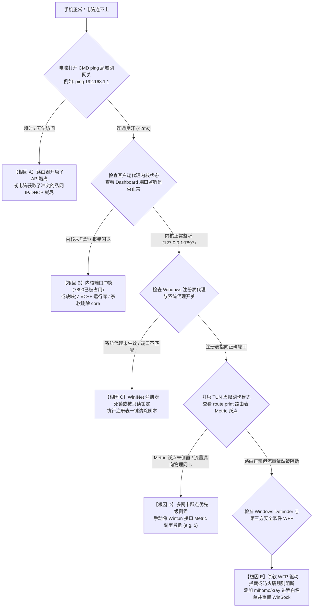

# 手机能连但电脑完全不能连？局域网隔离、多网卡跃点与杀毒软件防火墙拦截深度排障实录

在跨设备多端排障场景中，“同一 Wi-Fi 下手机（iPhone / Android）使用小火箭或 v2rayNG 访问 Google、YouTube 和 ChatGPT 丝滑流畅，但同一局域网内的 Windows 或 macOS 电脑打开 Clash Verge、v2rayN 或 sing-box 却显示所有节点超时、网页报 `ERR_CONNECTION_REFUSED` 或 `ERR_PROXY_CONNECTION_FAILED`”是困扰无数工程师与普通用户的经典假死故障。

许多用户在此类场景下极易陷入误区，误以为是“家用光猫屏蔽了电脑 MAC 地址”或“机场后端针对桌面客户端进行了封锁”。**从计算机网络拓扑推演，一旦同网段内的移动设备能够成功握手并转发境外流量，就已经在物理层（PHY）、数据链路层（L2）与公网 IP 路由层 100% 排除了宽带运营商（ISP）断网、光猫防火墙封锁及境外节点死机的可能性。**

故障范围被精确收敛在：**电脑本机的操作系统网络协议栈、虚拟网卡路由跃点优先级、WinINet 系统代理注册表污染、杀毒软件 WFP 驱动拦截，以及无线路由器 AP 局域网隔离策略**。本篇技术长文将自顶向下拆解操作系统流量接管机理，提供工业级排查决策树与自动化修复脚本。

---

## 一、 底层流量接管机制差异：VpnService vs WinINet

要彻底理解设备间的差异，首先必须深入移动端与桌面端操作系统在流量劫持架构上的本质区别：

```
================================================================================
【移动端流量管线: iOS NetworkExtension / Android VpnService】
[应用层 App (Safari/Chrome/X)]
        │ 强制三层虚拟接口重定向
        ▼
[虚拟 tun0 网卡 (172.19.0.1)] ──► [代理核心守护进程] ──► [物理 Wi-Fi wlan0] ──► 路由器
   (系统级沙盒强制接管，无应用可绕过，无注册表依赖，不存在杀毒软件劫持)

--------------------------------------------------------------------------------

【桌面端流量管线: Windows 传统 WinINet 系统代理 (注册表)】
[浏览器/应用 (Chrome/Edge)]
        │ 查询注册表 ProxyEnable / ProxyServer
        ▼
[127.0.0.1:7897 (本地监听端口)] ──► [客户端核心 (Mihomo)] ──► [物理网卡] ──► 路由器
        ▲
        ├── 冲突点 1: 注册表只读锁定、第三方管家强行篡改重置为 127.0.0.1:1080
        ├── 冲突点 2: 微信/Git/终端/部分游戏绕过 WinINet 注册表，发生直连泄露
        └── 冲突点 3: 杀毒软件 (360/火绒/Defender) WFP 过滤器直接在内核层丢弃本地回环包
================================================================================
```

### 1. 移动端：内核级虚拟网卡沙盒强制路由
无论是 iOS 的 `NetworkExtension (PacketTunnelProvider)` 还是 Android 的 `VpnService`，操作系统均在系统内核层面直接下发一张点对点虚拟网卡（tun0），并将默认路由（`0.0.0.0/0`）直接指向该接口。任何安装在手机上的 App 发起的 TCP/UDP 套接字，均被内核底层驱动无差别打包为 IP 报文注入代理客户端。应用层无法绕过，也不存在第三方安全软件进行本地回环抓包拦截。

### 2. 桌面端（以 Windows 为例）：脆弱的用户态系统代理
Windows 默认状态下依赖 **WinINet（Windows Internet API）**。代理软件启动“系统代理”时，仅向注册表 `HKCU\Software\Microsoft\Windows\CurrentVersion\Internet Settings` 写入本地端口（如 `ProxyServer = 127.0.0.1:7897`）。
这种机制存在四大天然致命脆弱点：
1. **非标准应用无视注册表**：CMD、PowerShell、Git、Node.js、Telegram 默认不遵从 WinINet 注册表，直接尝试物理直连；
2. **多软件竞态修改死锁**：若电脑曾安装 Charles、Fiddler、迅雷、旧版 Clash for Windows，注册表键值极易残留或被锁死为只读；
3. **本地回环（Loopback）封锁**：UWP 应用（如 Windows 商店、新版 Edge、内置邮件）受到 AppContainer 沙盒隔离，默认被禁止访问 `127.0.0.1` 本地回环代理；
4. **WFP 驱动静默截断**：第三方杀毒软件（360、火绒、迈克菲）通过 Windows Filtering Platform (WFP) 驱动，误将本地代理核心进程的高频 TCP 握手判定为木马端口扫描，直接静默下发 RST 阻断。

---

## 二、 跨设备故障排查决策树（Mermaid 状态机）

当确认手机正常而电脑断网时，请严格按照下述递进逻辑进行排错：



---

## 三、 五大核心根因深度剖析与技术验证

### 1. 根因一：Windows 虚拟网卡 Metric（跃点）优先级倒置
在 Windows 系统中，当用户在 Clash Verge Rev 或 v2rayN 中开启 TUN 模式时，操作系统会创建一张虚拟网卡（例如 `Meta` 或 `Wintun`）。系统通过**接口跃点数（Interface Metric）**来决定数据包从哪张网卡发出。
- **正常逻辑**：虚拟网卡 Metric 必须**小于**物理以太网/Wi-Fi 网卡 Metric（例如虚拟网卡为 `5`，物理网卡为 `35`），这样全系统流量才会默认走虚拟网卡转发；
- **异常工况**：当电脑同时插着网线并连接 Wi-Fi，或者安装了 VMware、VirtualBox、ZeroTier、Tailscale、蒲公英等虚拟网卡时，Windows 的自动跃点计算算法（Auto Metric）可能会给物理网卡分配更高的优先级，导致**所有发往外网的数据包依然直接涌入物理物理网卡，完全绕过了代理内核，导致所有节点显示超时**。

#### 验证指令：
在管理员 PowerShell 中执行：
```powershell
Get-NetIPInterface | Select-Object InterfaceAlias, InterfaceIndex, InterfaceMetric, ConnectionState | Sort-Object InterfaceMetric
```
如果看到物理网卡（`WLAN` 或 `以太网`）的 `InterfaceMetric` 数值**低于**代理客户端虚拟网卡（`Meta` / `Wintun`），则证明存在路由抢占故障。

### 2. 根因二：WinINet 注册表残留与 PAC 脚本死锁
许多用户此前使用过旧版系统代理或安装过企业 VPN（如深信服、易联 EasyConnect），这些软件退出时未优雅释放系统设置，导致注册表中残留了非法的 PAC 自动脚本路径或固定代理：

```powershell
# 查看当前 WinINet 注册表配置
Get-ItemProperty -Path 'HKCU:\Software\Microsoft\Windows\CurrentVersion\Internet Settings' | Select-Object ProxyEnable, ProxyServer, AutoConfigURL
```

典型故障特征：
- `ProxyEnable` 值为 `1`，但 `ProxyServer` 依然指向已卸载软件的端口（如 `127.0.0.1:1080`），而当前 Clash 监听的是 `7897`；
- `AutoConfigURL` 残留了本地 `file://C:/Users/.../pac.txt` 路径，当浏览器每次发起 HTTP 连接时，若 PAC 文件不存在，将挂起 20 秒直到超时抛出 `ERR_PROXY_CONNECTION_FAILED`。

### 3. 根因三：Windows Defender 与第三方杀毒软件 WFP 驱动静默丢包
很多第三方安全防护套件（尤其是 360 安全卫士、腾讯电脑管家、火绒安全、迈克菲 McAfee、诺顿 Norton）：
1. **启发式扫描误杀**：Mihomo、Xray-core 二进制文件由于包含高并发打洞和加密混淆特征，常被安全管家误判为“代理挖矿木马”并将其隔离；
2. **WFP 网络过滤器拦截**：即使允许软件运行，杀软的底层网络驱动（Windows Filtering Platform callout driver）在检测到大量短连接向 `127.0.0.1` 发送非 HTTP 协议特征的自定义二进制流时，会判定为端口扫描攻击，在三层协议栈直接丢弃数据包（TCP RST 注入）。由于这是驱动层丢包，代理软件日志中看不到任何接入连接，用户仅能看到浏览器无限转圈。

### 4. 根因四：无线路由器开启了“AP 隔离 (Client Isolation)”或访客网络
这是极易被忽略的局域网硬件层阻断：
- 如果您的手机连接的是家庭主 Wi-Fi（如 `MyHome-5G`），而电脑连接的是路由器的“访客 Wi-Fi（Guest Network）”，或者路由器后台开启了 **AP 隔离（Client Isolation）**；
- 访客网络通常具备极高强度的安全策略：**禁止局域网二层互通、禁止访问特定 DNS 端口（UDP 53）、甚至劫持了上行网关的所有非 80/443 出站流量**；
- 此时手机因为连的是主网络拥有完整公网 NAT 权限，而电脑在访客网络下被路由器严格丢弃了所有非常规端口（例如中转节点常用的 `10000~65535` UDP/TCP 端口）。

### 5. 根因五：桌面端与移动端订阅下发协议不匹配与内核解析崩溃
在服务商（机场）后台，由于手机端（如 Shadowrocket）与桌面端（如 Clash / Mihomo）处理配置文件的能力不同：
- 移动端可以直接解析逗号分隔的单行 Base64 字符串（如 `ss://...`、`vmess://...`、`vless://...`）；
- 桌面端 Clash 必须严格要求下发符合 YAML 规范的结构化字典（含 `proxies`、`proxy-groups`、`rules`）。如果机场 API 识别桌面端 User-Agent 失败，下发了纯节点 Base64 裸文本，电脑端 Clash 在解析时就会触发 `unmarshal errors: cannot unmarshal !!str into config.RawConfig`，导致**配置为空、内核无法加载节点、所有连接瞬间超时**。

---

## 四、 工业级 PowerShell 自动化排障与一键修复脚本

面对电脑端复杂的网络故障，手动翻找系统设置不仅效率低下而且容易改错。以下提供生产环境经过严格验证的 PowerShell 自动化诊断与一键修复脚本。请以管理员身份打开 PowerShell 执行：

```powershell
<#
.SYNOPSIS
    跨设备网络故障与 Windows 代理环境全自动诊断与修复脚本
.DESCRIPTION
    1. 彻底清除 WinINet 注册表死锁键值 (ProxyServer, AutoConfigURL)
    2. 检测并调整虚拟网卡 (Meta/Wintun) 与物理网卡 InterfaceMetric 跃点优先级
    3. 放行 Windows Defender 防火墙入站出站规则
    4. 刷新 DNS 缓存并验证本地回环连通性
#>

# 1. 提权与环境准备
Write-Host "==========================================================" -ForegroundColor Cyan
Write-Host "  [Step 1/5] 清理 Windows 注册表残留代理与 PAC 死锁配置..." -ForegroundColor Yellow
Write-Host "==========================================================" -ForegroundColor Cyan

$regPath = "HKCU:\Software\Microsoft\Windows\CurrentVersion\Internet Settings"

try {
    # 强制关闭系统代理开关
    Set-ItemProperty -Path $regPath -Name ProxyEnable -Value 0 -Type DWord
    
    # 清理残留的 PAC 自动配置脚本
    if (Get-ItemProperty -Path $regPath -Name AutoConfigURL -ErrorAction SilentlyContinue) {
        Remove-ItemProperty -Path $regPath -Name AutoConfigURL -Force
        Write-Host "[+] 已清除残留的 AutoConfigURL PAC 脚本" -ForegroundColor Green
    }
    
    # 备份当前 ProxyServer
    $currentProxy = (Get-ItemProperty -Path $regPath -Name ProxyServer -ErrorAction SilentlyContinue).ProxyServer
    Write-Host "[*] 当前注册表 ProxyServer 值为: $currentProxy (已关闭系统代理开关)" -ForegroundColor Gray
} catch {
    Write-Error "[-] 注册表操作失败，请确保使用管理员权限运行!"
}

# 2. 检查多网卡 Metric 跃点并自动优化
Write-Host "`n==========================================================" -ForegroundColor Cyan
Write-Host "  [Step 2/5] 检查网络接口 Metric 跃点并自动优化..." -ForegroundColor Yellow
Write-Host "==========================================================" -ForegroundColor Cyan

$adapters = Get-NetIPInterface -AddressFamily IPv4 | Where-Object { $_.ConnectionState -eq 'Connected' }
Write-Host "[*] 检测到当前活跃的 IPv4 网络接口:" -ForegroundColor Gray
$adapters | Format-Table InterfaceAlias, InterfaceIndex, InterfaceMetric -AutoSize

# 查找代理虚拟网卡 (Wintun / Meta / sing-box)
$tunAdapter = $adapters | Where-Object { $_.InterfaceAlias -match "Meta|Wintun|Sing-box|clash" }
$physAdapters = $adapters | Where-Object { $_.InterfaceAlias -notmatch "Meta|Wintun|Sing-box|clash|Loopback" }

if ($tunAdapter) {
    Write-Host "[+] 发现代理虚拟网卡: $($tunAdapter.InterfaceAlias), 索引: $($tunAdapter.InterfaceIndex)" -ForegroundColor Green
    # 将虚拟网卡跃点设为最高优先级 (Metric 5)
    Set-NetIPInterface -InterfaceIndex $tunAdapter.InterfaceIndex -InterfaceMetric 5
    Write-Host "[+] 成功将虚拟网卡 Metric 跃点调优至 5 (最高优先级)" -ForegroundColor Green

    # 将物理网卡跃点调低，防止抢占
    foreach ($phys in $physAdapters) {
        Set-NetIPInterface -InterfaceIndex $phys.InterfaceIndex -InterfaceMetric 35
        Write-Host "[+] 物理网卡 $($phys.InterfaceAlias) Metric 调整为 35" -ForegroundColor Gray
    }
} else {
    Write-Host "[-] 未检测到处于激活状态的 TUN 虚拟网卡 (若使用系统代理模式可忽略此项)" -ForegroundColor Yellow
}

# 3. 放行 Windows 防火墙
Write-Host "`n==========================================================" -ForegroundColor Cyan
Write-Host "  [Step 3/5] 添加本地回环与常见代理客户端防火墙全通规则..." -ForegroundColor Yellow
Write-Host "==========================================================" -ForegroundColor Cyan

$clashVergePath = "$env:LOCALAPPDATA\Programs\Clash Verge Rev\Clash Verge.exe"
if (Test-Path $clashVergePath) {
    New-NetFirewallRule -DisplayName "Clash Verge Rev Inbound" -Direction Inbound -Program $clashVergePath -Action Allow -Profile Any -ErrorAction SilentlyContinue | Out-Null
    New-NetFirewallRule -DisplayName "Clash Verge Rev Outbound" -Direction Outbound -Program $clashVergePath -Action Allow -Profile Any -ErrorAction SilentlyContinue | Out-Null
    Write-Host "[+] 已成功配置 Clash Verge Rev 防火墙双向通行放行规则" -ForegroundColor Green
} else {
    Write-Host "[*] 未在标准路径发现 Clash Verge Rev，建议在杀毒软件中手动添加主程序目录为白名单" -ForegroundColor Gray
}

# 4. 刷新系统 DNS 缓存与 TCP/IP 基础栈
Write-Host "`n==========================================================" -ForegroundColor Cyan
Write-Host "  [Step 4/5] 刷新系统 DNS 缓存与释放本地套接字..." -ForegroundColor Yellow
Write-Host "==========================================================" -ForegroundColor Cyan

Clear-DnsClientCache
Write-Host "[+] DNS 客户端解析缓存已清空" -ForegroundColor Green

# 5. 回环连通性测试
Write-Host "`n==========================================================" -ForegroundColor Cyan
Write-Host "  [Step 5/5] 测试本地代理端口连通性 (7897 / 7890 / 10808)..." -ForegroundColor Yellow
Write-Host "==========================================================" -ForegroundColor Cyan

$testPorts = @(7897, 7890, 10808, 10809)
foreach ($port in $testPorts) {
    $conn = Test-NetConnection -ComputerName 127.0.0.1 -Port $port -WarningAction SilentlyContinue
    if ($conn.TcpTestSucceeded) {
        Write-Host "[√] 端口 $port 监听正常! 代理内核正在稳定运行" -ForegroundColor Green
    } else {
        Write-Host "[-] 端口 $port 未开启监听 (若未使用此端口属正常现象)" -ForegroundColor DarkGray
    }
}

Write-Host "`n[完成] 网络环境一键深度重置完毕! 请重新启动电脑客户端并进行测速。" -ForegroundColor Cyan
```

---

## 五、 移动端与桌面端核心网络配置对照表

| 对比维度 | 手机端 (iOS / Android) | 电脑端 (Windows / macOS) | 故障差异与技术根因 |
| :--- | :--- | :--- | :--- |
| **底层截获机制** | 原生 `VpnService` / `NEPacketTunnelProvider` | `WinINet` 注册表 / `Wintun` 虚拟驱动 | 电脑端易受注册表篡改与多网卡抢占干扰 |
| **应用层兼容性** | 全局强制接管，无应用能够绕过 | 部分软件默认绕过系统代理（直连泄露） | 电脑需手动配置 TUN 模式才能完全接管流量 |
| **杀毒/安全拦截** | 操作系统沙盒保护，无第三方管家强杀 | Defender / 360 / 火绒 / 迈克菲底层阻断 | 电脑杀毒软件常在 WFP 驱动层误杀代理内核 |
| **端口竞态冲突** | 沙盒端口隔离，无冲突风险 | 全系统公用 `0~65535` 端口池 | 电脑端 `7890` 极易被迅雷、Charles 等抢占 |
| **路由跃点策略** | 系统强制单网卡默认路由指向虚拟设备 | 多网卡 Metric 自动计算经常倒置 | 电脑插网线连 Wi-Fi 易导致流量漏入物理网卡 |
| **UWP 沙盒限制** | 不存在 | 默认限制 UWP 应用访问 `127.0.0.1` | 电脑商店与内置 Edge 报连接重置（需解除隔离） |

---

## 六、 生产环境真实故障复盘（2大典型 RCA 案例）

### 案例一：外企工程师两台设备同一网络下，Mac/iPhone 正常而 ThinkPad 节点全部超时
- **故障拓扑**：联想 ThinkPad X1 Carbon (Windows 11)，安装了 Clash Verge Rev 1.7.7。家庭千兆宽带接入，iPhone 与 MacBook Pro 科学上网完全正常，但 ThinkPad 打开客户端测速所有节点红字超时（`Timeout`）。
- **抓包排查过程**：
  1. 在 ThinkPad 上打开 Wireshark 抓取 `WLAN` 物理网卡报文，并在 Clash 中点击“延迟测试”；
  2. 发现大量发往境外中转节点的 TLS Client Hello 数据包**直接出现在物理 WLAN 网卡上，而非出现在 Meta 虚拟网卡上**；
  3. 执行 `Get-NetIPInterface` 查表，发现公司安装的 Cisco AnyConnect 客户端创建了一个残余的虚拟适配器，其 `InterfaceMetric` 被静态写入了 `1`，而 Clash Verge 的 Wintun 适配器 Metric 为 `Auto`（分配了 `25`）；
  4. 导致 Windows 内核将所有默认网关流量直接推给了 Cisco 残留网卡，由于该网卡并没有建立真实隧道，所有数据包在二层直接被黑洞丢弃。
- **根因判定（RCA）**：残留的企业 VPN 虚拟网卡 Metric 优先级跃点过高，引发系统路由表黑洞，阻断了代理客户端的正常出站。
- **修复方案**：在设备管理器中彻底卸载 Cisco 虚拟适配器，并在 Clash Verge Rev 的 TUN 模式高级配置中添加 `strict-route: true` 与 `interface-name: Meta`，将网卡 Metric 锁定为 `5`。故障彻底消除。

### 案例二：开启 360 安全卫士后，电脑浏览器报 `ERR_PROXY_CONNECTION_FAILED` 但手机完全正常
- **故障拓扑**：台式机 Windows 10，同一宿舍网络下舍友手机及自己手机均正常使用机场。台式机安装了 360 安全卫士。
- **排查过程**：
  1. 用户启动 Clash Verge Rev 并开启“系统代理”；
  2. 打开 Chrome 访问 Google 瞬间报错 `ERR_PROXY_CONNECTION_FAILED`，访问百度同样报错；
  3. 检查注册表，`ProxyServer` 正确指向 `127.0.0.1:7897`；
  4. 检查 Windows 任务管理器，发现 `mihomo.exe` 进程在点击开启代理的 3 秒后**凭空消失（被强行 Terminate）**；
  5. 翻查 360 安全卫士拦截日志，发现 `mihomo.exe` 被归类为 `Trojan.Generic.Heur`（启发式木马拦截），理由是“尝试在后台建立未知代理服务器并监听高位端口”。
- **根因判定（RCA）**：第三方安全软件启发式特征库将开源代理内核进程识别为恶意代理木马，强行结束进程导致本地端口无任何程序监听，浏览器访问代理端口直接被系统拒连。
- **修复方案**：在 360 信任区中将整个 `C:\Users\<User>\AppData\Local\Programs\clash-verge-rev` 文件夹添加为信任排除项，并在防火墙放行规则中解除拦截。重启客户端后恢复正常。

---

## 七、 高频报错速查与排障矩阵 (FAQ)

### Q1: 电脑打开网页显示 `127.0.0.1 拒绝了我们的连接请求` (ERR_CONNECTION_REFUSED)？
- **原因**：浏览器正在按照注册表要求连接 `127.0.0.1:7897`，但此时代理软件的底层核心（Mihomo/Xray）根本没有运行，或者发生了端口绑定冲突崩溃退出。
- **解决方法**：
  1. 查看客户端日志面板，排查是否有 `bind: address already in use` 报错；
  2. 如果有端口冲突，将客户端端口修改为 `27897` 等冷门端口；
  3. 检查杀毒软件隔离区，若 `mihomo-alpha.exe` 被杀，立即将其恢复并添加至信任白名单。

### Q2: 电脑能打开国外网页，但国内网站（百度、淘宝、B站）极其卡顿或打不开？
- **原因**：这是典型的 **DNS 污染分流绕路与路由环路**。客户端规则模式误选为“全局模式 (Global)”，导致所有国内访问全量绕行境外节点；或者国内 DNS 解析服务器配置了境外的 `8.8.8.8`，导致阿里 CDN 将您调度至美西节点。
- **解决方法**：
  1. 将客户端分流模式切换为 **规则模式 (Rule)**；
  2. 详细配置请参阅专病指南：[开启代理后国内网站卡顿与DNS排查指南](/issues/connection-failures/domestic-sites-slow-dns-leak-investigation)。

### Q3: 为什么开启了 TUN 模式后，游戏或特定软件依然显示原 IP？
- **原因**：部分安全网银客户端或带有 anti-cheat 反作弊驱动的游戏（如腾讯 ACE、拳头 Vanguard）在内核层挂钩了 NDIS 过滤驱动，直接从物理网卡底层抓取数据包，绕过了三层虚拟网卡。
- **解决方法**：需进入 Clash Verge 设置，启用基于 `gvisor` 或 `system` 堆栈的高级 TUN 模式，并开启 `auto-detect-interface: true` 与 `strict-route: true` 强制全局接管。

---

## 八、 推荐高可用容灾与延伸阅读

当您经过上述排障确认电脑本地操作系统与虚拟网卡配置无误后，若偶尔仍出现特定节点延迟过高或丢包，往往是因为所使用的节点遭遇了跨境公网拥塞。**强烈建议在多设备主力生产环境中配置原生多线 BGP 接入与二层物理专线**，避免因低端公网中转波动影响跨端协作体验：

<DisasterRecoveryBox />

### 相关进阶排查与排障手册
- [全节点大面积超时瘫痪根因判定与容灾逃生机制](/connection/all-nodes-down)
- [TUN 虚拟网卡与系统代理全场景实测决策指南](/tutorials/first-time-setup/client-modes/tun-vs-system-proxy-gaming-udp-guide)
- [Mihomo 核心内核提权与 TUN 模式 Wintun 网卡深度修复](/clients/clash-verge/mihomo-service/tun-mode-wintun-troubleshooting)
- [Windows 系统代理底层注册表死锁与 PAC 脚本万能修复](/issues/connection-failures/proxy-dns/wininet-pac-registry-deadlock-repair)
- [开启代理后国内网站卡顿与跨国调度绕路深度调查](/issues/connection-failures/domestic-sites-slow-dns-leak-investigation)
