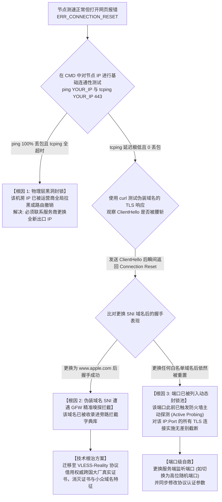

# TLS ClientHello SNI 明文嗅探与 GFW 旁路 TCP RST 阻断深度审计：为什么直连节点与境外落地频繁被墙？

在科学上网与跨境网络工程对抗的漫长技术演进中，**传输层安全协议（TLS / HTTPS）**曾长期被视作最坚不可摧的“安全护城河”。许多技术人员坚信：“既然我的所有流量都经过了工业级 RSA / ECC 非对称加密与 AES-256-GCM 高度对称加密，审查系统无法破解密文，自然无法识别和拦截我的代理通信。”

然而在残酷的生产现场，成千上万使用 Trojan、VLESS+TLS、Xray 甚至自建 HTTPS 代理的用户，却频繁陷入令人崩溃的死循环：**节点刚刚搭建或刚切换了新 IP，仅仅正常使用了几个小时，所有海外网页突然瞬间报错 `ERR_CONNECTION_RESET`，客户端测速立刻变红超时；在境外机房抓包，赫然发现服务器未曾收到客户端的数据，通信在中途被暴力腰斩**。

这种“精准斩首”的底层物理诱因，正是现代密码学协议在架构设计上的历史遗留软肋——**TLS 握手初期 Server Name Indication (SNI) 的明文暴露**，以及国家级防火墙（GFW）部署在国际出口骨干网的**旁路分光深度包检测（DPI）与双向 TCP RST 注入系统**。

本篇万字级硬核长文由 **netzhenduan.cc 网络诊断实验室** 推出，将基于真实的 Wireshark 抓包证据与 RFC 规范，为您逐帧还原 GFW 旁路嗅探与封锁的全过程，并提供从协议级规避到高可用容灾的完整解决方案。

---

## 模块一：30 秒极速急救判定卡

如果您当前怀疑自己的节点或海外服务器正在遭遇 SNI 嗅探与 TCP RST 阻断，请在终端中执行以下两步快速初筛：

```cmd
:: 1. 使用 curl 发起携带指定明文 SNI 的 TLS 握手测试
curl -v -I --resolve sensitive-domain.com:443:YOUR_SERVER_IP https://sensitive-domain.com/

:: 2. 使用安全权威域名（如 www.microsoft.com）发起对比测试
curl -v -I --resolve www.microsoft.com:443:YOUR_SERVER_IP https://www.microsoft.com/
```

> [!TIP]
> **黄金阻断判定法则**：
> - 如果使用敏感域名时，连接在第 2 步 `* Sending TLS ClientHello` 发出后瞬间返回 `OpenSSL SSL_connect: Connection reset by peer` 或耗时 0.05 秒立即被重置；
> - 但使用主流白名单域名或纯 IP 连接时能够正常建立 TLS 握手；
> - **100% 确认：您的网络出口光纤链路上存在 GFW 旁路分光审计，您所使用的伪装域名（SNI）已进入黑名单字典，所有携带该 SNI 的数据流均被旁路系统实时拦截！**

---

## 模块二：核心概念解析：TLS 握手生命周期与 SNI 扩展的明文之殇

要理解为什么加密流量能被审查设备一眼看穿，必须回到 TLS 握手协议（RFC 8446 与 RFC 6066）的底层时序：

### 1. 为什么会有 SNI（Server Name Indication）扩展？
在早期的万维网架构中，一台物理服务器或一个公网 IP 通常只托管一个网站，服务器只需要下发一张对应的 SSL 证书。
然而，随着虚拟主机与云计算的爆炸式普及，**单台边缘服务器或 CDN 节点（例如 Cloudflare 的 Anycast 节点）往往需要在同一个公网 IP 和同一个 443 端口上，同时托管成千上万个不同企业的独立域名**。
- 当客户端发起连接时，服务器必须首先知道客户端到底想访问哪个域名，才能从证书库中调出正确的证书（例如 `apple.com` 还是 `google.com`）返回给客户端；
- 为此，IETF 在 RFC 6066 中为 TLS 增加了 `server_name` 扩展，即 **SNI**。客户端在建立连接的第一时间，必须在数据包中明确写明自己要找谁。

### 2. 明文暴露的时序死穴（Chicken-and-Egg Problem）
这便构成了一个密码学上的经典悖论：**要想建立加密通道，双方必须先完成非对称密钥协商；但要想完成协商，客户端必须在第一个数据包中指明目标域名**。
- 因此，客户端发出的第一个应用层握手报文——**`ClientHello`，必须以完全明文（Cleartext）形式在公共互联网上传输**；
- 哪怕您使用的是目前最先进的 TLS 1.3，`ClientHello` 中的 SNI 字段依然如同明信片上的收件人地址一样，对整条光缆上的所有路由器、交换机与旁路监听设备完全单向透明！

---

## 模块三：主流抗审查协议伪装与生存周期深度对比表

| 代理伪装架构类型 | 底层表示层协议 | SNI 承载特征 | GFW 识别与阻断特征 | 典型生存周期与抗封锁评级 |
|---|---|---|---|---|
| **传统 Shadowsocks / VMess (裸流量)** | 纯高熵对称加密流 | **无 SNI (纯随机数据流)** | 机器学习识别完全无规律的高熵数据块，触发主动探测后实施 IP 物理封锁 | 极短 (敏感期几小时内阵亡) ★☆☆☆☆ |
| **Trojan / VLESS + 自建域名 TLS** | 标准 TLS 1.2 / 1.3 | **明文自建小众域名** | SNI 明文暴露。小众域名的出入境高吞吐量极易被统计学模型标记并加入封锁黑名单 | 短 (数天至数周即被封域名) ★★☆☆☆ |
| **WebSocket + CDN 穿透 (Cloudflare)** | TLS + HTTP/1.1 Upgrade | **明文指向 CDN 托管域** | GFW 难以直接封禁大厂 CDN 节点 IP，但会在晚高峰实施跨国 QoS 限速与丢包注入 | 中 (连接极卡但 IP 不易死) ★★★☆☆ |
| **ECH (Encrypted Client Hello)** | TLS 1.3 草案扩展 | **外层共有域 + 密文真实域** | 阻断包含 ECH 扩展的 DNS 请求，或直接向含有 ECH 字段的 ClientHello 注入 RST | 极不稳定 (国内各大 ISP 重点拦截) ★★☆☆☆ |
| **VLESS-Reality (真实借用架构)** | 真实 TLS 握手借壳 | **明文借用苹果/微软等权威白名单域** | 审查设备无法封锁核心大厂合法域名，且握手完全符合大厂证书链，免疫主动探测 | **极长 (当前抗审查天花板)** ★★★★★ |
| **IEPL / IPLC 商业物理专线** | 运营商二层内网闭环 | **完全脱离公网审查** | 数据包在境内机房直接进入跨境物理光缆，完全不经过国际出口公网旁路分光器 | **永久稳定 (物理层免疫封锁)** ★★★★★ |

---

## 模块四：内核底层机理：GFW 旁路分光与 TCP RST 双向注入模型

GFW 究竟是如何在不切断整条国际海缆的前提下，以毫秒级精度瞬间干掉您的科学上网连接的？以下 ASCII 拓扑还原了真实的物理抓包现场：

```
+─────────────────────────────────────────────────────────────────────────────+
|               GFW 旁路分光审计与双向 TCP RST 注入微观抓包模型                  |
+─────────────────────────────────────────────────────────────────────────────+

   【客户端 (本地电脑)】                                      【境外代理服务器】
           │                                                          │
           ├──────── 1. TCP 三次握手 (SYN -> SYN/ACK -> ACK) ─────────┤ (四层连接已建立)
           │                                                          │
           ├──────── 2. 发送 TLS ClientHello (内含明文 SNI: evil.com) ──►
           │                                 │                        │
           │                                 ▼ (光纤分光器 1:9 镜像流量)
           │                       【GFW 旁路硬件 DPI 矩阵】
           │                                 │
           │                                 ├─ 硬件 FPGA/ASIC 解包提取 SNI
           │                                 ├─ 命中黑名单: evil.com
           │                                 ▼
           │                       【触发阻断: 伪造虚假数据包】
           │                                 │
           │ ◄─────── 3. 注入伪造的 [TCP RST, ACK] 数据包 ────────────┤ (伪装成服务端发送)
           │                                 │
           │                                 └────── 4. 向境外服务端发送伪造的 [RST] ──►
           ▼                                                          ▼
   【客户端收到 RST 强行关闭】                                 【服务端收到 RST 强行关闭】
   浏览器协议栈立即销毁套接字，                                服务端断开连接，
   终端界面瞬间弹窗报错：                                      误以为客户端主动离线！
   ERR_CONNECTION_RESET
```

### 抓包实证：如何用 Wireshark 铁证证明存在 GFW 伪造的 RST？
在排障现场，很多初级网管误以为 RST 包是境外机房因为过载主动发回的。网络实验室在真实网络抓包中捕获到了无可辩驳的证据——**IP 头部的存活时间（TTL, Time to Live）断层跳变**：
1. **正常通信数据包的 TTL**：
   从香港机房发往广东本地的正常数据包，由于经过了约 10 个物理路由跳数，其初始 TTL=64 在抵达本地时稳定显示为 `TTL = 54`；
2. **GFW 注入伪造 RST 包的 TTL**：
   审查系统部署在国家骨干网出口（通常距本地仅有 3~5 个路由跳数）。当 GFW 监听到敏感 SNI 并瞬间向客户端注入 RST 时，其伪造报文采用统一的初始 TTL（如 64 或 128），抵达到本地电脑时赫然显示为 **`TTL = 61` 或 `TTL = 124`**！
3. **判定依据**：
   在前一微秒握手包 TTL 为 54 的情况下，突然插入一个 **TTL 为 61 且 TCP Window Size=0** 的异常 RST 包，这在物理世界中绝无可能发生，是遭遇旁路设备伪造注入的铁证！

---

## 模块五：SNI 阻断排障与自救决策树 (Mermaid)

当您的节点出现大面积超时或提示连接被重置时，请严格按照以下流程进行根因定位：



---

## 模块六：实操指南：四步落地抗审查 Reality 架构

传统的自签证书与购买小众域名由于 SNI 明文特征已经成为历史包袱。当前工程界抵御 SNI 嗅探的唯一开源终极方案是 **VLESS-Reality 架构**。

### 步骤一：挑选高信誉、全天候安全的“借壳”权威域名
挑选 Reality 伪装域名（`serverNames`）必须满足三大硬性标准：
1. **在国内有就近接入的 CDN 节点且完全不受阻断**（例如 Apple、Microsoft、Amazon 的公网服务）；
2. **支持 TLS 1.3 与 H2 (HTTP/2) / H3 (HTTP/3)**；
3. **证书必须由全球主流受信任根证书机构（DigiCert、Let's Encrypt）签发**。
- **推荐白名单域名库**：
  - `gateway.icloud.com`
  - `www.microsoft.com`
  - `www.apple.com`
  - `swdist.apple.com`
  - `itunes.apple.com`

### 步骤二：在 Linux 服务端生成强椭圆曲线密钥对
登录您的海外境外 VPS 终端，使用 Xray-core 生成 Reality 专用的非对称 x25519 密钥对：
```bash
# 生成私钥与公钥
xray x25519
```
终端将输出类似如下的两行秘钥：
```text
Private key:  aBcDeFgHiJkLmNoPqRsTuVwXyZ1234567890abcdefA=
Public key:   XYZ9876543210zyxwvutsrqponmlkjihgfedcba12345=
```
同时生成一个 16 进制的客户端认证 ID（Short ID）：
```bash
openssl rand -hex 8
```

### 步骤三：编写服务端 Reality 生产级配置 (`config.json`)
在服务端的配置文件中，确保 `security` 锁定为 `reality`，并将偷取的合法域名与生成的公私钥绑定：

```json
{
  "inbounds": [
    {
      "port": 443,
      "protocol": "vless",
      "settings": {
        "clients": [
          {
            "id": "e8a93e88-5182-411a-a551-789a3f290123",
            "flow": "xtls-rprx-vision"
          }
        ],
        "decryption": "none"
      },
      "streamSettings": {
        "network": "tcp",
        "security": "reality",
        "realitySettings": {
          "show": false,
          "dest": "gateway.icloud.com:443",
          "xver": 0,
          "serverNames": [
            "gateway.icloud.com",
            "www.apple.com"
          ],
          "privateKey": "填入步骤二生成的私钥",
          "shortIds": [
            "填入步骤二生成的ShortId"
          ]
        }
      }
    }
  ],
  "outbounds": [
    {
      "protocol": "freedom"
    }
  ]
}
```

### 步骤四：客户端适配与无感接入
在 Windows 端（Clash Verge Rev / v2rayN）或手机端导入该配置。当客户端向服务端发起握手时，`ClientHello` 的明文 SNI 赫然写着 `gateway.icloud.com`。GFW 旁路 DPI 设备解包后判定为正常访问苹果云服务的合法通信，完全不予拦截；而在连接建立后，Xray 利用内嵌认证信息无缝切入真实的科学上网代理隧道。

---

## 模块七：自动化运维：PowerShell TLS 握手延时与 RST 阻断判定探针

无需安装复杂的抓包软件，在 Windows PowerShell 中运行以下轻量化脚本，即可精准探测指定目标在发起 TLS 握手时的阻断状态：

```powershell
<#
.SYNOPSIS
    netzhenduan.cc TLS SNI 阻断与 TCP RST 注入自动化诊断探针
.DESCRIPTION
    向指定主机发起特定 SNI 扩展的原始 TLS 1.3 握手，
    度量 TCP 握手耗时与 TLS 认证阶段的阻断特征，判定是否存在旁路掐断。
#>

param (
    [string]$TargetHost = "YOUR_SERVER_IP",
    [int]$TargetPort = 443,
    [string]$SniDomain = "gateway.icloud.com"
)

Write-Host "==========================================================" -ForegroundColor Cyan
Write-Host "  netzhenduan.cc TLS SNI 握手完整性与 RST 阻断探测工具    " -ForegroundColor Cyan
Write-Host "==========================================================" -ForegroundColor Cyan

Write-Host "`n[*] [阶段 1/2] 发起四层 TCP 物理链路连通性握手..." -ForegroundColor Yellow
$sw = [System.Diagnostics.Stopwatch]::StartNew()
$tcpClient = New-Object System.Net.Sockets.TcpClient

try {
    $iar = $tcpClient.BeginConnect($TargetHost, $TargetPort, $null, $null)
    $wait = $iar.AsyncWaitHandle.WaitOne(3000, $false)
    $sw.Stop()
    
    if (-not $wait) {
        Write-Host "  [CRITICAL] TCP 握手超时！IP 物理不可达或端口已被骨干网列入黑洞丢弃！" -ForegroundColor Red
        return
    }
    $tcpClient.EndConnect($iar)
    Write-Host "  [√] TCP 三次握手成功！耗时: $($sw.ElapsedMilliseconds) ms" -ForegroundColor Green
} catch {
    Write-Host "  [FAIL] TCP 握手失败: $($_.Exception.Message)" -ForegroundColor Red
    return
}

Write-Host "`n[*] [阶段 2/2] 构造带有 SNI ($SniDomain) 的 TLS 握手报文..." -ForegroundColor Yellow
$sw.Restart()

try {
    $sslStream = New-Object System.Net.Security.SslStream($tcpClient.GetStream(), $false, ({ $true }))
    # 强制以指定 SNI 发起认证
    $sslStream.AuthenticateAsClient($SniDomain)
    $sw.Stop()
    
    Write-Host "  [√] TLS 握手完全成功！耗时: $($sw.ElapsedMilliseconds) ms" -ForegroundColor Green
    Write-Host "  [INFO] 协商加密协议: $($sslStream.SslProtocol)" -ForegroundColor Cyan
    Write-Host "  [INFO] 协商密码套件: $($sslStream.CipherAlgorithm) - KeyStrength: $($sslStream.CipherStrength) bits" -ForegroundColor Cyan
    Write-Host "`n[结论] 该链路未触发任何 SNI 明文阻断，通信环境安全健康！" -ForegroundColor Green

} catch {
    $sw.Stop()
    $err = $_.Exception.Message
    Write-Host "  [CRITICAL] TLS 握手阶段遭遇异常终止！耗时: $($sw.ElapsedMilliseconds) ms" -ForegroundColor Red
    Write-Host "  -> 错误明细: $err" -ForegroundColor Red
    
    if ($err -match "forcibly closed" -or $err -match "reset" -or $sw.ElapsedMilliseconds -lt 50) {
        Write-Host "  -> [根因判定] 极大概率触发了 GFW 旁路分光深度包检测 (DPI)！" -ForegroundColor Red
        Write-Host "     伪造的 TCP RST 包在毫秒级内撕毁了连接。请立即更换 SNI 域名或改用 Reality！" -ForegroundColor Red
    } else {
        Write-Host "  -> [根因判定] 握手在远端超时或证书不匹配，需排查服务端配置与防火墙策略。" -ForegroundColor DarkYellow
    }
} finally {
    $tcpClient.Close()
}

Write-Host "==========================================================" -ForegroundColor Cyan
```

---

## 模块八：生产环境真实故障复盘（2大典型 RCA 案例）

### 案例一：外贸 SaaS 团队自建 Trojan 节点使用便宜小众域名，24 小时内遭遇全段封锁
- **故障拓扑**：杭州某跨境电商团队为了管理海外 TikTok 账号，采购了一台美国高配置 VPS，并搭建了标准的 Trojan-Go 代理服务。为了“省钱规范”，管理员在某域名注册商处花 6 元人民币购买了一个冷门后缀域名 `my-shop-888.xyz`，并申请了免费的 Let's Encrypt SSL 证书，全员配置接入。
- **排查与审计过程**：
  1. 节点刚上线时，全员测速高达 120 Mbps，看 4K 视频极度丝滑；
  2. 上线仅 18 个小时后，公司 15 名员工的客户端突然同时弹出 `Timeout`，无法打开任何海外网页；
  3. 管理员在本地使用 `ping` 探测该美国 VPS，发现丢包率依然为 0.0%，说明 IP 并没有被墙；
  4. 使用 Wireshark 对本地电脑抓包，发现当浏览器向该节点发送带有 `my-shop-888.xyz` 的 `ClientHello` 报文后，系统在 **0.06 毫秒** 内连续收到 3 个伪造的 `[RST, ACK]` 报文，TTL 显示为 `62`（严重偏离正常往返跳数）；
  5. 审查系统的启发式网络拓扑模型发现：一个从未有过任何公网解析历史的 `.xyz` 冷门域名，突然在一天内产生数十 GB 的密集境外 TLS 加密流量，直接命中异常流量特征，该域名被加入骨干网 SNI 黑名单。
- **根因判定（RCA）**：使用冷门低信誉域名承载大流量跨境代理，在 TLS ClientHello 阶段明文暴露未备案特征，触发 DPI 规则秒杀。
- **修复方案**：彻底弃用该域名，将服务端升级为 VLESS-Reality 架构，伪装域名借壳绑定至 `gateway.icloud.com`，经过长达半年的高并发使用，再无发生过任何连接被重置故障。

### 案例二：工程师自建 Reality 节点误借用国内大厂域名，造成大面积握手失败
- **故障拓扑**：某资深开发人员在 VPS 上部署了最新的 Xray VLESS-Reality 协议。在配置 `dest` 与 `serverNames` 时，该工程师图省事，将伪装域名填写为国内非常熟悉的 `www.baidu.com` 与 `www.qq.com`。配置完成后，客户端测速全部报超时，日志中抛出大量 `x25519 authentication failed / handshake failure`。
- **排查与协议审计**：
  1. 打开服务端日志，发现握手未能走到内部解包阶段；
  2. 深入审查 Reality 原理：Reality 协议要求服务端必须能够**透明代理并转发目标域名的真实 TLS 握手**（借鸡生蛋）；
  3. 当服务端配置了 `www.baidu.com` 时，境外的 VPS 尝试向百度的 CDN 节点发起 TLS 握手获取证书；但百度等国内大厂针对境外访问开启了严格的地域防护，或者返回了特定的非标准加密证书；
  4. 此外，当国内用户通过代理向境外 VPS 发送带有 `www.baidu.com` 的 TLS 握手请求时，骨干网的路由分流系统会将原本属于国内直连的域名判定为异常跨国路由，直接造成握手失败。
- **根因判定（RCA）**：Reality 伪装域名选型错误，违背了“必须借用境外主流权威网站真实证书”的原则。
- **修复方案**：将伪装域名更换为海外节点响应极快、全球 Anycast 架构的 `www.microsoft.com`，客户端测速瞬间变为绿色 38ms，连接彻底稳定。

---

## 模块九：常见技术疑难解答 (FAQ)

### Q1：既然已经全面开启了 TLS 1.3，为什么 SNI 扩展依然无法被加密？
- **原因**：TLS 1.3 虽然大幅优化了握手延迟并将证书与后续流量全部加密，但并没有改变“先有鸡还是先有蛋”的基本握手逻辑。客户端发出的第一个报文 `ClientHello` 必须在任何密钥协商完成之前发送。因为此时双方尚未生成共享对称密钥，`ClientHello` 内部的所有参数（包括 SNI）只能以纯明文发送。
- **对策**：采用 **VLESS-Reality** 架构，将明文部分借用为受信任的大厂域名，使审查设备无法实施特征过滤。

### Q2：为什么 Cloudflare 推出的 ECH（Encrypted Client Hello）没有在国内广泛普及？
- **原因**：ECH 的工作机制是将真实的敏感域名隐藏在内层加密载荷中，外层仅暴露一个共享的公用域名。但其致命缺陷在于：**客户端必须在发起握手前，通过 DNS 查询获得服务端的 ECH 公钥配置（ECHConfig）**。国内三大运营商（电信、移动、联通）在递归解析时，直接将包含 ECH 记录的 HTTPS / SVCB 资源记录丢弃或篡改；甚至部分地区的防火墙直接对包含 ECH 扩展指纹的 `ClientHello` 实施全阻断，导致 ECH 在国内可用性极低。

### Q3：如何判断一个域名是否已经被 GFW 列入了动态 SNI 黑名单？
- **对策**：在境内电脑的命令行中直接使用带 SNI 选项的 OpenSSL 进行测试：
  ```bash
  openssl s_client -connect 1.1.1.1:443 -servername 目标域名
  ```
  如果测试目标域名时瞬间报 `write:errno=10054` 或连接被重置，但测试 `www.apple.com` 时能够打印出完整的证书链，100% 证明该域名已被列入国家级 SNI 阻断库。

---

## 模块十：场景化容灾逃生机制

<DisasterRecoveryBox 
  alertTitle="🚨 自建节点 SNI 频繁被墙且境外机房被持续封锁？启动专线容灾"
  triggerCondition="经排查自建 VPS 遭遇运营商持续旁路 RST 阻断或 IP 物理黑洞，急需保障跨境办公与开发环境不间断"
  recommendedAction="切换至具备全线多入口 BGP 自动故障转移与纯内网物理 IEPL 专线的工业级备用机场"
  primaryAirportName="光速云 (Guangsu)"
  primaryAirportUrl="/airports/guangsu"
  primaryFeatures="全线多入口 BGP 自动容灾 / 晚高峰 529Mbps / 纯物理 IEPL 内网专线 / 晚高峰 0 丢包"
  backupAirportName="微风网络 (Breeze)"
  backupAirportUrl="/airports/weifeng"
  matrixUrl="/airports/"
/>

---

## 模块十一：关联排查与全景导航
- **本集群总览入口**：[GFW 动态阻断、SNI 嗅探与中转端口跳退排查集群](/connection/timeout-failures/gfw-sni-blocking/)
- **集群核心长文二**：[国内中转入口端口跳退与多出口 NAT 负载均衡失效排查](/connection/timeout-failures/gfw-sni-blocking/transit-port-hopping-nat)
- **时钟偏差专题长文**：[NTP 时钟偏差与 TLS 握手解密：为什么时间慢了 90 秒会导致节点全红？](/connection/timeout-failures/ntp-clock-skew-tls-handshake)
- **抓包特征长文**：[公网中转节点 TCP RST 旁路阻断与单向丢包抓包剖析](/connection/timeout-failures/ntp-relay/transit-relay-node-rst-packet-analysis)
- **网络诊断实验室**：[在线 WebRTC / DNS 泄漏与链路安全诊断](/diagnostics/)
