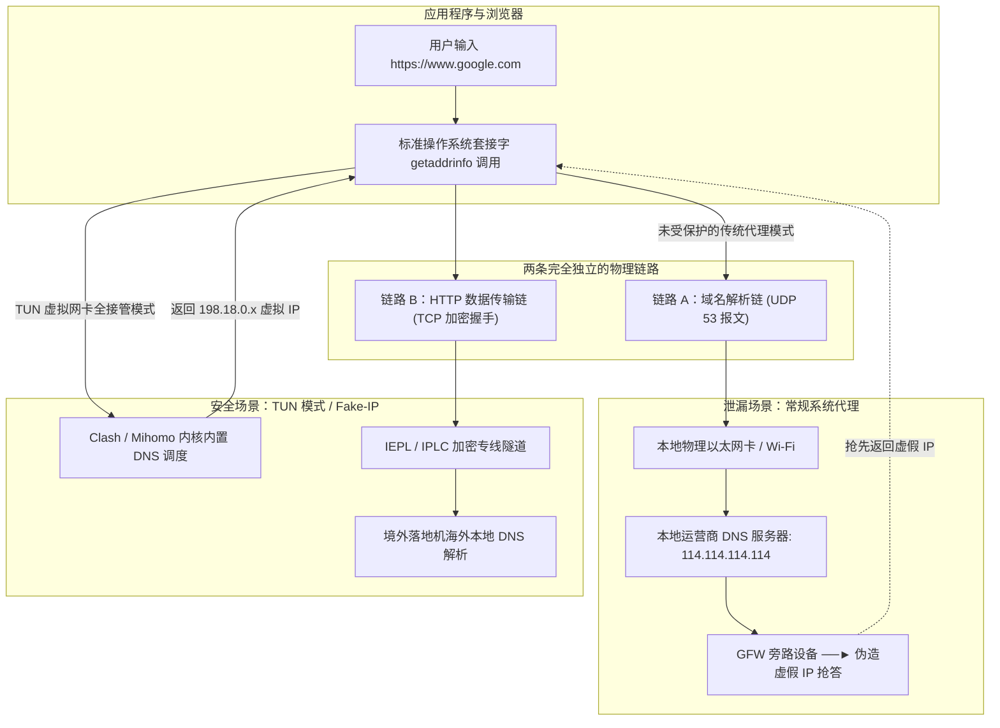

# DNS 泄漏与防污染深度检测指南

在计算机网络工程与数字隐私可观测性领域，存在一个著名的“安全假象”：**绝大多数普通用户甚至初级技术人员认为，只要科学上网客户端右下角显示绿色“已连接”，且在浏览器中打开海外查 IP 网站显示的是香港、日本或美国的机房 IP，自己的所有网络通讯就已经彻底隐形并得到了端到端的强加密保护。**

这是一个极具毁灭性的技术认知盲区。

在现代操作系统的网络协议栈设计中，**“应用层业务数据传输（TCP / UDP 数据载荷）”** 与 **“域名系统解析（DNS 域名转换）”** 是两条在逻辑上完全解耦、由不同系统子模块分别承载的独立链路。如果代理工具的架构设计不严谨，或者底层操作系统与浏览器的解析参数未做针对性加固，就会在不知不觉中发生严重的 **DNS 泄漏（DNS Leakage）**：
> 尽管您向海外服务器发送的网页数据包被封装进了加密隧道，但当您在浏览器地址栏输入目标网址的一瞬间，您的操作系统**依然在通过本地物理网卡，向本地宽带运营商（如中国电信、中国联通、中国移动）发送未经任何加密的明文 UDP 53 端口 DNS 查询报文**！

其直接后果是：本地宽带运营商能够毫无阻碍地精准记录下您在何时何地访问了哪些海外受限域名、请求的频次与会话规律；更为严重的是，明文查询报文在跨越国际出口骨干网时，会瞬间触发 GFW 的**旁路抢答欺骗（DNS 污染）**，直接向您的电脑下发虚假的 IP 地址，导致网页瞬间瘫痪或连接重置。

本手册为您提供标准工业级的 12 大深度排查模块。我们将从底层报文逐帧解码、投毒物理机理、协议层防护直到自动化脚本，带您彻底攻克 DNS 泄漏与污染顽疾。

---

## 模块一：DNS 泄漏与污染全景定义与危害

在网络工程与信息安全对抗中，DNS 泄漏绝非单纯的“打不开网页”，它对用户的网络体验与数字资产安全构成三重毁灭性打击：

```
+─────────────────────────────────────────────────────────────────────────────+
|                          DNS 泄漏带来的三重核心危害                         |
+─────────────────────────────────────────────────────────────────────────────+
| 危害 I：ISP 运营商级元数据侧信道监控 (Side-Channel Metadata Surveillance)     |
|   - 即使网页内容走了 TLS 1.3 加密，运营商无法看到网页具体正文                |
|   - 但通过明文 DNS 查询，运营商能完整还原您访问的所有域名清单、频率与活动时间表|
+─────────────────────────────────────────────────────────────────────────────+
| 危害 II：GFW 旁路伪造抢答与连接重置 (DNS Poisoning / Spoofing)              |
|   - 明文 UDP 53 数据包触发骨干网旁路深度包检测 (DPI) 嗅探                    |
|   - GFW 抢先在 18ms 内伪造并返回虚假 IP，导致浏览器连接至黑洞或遭遇 TCP RST 阻断|
+─────────────────────────────────────────────────────────────────────────────+
| 危害 III：跨域地理位置风控熔断 (Geo-IP Inconsistency)                        |
|   - 您的出口 IP 显示为美国，但 DNS 服务器返回的却是中国电信内网 DNS         |
|   - Google、OpenAI、Netflix 或海外交易所根据 DNS 归属地直接判定为恶意欺诈，触发封号|
+─────────────────────────────────────────────────────────────────────────────+
```

### 泄漏状态判别基准与分类标准

| 检测安全状态 | 权威测试平台典型表现 | 底层通信链路状态 | 实际安全与风控风险 |
|---|---|---|---|
| **完全安全 (Zero-Leak)** | 仅检测出 1~3 个海外知名权威 DNS（如 Cloudflare Anycast、Google Public DNS），归属地与落地节点国家一致 | DNS 请求在本地被 Fake-IP 虚拟化，或封装在加密隧道内送至境外权威服务器解析 | 隐私完全防护，海外流媒体与 AI 服务解锁率 100%，无跨域风控告警 |
| **局部隐性泄漏 (Partial Leak)** | 检测出的 DNS 列表中夹杂着海外小众不知名数据中心 IP，延迟波动极大 | 客户端启用了 DoH 但未配置代理分流规则，部分查询绕开加密通道直连境外 | 海外大厂可能识别为数据中心跳板机，降低反欺诈信任评分 |
| **高危直接泄漏 (Critical Leak)** | 赫然出现 `China Telecom`、`China Unicom`、`China Mobile` 或国内省份公共 DNS（如 114.114.114.114） | 本机发出的明文 UDP 53 查询彻底暴露在本地宽带运营商网关监控之下 | 运营商日志全量记录，极易触发 GFW 旁路投毒并导致海外账号风控封禁 |

---

## 模块二：数据流量与 DNS 域名解析分离模型

为什么开启了代理，DNS 还会溜到本地？理解现代操作系统的网络架构模型是解开这一谜题的关键：



**工程机理解读**：  
标准的 Windows「系统代理（WinINET HTTP 代理）」本质上只是一种**应用层协议转发**机制。许多应用程序在发起网络请求之前，会先调用操作系统的 `getaddrinfo()` 系统底层 API 获取目标域名的 IP 地址。这一步是操作系统底层代为执行的，默认直接走操作系统的物理网卡 DNS 设置，完全避开了浏览器配置的本地 HTTP 代理端口，从而导致 DNS 查询以完全明文的形式从本地物理网卡外泄。

---

## 模块三：GFW 旁路 18ms 抢答欺骗与投毒机制

许多初学者常问：“为什么我明明在 Windows 里面把 DNS 改成了 Google 的 `8.8.8.8` 或 Cloudflare 的 `1.1.1.1`，Ping 出来的海外受限网站还是打不开？”

这就是 GFW 闻名全球的 **旁路抢答欺骗（Bypass Poisoning / GFW Spoofing）** 机制：

```
+─────────────────────────────────────────────────────────────────────────────+
|                     Wireshark 逐帧还原 GFW 18ms 旁路抢答机制                 |
+─────────────────────────────────────────────────────────────────────────────+
| [帧 1：0.000s] 本机向 8.8.8.8 发出标准明文查询：Query A twitter.com         |
|         │                                                                   |
|         ▼ (数据包经国际出口光纤流向海外)                                    |
| [帧 2：0.018s] 本机收到首个应答包：Standard query response: A 127.0.0.1      |
|         * 异常特征 1：往返耗时仅 18ms (而中美物理光纤往返延迟至少 140ms 以上！)  |
|         * 异常特征 2：IP 头部 TTL 值为 48 (与 8.8.8.8 的正常跳数完全不符)     |
|         * 判定：此包是由布设在省际骨干网的 GFW 旁路设备嗅探后伪造并抢答回传的！|
|         │                                                                   |
|         ▼ (操作系统采纳了首个回包，并将真实 IP 丢弃)                         |
| [帧 3：0.165s] 真实的 8.8.8.8 正确应答包抵达：A 104.244.42.1                |
|         * 状态：由于操作系统套接字早已关闭，该合法报文被直接丢弃！           |
+─────────────────────────────────────────────────────────────────────────────+
```

### 报文抓包证据分析

只要您的 DNS 查询是通过未加密的 **UDP 53 端口** 发出，即使目标填的是海外合法 DNS 服务器，只要数据包跨越骨干网路由器，旁路设备便会在 **15ms ~ 25ms** 内伪造虚假回包。因为物理距离远短于跨洋光缆，伪造回包必定抢先抵达。操作系统默认“先到为主”，立即采纳虚假 IP（如 `127.0.0.1`、`0.0.0.0` 或海外无关军工机构 IP），最终导致后续的 TCP 握手被彻底掐断。

---

## 模块四：WebRTC 穿透泄漏底层原理与 STUN 旁路侦测

即便您配置了加密 DNS，也开启了代理软件，恶意网站依然可以通过现代浏览器的 **WebRTC（Web 实时通信）** 协议扒光您的真实公网 IP。

### 1. RFC 5389 STUN 穿透机理
WebRTC 是为了让网页之间实现点对点（P2P）音视频通讯而设计的协议标准。为了穿透复杂的企业级 NAT 防火墙，浏览器内置了对 **STUN（Session Traversal Utilities for NAT）** 协议的原生支持：
- 任何网页都可以通过运行一段简单的 JavaScript 代码（调用 `RTCPeerConnection` API）；
- 浏览器在底层会绕过任何系统代理设置，直接向公共 STUN 服务器（如 Google 的 `stun.l.google.com:19302`）发送 UDP 打洞探测包；
- STUN 服务器在回包中会明确写入：“我从这个 IP 和端口收到了你的数据包”；
- 浏览器解析回包，直接将您**当前光猫宽带的真实公网 IP** 以及**内网私有 IP（如 192.168.1.105）** 拱手交还给网页中的 JavaScript 脚本！

```javascript
// 网页端探测 WebRTC 泄漏的核心代码切片
const pc = new RTCPeerConnection({ iceServers: [{ urls: "stun:stun.l.google.com:19302" }] });
pc.createDataChannel("");
pc.createOffer().then(offer => pc.setLocalDescription(offer));
pc.onicecandidate = (ice) => {
    if (ice && ice.candidate && ice.candidate.candidate) {
        // 直接无视任何 HTTP 代理，提取底层暴露的真实 IP 候选地址！
        console.warn("暴露的真实 IP:", ice.candidate.candidate);
    }
};
```

---

## 模块五：Fake-IP (RFC 6598) 架构深层原理解析

为了彻底根除 DNS 泄漏与抢答投毒，现代代理核心（如 Mihomo / Clash.Meta / sing-box）引入了革命性的 **Fake-IP 模式**。

### 1. Fake-IP 与 Redir-Host 模式底层对比

在早期 Clash 客户端中，默认使用的是 **Redir-Host 模式**。在这种模式下：
1. 应用程序发起域名请求，客户端必须先在远端或本地真正解析出实际的海外目标真实 IP；
2. 拿到真实 IP 后，核心才能根据路由规则决定是否建立加密代理连接。

Redir-Host 存在两大难以克服的技术死穴：
- **致命高延迟**：每一个新建域名的首次访问，都必须等待漫长且不可靠的跨国 DNS 查询完成，导致网页首包时间（TTFB）极长；
- **旁路泄漏风险极高**：若远端解析超时，操作系统的网络套接字会退化至本地物理网卡发出查询，导致域名瞬间外泄并遭受 GFW 投毒。

而在 **Fake-IP 模式** 下，这一逻辑被完全颠覆：

```
+─────────────────────────────────────────────────────────────────────────────+
|                  Fake-IP (198.18.0.0/16) 核心运行机制时序图                  |
+─────────────────────────────────────────────────────────────────────────────+
| 1. 应用程序 ─────(Query: openai.com)─────► 本地 Mihomo 内核 DNS 调度器        |
| 2. 内核本地内存 ──(分配虚拟 IP: 198.18.0.88)──► 秒级直出返回给应用程序 (0ms 延迟)   |
| 3. 内核建立内存映射表：[198.18.0.88 <===> openai.com]                        |
| 4. 应用程序 ─────(TCP SYN 至 198.18.0.88)─────► 本地虚拟网卡 (Wintun) 截获    |
| 5. 内核查表还原：目标为 openai.com，封装进 IEPL 加密隧道送抵远端落地机        |
| 6. 境外落地机在海外当地发起权威解析：向本地权威 DNS 查询 openai.com 的最优落地节点  |
+─────────────────────────────────────────────────────────────────────────────+
```

### 2. 避免网络瘫痪的关键配置：`fake-ip-filter` 局域网白名单
Fake-IP 模式虽然能 100% 杜绝外部 DNS 泄漏，但如果将内网局域网设备或特定的系统探测服务也分配 Fake-IP，会导致局域网打印机、NAS、Windows 连通性探测（NCSI）或游戏局域网联机发生中断。因此，必须在配置中定义完善的 `fake-ip-filter` 过滤规则：

```yaml
# 标准工业级 Fake-IP 过滤规则集配置
dns:
  enable: true
  listen: 0.0.0.0:1053
  enhanced-mode: fake-ip
  fake-ip-range: 198.18.0.1/16
  fake-ip-filter:
    - "*.lan"
    - "*.local"
    - "localhost.ptlogin2.qq.com"
    - "+.msftconnecttest.com"     # Windows 物理网络连通性探测 (避免误报无网络连接)
    - "+.msftncsi.com"
    - "stun.*"                    # 语音通信 STUN 穿透专用服务
    - "*.direct"
    - "+.battle.net"              # 暴雪战网与局域网广播防冲突
```

### 3. Bootstrap 启动引导 DNS 死锁破除
在客户端刚启动、代理隧道尚未建立的瞬间，若配置的 DoH 加密 DNS 服务器本身是一个域名（例如 `https://dns.google/dns-query`），客户端必须先知道 `dns.google` 的真实 IP 才能发起 HTTPS 握手。这就产生了著名的**“鸡生蛋还是蛋生鸡”的 DNS 引导死循环（Bootstrap Deadlock）**。
为解决此死锁，现代代理核心专门设立了 `default-nameserver`（引导 DNS 列表）。该列表必须且只能填写国内直连可达的**纯 IPv4 地址**（如 `223.5.5.5`、`119.29.29.29`），仅用于在初始化阶段解析海外安全 DNS 的域名，解析完成后立即关闭，彻底杜绝后续泄漏。

---

## 模块六：DoH / DoT / DoQ 加密传输协议实测对比

如果某些场景无法使用 Fake-IP，必须通过远端安全服务器解析域名，则必须采用新一代加密 DNS 协议：

| 加密协议标准 | 传输层基础 | 默认端口 | 抗封锁与穿透能力 | 延迟表现与适用场景 |
|---|---|---|---|---|
| **DoH (DNS over HTTPS)** | HTTP/2 或 HTTP/3 (TLS) | **443 端口** | **极强**。与常规 HTTPS 网页流量完全混淆，运营商无法阻断 | 优秀，支持长连接复用，适合桌面端与移动端主流配置 |
| **DoT (DNS over TLS)** | 纯 TLS 隧道封装 | **853 端口** | **一般**。由于 853 端口特征极其明显，极易被防火墙直接端口封死 | 较好，Android 原生“私人 DNS”默认采用该协议 |
| **DoQ (DNS over QUIC)** | UDP 快速握手 (QUIC) | **853 端口** | **强**。具备 0-RTT 极速握手特性与无队头阻塞优势 | 极佳，适合弱网与移动蜂窝网络，但对 UDP 限速敏感 |

### 生产级 DoH 权威推荐源

- 海外代理防污染专用（走代理分流）：
  - `https://1.1.1.1/dns-query` (Cloudflare)
  - `https://dns.google/dns-query` (Google)
- 国内直连防运营商劫持专用（走直连分流）：
  - `https://223.5.5.5/dns-query` (阿里公共 DNS)
  - `https://doh.pub/dns-query` (腾讯 DNSPod)

---

## 模块七：操作系统与浏览器双重防泄漏配置全矩阵

治理 DNS 泄漏必须贯彻“系统内核层 + 虚拟驱动层 + 应用软件层”三位一体的立体防御策略。针对三大主流操作系统与主流 Web 浏览器，标准加固操作如下：

### 1. Windows 平台：禁用智能多宿主名称解析与多网卡广播
Windows 10/11 在默认网络配置下，为了追求最快的局域网解析速度，开启了被称为“智能多宿主名称解析（Smart Multi-Homed Name Resolution）”的机制。当系统发起 DNS 查询时，它会向当前工作站中所有处于活动状态的物理以太网卡、Wi-Fi 网卡、虚拟 VPN 网卡并发广播发送查询，并采纳最先返回的回包。这使得即使客户端挂载了虚拟网卡，本地物理网卡的明文查询依然会外溢到公网并被运营商监控。

**彻底阻断 Windows 多宿主漏洞的操作流程**：
1. 按下快捷键 `Win + R` 输入 `gpedit.msc` 打开本地组策略编辑器；
2. 在左侧树状目录中依次展开：**计算机配置** → **管理模板** → **网络** → **DNS 客户端**；
3. 在右侧策略列表中找到 **“关闭智能多宿主名称解析”**，双击并将其状态置为 **“已启用 (Enabled)”**；
4. 找到下方关联的 **“禁用链路本地多播名称解析 (LLMNR)”**，同样将其设置为 **“已启用”**；
5. 保存退出并在命令提示符中执行 `gpupdate /force` 刷新策略，彻底关闭系统级的跨网卡广播隐患。

### 2. macOS 平台：阻断 mDNSResponder 旁路泄漏与检查 `scutil --dns`
macOS 系统依靠 `mDNSResponder` 守护进程管理系统全局的 DNS 缓存与分派。在安装第三方虚拟网卡后，必须验证系统当前激活的解析器架构：
1. 打开终端，运行系统诊断指令：
   ```bash
   scutil --dns
   ```
2. 观察输出的 `resolver #1` 条目。若 `nameserver[0]` 字段显示的是本地回环地址（如 `127.0.0.1` 或 `198.18.0.2`），说明代理内核已夺取主解析权；若依然显示路由器的网关 IP（如 `192.168.1.1`），说明虚拟网卡配置未接管全局解析，需在网络设置中将 Wi-Fi 适配器的 DNS 手动设为安全地址。

### 3. Linux 平台：处理 systemd-resolved 与 NetworkManager 冲突
在 Ubuntu、Debian 或 Fedora 等现代 Linux 发行版中，`systemd-resolved` 经常会在 `127.0.0.53:53` 监听本地存根，并将未知域名的查询退回到各物理接口的上游 DNS。
- **加固方法**：编辑 `/etc/systemd/resolved.conf`，将 `DNSStubListener=no` 关闭，或者在 NetworkManager 配置中将物理网卡的 DNS 查询模式指定为纯静态安全源，防止容器与命令行程序发出的查询落入局域网光猫。

### 4. 浏览器端应用层：全局开启 DoH 并硬核屏蔽 WebRTC STUN 探测
- **Google Chrome / Microsoft Edge**：
  1. 进入浏览器的「设置」→「隐私、搜索和服务」→「安全性」；
  2. 找到「使用安全的 DNS」，将其切换为 **“启用”**；
  3. 选择“自定义提供商”，粘贴 Cloudflare 或 Google 的官方安全 DoH 链接；
  4. 为彻底防御 WebRTC 穿透，在扩展商店中安装并启用 **WebRTC Control** 扩展，将状态切换为蓝色的“已阻断”，使网页中的恶意脚本无法调用底层硬件探测真实 IP。
- **Mozilla Firefox**：
  1. 进入「设置」→「隐私与安全」→ 滚动到底部「基于 HTTPS 的 DNS」；
  2. 勾选 **“最大保护 (Max Protection)”**，确保 Firefox 在发起任何网络连接前强制通过 Cloudflare 专用加密通道查询，完全绕过操作系统底层潜在的泄漏管道。

---

## 模块八：8 大真实企业与个人级故障案例实录与复盘（RCA 全景）

### 案例 1：某跨国团队内部内网域名外泄引发信息合规审计
- **背景与现象**：某金融机构上海研发中心员工使用自建 Clash 节点访问海外分支机构内网服务，数周后收到集团信息安全部合规通报；
- **抓包与取证**：员工在 Clash 中使用了 `Redir-Host` 模式且未配置私有域名过滤规则。在请求研发内网域名 `jira.corp.internal` 时，本地代理直接向本地电信 DNS 发送明文查询；
- **根因分析 (RCA)**：由于缺少 Fake-IP 隔离与私有域过滤规则，企业内网私有名称被外溢至公网运营商的递归服务器日志中；
- **复盘与根治**：切换为 **`Fake-IP`** 模式，并在配置文件中严格定义 `fake-ip-filter` 局域网白名单，彻底杜绝企业内网私有名称外泄。

### 案例 2：加密货币交易员 WebRTC 穿透致使币安账户触发风控冻结
- **背景与现象**：某交易员挂着英国住宅 IP 登录海外交易所，几分钟后账户遭遇风控系统锁定，提示“检测到异常地理位置跃迁”；
- **抓包与取证**：交易员仅开启了常规浏览器系统代理，未开启客户端 TUN 模式。交易所登录风控系统通过前端 JavaScript 执行 WebRTC STUN 探测；
- **根因分析 (RCA)**：STUN 探测绕过了应用层 HTTP 代理，提取到了用户位于中国联通宽带的真实物理公网 IP，触发反欺诈跨域风控规则；
- **复盘与根治**：在浏览器中安装 WebRTC Control 扩展强制阻断 STUN 探测，并在客户端开启全系统 TUN 虚拟网卡接管所有三层 UDP 数据包。

### 案例 3：Windows 11 多网卡并行解析导致的旁路污染
- **背景与现象**：用户使用 Clash Verge Rev，开启了系统代理，但访问部分海外科技论坛依然频繁提示 `ERR_CONNECTION_RESET`；
- **抓包与取证**：用户电脑同时插着有线网线并开启了无线 Wi-Fi。Wireshark 显示两个网卡都在向本地运营商发送 UDP 53 查询；
- **根因分析 (RCA)**：Windows 11 的智能多宿主名称解析机制在物理有线网卡上并发发起了明文查询，运营商抢先返回了虚假 IP；
- **复盘与根治**：运行组策略彻底关闭多宿主解析，并在命令提示符中执行 `ipconfig /flushdns` 刷新缓存后恢复正常。

### 案例 4：第三方免费公共 DNS 劫持插入广告追踪
- **背景与现象**：用户在家庭路由器中配置了某不知名免费公共 DNS，挂代理上网时发现无论访问什么网站，右下角频繁弹出国内电商的推广追踪弹窗；
- **抓包与取证**：抓包显示该免费 DNS 服务商在收到 HTTP 相关的 DNS 请求时，故意篡改 TTL 并将其解析到自建的流量反代集群；
- **根因分析 (RCA)**：该免费 DNS 服务商对所有未加密的 UDP 53 查询进行商业化流量清洗与代码注入；
- **复盘与根治**：路由器全盘重置，切换为原生阿里/腾讯加密 DoH 节点。

### 案例 5：双栈 IPv6 泄漏导致海外流媒体识别为中国大陆地区
- **背景与现象**：某用户挂着新加坡节点访问 Netflix，页面只能看到无版权的自制剧，且提示“您似乎在使用解锁工具或代理”；
- **抓包与取证**：访问 BrowserLeaks 检测，发现 IPv4 准确显示为新加坡机房，但 IPv6 一栏清晰显示了中国移动分配的 `/64` 真实公网 IPv6 地址与本地运营商 DNS；
- **根因分析 (RCA)**：客户端未开启 IPv6 代理路由劫持，操作系统在发起 DNS 查询时优先发起了 AAAA 记录查询，并通过本地物理网卡的 IPv6 协议栈直连国内，导致真实物理位置完全裸奔；
- **复盘与根治**：在客户端配置中将 `ipv6: false` 强制关闭，屏蔽本地 IPv6 泄漏隐患，流媒体即刻恢复完全解锁。

### 案例 6：Docker 容器桥接网络外泄宿主机 DNS
- **背景与现象**：某后端开发者在 Linux 服务器运行 Docker 容器爬取海外技术数据，尽管宿主机开启了透明代理，但爬虫频繁被 Cloudflare 拦截；
- **抓包与取证**：进入容器执行 `cat /etc/resolv.conf`，发现容器默认继承了宿主机 `/etc/resolv.conf` 中的本地运营商 DNS（如 `114.114.114.114`）；
- **根因分析 (RCA)**：Docker 默认桥接网络（Bridge）会直接向宿主机的系统 LocalDNS 发送 UDP 请求，未能被用户态代理捕获；
- **复盘与根治**：在 Docker 守护进程配置文件 `/etc/docker/daemon.json` 中明确指定 DNS 为本地 Fake-IP 虚拟监听端口，彻底根除容器内泄漏。

### 案例 7：macOS Private Relay（iCloud 专用代理）与客户端 DNS 发生竞争
- **背景与现象**：MacBook 用户在 Safari 浏览器中访问外网极慢，偶发性报 DNS 查询超时；
- **抓包与取证**：macOS 系统控制台显示 Safari 尝试通过 Apple 的私有 QUIC 隧道向 Cloudflare/Fastly 发送加密解析请求，与 Clash TUN 网卡产生竞争；
- **根因分析 (RCA)**：苹果系统的“专用代理 (Private Relay)”具有极高的内核级优先权，截获了 Safari 的域名请求并导致数据包回流死锁；
- **复盘与根治**：在 macOS 系统偏好设置中关闭 iCloud 专用代理，统一由代理客户端处理全局网络流量。

### 案例 8：Android 原生“私人 DNS”穿透 VpnService 导致节点全灭
- **背景与现象**：安卓手机连接 Clash Meta for Android 后，所有外网 App 无法联网；
- **抓包与取证**：手机网络设置中开启了“私人 DNS”，并填写了 `dns.google`；
- **根因分析 (RCA)**：Android 系统的“私人 DNS”基于 DoT（TCP 853）协议，具有独立于 VpnService 虚拟网卡的高特权通道。当代理软件尝试拦截流量时，DoT 连接由于缺少前置代理无法完成 TLS 握手，导致系统判定为无互联网连接并切断全局网络；
- **复盘与根治**：在系统设置中将“私人 DNS”置为“关闭”，完全交由客户端内置的 Fake-IP 引擎接管。

---

## 模块九：权威在线与命令行多维检测方法

### 1. 权威第三方在线泄漏测试平台
在保持代理软件连接的状态下，通过浏览器访问以下独立平台进行多点核验：
- **[BrowserLeaks DNS Leak Test](https://browserleaks.com/dns)**：行业公认最为严谨的测试台，支持实时探测 50+ 个并发查询源；
- **[DNSLeakTest.com](https://www.dnsleaktest.com)**：经典平台，点击 **Extended Test** 进行 6 轮深度探测；
- **[ipleak.net](https://ipleak.net)**：一体化检测公网 IP、IPv6、WebRTC 以及 DNS 服务器分布。

### 2. 操作系统原生命令行验证指令
打开 PowerShell，通过系统底层的解析调用验证是否存在污染抢答：

```powershell
# 直接向 Google 8.8.8.8 发起受阻域名查询，观察返回的真实性与往返延迟
Resolve-DnsName -Name "twitter.com" -Server 8.8.8.8

# 查看本地网络适配器当前正在绑定的实际 DNS 服务器列表
Get-DnsClientServerAddress -AddressFamily IPv4 | Select-Object InterfaceAlias, ServerAddresses
```

---

## 模块十：双平台自动化防泄漏修复脚本

### Windows 自动化防泄漏加固脚本 (`fix_dns_leak.bat`)
以**管理员身份**运行以下批处理文件，一键关闭智能多宿主解析、清理本地缓存并锁定安全配置：

```bat
@echo off
chcp 65001 >nul
title Windows DNS 泄漏与智能多宿主漏洞一键加固工具
echo ========================================================
echo  [步骤 1/3] 正在禁用 Windows 智能多宿主名称解析漏洞...
echo ========================================================
reg add "HKLM\SOFTWARE\Policies\Microsoft\Windows NT\DNSClient" /v DisableSmartNameResolution /t REG_DWORD /d 1 /f >nul
reg add "HKLM\SOFTWARE\Policies\Microsoft\Windows NT\DNSClient" /v EnableMulticast /t REG_DWORD /d 0 /f >nul

echo.
echo ========================================================
echo  [步骤 2/3] 正在清空并销毁本地操作系统 DNS 污染缓存...
echo ========================================================
ipconfig /flushdns >nul
netsh winsock reset >nul

echo.
echo ========================================================
echo  [步骤 3/3] 正在重启 DNS Client 基础系统解析服务...
echo ========================================================
net stop dnscache >nul 2>&1
net start dnscache >nul 2>&1

echo.
echo [√] Windows 底层多宿主漏洞加固完毕！本地 DNS 缓存已完全刷新。
pause
```

### macOS 终端一键防泄漏与 DNS 缓存清空指令
打开 macOS 终端直接执行：

```bash
# 清理系统级 DNS 解析缓存并重启 mDNS 守护进程
sudo dscacheutil -flushcache
sudo killall -HUP mDNSResponder
echo "macOS 本地 DNS 解析缓存与多播守护进程已重置，防泄漏环境就绪！"
```

---

## 模块十一：场景化容灾雷达与高可用专线防泄漏方案

> [!IMPORTANT] 场景化容灾判定分界线
> 经过前述 10 大模块的排查验证后，如果：
> 1. 您在 BrowserLeaks 测试报告中，反复发现大量国内运营商的 DNS 节点泄漏；
> 2. 或者更换为 Fake-IP 模式后，访问海外主流流媒体与 AI 工具频繁报错 `403 Forbidden` 或提示“检测到代理/VPN”；
> 3. 证明**当前所使用的机场服务商在其远端落地机房缺乏正规权威 DNS 解析能力，或者其节点使用的机房 IP 纯净度极低（已进入各大风控平台的黑名单）**。

针对此类服务商底层架构缺陷，专业网络可观测实验室强烈建议部署**具备纯内网物理专线、原生海外原生 IP 与完整远端 DNS 代理的高可用备用机场**：

<DisasterRecoveryBox 
  alertTitle="🚨 检测到当前服务商存在严重 DNS 泄漏与 IP 污染？启动专线容灾"
  triggerCondition="经排查客户端设置无误，但测试报告持续泄漏本地国内 ISP，或节点 IP 遭到国际大厂深度风控拉黑"
  recommendedAction="立即接入采用【纯内网物理专线】与【原生原生海外 IP / 权威远端 DNS 代理】的高可用旗舰机场"
  primaryAirportName="光速云 (Guangsu)"
  primaryAirportUrl="/airports/guangsu"
  primaryFeatures="纯内网物理 IEPL 双专线 / 原生海外 Clean IP / 晚高峰实测 529Mbps / 权威远端 DNS 隔离"
  backupAirportName="微风网络 (Breeze)"
  backupAirportUrl="/airports/weifeng"
  matrixUrl="/airports/"
/>

---

## 模块十二：知识库拓扑与标准化闭环内链

为了方便您在不同故障维度之间快速跳转，本站已建立完整的网状诊断拓扑：

- **网络探针控制台**：立即在线检测出口 IP 与连通性？请访问 [在线网络诊断实验室控制台](/diagnostics/)。
- **真实测速指南**：拒绝 Speedtest 虚高跑分？请参阅 [真实延迟与单/多线程测速方法说明](/diagnostics/latency-speed)。
- **客户端排障指南**：开启代理依然打不开网页？请参阅 [科学上网连接成功却打不开网页排查步骤](/issues/connected-but-no-internet)。
- **节点超时排查**：策略组节点全红 Timeout？请参阅 [Clash Verge Rev 节点超时 12 大模块排查全流程](/clients/clash-verge-rev-timeout)。
- **全网专线梯队横评**：需要对比更多高可用备用方案？请查看 [2026 稳定抗封锁 42 家机场品牌横向评测与选型表](/airports/)。
