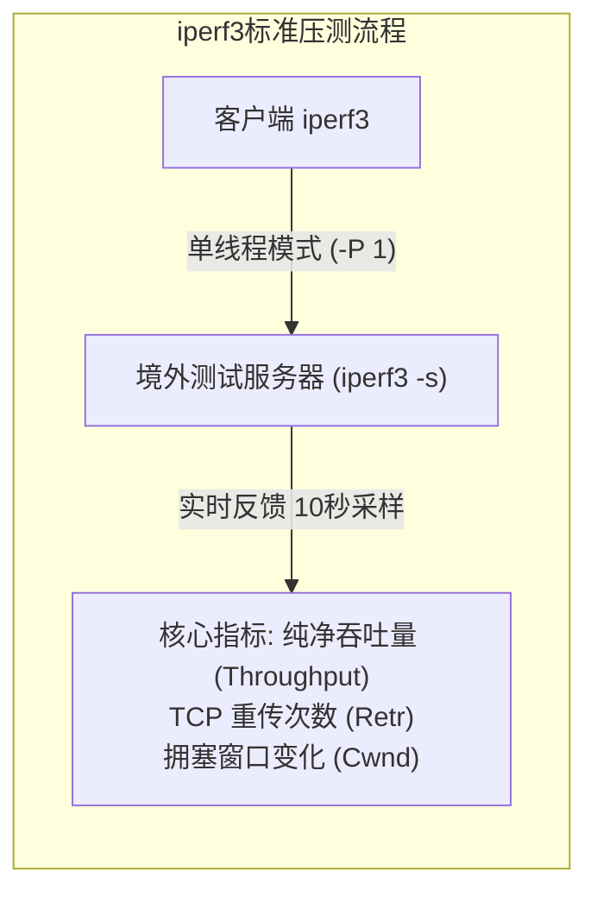

# 真实延迟与单/多线程测速方法：拒绝虚高跑分与 iperf3 跨境吞吐实测指南

在科学上网社群、各类机场测评博客与测速频道中，用户每天都能看到两类极具视觉冲击力的跑分截图：一类是“千兆跑满（900+ Mbps）”的 Speedtest 炫彩测速仪表盘，另一类是节点延迟列表中整齐划一的“15ms”深绿色低延迟标识。

然而，计算机网络传输是一门严格遵从光速物理极限与拥塞控制数学模型的硬科学。**在真实的生产网络中，一个在 Speedtest 跑出上千兆的节点，在实际播放 YouTube 4K 视频时却可能频繁画圈缓冲；一个在客户端里标称 15ms 的节点，在点击网页时甚至可能耗时数秒！**

为什么标称的低延迟无法转化为流畅的打开体验？为什么高跑分无法拯救 4K 视频的卡顿？**从网络工程度量衡来看，很多客户端测得的仅仅是本地到国内中转机房的“入口三层 Ping”，而实际业务体验由端到端四层 TCP 握手 RTT、七层 HTTP 首字节时间（TTFB）、单线程物理吞吐上限（Mathis 理论值）以及路由器缓冲膨胀（Bufferbloat）共同决定。**

本文将为您全面拆解网络测速中的四大认知陷阱，建立起专业网络可观测实验室的标准化性能评估体系与自动化实测工具。

---

## 一、 指标陷阱一：ICMP Ping 假象 vs 真实四层/七层应用层 RTT

在代理客户端中点击测速图标时，不同软件采用的技术原理存在根本性差异：

```
================================================================================
【网络延迟的三层物理与逻辑度量对比】
[层级 1: 欺骗性三层 ICMP Ping (部分轻量客户端采用)]
客户端 ───────(ICMP Echo Request 纯 IP 报文)───────► 国内 BGP 中转机房 (上海/广州)
  * 致命缺陷 1: 只测到了电脑到国内机房的距离，完全没经过跨国内网专线与境外落地机
  * 致命缺陷 2: 机房对 ICMP 开启了最高优先级快转，即使境外代理服务已经宕机，Ping 依然是绿的！

--------------------------------------------------------------------------------

[层级 2: 四层 TCP 握手延迟 (TCP Handshake RTT)]
客户端 ──► 专线中转 ──► 境外落地服务器 (香港/日本)
  * 测量 SYN -> SYN/ACK 的网络往返耗时，真实反映传输层建立连接的物理时延

--------------------------------------------------------------------------------

[层级 3: 真实七层应用层 RTT 测速 (Mihomo / Clash Verge Rev / v2rayN 真连接采用)]
客户端 ──► 本地代理 ──► 专线隧道 ──► 境外落地机 ──► 真实目标网站 (Google / Cloudflare 204)
  * 完整经过: TCP 三次握手 + TLS 1.3 密码协商 + 发送 HTTP GET + 接收 204 No Content
  * 真实反映: 用户点击网页后，浏览器接收到首字节响应所需要的真实等待时间 (TTFB)
================================================================================
```

### 物理常数与光缆时延不可逾越的标尺
光在真空中的传播速度为 $300{,}000\text{ km/s}$。但在现代通信采用的二氧化硅石英光纤中，由于折射率约为 $n = 1.468$，**光在光纤中的实际传播速度约为 $204{,}000\text{ km/s}$（约为真空光速的三分之二）**。
再考虑到光缆的物理铺设并非绝对直线、以及途经光放大器（EDFA）与交换机转发排队延迟，可以计算出不可逾越的**物理理论最低往返时延（RTT）**：

| 通信起止端点 | 真实地理物理直线距离 | 光缆物理极限往返时延 (RTT) | 优质 IEPL 专线实测基准 |
| :--- | :--- | :--- | :--- |
| **深圳 ↔ 香港机房** | 约 35 公里 | **1.2 ms ~ 2.0 ms** | **2.5 ms ~ 4.0 ms** |
| **上海 ↔ 香港机房** | 约 1,250 公里 | **18.5 ms ~ 24.0 ms** | **24.0 ms ~ 28.0 ms** |
| **上海 ↔ 日本东京** | 约 1,800 公里 | **22.0 ms ~ 28.0 ms** | **28.0 ms ~ 35.0 ms** |
| **广州 ↔ 新加坡** | 约 2,600 公里 | **32.0 ms ~ 38.0 ms** | **40.0 ms ~ 48.0 ms** |
| **上海 ↔ 美国洛杉矶** | 约 10,400 公里 (跨太平洋海缆) | **125.0 ms ~ 138.0 ms** | **135.0 ms ~ 155.0 ms** |

> [!WARNING] 物理常识铁律
> 如果您在客户端里看到一个标称“美国洛杉矶”的节点延迟显示只有 **25ms**，这 **100% 只是测到了国内中转机房的假象延迟**！
> 没有任何人类科技能让光子在 25 毫秒内跨越太平洋往返两万公里。

---

## 二、 指标陷阱二：Speedtest 多线程跑分虚高与单线程决胜论

为什么在 Speedtest 上测速轻松跑满 500Mbps 甚至上千兆，但日常观看 YouTube 4K 视频依然频繁画圈缓冲？

```
+─────────────────────────────────────────────────────────────────────────────+
|                 多线程跑分欺骗性 vs 单线程业务卡顿机制对比                   |
+─────────────────────────────────────────────────────────────────────────────+
| Speedtest 多线程工作模式 (Multi-Connection 8~32 条并发流):                  |
|   - 相当于 32 辆轻轨列车并排行驶。                                          |
|   - 即使其中 3 辆遭遇网络丢包减速，另外 29 辆依然在狂飙，汇总相加刷出 500M 跑分 |
|   - 结论: 只能说明机房的"总水管"有多粗，无法代表单个用户的实际体验          |
+─────────────────────────────────────────────────────────────────────────────+
| 真实业务场景 (YouTube 4K, 网页加载, 文件下载):                              |
|   - 全部依赖【单条 TCP 长连接】进行连续数据流传输                           |
|   - 根据 Mathis 公式，单条连接一旦遭遇 2% 的微小丢包，拥塞窗口瞬间腰斩      |
|   - 速度由 500Mbps 断崖式下跌至 6Mbps，播放器瞬间耗尽缓冲区引发卡顿         |
+─────────────────────────────────────────────────────────────────────────────+
```

### Mathis 理论极限：丢包对单流吞吐量的毁灭性打击
根据著名的 **Mathis TCP 吞吐量公式**：
$$\text{Throughput} \le \frac{\text{MSS}}{\text{RTT} \times \sqrt{\text{Loss}}} \times C$$

假设一条跨境链路带宽高达 1000 Mbps，端到端延迟为 50ms（0.05 秒）：
- **若丢包率为 0.0%**（纯内网 IEPL 专线）：单线程吞吐量可达 **500+ Mbps**（4K 极速秒开）；
- **若丢包率仅为 1.0%**（轻微公网中转抖动）：$\sqrt{0.01} = 0.1$，单线程物理吞吐量被直接压制在 **60 Mbps** 左右；
- **若丢包率达到 3.0%**（晚高峰公网严重拥塞）：单线程吞吐量发生**雪崩式下跌至 8 Mbps（约 1 MB/s）**，此时即使多线程跑分再漂亮，看 4K 原盘也必然频繁缓冲死机！

---

## 三、 指标陷阱三：缓冲膨胀 (Bufferbloat) 与负载延迟

很多用户发现：“自己一个人上网挺顺畅，但只要有人在下载大文件，哪怕网络带宽没跑满，所有人的游戏延迟瞬间从 30ms 暴增到 1500ms，网页彻底打不开。”

这种现象被称为 **缓冲膨胀（Bufferbloat）**：
- **产生机理**：网络设备（如家用路由器或机房交换机）为了防止丢包，内置了过大的数据缓冲区（FIFO 队列）；
- 当大流量数据涌入时，数据包在过大的队列中排队，引发了巨大的**排队延迟（Queueing Delay）**；
- **未加载延迟（Unloaded Latency）**：空闲时测得的延迟（如 25ms）；
- **已加载延迟（Loaded Latency）**：在大流量满载时测得的延迟。若已加载延迟飙升至 **500ms ~ 2000ms**，说明链路或节点存在极其严重的超售与队列堆积。

---

## 四、 工业级标准测速工具：iperf3 跨境吞吐实测实战

要客观衡量节点的真实吞吐量，消除多线程测速的泡沫，业界公认的黄金标准工具是 **iperf3**。



### 1. 单线程吞吐压测标准指令（考验真实抗丢包能力）
在已配置本地代理环境的 Linux / macOS 终端或软路由中执行：
```bash
# -c: 目标服务器地址
# -p: iperf3 监听端口
# -t: 持续压测时间 10 秒
# -P 1: 严格单线程测试 (Single Stream)
# -R: 反向传输 (测试下行带宽)
iperf3 -c speedtest.server.com -p 5201 -t 10 -P 1 -R
```

### 2. 观察核心输出字段：
- **`Bitrate`**：单线程真实持续有效带宽（若在 100 Mbps 以上，代表专线极其优质）；
- **`Retr`（Retransmissions）**：TCP 重传次数。如果 10 秒内重传超过 50 次，说明链路存在严重丢包；
- **`Cwnd`**：拥塞窗口大小。如果 Cwnd 始终维持在数百 KB 以上且不发生断崖式下跌，代表拥塞控制算法处于极佳健康状态。

---

## 五、 专业网络实验室晚高峰实测指标矩阵

网络诊断实验室确立了评判机场与节点质量的**四大硬核客观门槛**：

| 评估指标 | 顶级工业级 (Tier 1 物理专线) | 普通商用级 (Tier 2 BGP 中转) | 劣质中转 / 垃圾公网直连 |
| :--- | :--- | :--- | :--- |
| **晚高峰物理丢包率** | **严格 0.0%**（全天候恒定） | `低于 1.0%`（轻微波动） | `高于 5.0%`（严重丢包断流） |
| **单线程下载吞吐量** | **高于 100 Mbps**（4K/8K 秒开） | `30 ~ 80 Mbps`（满足日常 4K） | `低于 10 Mbps`（降码率卡顿） |
| **延迟抖动方差 (mdev)**| **低于 1.5 ms**（物理时钟级平滑）| `低于 10.0 ms` | `高于 35.0 ms`（大幅跳变） |
| **YouTube 详细连接速度**| **高于 85,000 Kbps** | `35,000 ~ 60,000 Kbps` | `低于 15,000 Kbps` |
| **Bufferbloat 负载延迟**| **增加低于 20 ms**（A+ 评级） | 增加 `50 ~ 150 ms` | 增加 `高于 500 ms`（严重堆积）|

---

## 六、 生产环境真实故障复盘（2大典型 RCA 案例）

### 案例一：外企用户迷信“千兆跑分图”，晚高峰开跨国视频会议频繁断音
- **故障拓扑**：某跨境咨询公司高管，购买了某声称“千兆大带宽”的低价机场。白天使用 Speedtest 测速跑出了 850 Mbps 的耀眼跑分。但每到晚上 21:00 与海外客户进行 Zoom 跨国视频会议时，声音频繁断续，提示“网络连接不稳定”。
- **排查与抓包分析**：
  1. 使用 MTR 在晚高峰对该节点进行 500 次 ICMP 采样；
  2. 结果显示：平均延迟虽然为 45ms，但**晚高峰丢包率高达 4.2%**，抖动（mdev）高达 28ms；
  3. 进行 iperf3 单线程压测，其实际单流带宽暴跌至仅有 **3.2 Mbps**；
  4. 该服务商租用的是普通公网中转，白天公网出口空闲，多线程能刷出高分；晚上公网骨干网拥塞，丢包激增，Zoom 依靠的单流实时音视频连接瞬间发生严重丢包。
- **根因判定（RCA）**：多线程跑分掩盖了高丢包本质，单线程吞吐与抗抖动性能不达标导致实时语音长连接崩溃。
- **修复方案**：更换为晚高峰丢包严格维持在 0.0% 的真实内网专线服务商。在相同的 Zoom 会议中，音频丢包率降低至 0%，通话丝滑顺畅。

### 案例二：用户误将 ICMP Ping 20ms 当成真延迟，实际网页加载耗时 3 秒
- **故障拓扑**：某用户电脑使用某免费节点，客户端内显示的 Ping 只有 18ms，但点击访问 Google 首页却需要等待 3 秒以上。
- **排查与 TTFB 耗时拆解**：
  1. 打开 Chrome 开发者工具（F12）进入 Network 面板；
  2. 观察 Google 请求的瀑布流数据：
     - DNS Lookup: 12ms
     - Initial Connection (TCP): **480ms**
     - SSL Handshake: **1,250ms**
     - TTFB (Waiting for server): **1,400ms**
  3. 客户端显示的 18ms，仅仅是本地电脑与位于上海的内网中转机房的 ICMP 握手时间；
  4. 该中转机房后面连接的是一台位于欧洲极度过载的免费小鸡，其真正的四层与七层握手耗时超过 1.5 秒。
- **根因判定（RCA）**：三层 ICMP 延迟与七层真实业务 TTFB 延迟严重脱节，用户被假象延迟误导。
- **修复方案**：在客户端中全面开启“真连接延迟测试（URL-Test）”，淘汰仅显示三层 Ping 的虚假指标。

---

## 七、 常见高频报错与排障速查表 (FAQ)

### Q1: 在哪里可以测试真实的 Bufferbloat（缓冲膨胀）评级？
- **回答**：推荐使用专业网络测试站点 **Waveform Bufferbloat Test**（`https://www.waveform.com/tools/bufferbloat`）。该工具会在满载下载和上传的同时精确度量延迟增加值，并给出从 A+ 到 F 的客观评级。

### Q2: 为什么测速时显示下载几百兆，但上传只有几兆？
- **回答**：这是因为绝大多数机场为了成本优化与防止滥用，采购的均为**不对称带宽**（或者限制了上行出口）。日常看视频、刷网页 95% 以上都是下行流量，只要上行带宽能满足 10~20 Mbps 的 TCP ACK 确认包发送，就不会影响下行拉流速度。

### Q3: 测速越快，就代表看 4K 越流畅吗？
- **回答**：**不一定**。看 4K 流畅的核心是**“单线程最低持续吞吐量高于 25 Mbps”**并且**“丢包率低于 0.5%”**。一个稳定维持在 50 Mbps 且 0 丢包的专线节点，其观影体验远胜于一个平时能冲到 500 Mbps 但每隔 30 秒卡顿一下的劣质公网节点。

---

## 八、 推荐高品质专线容灾逃生节点与延伸阅读

如果您已经厌倦了虚高跑分的欺骗，希望拥有一条全天候 0 丢包、单线程稳定破百兆的真实跨国生产力网络，**强烈建议选择全线配备企业级内网物理专线的顶级服务商**：

<DisasterRecoveryBox />

### 相关进阶排查与排障手册
- [真实网络测速与晚高峰可观测性专题总览](/diagnostics/latency-speed/)
- [单/多线程吞吐衰减与 Bufferbloat 缓冲膨胀集群](/diagnostics/latency-speed/throughput-jitter/)
- [路由器 Bufferbloat 缓冲膨胀与队列延迟调优指南：SQM CAKE / FQ-CoDel 实战](/diagnostics/latency-speed/throughput-jitter/bufferbloat-router-queue-latency-tuning)
- [iperf3 跨境单线程吞吐实测与 TCP 窗口调优指南：突破长肥网络（BDP）物理限制](/diagnostics/latency-speed/throughput-jitter/iperf3-cross-border-throughput-tcp-window-diagnosis)
- [科学上网单线程与多线程测速差异深度解析](/diagnostics/speed-test-single-vs-multi-thread)
- [BGP 公网中转隧道与 IEPL 物理专线全方位对比与成本模型](/airports/speed-stability/iepl-vs-iplc/bgp-tunnel-vs-dedicated-line)
- [DNS 泄漏与防污染深度检测指南](/diagnostics/dns-leak)
- [全节点大面积超时瘫痪根因判定与容灾逃生机制](/connection/all-nodes-down)
- [2026 稳定抗封锁 42 家专线机场综合横评与选型大横表](/airports/)
