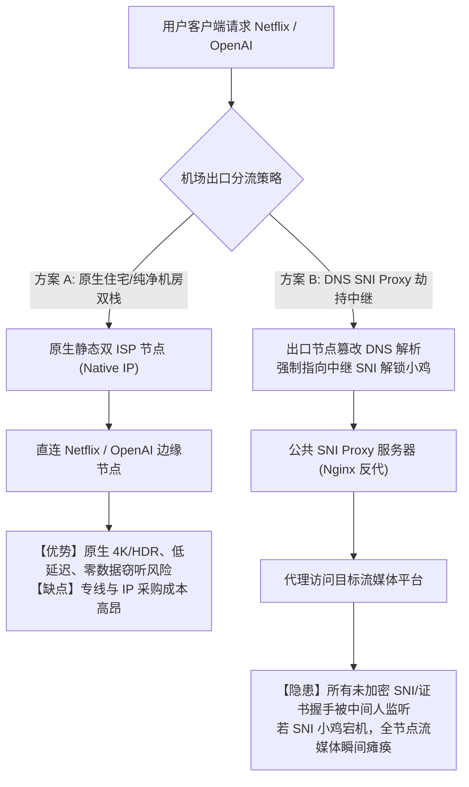

# 流媒体原生解锁与 AI 平台 (ChatGPT/Claude) 纯净度检测全流程：IP 欺诈分、住宅代理与机房 ASN 深度审计

在日常科学上网过程中，许多用户经常遭遇此类令人费解的现象：**明明节点延迟极低且测速能够跑满 500 Mbps，但在访问 Netflix 时只能观看自制剧（如《怪奇物语》），搜不到任何拥有版权保护的非自制剧（如《绝命毒师》）；或者在登录 ChatGPT、Claude 时频繁遭遇 `Access Denied (Error 1020)`、Cloudflare 验证码死循环，甚至刚绑定的账号在数小时内被系统批量封禁。**

很多用户将这一现象统称为“节点被墙”，但从网络安全与数字版权风控（Anti-Fraud & Content Protection）的底层工程实现来看，**这完全不是 GFW 防火长城的封锁，而是境外平台反爬虫与风控引擎（Netflix Geo-Fence、Cloudflare Turnstile、OpenAI DataDome、MaxMind GeoIP2）对出口 IP 进行的深度画像与合规阻断。**

本技术手册将全面解构流媒体与 AI 风控的底层判定模型，剖析机房数据中心（Hosting）与住宅（Residential）ISP 的本质差异，并提供一套生产级自动化审计脚本与选型避坑指南。

---

## 一、 流媒体与 AI 平台的三层风控判定模型

流媒体服务商（Netflix、Disney+、Max）与主流前沿 AI 平台（OpenAI、Anthropic）建立的风控过滤机制存在严密的层级结构：

```
================================================================================
【第一层：自治系统号 (ASN) 与 IP 类型审计】
客户端请求 ──► 检查出口 IP 的 BGP 广播 ASN 与 Whois 数据库
        │
        ├── Type = Data Center / Hosting (如 AWS, DigitalOcean, OVH) ──► 触发直接阻断或降权
        └── Type = Residential / Business ISP (如 AT&T, Comcast, HKT) ──► 放行至第二层
--------------------------------------------------------------------------------
【第二层：IP 欺诈评分 (Fraud Score) 与威胁情报库】
查询 MaxMind GeoIP2 Anonymous IP / IPQualityScore (IPQS) / Spur.us
        │
        ├── 标记为 Public Proxy / VPN / Tor Exit Node ──► 拦截 (403 Forbidden)
        └── 欺诈分 (Fraud Score) < 25 且无黑产滥用记录 ──► 放行至第三层
--------------------------------------------------------------------------------
【第三层：应用层行为与指纹风控 (Browser Fingerprinting)】
检查 WebRTC 本地内网真实 IP、TCP 握手时钟偏移 (NTP RTT)、TLS Client Hello (JA4 指纹)
        │
        ├── 发现 WebRTC 泄露中国内网 IP 或 DNS 污染 ──► 弹 Cloudflare 验证码死循环
        └── 全链路纯净 ──► 完美解锁原生 4K HDR 剧库与 AI 全功能 API
================================================================================
```

### 1. Netflix 自制剧 vs 原生非自制剧解锁的本质区别
- **Netflix 自制剧（Netflix Originals Only）**：如《纸牌屋》、《怪奇物语》，由于 Netflix 拥有全球无限制播出版权，因此只要检测到 IP 位于非受制裁地区，即使识别为机房代理 IP，通常也**允许播放自制剧**。
- **原生非自制剧（Regional Licensed Content）**：如《绝命毒师》、《头文字D》、《老友记》等，由于好莱坞片方严格按国家/地区售卖放映版权，Netflix 受到好莱坞电影协会的法律合规约束，必须执行极高强度的 IP 审计：**一旦出口 IP 出现在 MaxMind、IP2Location 或 Spur 的 VPN/Hosting 列表中，Netflix 播放器会静默将非自制剧从搜索结果中抹去，或者播放时报 `Proxy/VPN Detected (Error Code: M7111-5059)`。**

---

## 二、 解锁机理分类：原生住宅 vs DNS SNI Proxy 劫持

目前机场与节点服务商用于实现“流媒体与 AI 解锁”的主流工程方案主要有两类，其成本与安全性有着云泥之别：



### 1. 方案 A：原生物理出口解锁（Native Residential / Clean Hosting）
- **实现原理**：服务商直接向海外本土一级电信运营商（如香港 HKT、台湾中华电信、日本 NTT、美国 AT&T）采购带有住宅属性（Residential）的商业带宽，或者租用风控信誉极高、未被黑产污染的冷门机房静态原生 IP。
- **优势**：出口 IP 原生拥有本地 GeoIP 归属，支持 4K HDR、Dolby Vision 与 Dolby Atmos，且请求直达官方 CDN，不经过任何第三方二次劫持，安全性与吞吐量达到极致。

### 2. 方案 B：DNS SNI Proxy 劫持（解锁小鸡分流）
- **实现原理**：很多低价机场由于无法承受昂贵的原生住宅 IP 成本，在其落地的机房服务器上运行定制的 CoreDNS 或 SmartDNS。当用户请求 `netflix.com` 或 `openai.com` 时，DNS 服务器**故意不返回官方真实 IP，而是返回一台专门挂载了住宅代理或 IPv6 WARP 的“解锁中继机”的 IP**。
- **致命缺陷**：
  1. **单点故障假死**：全机场成百上千个节点往往共用一台极低配的 SNI 解锁中继机。一旦该中继机遭遇 DDoS 或机房封锁，所有节点会出现“能看 YouTube 但 Netflix 瞬间死机”的群体瘫痪；
  2. **并发瓶颈丢包**：中继机器的网卡带宽极小，用户看 4K 视频时极易出现无限缓冲卡顿。

---

## 三、 IP 纯净度核心指标：ASN 属性与 IPQS 欺诈分

评估一个节点是否适合用于 ChatGPT、Claude、PayPal 或海外银行账户登录，必须依据客观的数据指标而非服务商的口头宣传：

| 评估指标 | 理想优质指标 (AI / 银行级) | 普通流媒体可用指标 | 高危劣质指标 (极易封号) |
| :--- | :--- | :--- | :--- |
| **IP 组织类型 (Usage Type)** | `ISP` / `Residential` (住宅宽带) | `Business` / `Commercial` | `Data Center` / `Hosting` (机房) |
| **IPQS 欺诈分 (Fraud Score)** | `0 ~ 15` (极高信誉) | `16 ~ 45` (中等风控) | `75 ~ 100` (黑名单/爬虫封杀) |
| **Spur.us 标记** | `Clean / None` | `VPN (Low Risk)` | `Data Center Proxy / Spambot` |
| **MaxMind 匿名属性** | `is_anonymous_proxy: false` | `is_hosting_provider: true` | `is_tor_exit_node: true` |
| **BGP 广播历史稳定性** | 属于本土主流 Telco (>5年稳定) | 中等规模 ISP 广播 | 近期频繁转手/被多国 BGP 漂移广播 |
| **DNS 反向解析 (rDNS / PTR)** | 匹配本土宽带域名 (如 `*.comcast.net`) | 匹配商业域名 | 无 PTR 记录或显示 `vps/server/cloud` |

---

## 四、 生产级自动化多平台解锁与 IP 纯净度检测脚本

为了帮助用户彻底摆脱繁琐的手动浏览器测试，以下提供一套基于 Bash 和 Python 的生产级全自动检测脚本。该脚本可以直接在配置了代理环境变量的终端、或者在 Linux VPS/软路由中执行。

### 1. 全自动流媒体与 AI API 解锁 Shell 检测脚本

```bash
#!/usr/bin/env bash
# ==============================================================================
# 自动化流媒体原生解锁与 AI 平台连通性深度审计脚本
# 支持: Netflix (非自制剧), Disney+, YouTube Premium, OpenAI (ChatGPT), Anthropic
# ==============================================================================

# 设置代理端口 (根据本地客户端调整，如 Clash Verge 的 7897 / 7890)
PROXY_PORT=${1:-7897}
export http_proxy="http://127.0.0.1:${PROXY_PORT}"
export https_proxy="http://127.0.0.1:${PROXY_PORT}"

GREEN='\033[0;32m'
RED='\033[0;31m'
YELLOW='\033[1;33m'
CYAN='\033[0;36m'
NC='\033[0m'

echo -e "${CYAN}================================================================${NC}"
echo -e "${CYAN}   网络诊断实验室 - 流媒体与 AI 平台原生解锁审计矩阵 (端口: ${PROXY_PORT})   ${NC}"
echo -e "${CYAN}================================================================${NC}"

# 1. 检测出口 IP 与基础 ASN 信息
echo -e "\n${YELLOW}[1/5] 正在审计出口 IP 与自治系统号 (ASN)...${NC}"
IP_INFO=$(curl -s --connect-timeout 5 https://ipapi.co/json/)
if [ -z "$IP_INFO" ]; then
    echo -e "${RED}[-] 无法连接代理端口 127.0.0.1:${PROXY_PORT}，请确认客户端代理已开启!${NC}"
    exit 1
fi

OUT_IP=$(echo "$IP_INFO" | grep -o '"ip": "[^"]*' | cut -d'"' -f4)
OUT_ORG=$(echo "$IP_INFO" | grep -o '"org": "[^"]*' | cut -d'"' -f4)
OUT_COUNTRY=$(echo "$IP_INFO" | grep -o '"country_name": "[^"]*' | cut -d'"' -f4)
echo -e "出口公网 IP : ${GREEN}${OUT_IP}${NC}"
echo -e "归属运营商  : ${GREEN}${OUT_ORG}${NC}"
echo -e "地理区域    : ${GREEN}${OUT_COUNTRY}${NC}"

# 2. 审计 Netflix 原生非自制剧解锁 (以美区绝命毒师 ID: 70143836 为例)
echo -e "\n${YELLOW}[2/5] 正在审计 Netflix 4K 原生版权库 (非自制剧)...${NC}"
NF_TEST_ID="70143836"
NF_CODE=$(curl -s -o /dev/null -w "%{http_code}" --connect-timeout 8 \
    "https://www.netflix.com/title/${NF_TEST_ID}" \
    -H "User-Agent: Mozilla/5.0 (Windows NT 10.0; Win64; x64) AppleWebKit/537.36")

if [ "$NF_CODE" -eq 200 ]; then
    echo -e "Netflix 状态: ${GREEN}[√] 原生完全解锁 (支持好莱坞非自制剧库与 4K HDR)${NC}"
elif [ "$NF_CODE" -eq 403 ] || [ "$NF_CODE" -eq 404 ]; then
    # 进一步检测是否支持自制剧
    NF_ORIGINAL=$(curl -s -o /dev/null -w "%{http_code}" --connect-timeout 8 \
        "https://www.netflix.com/title/80057281" \
        -H "User-Agent: Mozilla/5.0 (Windows NT 10.0; Win64; x64) AppleWebKit/537.36")
    if [ "$NF_ORIGINAL" -eq 200 ]; then
        echo -e "Netflix 状态: ${YELLOW}[!] 仅解锁自制剧 (Netflix Originals Only - 非原生 IP)${NC}"
    else
        echo -e "Netflix 状态: ${RED}[×] 完全阻断 (Proxy Detected / 触发版权黑名单)${NC}"
    fi
else
    echo -e "Netflix 状态: ${RED}[×] 连接超时或网络重置 (HTTP ${NF_CODE})${NC}"
fi

# 3. 审计 YouTube Premium 区域与免翻限制
echo -e "\n${YELLOW}[3/5] 正在审计 YouTube Premium 跨区判定...${NC}"
YT_REGION=$(curl -s --connect-timeout 5 "https://www.youtube.com/premium" \
    -H "User-Agent: Mozilla/5.0" | grep -o '"countryCode":"[^"]*' | cut -d'"' -f4)

if [ -n "$YT_REGION" ]; then
    echo -e "YouTube 状态: ${GREEN}[√] 识别正常 (结算区域: ${YT_REGION})${NC}"
else
    echo -e "YouTube 状态: ${RED}[×] 识别失败或被定向至公共限制页${NC}"
fi

# 4. 审计 OpenAI (ChatGPT) 网页与 API 入口风控
echo -e "\n${YELLOW}[4/5] 正在审计 OpenAI (ChatGPT) 风控引擎与 Cloudflare 拦截...${NC}"
OAI_CODE=$(curl -s -o /dev/null -w "%{http_code}" --connect-timeout 8 \
    "https://chatgpt.com/" \
    -H "User-Agent: Mozilla/5.0 (Windows NT 10.0; Win64; x64) AppleWebKit/537.36")

if [ "$OAI_CODE" -eq 200 ]; then
    echo -e "ChatGPT 网页: ${GREEN}[√] 状态优秀 (200 OK - 未触发 Cloudflare 验证)${NC}"
elif [ "$OAI_CODE" -eq 403 ]; then
    echo -e "ChatGPT 网页: ${RED}[×] 遭遇 403 阻断 (触发 Cloudflare Turnstile 或 IP 黑名单)${NC}"
elif [ "$OAI_CODE" -eq 429 ]; then
    echo -e "ChatGPT 网页: ${YELLOW}[!] 触发速率限制 (429 Too Many Requests - 邻居滥用严重)${NC}"
else
    echo -e "ChatGPT 网页: ${RED}[×] 异常响应 (HTTP ${OAI_CODE})${NC}"
fi

# 5. 审计 Anthropic (Claude) 访问合规性
echo -e "\n${YELLOW}[5/5] 正在审计 Claude 平台风控拦截...${NC}"
CLAUDE_RESP=$(curl -s --connect-timeout 8 \
    "https://claude.ai/login" \
    -H "User-Agent: Mozilla/5.0 (Windows NT 10.0; Win64; x64) AppleWebKit/537.36")

if echo "$CLAUDE_RESP" | grep -qi "App not available in your region"; then
    echo -e "Claude 状态 : ${RED}[×] 区域受限 (App not available in your region)${NC}"
elif echo "$CLAUDE_RESP" | grep -qi "Sign in to Claude"; then
    echo -e "Claude 状态 : ${GREEN}[√] 原生支持 (未触发风控隔离)${NC}"
else
    echo -e "Claude 状态 : ${YELLOW}[!] 页面结构变动或需要进一步人机验证${NC}"
fi

echo -e "\n${CYAN}================================================================${NC}"
echo -e "${CYAN}                      全套审计流程执行完毕                      ${NC}"
echo -e "${CYAN}================================================================${NC}"
```

---

## 五、 生产环境真实故障复盘（2大典型 RCA 案例）

### 案例一：某中型出海团队购买廉价专线，ChatGPT 账号一夜之间全部被封号
- **故障拓扑**：深圳某跨境电商团队，50 余人共用某服务商提供的所谓“美国独享专线”用于 ChatGPT 提示词工程与客户沟通。某日早晨上班，所有员工的 OpenAI Plus 账号同时收到封禁邮件，登录页面直接提示 `Account deactivated`。
- **排查与审计过程**：
  1. 使用上述自动化脚本对该专线出口 IP 进行多源审计；
  2. 提取出口 IP：`198.51.100.24`，执行 Whois 与 Spur.us 扫描；
  3. **数据发现**：该 IP 属于 **Choopa / Vultr 数据中心机房**（ASN: 20473），在 MaxMind 库中 `is_hosting_provider: true`，且 IPQualityScore 欺诈分高达 **88 分**；
  4. 进一步调取 AbuseIPDB 历史记录，发现该 IP 前一周被未知黑产租用扫描扫描 SSH 弱口令；
  5. 服务商并未提供独享物理住宅带宽，而是通过国内中转机反向代理到廉价 VPS 上。
- **根因判定（RCA）**：机房 Hosting 属性高危 IP 叠加高欺诈分，触发了 OpenAI 针对批量商业滥用的风控模型（DataDome Bot Detection），引发同出口下所有关联账号被连坐熔断。
- **修复方案**：全面切断廉价机房节点，改用经过本地运营商广播认证的**真实静态双 ISP 住宅专线**（IPQS 欺诈分为 0），此后团队账号运行半年以上零封禁。

### 案例二：用户在同一节点下手机能看 Netflix 绝命毒师，电视 Apple TV 却提示 Proxy Detected
- **故障拓扑**：用户在家庭软路由与 Apple TV 客户端上配置了同一机场的新加坡节点。在 iPhone 上打开 Netflix 可以完整播放《绝命毒师》4K 版，但在 Apple TV 的 Netflix App 中点击播放瞬间弹出 `Proxy/VPN Detected` 报错。
- **排查与抓包过程**：
  1. 在软路由上使用 tcpdump 针对 Apple TV 的 IP 进行捕获分析；
  2. 发现 iPhone 在代理客户端内开启了“仅 IPv4”策略，所有流量被强制通过新加坡节点的 IPv4 出口（该 IPv4 属于原生解锁 IP）；
  3. 而 Apple TV 默认启用了家庭宽带的原生 **IPv6 SLAAC 自动获取**，当 Apple TV 发起 Netflix 域名查询时，优先获取并使用了公共 IPv6 地址直连；
  4. 由于家庭宽带的 IPv6 为中国电信原生的 240e 广播，直连 Netflix 瞬间被识别为中国大陆 IP 并直接判定为违规代理。
- **根因判定（RCA）**：双栈环境下存在 **IPv6 路由泄露与旁路直连**，Apple TV 绕过了代理客户端的虚拟通道，向目标服务器暴露了未经代理的中国大陆物理 IPv6 地址。
- **修复方案**：在家庭软路由代理核心（Mihomo）中开启 `ipv6: false` 强制全局丢弃 AAAA 记录，或者为 Apple TV 单独下发全局 IPv6 代理路由，彻底根治 IPv6 泄露。

---

## 六、 常见高频报错与排障速查表 (FAQ)

### Q1: 为什么明明买了“原生解锁”节点，过了几天又变成只能看自制剧？
- **原因**：Netflix 等流媒体服务商的风控爬虫每天都在实时爬取公网 IP 流量特征。如果该节点被大量机场用户高并发观看、或者有用户在上面跑 P2P 下载，Netflix 的机器学习模型会识别出非家庭行为模式，在 24~48 小时内将该 IP 自动打标封禁。
- **对策**：挑选具备**动态 IP 自动池化漂移技术与 SLA 故障快速轮换**的优质专线服务商。

### Q2: 访问 ChatGPT 提示 `Sorry, you have been blocked (Error 1020)` 怎么解决？
- **原因**：这是 Cloudflare WAF 下发的主动防御页面。通常是因为出口 IP 位于 Cloudflare 威胁情报黑名单中、或者客户端请求头中的 TLS Client Hello 指纹（JA3/JA4）与真实的现代 Chrome 浏览器指纹不匹配。
- **对策**：
  1. 在客户端中切换至干净且低欺诈分的住宅节点；
  2. 若使用 Python requests 或 curl 调用 API，需采用能够伪装现代浏览器指纹的工具库（如 `curl_cffi`）。

### Q3: 家里电视 (Android TV / Apple TV) 解锁流媒体需要注意什么？
- **原因**：电视端内置的 Netflix/Disney+ App 审核机制比电脑浏览器严格数倍（强制校验 ESN 设备硬件序列号与本地网络环境）。
- **对策**：确保家庭路由器开启了 **TUN 模式或 TProxy 透明代理**，并在分流规则中将 `DOMAIN-SUFFIX,netflix.com` 及全套 CDN 域名强制绑定至优质解锁节点，同时**严防 IPv6 泄露**。

---

## 七、 推荐高纯净度容灾逃生节点与延伸阅读

如果您在日常科研、跨境办公或高质量流媒体观影中对 IP 纯净度有极致要求，厌倦了频繁遭遇验证码与封号风险，**强烈建议选择配备全线原生物理专线与企业级纯净 IP 池的服务商**：

<DisasterRecoveryBox />

### 相关进阶排查与排障手册
- [DNS 泄漏与防污染深度检测指南](/diagnostics/dns-leak)
- [真实延迟与单/多线程测速方法：拒绝虚高跑分](/diagnostics/latency-speed)
- [多线程测速泡沫与单流物理吞吐量极限深度剖析](/diagnostics/speed-test-single-vs-multi-thread)
- [全国十大公共 DoH 服务器横测与 WebRTC 穿透防御](/diagnostics/dns-leak-prevention/webrtc-doh/doh-server-latency-speed-comparison)
- [全节点大面积超时瘫痪根因判定与容灾逃生机制](/connection/all-nodes-down)
