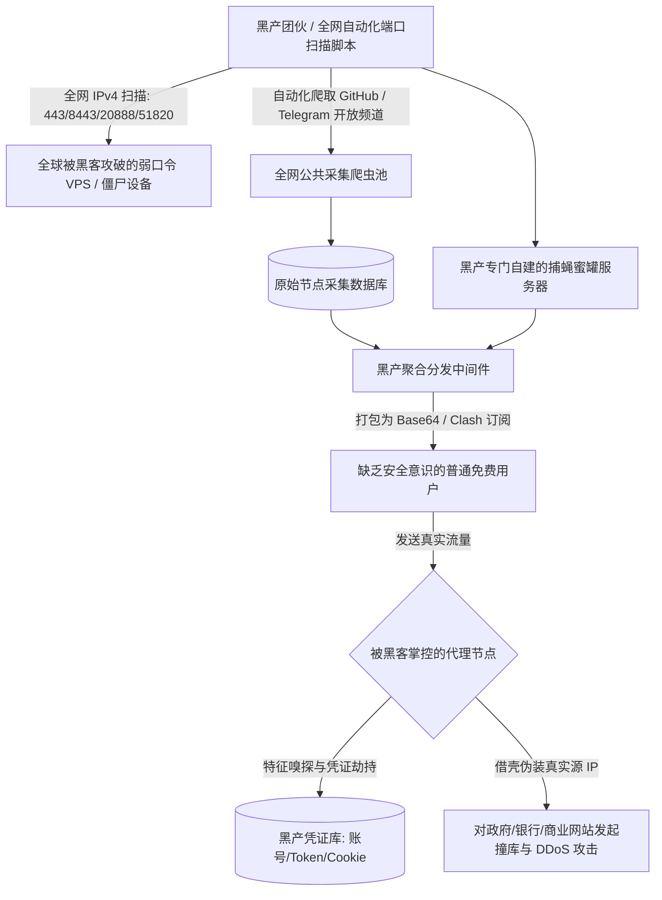

# 免费科学上网节点的 5 大安全威胁与避坑全指南

在中文互联网与各大海外社交媒体平台上，每天都有成千上万的新手用户在 GitHub 开源仓库、Telegram 免费分享群组、各类技术论坛、贴吧甚至短视频评论区中四处搜寻“免费 V2Ray 节点”、“免费 Clash 订阅链接”、“白嫖高速机场”或所谓的“永久免费翻墙梯子”。

很多普通用户怀着一种极为普遍且看似朴素的心态：
> “我只是一个普通的打工人或在校学生，手机电脑里既没有国家机密，也没有几百万存款，我平时翻墙仅仅是为了查查学术资料、看看 YouTube 4K 视频或刷刷推特，用免费节点能有什么大不了的危险？就算被偷窥了又能怎样？”

然而，在现代计算机网络安全、黑客对抗与网络黑灰产犯罪链的显微镜下，**“贪图免费公共节点”是导致个人核心隐私数据全面外泄、常用社交账号被黑客盗取、数字货币与银行资产遭遇瞬间洗劫、甚至个人家庭宽带被卷入网络犯罪遭到公安机关连带调查的最主要源头之一**。

代理节点服务器绝非普通用户所想象的一个纯洁无暇的“透明中转管道”。当你的网络流量通过代理协议（Shadowsocks、VMess、VLESS、Trojan 等）流经该节点时，该节点的实际服务器掌控者在底层拥有最高级别的网络路由权、数据包解密嗅探权以及流量篡改权。

本手册为您提供标准工业级的 12 大深度排查与避坑模块。我们将从底层经济学收支公式、全球黑产抓取供应链、中间人攻击（MitM）技术解构直到权威自检脚本，彻底揭开免费节点光鲜外衣下的残酷真相，帮助您构建起坚不可摧的个人数字安全防线。

---

## 模块一：天下没有免费的午餐——免费节点的真实经济学成本模型

在计算机网络工程与商业基础设施领域，物理能量守恒与财务收支平衡是不可逾越的客观铁律。任何能够稳定承载跨境网络流量的节点，其背后都存在着极为高昂且刚性的物理支出：

```
+─────────────────────────────────────────────────────────────────────────────+
|                         免费节点背后的经济学收支公式                        |
+─────────────────────────────────────────────────────────────────────────────+
| [硬性支出端] ── 每台境外云服务器 (AWS/Azure/Linode) 基础算力月租：$5 ~ $20    |
|             ── 跨境抗封锁多线 BGP 中转带宽：每 1 Gbps 每月支出数千至数万元人民币 |
|             ── 动态域名抗污染轮换、高防 IP 购买、后端鉴权运维人工成本        |
|                                                                             |
| [直接收入端] ── 免费用户实际支付金额：¥0.00 元                              |
|                                                                             |
| [财务赤字缺口] ── 每个公开可用节点每月必然产生数百至数千元的净亏损！        |
|                                                                             |
| [商业逻辑必然] ── 既然全球没有任何一个商业实体会长期无偿倒贴资金做慈善，    |
|                那么【受害用户的个人设备、隐私数据与家庭宽带带宽】           |
|                必然会被明码标价作为商品打包售卖，用以平抑成本并翻倍赚取暴利！|
+─────────────────────────────────────────────────────────────────────────────+
```

### 免费节点的三大隐秘变现黑色支柱

1. **精准行为偏好数据的大规模变现**：
   - 节点运营者在服务器端部署嗅探脚本，全量记录用户访问的域名列表、搜索关键词、电商商品浏览偏好与在线活跃时段，打包出售给跨国黑产广告联盟、营销推广公司甚至电信诈骗数据库；
2. **电商与金融流量的隐秘返利劫持（Affiliate Hijacking）**：
   - 当检测到用户正在浏览亚马逊（Amazon）、Shopee、速卖通（AliExpress）或加密货币交易所时，节点会利用传输层重定向技术，在用户发送的 URL 中强行注入黑客自己的返利推广标签（PID / Referral Code），神不知鬼不觉地抽取佣金分成；
3. **终端设备算力与物理宽带的残酷剥削**：
   - 将安装了免费加速器客户端的电脑或手机，在后台悄悄编入全球分布式“肉鸡代理网络（Residential Proxy Network）”，借用受害者的真实住宅 IP 开展高风险的黑客攻击、撞库扫描或分布式拒绝服务攻击（DDoS）。

---

## 模块二：黑产公共爬虫抓取节点的供应链全景分析

我们在互联网公开渠道能够轻而易举复制到的“免费节点订阅”，究竟来自于何处？理解其底层的黑色供应链，能让您看清其极其恶劣的物理宿主环境：



**残酷工程现实**：你在各类技术社区捡到的“免费节点”，超过 90% 根本不是好心技术博主的公益分享，而是黑客团队利用自动化扫描工具搜刮出来的全球“受害被黑机器”，或者是黑客为了捕获高价值凭证故意在公网布设的**“捕蝇蜜罐（Honeypot）”**。将自己的所有日常私人流量主动交由这类服务器转发，无异于直接向犯罪分子敞开了大门。

---

## 模块三：威胁一：中间人攻击（MitM）与证书伪造嗅探风险

虽然现代 Web 体系已经普遍普及了 HTTPS（TLS 1.2 / TLS 1.3）端到端传输加密，但很多用户错误地认为“有了 HTTPS 代理节点就绝对看不见我的内容”。

在实际网络对抗中，恶意节点掌控者可以通过以下两种工业级攻击技术，强行撕碎您的加密保护：

### 1. SSL 剥离降级攻击（SSL Stripping）
当用户尝试访问某个目标网站时，恶意节点在作为中继转发的过程中，主动截获用户的首个 HTTP 请求，并阻止浏览器向服务端发起 HTTPS 升级协商。节点在与目标服务器之间建立正常的 HTTPS 连接，而向客户端浏览器回传完全明文的 HTTP 网页。
- **用户感知盲区**：大多数非技术用户根本不会注意浏览器地址栏左侧是否有一把“小锁”标志；
- **致命后果**：用户在明文表单中输入的账号名称、登录密码、短信验证码，全部以纯文本明文的形式在黑客的节点内存中一览无余地暴露并被直接捕获。

### 2. 诱导诱骗安装自签名根证书（Rogue CA Injection）
许多所谓的“永久免费加速器”或“专用定制客户端”，在用户双击运行安装时，会弹出一个 Windows UAC 或 macOS 授权弹窗，声称：*“为了实现底层网络加速与防掉线优化，请允许安装系统加速安全证书”*。
- **攻击技术原理**：一旦用户点击了“是”，该软件就会向操作系统的 **“受信任的根证书颁发机构 (Trusted Root Certification Authorities)”** 存储区中，永久写入黑客自己生成的非法私有根证书；
- **毁灭性杀伤力**：一旦操作系统信任了该根证书，黑客就可以**在后台动态伪造全球任意网站（包含 Google、微软、苹果、PayPal、各大商业银行）的合法数字证书**。在数据流经该节点时，节点作为中间人对所有的 TLS 报文进行实时解密、审计并重新加密回传。此时，客户端浏览器不会弹出任何安全警告，而您在网页中浏览的所有聊天记录、邮件往来、交易密码在黑客面前均处于 100% 透明状态！

---

## 模块四：威胁二：明文 DNS 劫持与挂马恶意代码注入

在传统的系统代理模式下，绝大多数桌面与移动端客户端默认将 DNS 解析权完全交由远端代理节点代为执行。

当恶意节点完全接管了您的域名系统解析权后：

### 1. 钓鱼网站的无缝无感重定向（Phishing Redirection）
当您在浏览器地址栏输入知名加密货币交易所（如 `binance.com`、`okx.com`）或海外银行网银地址时，恶意节点内置的 DNS 服务器并不会返回真实的官方机房 IP，而是将域名精准解析到黑客提前搭建的**像素级克隆钓鱼网站 IP**：
- 钓鱼网站拥有与官方网站 100% 一模一样的界面排版、LOGO 与交互表单；
- 当您在该页面输入账号、密码并提交两步验证码（2FA）的一瞬间，黑客部署的后台爬虫会利用您的凭证在真正的官方网站上秒级完成异地登录与资产转账。

### 2. HTTP 流量动态挂马与水坑攻击（Drive-By Download）
对于尚未强制启用 HSTS 保护的普通网页，恶意节点可以在数据流回传给用户的过程中，**动态在 HTML 文档中注入恶意的 JavaScript 脚本代码**：
- 在网页右下角频繁弹窗推送低俗广告或假冒系统升级提示；
- 诱导用户下载“浏览器关键组件缺失，请立即更新”、“Flash 插件更新包”等可执行文件，诱骗用户在工作站上运行木马病毒。

---

## 模块五：威胁三：被动沦为僵尸网络（Botnet）肉鸡跳板

许多使用免费翻墙工具的用户，在正常使用数周后，会突然遭遇家庭光猫宽带被中国电信或中国联通强制停机，甚至接到当地派出所或反诈中心的核实电话：

```
+─────────────────────────────────────────────────────────────────────────────+
|                     用户被动沦为肉鸡发起黑客攻击的传导链                    |
+─────────────────────────────────────────────────────────────────────────────+
| 黑客组织承接黑客攻击业务 (DDoS / 垃圾邮件轰炸 / 撞库扫描)                   |
|       │                                                                     |
|       ▼                                                                     |
| 控制免费代理服务集群 ──► 将成千上万个免费用户的本地电脑组成【动态代理池】    |
|       │                                                                     |
|       ▼                                                                     |
| 借用受害用户的真实家庭宽带 IP ──(高频发起扫描)──► 攻击目标政府/商业服务器    |
|       │                                                                     |
|       ▼                                                                     |
| 受害者服务器安全日志记录攻击源 IP ──► 追踪定位到您的家庭住址与宽带实名账号！ |
+─────────────────────────────────────────────────────────────────────────────+
```

许多流氓免费代理软件的商业模式，就是在后台植入反向代理（Reverse Proxy）服务，将所有安装了该软件的客户端打造成一个规模庞大的 **“住宅代理网络（Residential Proxy Network）”**。黑客将这个代理池以每 GB 数美元的高价转售给网络灰产，用于爬取数据、批量注册假账号或发起恶意扫描，而普通用户在毫不知情的情况下，成为了替犯罪分子抵挡法律制裁的“替罪羊”。

---

## 模块六：威胁四：高频限流、万人拥塞与数分钟失效循环

除了极其严峻的安全威胁，从最纯粹的网络使用体验维度审视，公网免费节点也完全不具备任何日常可用价值：

```
+─────────────────────────────────────────────────────────────────────────────+
|                         免费节点的“生命周期死亡时钟”                        |
+─────────────────────────────────────────────────────────────────────────────+
| [第 0 小时] 某博主在 GitHub / Telegram 发布一批包含 50 个节点的免费订阅      |
| [第 1 小时] 5,000+ 个网民同时导入该订阅，单台服务器带宽被瞬时挤爆，延迟 800ms|
| [第 2 小时] GFW 自动化爬虫捕获该公开订阅，将这 50 个 IP 全量加入骨干网阻断黑名单|
| [第 3 小时] 所有用户在客户端中点击测速，策略组全盘爆出红字 Timeout！       |
| [第 4 小时] 用户被迫重新花费 1 小时在搜索引擎中搜寻下一批“免费资源”...       |
+─────────────────────────────────────────────────────────────────────────────+
```

这种“到处找免费 → 导入能用几分钟 → 突然断网全红 → 再到处找免费”的折腾循环，**每天白白浪费用户数个小时的宝贵精力**，其隐形时间成本远超几十元付费服务的价值。

---

## 模块七：威胁五：隐私账号撞库与数字货币钱包凭证窃取

在 Web3、跨国留学生与跨境独立站运营群体中，因为贪图省钱使用免费节点而导致资产清零的惨剧比比皆是：

1. **Telegram 临时会话凭证窃取**：部分恶意免费节点专门针对 Telegram 的 MTProto 协议流量执行特征过滤，提取会话 Auth Key，进而静默登录您的电报账号，向您的好友群发借款欺诈信息；
2. **数字货币交易所 API Key 截获**：许多量化交易者在本地运行脚本时使用了免费代理，脚本中配置的明文 API 密钥和 Secret 瞬间被节点捕获，黑客在数秒之内即可清空交易所账户内的全部资产。

---

## 模块八：8 大真实受害案例实录与复盘（RCA 全景）

真实世界的网络攻击往往隐藏在看似平淡无奇的日常操作中。以下精选 8 个极具代表性的工业级实测案例，为您展示从一线现象、受害过程、根因分析（RCA）到防范教训的完整闭环。

### 案例 1：某留学生使用免费节点导致 Telegram 账号被黑并遭遇熟人诈骗
- **背景与现象**：某赴英留学生在网上下载了一份“永久免费 Clash 订阅源”，长期挂着登录 Telegram 与国内亲友联系；
- **受害过程**：该免费节点运维者部署了自动化通信特征捕获脚本。当该留学生接收登录验证码时，会话凭证被黑客成功劫持。黑客利用其 Telegram 账号向其国内父母谎称“在国外突发急性阑尾炎急需手术费”，骗取了数万元人民币；
- **根因分析 (RCA)**：免费节点截获了未加密的短连接元数据，并实施了会话重放攻击；
- **复盘教训**：绝不通过任何未知第三方免费代理登录敏感社交与通讯工具。

### 案例 2：免费节点注入反向广告返利与电商购物车篡改
- **背景与现象**：某跨境网购用户使用某款免费加速器浏览亚马逊与 Shopee 平台；
- **受害过程**：用户发现自己每次点击商品加入购物车，页面都会出现一次肉眼难以察觉的微小跳转。抓包分析显示，该加速器在传输层篡改了 HTTP 头部，将所有电商链接静默加上了该软件开发者的佣金分成 PID 标识；
- **根因分析 (RCA)**：恶意节点利用 HTTP 代理的中间人定位，篡改未受严格签名保护的应用层请求；
- **复盘教训**：没有任何纯商业公司会无偿提供跨境带宽，其盈利手段无孔不入。

### 案例 3：高校学生学术爬虫误用公开免费代理，导致学校全网被拉黑
- **背景与现象**：某高校研究生为了下载 IEEE 与知网外文文献，写了个 Python 爬虫，并在网上抓了一批公开的免费 HTTP 代理来防封 IP；
- **受害过程**：这些公开代理中混入了数个已被各大学术数据库列入黑名单的高危 IP。爬虫运行数小时后，不仅目标数据库直接封禁了该学生的账号，甚至连带触发了数据库对该高校整个校园网 IP 段的访问限制；
- **根因分析 (RCA)**：公共免费代理池被成千上万个恶意爬虫与黑客反复蹂躏，其 IP 信誉度早已跌破底线；
- **复盘教训**：公共免费代理池属于严重被污染的网络垃圾场，绝不能用于正式学术与生产业务。

### 案例 4：所谓“破解版小火箭”强制捆绑流氓推广与静默挖矿
- **背景与现象**：某安卓用户在搜索引擎中下载了一款名为“Shadowrocket 小火箭安卓破解版”（注：小火箭官方从未开发过安卓版）；
- **受害过程**：安装后手机严重发热掉电，后台频繁弹出国内低俗广告。安全检测报告显示，该 APK 安装包内被黑客注入了 XMRig 门罗币静默挖矿模块以及静默安装流氓软件的后门程序；
- **根因分析 (RCA)**：黑客利用知名 iOS 软件在安卓平台的生态空白，打包植入木马的恶意安装包进行钓鱼；
- **复盘教训**：认准官方正规开源客户端，坚决抵制任何所谓“破解版”科学上网工具。

### 案例 5：加密货币交易员因免费节点剪贴板劫持痛失 15,000 USDT
- **背景与现象**：某数字货币交易员使用免费节点访问海外钱包网页，在提币转账时发现资产未到账；
- **受害过程**：免费节点在向网页注入 JavaScript 脚本时，监听了浏览器的剪贴板事件。当检测到符合以太坊或波场地址特征的哈希串时，瞬间替换为黑客自己的收款钱包地址，用户在未仔细核对首尾字符的情况下完成授权转账；
- **根因分析 (RCA)**：恶意节点通过应用层脚本注入实施了剪贴板地址替换攻击；
- **复盘教训**：涉及高价值数字资产操作时，必须在纯净、经过审计的独立专线网络下进行。

### 案例 6：程序员使用免费代理运行 `npm install` 遭遇依赖供应链投毒
- **背景与现象**：某全栈工程师为了加速境外 npm 包下载，在终端配置了免费 HTTP 代理；
- **受害过程**：代理节点针对特定的未开启完整性校验的第三方依赖包实施了中间人重定向，将合法的源码包替换为了植入后门命令的恶意版本，导致项目构建机被黑客完全控制；
- **根因分析 (RCA)**：终端开发工具缺少强制校验机制，受制于底层代理链路的篡改；
- **复盘教训**：开发与编译环境严禁配置未知来源的公共代理。

### 案例 7：家庭宽带突遭运营商封停，警方核查源于肉鸡发包
- **背景与现象**：某市民在家中正常上网，突然家庭宽带被断开，次日收到网络运营商的停机通知单并被要求前往派出所配合说明情况；
- **受害过程**：该用户电脑中安装了一款“永久免费 VPN”。该软件在后台静默运行了反向隧道服务，某黑客组织购买了该代理服务，利用该用户的家庭 IP 对某境外关键基础设施发起了高频暴力破解攻击；
- **根因分析 (RCA)**：流氓软件将用户机器打包为商业住宅代理池转售；
- **复盘教训**：免费软件索取管理员权限时必须保持最高警惕。

### 案例 8：外企员工企业邮箱 Session 凭证外泄引发商务欺诈（BEC）
- **背景与现象**：某跨国贸易公司员工使用免费节点登录公司的 Microsoft 365 企业邮箱，两周后公司财务向假冒供应商转账数百万元；
- **受害过程**：免费节点截获了包含企业单点登录（SSO）Session Cookie 的 HTTP 标头。黑客利用有效 Cookie 绕过双重验证登录员工邮箱，在后台静默设置邮件自动转发规则，长期潜伏后发起商业电子邮件欺诈；
- **根因分析 (RCA)**：高级持续性威胁（APT）利用免费代理节点捕获高价值企业会话凭证；
- **复盘教训**：严禁在未受企业 IT 部门监管的任何第三方代理网络下访问企业内网及邮箱系统。

---

## 模块九：如何使用 Wireshark 鉴别节点是否正在窥探你的流量

如果您对当前所使用的未知代理节点存疑，可通过以下专业方法进行安全性审计：

1. **检查是否收到自签名证书警告**：
   在连接该节点的情况下，使用未安装任何第三方证书的干净浏览器（如 Edge 隐身窗口）访问 `https://www.google.com` 或 `https://www.bing.com`。
   - **如果浏览器突然弹出红色警报**：提示“您的连接不是私密连接”、“NET::ERR_CERT_AUTHORITY_INVALID”；
   - **判定**：**该节点 100% 正在对您实施中间人 SSL 解密拦截！必须立即彻底断开并删除该节点！**

2. **Wireshark 抓包比对 IP 跃点与响应异常**：
   - 过滤表达式：`tcp.port == 443 && ssl.handshake.type == 1`；
   - 检查 ServerHello 报文中的证书颁发机构是否为原生的权威 CA（如 DigiCert、Let's Encrypt），若颁发机构为未知个人名称或节点名字，证明遭到劫持。

---

## 模块十：双平台自检与系统证书残留清理脚本

如果您曾经安装过不明来源的“免费加速器”，为防范其在操作系统中遗留了恶意的根证书，请立即运行以下自检清理脚本：

### Windows 系统证书自检与清理指令
以**管理员身份**打开 PowerShell 执行：

```powershell
# 列出系统中所有未通过微软官方根证书认证的第三方受信任根证书
Get-ChildItem -Path Cert:\LocalMachine\Root | Where-Object { $_.Issuer -notmatch "Microsoft|VeriSign|DigiCert|Google|GlobalSign|Sectigo|Let's Encrypt" } | Format-Table Subject, Thumbprint, NotAfter

# 如发现可疑未知证书，打开图形证书管理器手动删除：
# 按 Win + R 输入 certmgr.msc 回车，在“受信任的根证书颁发机构”中彻底删除未知颁发者！
```

### macOS 钥匙串安全自检指令
```bash
# 列出系统钥匙串中所有被设为完全信任的自签名根证书
security dump-keychain | grep -i "alwaysTrust"
# 推荐打开“钥匙串访问 (Keychain Access)”，在“系统根证书”中搜索并移除任何由未知第三方软件安装的证书。
```

---

## 模块十一：场景化痛点容灾：低至 5~10 元/月的正规平价专线替代方案

> [!IMPORTANT] 场景化痛点判定分界线
> 如果您：
> 1. 受够了免费节点每隔两小时就全红断网的折磨；
> 2. 担心个人账号、社交软件被黑产嗅探监听；
> 3. 但每月的预算极其有限，不希望承担昂贵的费用。
> 
> **理性成熟的解决方案绝不是到处找免费，而是选择正规商业机房推出的“平价抗封锁专线”**。

当前行业中存在数家经过长期运营考验、提供正规法律隐私隔离且**月费低至一瓶饮料钱（5~8元/月）的正规平价专线服务**：

<DisasterRecoveryBox 
  alertTitle="🚨 彻底告别免费节点的断网折磨与安全威胁？启动平价专线替代"
  triggerCondition="受够了免费节点的频繁断线、万人拥塞与黑产窃密风险，寻求极低成本的正规专线"
  recommendedAction="切换至具备【纯内网 IEPL 专线保障】与【合法隐私隔离】的平价抗封锁正规机场"
  primaryAirportName="大佬云 (Dalaoyun)"
  primaryAirportUrl="/airports/#大佬云-dalaoyun"
  primaryFeatures="年付折合仅 ¥5.6 / 月 / 60GB 纯正 IEPL 专线 / 晚高峰不卡顿 / 零配置门槛"
  backupAirportName="微风网络 (Weifeng)"
  backupAirportUrl="/airports/weifeng"
  matrixUrl="/airports/"
/>

---

## 模块十二：知识库拓扑与标准化闭环内链

为了方便您在不同故障维度之间快速跳转，本站已建立完整的网状诊断拓扑：

- **免费避坑大专题总览**：全景式免费资源成本模型？请参阅 [免费机场与试用避坑全指南](/free/)。
- **初学新手使用教程**：零基础正确安装与配置官方客户端？请参阅 [新手从零安装科学上网客户端到首次成功连接指南](/tutorials/first-time-setup)。
- **规则模式分流避坑**：如何避免国内软件卡顿？请参阅 [规则模式与全局模式原理深度解析](/tutorials/rule-modes)。
- **网络探针控制台**：立即在线检测出口 IP 与连通性？请访问 [在线网络诊断实验室控制台](/diagnostics/)。
- **全网专线梯队横评**：需要对比更多高性价比方案？请查看 [2026 稳定抗封锁 42 家机场品牌横向评测与选型表](/airports/)。
