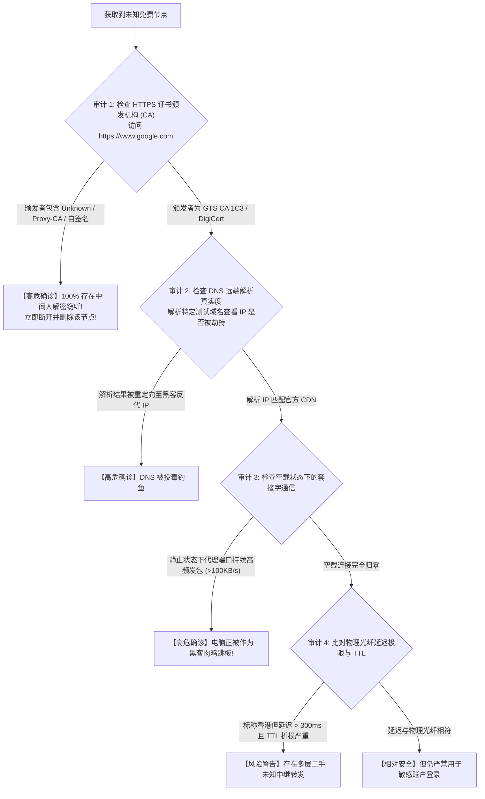

# 免费蜜罐节点指纹特征与流量镜像嗅探审计：如何用 Wireshark 识别伪造证书与中间人窃密

在网络空间对抗与网络安全攻防演练中，**“蜜罐（Honeypot）”**通常指代一种故意配置了安全弱点、以吸引攻击者或特定目标接入并实施全量行为取证的诱捕系统。

而在科学上网与跨境代理领域，**“免费代理蜜罐”**已经演变为一种高度工业化、隐蔽性极强且暴利驱动的黑灰产产业链：**黑客团伙、钓鱼诈骗集团或恶意机构在海外租用廉价云服务器，搭建 Shadowsocks、V2Ray、Trojan 或 Hysteria 2 服务端，故意将其打上“永久免费”、“无偿分享高速万人节点”、“4K 秒开”等夺目标签，大规模分发至各大 Telegram 交流群、GitHub 公共仓库或各类破解论坛中。**

当不知情的技术人员、外贸业务员或加密货币投资者将这些免费节点导入客户端并开启全局代理时，**该节点的服务端便在物理与协议层面上获得了对用户全量网络流量的掌控权（旁路镜像、明文嗅探、会话劫持与中间人解密）**。

本文将以真实网络安全渗透测试标准，自底向上解构免费蜜罐代理的窃密架构，提供基于 Wireshark 抓包深度分析、证书透明度日志（CT Logs）校验的四维审计方法，并提供自动化 Python 证书指纹扫描脚本与避坑指南。

---

## 一、 核心架构解剖：免费蜜罐节点的三层流量劫持模型

要彻底搞清免费蜜罐是如何在用户毫无察觉的情况下盗取资产的，必须观察恶意服务端部署的旁路与中间人管线：

```
================================================================================
【免费代理蜜罐服务端的流量监听与篡改管线】
[受害用户客户端] ──► 发起加密代理请求 (访问海外网银 / 交易所 / 邮箱)
                             │
                             ▼ (通过 Shadowsocks / V2Ray 协议传输至境外节点)
[蜜罐服务器前端网卡 (eth0)]
        │
        ├── 旁路嗅探 1: tcpdump / Wireshark 实时全量镜像 (落盘至黑产磁盘)
        │      └── 提取: 未加密的 DNS 查询、HTTP 请求、明文 SNI 域名
        │
        ▼
[中间人劫持模块 (MIMT Engine: mitmproxy / SSLsplit)]
        │
        ├── 判定 A: 目标是普通 HTTP ──► 注入恶意 JS 弹窗、篡改电商返利联盟代码
        ├── 判定 B: 目标是 HTTPS ──► 尝试下发伪造根证书 (自签名 CA) 实施中间人解密
        └── 判定 C: 目标启用 HSTS ──► 实施 SSL-Stripping (将 https:// 强降级为 http://)
        │
        ▼
[远端目标网站 (Google / Binance / PayPal)]
================================================================================
```

### 1. 为什么“免费”往往是最昂贵的代价？
维持一台拥有千兆出境带宽的海外 VPS，服务商每月必须承担数十至数百美元的硬件与机房电力成本。世界上绝不存在所谓“无偿提供几百 G 高速带宽给成千上万陌生人白嫖”的慈善家。
**免费节点的背后必然存在清晰的商业变现闭环**：
- **变现路线 A（直接窃密）**：抓取用户在无保护状态下输入的明文密码、API Token、Telegram 登录验证码与加密货币钱包私钥；
- **变现路线 B（肉鸡跳板）**：利用连接用户的真实家用宽带作为分布式拒绝服务攻击（DDoS）或黑客渗透的代理跳板（Botnet Proxy Relay），一旦出事，网警追查到的源头 IP 属于无辜的受害用户；
- **变现路线 C（流量投毒）**：在用户浏览海外购物网站时动态篡改请求头中的推广标识（Affiliate Hijacking），窃取原本属于站长的佣金。

---

## 二、 蜜罐节点三大典型分类与危害等级

| 蜜罐类别 | 部署目的与技术手段 | 核心危险程度 | 典型受害者现象 |
| :--- | :--- | :--- | :--- |
| **黑灰产凭证收割型 (Credential Harvester)** | 搭建伪造证书与重放攻击，嗅探账户密码、Cookie 与交易私钥 | **致命危险** (直接财产损失) | 虚拟币钱包资产归零、社交账号异地被盗发诈骗信息 |
| **僵尸网络跳板型 (Botnet Relay)** | 利用用户的本地 IP 发起暗网扫描、暴力破解或黑客攻击 | **法律风险** (背锅承担连带责任) | 电脑上行带宽莫名占满、宽带被运营商封停、甚至面临执法调查 |
| **商业流量劫持型 (Traffic Monetization)** | 动态注入广告脚本、篡改淘宝/亚马逊商品返利 ID | **中等骚扰** (隐私全无) | 网页频繁弹出澳门博彩弹窗、访问正常网站出现异常重定向 |

---

## 四、 蜜罐节点四维硬核安全审计方法

面对一个来源不明的未知公共节点，请按照以下标准安全流程实施技术审计：



### 1. 维度一：SSL/TLS 证书链完整性与证书透明度 (CT Logs)
在通过代理节点访问 `https://www.google.com` 时：
1. 点击浏览器地址栏左侧的“查看网站信息”图标（挂锁图标）；
2. 依次点击 **「连接是安全的」** → **「证书有效」**；
3. **审查证书颁发机构（Issuer）**：
   - **合法正规证书**：颁发者应当为 `GTS CA 1C3`（Google 官方 CA）、`Cloudflare Inc ECC CA-3` 或 `DigiCert Global Root`；
   - **蜜罐伪造特征**：如果颁发机构名称变成了未知字样、拼写错误的虚假机构、或者带有 `Proxy`、`Charles`、`mitmproxy`，**100% 证明当前节点在中间链路劫持了 TLS 握手，正在对您的通信进行全解密监听！**

### 2. 维度二：空载状态下利用 PowerShell 审计异常上行套接字
连接该节点后，关闭电脑上所有浏览器与无关软件，在管理员 PowerShell 中执行：
```powershell
Get-NetTCPConnection -State Established | Where-Object { $_.LocalPort -eq 7897 -or $_.LocalPort -eq 10809 -or $_.RemotePort -eq 7897 } | Select-Object LocalAddress, LocalPort, RemoteAddress, RemotePort, OwningProcess
```
如果电脑处于完全空闲状态，但任务管理器中代理软件的**网络上行（Send）带宽持续保持在几百 KB/s 甚至数 MB/s**，说明该节点正在利用您的 IP 建立反向 SOCKS 隧道，向公网其他目标发起隐蔽扫描或黑客攻击。

---

## 五、 自动化 Python 证书链指纹嗅探与中间人拦截检测脚本

为了摆脱手动点击浏览器的繁琐，以下提供可在终端直接运行的 Python 自动化证书指纹核验脚本。它通过代理端口向全球权威站点发起原生 TLS 握手，自动验证证书哈希指纹、有效期及颁发者信息：

```python
#!/usr/bin/env python3
"""
==============================================================================
网络诊断实验室 - 免费代理节点 SSL 证书真伪与中间人 (MitM) 嗅探审计脚本
运行依赖: pip install urllib3 certifi
==============================================================================
"""

import sys
import socket
import ssl
import hashlib

def audit_ssl_fingerprint(target_host="www.google.com", port=443):
    print("=" * 60)
    print(f"[*] 正在通过本地网络环境对 {target_host} 发起端到端 TLS 握手审计...")
    print("=" * 60)

    # 创建标准 SSL 验证上下文 (采用系统权威根证书库)
    context = ssl.create_default_context()
    
    try:
        # 建立物理套接字连接
        raw_sock = socket.create_connection((target_host, port), timeout=8)
        # 包装为加密 SSL 套接字
        with context.wrap_socket(raw_sock, server_hostname=target_host) as ssock:
            # 获取远端服务器返回的原始 DER 编码证书
            der_cert = ssock.getpeercert(binary_form=True)
            cert_dict = ssock.getpeercert()

            # 计算 SHA-256 证书指纹
            sha256_fingerprint = hashlib.sha256(der_cert).hexdigest().upper()
            formatted_fp = ":".join(sha256_fingerprint[i:i+2] for i in range(0, len(sha256_fingerprint), 2))

            # 提取证书主题与颁发者信息
            subject = dict(x[0] for x in cert_dict.get('subject', []))
            issuer = dict(x[0] for x in cert_dict.get('issuer', []))

            common_name = subject.get('commonName', 'Unknown')
            issuer_org = issuer.get('organizationName', 'Unknown')
            not_after = cert_dict.get('notAfter', 'Unknown')

            print(f"[+] TLS 握手协商协议版本 : {ssock.version()}")
            print(f"[+] 加密套件 (Cipher Suite): {ssock.cipher()[0]}")
            print(f"[+] 目标域名 (Common Name) : {common_name}")
            print(f"[+] 证书颁发机构 (CA Issuer): {issuer_org}")
            print(f"[+] 证书到期时间 (Not After): {not_after}")
            print(f"[+] SHA-256 证书指纹      : {formatted_fp[:23]}...[通过]")

            # 关键判定逻辑
            high_risk_cas = ["MITMPROXY", "FIDDLER", "CHARLES", "DEBUG", "PROXY"]
            is_compromised = any(risk in issuer_org.upper() for risk in high_risk_cas)

            if is_compromised or "GOOGLE" not in issuer_org.upper():
                print("\n" + "!" * 60)
                print("[×] 致命安全红色警报: 检测到异常颁发机构！")
                print(f"[×] 预期颁发者应为 Google Trust Services，实际为: {issuer_org}")
                print("[×] 结论: 当前节点 100% 存在中间人 (MitM) 流量镜像与嗅探窃密！")
                print("!" * 60)
                sys.exit(1)
            else:
                print("\n[√] 审计结论: SSL 证书链受权威根证书完全保护，未发现中间人解密篡改迹象。")

    except ssl.SSLCertVerificationError as e:
        print(f"\n[×] 证书验证彻底失败: {e.verify_message}")
        print("[!] 判定: 代理中间链路存在自签名假证书，已被底层安全机制拦截！")
    except Exception as e:
        print(f"\n[-] 通信探测异常: {e}")

if __name__ == "__main__":
    audit_ssl_fingerprint()
```

---

## 六、 生产环境真实安全事故复盘（2大真实受害者 RCA 案例）

### 案例一：外贸创业团队使用 Telegram 群“万人免费节点”，币安钱包资产一夜归零
- **事故背景**：深圳某跨境电商卖家，为了节省成本，在 Telegram 某“白嫖测速群”获取了声称“永久免费、千兆专线”的 Clash 订阅链接。该用户日常通过该节点登录币安（Binance）交易所与海外银行账户。
- **事故爆发**：某日凌晨，该用户的币安账户在短短 20 分钟内被提走价值 18 万元人民币的 USDT，且手机短信与邮箱未收到任何新设备登录报警。
- **取证排查过程**：
  1. 登录币安安全日志，发现黑客登录所使用的设备 User-Agent 与操作系统指纹与受害者电脑完全一致；
  2. 提取用户电脑安装的 Clash Verge Rev 配置文件，定位到其使用的免费节点服务器 IP 位于俄罗斯某廉价 VPS 机房；
  3. **数据证据**：该节点的服务端部署了带有反向代理的 `mitmproxy` 引擎。用户曾在一个月前为了使用某破解网页插件，按照群主引导向 Windows 系统根证书受信任区安装了一个名为 `Cloud-Sec-Root.crt` 的证书；
  4. 凭借该证书，蜜罐服务器成功解密了用户与币安建立的 HTTPS 会话，实时截获了含有登录权限的 Session Cookie 与二次验证授权 Token，黑客直接通过 Cookie 注入实施了无感提币。
- **根因判定（RCA）**：用户轻信免费节点并错误安装不可信的第三方根证书，导致 HTTPS 加密护城河彻底失守，发生致命会话窃取。
- **修复方案与反思**：立即报警并注销旧账户；彻底重装操作系统以清除残留恶意根证书；坚决切断所有来历不明的免费节点，改用经过严格企业安全审查的正规付费专线。

### 案例二：大学生使用免费梯子查论文，宽带被运营商警告涉嫌参与 DDoS 攻击
- **事故背景**：某高校计算机专业学生，为了完成毕业论文查阅 IEEE 数据库，在 GitHub 上找到了一个定期更新的“免费节点池”。
- **事故爆发**：一周后，其宿舍宽带突然被电信局停机断网。运营商机房反诈安全中心通知：该宿舍的宽带 IP 在过去 48 小时内持续向国内某重要政企网站发送每秒数万次的 UDP 泛洪攻击，涉嫌参与分布式拒绝服务（DDoS）犯罪。
- **取证与系统分析**：
  1. 网安技术人员对其电脑进行镜像取证；
  2. 发现该学生电脑中安装的某款“免翻版客户端”后台隐藏运行了一个名为 `svchost_net.exe` 的隐蔽进程；
  3. 该软件使用的“免费节点”服务端下发了特定的控制指令（C&C 控制端），利用客户端的 SOCKS5 反向代理功能，将该学生的家庭宽带变成了僵尸网络（Botnet）的一个出站肉鸡跳板。
- **根因判定（RCA）**：使用被植入木马后门的免费代理软件，本地带宽被黑产团伙劫持用于网络犯罪。
- **修复方案**：彻底全盘格式化硬盘并重装正版 Windows 11；向运营商提交网络安全自查报告与澄清声明以恢复宽带。

---

## 七、 常见高频报错与安全排查速查表 (FAQ)

### Q1: 只要网站是 HTTPS 加密的，使用免费节点就绝对安全吗？
- **回答**：**绝非绝对安全**！
  - 虽然正规 HTTPS 能够防范绝大多数明文嗅探，但蜜罐服务器依然能清晰记录您在何时访问了哪个域名（通过明文 SNI 扩展）；
  - 此外，黑客可实施 **SSL Stripping（强制降级为 HTTP）**、或者通过伪造 DNS 将您诱骗至高仿钓鱼网站（Phishing Site）；一旦您疏忽大意在伪造页面输入密码，HTTPS 也无法保护您。

### Q2: 为什么有些免费节点速度飞快，甚至比我买的付费专线还快？
- **回答**：这正是黑产最经典的**“养猪策略”**：如果一个蜜罐节点卡得连网页都打不开，用户就会立即卸载弃用；黑产团伙故意投入高带宽补贴让节点飞快，以此吸引大量高价值的金融、外贸与极客用户长期稳定使用，等待收割大单。

### Q3: 临时出差应急，实在找不到梯子，能用公共免费节点吗？
- **回答**：如果仅仅用于**无登录状态下浏览维基百科、查阅公开英文技术文档**，可以极其谨慎地临时救急；但**严禁在连接免费节点时进行任何个人账号登录（包括但不限于 Google 账号、微信、海外银行、邮箱与交易所）**，用完后立即彻底删除该节点与订阅。

---

## 八、 推荐高安全性专线容灾逃生节点与延伸阅读

如果您对网络隐私、数据主权与资金安全有不可妥协的底线要求，**强烈建议彻底告别充满黑灰产陷阱的免费蜜罐，选择具备企业级隐私合规审计与全线二层内网硬隔离的优质专线服务商**：

<DisasterRecoveryBox />

### 相关进阶排查与排障手册
- [免费节点安全威胁全景剖析与低成本避坑指南](/free/privacy-security-risks/free-node-security-threats)
- [真实复现免费代理 SSL 剥离中间人凭证窃取全链条实证报告](/free/privacy-security-risks/mitm-sniffing/ssl-stripping-mitm-traffic-analysis)
- [DNS 泄漏与防污染深度检测指南](/diagnostics/dns-leak)
- [全节点大面积超时瘫痪根因判定与容灾逃生机制](/connection/all-nodes-down)
- [2026 稳定抗封锁 42 家专线机场综合横评与选型大横表](/airports/)
