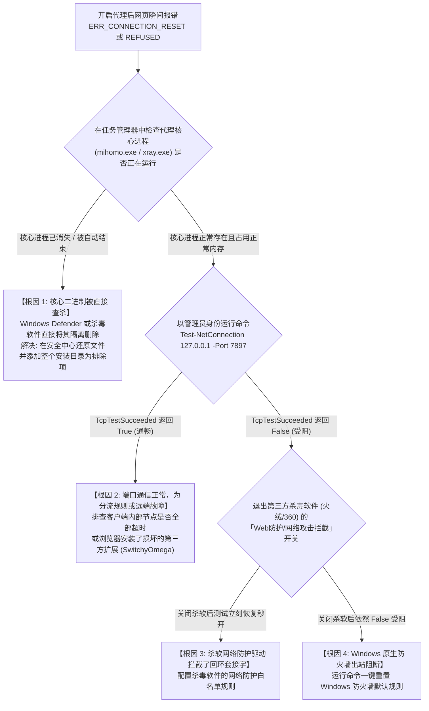

# 第三方杀毒软件拦截本地回环 (127.0.0.1) 流量排查全指南：火绒、360 与 Windows Defender 导致代理假死根治实战

在 Windows 操作系统的科学上网排障中，最隐蔽、最具有欺骗性的故障之一，当属**本地安全防护软件（杀毒软件与防火墙）对本地回环端口（Loopback Interface / `127.0.0.1`）的静默拦截与主动复位**。

很多用户在遇到断网时，看到客户端界面（Clash Verge Rev、v2rayN、sing-box）明明显示“节点测速正常、延迟绿灯、已连接”，系统托盘的代理图标也处于激活状态，但只要在浏览器中敲下回车访问网页，页面便会在毫秒之间瞬间崩溃，并抛出令人费解的报错：
- **Chrome / Edge**：`ERR_CONNECTION_RESET`（连接被重置）或 `ERR_CONNECTION_REFUSED`（连接被拒绝）；
- **命令行工具 (curl / git)**：`Failed to connect to 127.0.0.1 port 7890: Connection refused`；
- **部分外企办公软件**：`Proxy server is not responding / Socket closed unexpectedly`。

大部分用户会误以为是机场服务商跑路或本地网络欠费，但真正的物理破坏者，其实是正在后台静默运行的**火绒安全、360 安全卫士、卡巴斯基、迈克菲（McAfee）或 Windows Defender**。安全软件的 Web 监控驱动将客户端核心的高频本地握手误判为木马病毒的内网渗透，并在内核层主动注入了 TCP RST 数据包。

本篇工业级技术指南由 **netzhenduan.cc 网络诊断实验室** 推出，带您深入 Windows 过滤平台（WFP）的底层拦截机理，并提供三大主流杀软的防御式放行策略与 PowerShell 诊断工具。

---

## 模块一：30 秒极速急救判定卡

当您怀疑当前代理假死是由杀毒软件误杀所致时，请按以下三步快速自证：

```powershell
# 1. 在管理员 PowerShell 中探测本地代理核心端口是否真实处于 LISTENING 监听
Get-NetTCPConnection -LocalPort 7890, 7897, 10808, 10809 -ErrorAction SilentlyContinue | Select-Object LocalAddress, LocalPort, State, OwningProcess

# 2. 尝试向本地回环代理端口发起底层 TCP 原始握手测试
Test-NetConnection -ComputerName 127.0.0.1 -Port 7897 -InformationLevel Detailed
```

> [!TIP]
> **黄金根因分水岭**：
> - 如果第 1 步没有任何进程监听对应端口，说明**杀毒软件已直接将 `mihomo.exe` 或 `xray.exe` 核心进程判定为恶意程序并强制挂起杀掉**；
> - 如果第 1 步显示正在监听，但第 2 步的 `TcpTestSucceeded` 却返回 `False`，说明**杀毒软件的 WFP 网络驱动正在物理层阻断所有尝试连向 127.0.0.1 的套接字通信**！

---

## 模块二：核心概念解析：本地回环端口与代理软件通信生命周期

为什么科学上网工具如此依赖 `127.0.0.1`？理解这一通信基石是认清安全软件误杀行为的前提：

### 1. 什么是本地回环地址（Loopback Interface）？
根据 IETF RFC 1122 规范，IPv4 地址空间中的 `127.0.0.0/8` 保留网段专用于主机内部的进程间网络通信，其中 `127.0.0.1` 被称为标准回环地址（Localhost）。
- 回环通信**完全不经过外部物理网卡，不产生任何电磁信号，也不消耗任何光纤流量**；
- 所有发往 `127.0.0.1` 的 TCP/UDP 数据包，在进入操作系统内核协议栈（`TCPIP.sys`）后，直接在内存缓冲区中被原路折返，送达本机另一个正在监听该端口的进程。

### 2. 系统代理模式（System Proxy）的数据流转闭环
在没有开启 TUN 虚拟网卡时，所有的 Windows 客户端均通过**本地回环中继**工作：
1. 客户端在后台启动代理核心（如 `mihomo.exe`），在内存中打开端口 `127.0.0.1:7897` 处于监听等待状态；
2. 客户端修改 Windows 注册表，通知全系统：“所有浏览器发送 HTTP 请求时，严禁直连外部公网，必须把明文数据包送入 `127.0.0.1:7897`”；
3. 浏览器向本地 `127.0.0.1:7897` 发起 TCP 三次握手；
4. 代理核心在内存中接收到数据，执行复杂的加密与封装，再通过外部真实物理网卡发出。

---

## 模块三：主流杀毒软件对本地回环端口的拦截机制与特征横评

| 安全防护软件 | 拦截技术模块 | 触发误杀的特征行为 | 典型报错现象与用户端反馈 |
|---|---|---|---|
| **火绒安全 (Huorong)** | **恶意外联拦截 / Web 扫描** | 代理客户端高频向境外未备案 IP 发起握手，且本地多进程频繁涌入 7890 端口 | 浏览器访问特定境外域名时频繁弹窗“已阻止恶意外联”，随后整机断流 |
| **360 安全卫士 / 杀毒** | **网络防护驱动 (360NetP)** | 检测到未经 360 认证签名的开源内核二进制（如新编译的 Alpha 核心）绑定低位端口 | 提示“拦截未知进程注入网络栈”，随后静默向 7897 端口注入 TCP RST 复位包 |
| **Windows Defender** | **网络保护 (Network Protection)**| 订阅配置中包含被微软云端威胁情报库标记的高危境外机房 IP 列表 | 界面直接抛出 `Trojan:Win32/Wacatac` 误报，将核心二进制文件强行隔离删除 |
| **卡巴斯基 (Kaspersky)** | **网络流量扫描 (Web-Anti-Virus)**| 开启「对安全连接 (HTTPS) 进行解密扫描」时，与客户端 Fake-IP 发生证书劫持冲突 | 浏览器弹出卡巴斯基专属警告页，提示“无法建立安全连接，证书颁发者不受信任” |
| **迈克菲 (McAfee)** | **防火墙 NetGuard** | 阻止向未经权威机构签署证书的私有端口进行双向转发 | 所有通过系统代理发出的连接均在 5 秒后超时，界面报 `ERR_TIMED_OUT` |

---

## 模块四：内核底层机理：Windows 过滤平台 (WFP) 与 TCP RST 注入模型

杀毒软件究竟是在哪一个网络跃点实施拦截的？为什么它们能够让浏览器“瞬间闪退报错”？以下 ASCII 拓扑揭示了内核层 WFP 过滤器的暴力阻断过程：

```
+─────────────────────────────────────────────────────────────────────────────+
|               Windows 过滤平台 (WFP) 与安全软件 TCP RST 注入模型             |
+─────────────────────────────────────────────────────────────────────────────+

   【浏览器 (Chrome.exe)】
           │
           ▼ 1. 发起 TCP SYN 握手连接请求 (目标: 127.0.0.1:7897)
   【Windows 内核网络栈 (TCPIP.sys)】
           │
           ▼ 2. 数据包流经 Windows 过滤平台核心层 (WFP: FWPM_LAYER_ALE_AUTH_CONNECT_V4)
   ┌─────────────────────────────────────────────────────────────────────────┐
   │ 【第三方杀毒软件内核过滤驱动 (如 HrNetDrv.sys / 360Netp.sys)】           │
   │   - 挂载在 WFP 传输层与应用层强制认证层 (ALE)                           │
   │   - 提取套接字元数据: 发起进程="chrome.exe", 目标端口=7897, 目标IP=127.0.0.1 │
   │   - 触发启发式规则: "短时间内大量异构应用聚集向 7897 回环端口发送高密加密数据包"  │
   │   - 判定结果: 命中【疑似挖矿木马回环隧道 / 僵尸网络后门】规则！           │
   └─────────────────────────────────────────────────────────────────────────┘
           │
           ├─► 【处理路径 A: 暴力阻断并向浏览器注入伪造的 TCP RST 包】
           │     驱动在内核层伪造一个 [RST, ACK] 数据包，反向甩回给浏览器！
           │     浏览器协议栈接收到 RST，立即销毁套接字，界面闪电抛出：
           │     ERR_CONNECTION_RESET / ERR_CONNECTION_REFUSED
           │
           └─► 【处理路径 B: 内存挂起并冻结代理核心 (mihomo.exe)】
                 杀毒软件安全引擎下发线程挂起指令，核心停止响应，
                 端口处于僵尸状态，后续所有外网数据包彻底丢弃！
```

### 关键技术点：
1. **TCP RST（Reset）复位包**的语义是“强行撕毁套接字”。由于杀软直接在内核层注入该包，耗时不到 0.1 毫秒，因而用户在浏览器中点击刷新时，根本看不到正常网络超时的缓冲等待圆圈，而是**页面瞬间变灰并提示重置**；
2. **TUN 模式同样可能受波及**：部分高级防火墙不仅拦截 127.0.0.1，更在 WFP 的 `FWPM_LAYER_INBOUND_IPPACKET_V4` 层拦截未经其认可的虚拟网卡（Wintun）数据帧注入，导致连 TUN 模式也被一并掐断。

---

## 模块五：杀毒拦截与网络假死排障决策树 (Mermaid)

当您开启代理但遭遇浏览器瞬间报连接被重置时，请严格遵照以下决策树进行排查：



---

## 模块六：三大主流安全软件白名单配置防误杀指南

为了在保障整机系统安全的同时，彻底根绝代理客户端的误杀假死，必须严格按照以下工业级规范配置排除项：

### 1. 火绒安全 (Huorong Security) 规范配置
火绒对未知加密通信较为敏感，但其白名单机制非常纯粹：
1. 打开火绒安全主界面，点击右上角菜单 -> 进入 **「安全设置」**；
2. 在左侧进入 **「防护中心」** -> 点击 **「信任区」**；
3. 点击 **「添加信任文件」** 与 **「添加信任文件夹」**：
   - 添加整个客户端安装目录（例如 `C:\Program Files\Clash Verge Rev\`）；
   - 特别添加客户端的数据核心目录（`%APPDATA%\clash-verge\resources\` 中的 `mihomo.exe`）；
4. 进入 **「系统防护」** -> **「恶意外联拦截」**：
   - 如果开启了该功能，点击右侧设置，将 `mihomo.exe` 添加为**允许外联白名单进程**。

### 2. 360 安全卫士 / 360 杀毒规范配置
360 的网络过滤驱动层级很深，配置时必须同时覆盖文件白名单与网络防护白名单：
1. 打开 360 安全卫士 -> 进入 **「木马查杀」** -> 点击左下角 **「信任区」**；
2. 点击 **「添加目录」**，选中代理客户端所在根文件夹，勾选“同时信任该目录下的所有子目录”；
3. 进入 **「功能大全」** -> 打开 **「360 防火墙」** 或网络优化组件；
4. 检查是否有针对 `7890`、`7897` 端口或未知程序的“提示拦截”规则，将其强制设定为 **“完全信任 / 允许通信”**。

### 3. Windows Defender (Windows 安全中心) 规范配置
Windows 10/11 内置的 Defender 经常在系统自动更新后静默干掉开源核心：
1. 按快捷键 `Win + I` 打开 Windows 设置，进入 **「隐私和安全性」** -> **「Windows 安全中心」**；
2. 点击 **「病毒和威胁防护」** -> 在“病毒和威胁防护设置”下点击 **「管理设置」**；
3. 下拉找到 **「排除项」** -> 点击 **「添加或删除排除项」**；
4. 点击 **「添加排除项」** -> 选择 **「文件夹」**，将客户端所在的完整工作目录全量加入；
5. 点击 **「进程」**，输入 `mihomo.exe`、`clash-meta.exe` 与 `xray.exe`，保存生效。

---

## 模块七：自动化运维：PowerShell 本地回环与 WFP 网络拦截排查脚本

在 Windows 终端中运行以下脚本，一键检测本地代理端口健康度、核心进程生存状态与系统防火墙拦截规则：

```powershell
<#
.SYNOPSIS
    netzhenduan.cc 本地回环端口与杀毒防火墙拦截自动化体检工具
.DESCRIPTION
    1. 检查核心进程是否存在并定位 PID
    2. 校验 127.0.0.1 关键代理端口的监听与 TCP 握手状态
    3. 审计 Windows 防火墙是否有阻断入站/出站规则
#>

Write-Host "==========================================================" -ForegroundColor Cyan
Write-Host "  netzhenduan.cc 本地回环与杀软拦截自动化审计探针        " -ForegroundColor Cyan
Write-Host "==========================================================" -ForegroundColor Cyan

# 1. 检查代理核心进程生存状态
Write-Host "`n[*] [步骤 1/3] 正在扫描代理核心进程生存状态..." -ForegroundColor Yellow
$coreProcesses = @("mihomo", "clash-meta", "clash-verge", "xray", "v2ray", "sing-box")
$foundCores = Get-Process -Name $coreProcesses -ErrorAction SilentlyContinue

if ($foundCores) {
    foreach ($p in $foundCores) {
        Write-Host "  [OK] 发现活跃核心进程: $($p.Name) | PID: $($p.Id) | 工作集内存: $([math]::Round($p.WorkingSet64 / 1MB, 2)) MB" -ForegroundColor Green
    }
} else {
    Write-Host "  [CRITICAL] 严重警告: 未检测到任何代理核心进程！极大概率被杀毒软件静默隔离删除！" -ForegroundColor Red
}

# 2. 检查本地回环端口监听与实际握手连通性
Write-Host "`n[*] [步骤 2/3] 审计关键代理端口 (7890/7897/10808) 监听与握手..." -ForegroundColor Yellow
$testPorts = @(7890, 7897, 10808, 10809)

foreach ($port in $testPorts) {
    $conn = Get-NetTCPConnection -LocalAddress 127.0.0.1 -LocalPort $port -State Listen -ErrorAction SilentlyContinue
    if ($conn) {
        Write-Host "  [√] 端口 $port 正在被 PID=$($conn.OwningProcess) 监听 (LISTENING)" -ForegroundColor Green
        
        # 尝试发起实际 TCP 握手
        $sw = [System.Diagnostics.Stopwatch]::StartNew()
        $tClient = New-Object System.Net.Sockets.TcpClient
        try {
            $iar = $tClient.BeginConnect("127.0.0.1", $port, $null, $null)
            $success = $iar.AsyncWaitHandle.WaitOne(1500, $false)
            $sw.Stop()
            if ($success) {
                $tClient.EndConnect($iar)
                Write-Host "    -> 本地回环握手成功! RTT = $($sw.ElapsedMilliseconds) ms (无杀软网络层阻断)" -ForegroundColor Green
            } else {
                Write-Host "    -> [FAIL] 握手超时！虽然端口在监听，但套接字被 WFP 过滤层静默丢弃！" -ForegroundColor Red
            }
        } catch {
            Write-Host "    -> [FAIL] 握手被直接拒绝或重置 ($($_.Exception.Message))！杀软注入了 RST 包！" -ForegroundColor Red
        } finally {
            $tClient.Close()
        }
    }
}

# 3. 检查 Windows Defender 防火墙是否存在拦截规则
Write-Host "`n[*] [步骤 3/3] 检索 Windows 防火墙阻断规则 (Block Rules)..." -ForegroundColor Yellow
$blockRules = Get-NetFirewallRule -Action Block -Enabled True -ErrorAction SilentlyContinue | Where-Object { $_.DisplayName -match "Clash" -or $_.DisplayName -match "Mihomo" -or $_.DisplayName -match "v2ray" }

if ($blockRules) {
    foreach ($r in $blockRules) {
        Write-Host "  [CRITICAL] 发现防火墙主动阻断规则: $($r.DisplayName) ($($r.Direction))" -ForegroundColor Red
    }
    Write-Host "  -> 建议以管理员身份运行: Remove-NetFirewallRule -Name '$($blockRules[0].Name)'" -ForegroundColor DarkYellow
} else {
    Write-Host "  [OK] 未发现针对代理核心的主动防火墙阻断规则。" -ForegroundColor Green
}

Write-Host "`n==========================================================" -ForegroundColor Cyan
Write-Host "  审计完毕！若存在红字异常，请依照上方模块六添加信任排除项。" -ForegroundColor Cyan
Write-Host "==========================================================" -ForegroundColor Cyan
```

---

## 模块八：生产环境真实故障复盘（2大典型 RCA 案例）

### 案例一：外企工程师安装火绒安全后，Clash Verge Rev 所有网页瞬间报 `ERR_CONNECTION_RESET`
- **故障拓扑**：北京某外企软件工程师，办公电脑使用 Clash Verge Rev。某日电脑因弹出弹窗广告安装了火绒安全软件。安装后重启电脑，发现 Clash 界面测速一切正常（显示香港节点 24ms），但无论用 Chrome 访问 Google 还是访问公司内网飞书，均在敲下回车后**瞬间弹出网页错误 `ERR_CONNECTION_RESET`**。
- **排查与抓包分析**：
  1. 工程师起初怀疑是 Windows 注册表坏死，重置注册表后依旧报错；
  2. 打开 Wireshark 对本地回环网卡（Npcap Loopback Adapter）进行抓包；
  3. 观察浏览器向 `127.0.0.1:7897` 发送的第一个 `[SYN]` 握手包；
  4. 抓包窗口显示：浏览器发出 `[SYN]` 后的 **0.08 毫秒** 内，系统便反向收到了一个带有 `[RST, ACK]` 标志位的报文，且该报文的 IP TTL 与正常回环包存在异常断层；
  5. 打开火绒安全托盘日志，赫然在「防护日志」中发现每分钟产生上百条拦截记录：“拦截未知进程尝试向未备案海外地址发起高频连接”；
  6. 火绒的 Web 防护模块将 Clash Meta 核心处理分流时的多路复用连接当成了木马外联，并在本地回路中直接注入了 RST 复位。
- **根因判定（RCA）**：火绒安全的启发式 Web 扫描组件误判了代理内核的回环端口转发行为，主动伪造 TCP RST 数据包撕毁应用层连接。
- **修复方案**：进入火绒「信任区」，将 Clash Verge Rev 整个安装目录与 `%APPDATA%\clash-verge` 目录加入信任白名单，并在「恶意外联拦截」中解除对 `mihomo.exe` 的限制，网页瞬间秒开。

### 案例二：Windows Defender 自动更新威胁库，后台静默将核心删除导致连接被拒（10061）
- **故障拓扑**：某跨境电商运营人员，早晨开机后发现昨天使用正常的代理软件完全瘫痪，所有浏览器访问网页均提示 `无法连接到代理服务器 / ERR_CONNECTION_REFUSED`。
- **排查与进程审计**：
  1. 查看 Windows 系统代理设置，显示代理开关正常打开，地址为 `127.0.0.1:7897`；
  2. 运行 `Get-Process mihomo`，系统抛出红色报错：“找不到名为 mihomo 的进程”；
  3. 打开 Windows 安全中心，进入「保护历史记录」；
  4. 发现凌晨 03:00 系统自动更新了 Windows Defender 安全智能定义库后，自动将 `mihomo.exe` 标记为严重威胁 `Trojan:Win32/Wacatac.B!ml` 并直接隔离清除；
  5. 由于核心文件被杀，系统注册表中指向 7897 端口的系统代理瞬间沦为空壳，浏览器连接不到任何监听进程，导致报错 10061 拒绝连接。
- **根因判定（RCA）**：Windows Defender 机器学习模型（!ml 标识代表基于机器学习启发式查杀）对开源 Go 语言编译的核心产生严重误报，静默删除了核心可执行文件。
- **修复方案**：在 Windows 安全中心将该文件选择「在设备上允许」并恢复，随后将整个客户端安装根目录添加至 Defender 的「排除项」中，重启客户端后恢复正常。

---

## 模块九：常见技术疑难解答 (FAQ)

### Q1：为什么我已经把客户端主程序（如 Clash-Verge.exe）加了白名单，依然被杀软拦截？
- **原因**：这是因为现代化客户端采用**微内核架构**。`Clash-Verge.exe` 仅仅是一个用 Rust / Tauri 或 Electron 构建的前端图形外壳，真正负责网络握手和端口监听的是位于子目录下的 `mihomo.exe` 或 `clash-meta.exe`。如果只把前端外壳加白，核心内核依然会被杀软无情拦截。
- **对策**：白名单不要添加单一 `.exe` 文件，而是直接将包含所有核心组件的**整个文件夹路径**（如 `C:\Program Files\Clash Verge Rev\` 及 `%APPDATA%\` 下的相关配置目录）完整加入信任区。

### Q2：开启 TUN 模式后，杀毒软件就不会拦截网络了吗？
- **原因**：不一定。虽然 TUN 模式绕过了传统的 WinINet 应用层系统代理与 127.0.0.1 回环端口，改走底层的三层虚拟网卡，但现代杀毒软件（如 360 与卡巴斯基）内置了 NDIS 网络驱动层过滤。如果杀毒软件认为某个虚拟网卡未通过微软 WHQL 认证，会在三层 IP 包注入阶段将其整体拦截丢弃。
- **对策**：同样需要在杀毒软件中对客户端核心进程与 Wintun 驱动做全量信任，并确保服务模式正常安装。

### Q3：为什么退出杀毒软件后，网络依然打不开网页？
- **原因**：许多杀毒软件（如 360 安全卫士与电脑管家）即使在任务栏点击“退出”，其注册在 Windows 底层的系统服务（如 `360Safe.exe`、`HrNetFilter`）和网络驱动并不会真正卸载，内核过滤层依然在起作用。
- **对策**：必须在杀毒软件内部的设置面板中，明确将“网络防护”、“Web 网站威胁扫描”开关手动切换为「关闭」；或者直接在白名单中配置信任规则，配置后重启电脑让驱动重新加载。

---

## 模块十：场景化容灾逃生机制

<DisasterRecoveryBox 
  alertTitle="🚨 杀毒软件已完全配置白名单且无拦截，但节点依然全红超时？"
  triggerCondition="经排查本地核心监听正常且杀软已全量放行，但客户端所有海外节点依旧显示红字 Timeout，判定为服务商中转机房入口遭受 GFW 阻断"
  recommendedAction="切换至具备全线多入口 BGP 自动故障转移与纯内网物理 IEPL 专线的工业级备用机场"
  primaryAirportName="光速云 (Guangsu)"
  primaryAirportUrl="/airports/guangsu"
  primaryFeatures="全线多入口 BGP 自动容灾 / 晚高峰 529Mbps / 纯物理 IEPL 内网专线 / 晚高峰 0 丢包"
  backupAirportName="微风网络 (Breeze)"
  backupAirportUrl="/airports/weifeng"
  matrixUrl="/airports/"
/>

---

## 模块十一：关联排查与全景导航
- **本集群总览入口**：[多网卡路由跃点冲突与 TUN 虚拟网卡死锁排查集群](/issues/connection-failures/tun-routing/)
- **集群核心长文一**：[多网卡接口跃点 (Metric) 冲突与默认网关抢占排障全指南](/issues/connection-failures/tun-routing/multi-nic-metric-route-conflict)
- **系统代理注册表排查**：[Windows 系统代理注册表死锁与 PAC 脚本缓存崩溃排障实战](/issues/connection-failures/proxy-dns/wininet-pac-registry-deadlock-repair)
- **客户端专用手册**：[Clash Verge Rev 显示节点超时 12 大模块排查全流程](/clients/clash-verge-rev-timeout)
- **网络诊断实验室**：[在线 WebRTC / DNS 泄漏与链路安全诊断](/diagnostics/)
