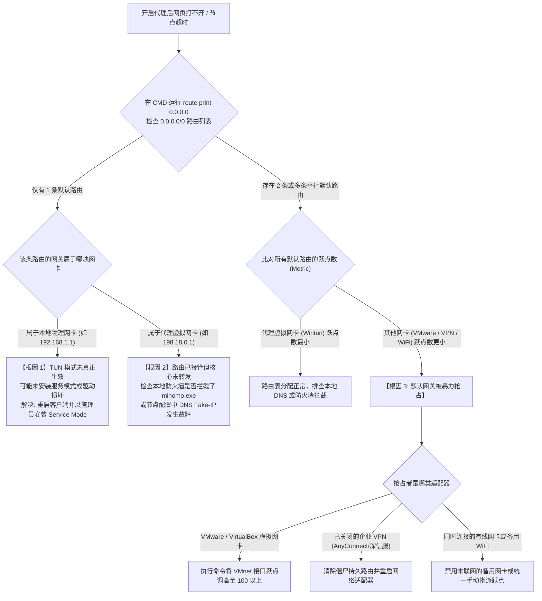

# 多网卡接口跃点 (Interface Metric) 冲突与默认网关抢占排障全指南：彻底解决虚拟机与内网 VPN 导致的代理断网

在软件研发、网络运维、多媒体创作以及跨国办公场景中，技术人员的电脑通常不会只有单一的一块物理网卡。系统往往同时承载着：千兆有线以太网口、Wi-Fi 6 无线网卡、VMware Workstation（`VMnet1` / `VMnet8`）、VirtualBox、WSL2 虚拟交换机、Tailscale / ZeroTier 虚拟组网网卡，以及深信服 EasyConnect、Cisco AnyConnect、FortiClient 等企业内网办公 VPN 虚拟网卡。

当用户在代理客户端（如 Clash Verge Rev、v2rayN、sing-box）中开启 **TUN 虚拟网卡模式** 时，客户端核心会自动在系统中安装一个名为 `Wintun` 的三层虚拟网络设备，并向 Windows 路由表注入一条指向虚拟网关的默认路由（`0.0.0.0/0`）。

然而，许多用户经常遭遇极具迷惑性的“诡异断网”现象：**客户端显示已连接且节点延迟刷新完全正常，但浏览器和终端工具却打不开任何网页，甚至在关闭代理后整机依然全网断网**。

这一现象的底层元凶，正是操作系统的 **接口跃点（Interface Metric）** 与 **默认网关路由抢占（Default Gateway Preemption）** 冲突。本篇万字级实战手册将从 Windows 内核网络栈（`TCPIP.sys`）的路由仲裁原理出发，为您提供完整的抓包判定证据、自动化修复脚本与生产级排障闭环。

---

## 模块一：30 秒极速急救判定卡

如果您当前正遭遇“开启代理后打不开网页，关闭代理后整机依然断网”的紧急状况，请先在管理员身份打开的 PowerShell 窗口中运行以下应急命令：

```powershell
# 1. 查询当前抢占最低跃点的默认路由接口
Get-NetRoute -DestinationPrefix "0.0.0.0/0" | Sort-Object RouteMetric | Select-Object -First 3 InterfaceAlias, NextHop, RouteMetric

# 2. 如果发现 VMware 或 VirtualBox 网卡跃点极小，一键强制调高虚拟机网卡跃点
Get-NetIPInterface | Where-Object { $_.InterfaceAlias -match "VMware" -or $_.InterfaceAlias -match "VirtualBox" } | Set-NetIPInterface -InterfaceMetric 100

# 3. 强制清除可能残留的僵尸网关并刷新 DNS
Clear-DnsClientCache
```

> [!TIP]
> **黄金自检法则**：在开启代理客户端的 TUN 模式后，代理虚拟网卡（`Wintun` / `Mihomo`）的路由跃点必须是整台电脑所有网卡中**严格最小的绝对数值（通常建议手动设定为 1 到 5）**。一旦任何其他网卡的跃点低于或等于该值，代理分流管线将在三层网络协议栈中被彻底短路。

---

## 模块二：核心概念解析：Windows 路由仲裁与接口跃点机制

为了精准排障，必须理解操作系统网络内核在决定“数据包该往哪块网卡发”时所遵循的底层规则：

### 1. 什么是跃点数（Metric）？
在计算机网络路由体系中，**跃点数（Metric）**是衡量一条路由路径“开销代价（Cost）”的量化指标。开销越低，代表该路径越优质，优先级越高。在 Windows 操作系统中，一个数据包的综合路由开销由两部分相加决定：
$$\text{总路由开销 (Total Route Cost)} = \text{路由跃点 (Route Metric)} + \text{接口跃点 (Interface Metric)}$$

### 2. 操作系统的路由仲裁两大黄金定律
当某个应用程序（如 Chrome 浏览器）发起一个指向目标公网 IP（例如 `104.21.5.12`）的 TCP 连接时，Windows 内核网络栈执行严格的判定次序：
1. **定律一：最长子网掩码匹配原则（Longest Prefix Match）**：
   系统优先查找网络掩码长度最长的路由项。例如，一条指向 `/32`（单主机）或 `/24`（子网）的精确路由，优先级永远无条件高于指向 `0.0.0.0/0`（全网默认）的兜底路由；
2. **定律二：最低跃点开销原则（Lowest Metric Wins）**：
   如果多条路由具有相同长度的网络前缀（例如系统路由表中存在多条相互平行的 `0.0.0.0/0` 默认路由），**操作系统将把全部数据包单向倾泻入总跃点数值最小的那块网卡**。

### 3. Windows 的“自动跃点（Automatic Metric）”缺陷
Windows 默认对所有网络适配器开启了「自动跃点」功能。系统依据物理链路的理论物理协商带宽自动换算初始跃点数：
- 链路带宽 $\ge 1\text{ Gbps}$（千兆以太网）：分配接口跃点为 `25` 或 `15`；
- 链路带宽在 $200\text{ Mbps} \sim 1\text{ Gbps}$（Wi-Fi 6）：分配接口跃点为 `25` 或 `35`；
- 链路带宽在 $100\text{ Mbps}$：分配接口跃点为 `30`；
- 虚拟网络适配器：由于虚拟交换机往往向系统虚标自己为 `10 Gbps` 或 `1 Gbps` 全双工链路，Windows 往往极其鲁莽地为 VMware 或 VirtualBox 网卡分配了**极小的跃点数值（如 10 或 15）**！

---

## 模块三：各类网络适配器默认 Metric 与路由权重对照表

| 网络适配器类型 | 典型接口名称 | Windows 默认协商带宽 | 自动跃点区间 | 常见冲突隐患与引发的代理故障现象 |
|---|---|---|---|---|
| **物理有线以太网** | `以太网` / `Ethernet` | 1000 Mbps ~ 2.5 Gbps | 15 ~ 25 | 当同时连接 WiFi 与有线时，若网线仅连局域网无法上外网，会导致整机断网 |
| **物理无线网卡** | `WLAN` / `Wi-Fi` | 300 Mbps ~ 2400 Mbps | 25 ~ 35 | 信号微弱时协商速率下降，导致跃点突变，引发 TUN 虚拟网卡路由争抢失控 |
| **代理 TUN 虚拟网卡**| `Wintun` / `Mihomo` | 虚拟无损管道 | **5 ~ 10** (客户端配置)| 核心依赖该网卡抢占 `0.0.0.0/0`。若其跃点被压制，TUN 模式彻底失效 |
| **VMware 虚拟网卡** | `VMnet8 (NAT)` / `VMnet1` | 虚标 10 Gbps | **10 ~ 20 (极易越权)** | **【高危冲突源】** 默认网关经常抢占全网最小跃点，吞噬代理出海流量 |
| **VirtualBox 虚拟网卡**| `VirtualBox Host-Only` | 虚标 1 Gbps | 15 ~ 25 | 在休眠唤醒后经常强行刷新路由表，导致系统代理通道瞬间断流 |
| **企业办公 VPN 适配器**| `AnyConnect` / `EasyConnect`| 视内网通道而定 | **1 ~ 10 (暴力锁定)** | **【致命破坏者】** 强制注入全局路由，退出后残留僵尸网关导致全网断网 |
| **异地组网网卡** | `Tailscale` / `ZeroTier` | 虚拟 Overlay 接口 | 20 ~ 40 | 开启「Exit Node (出口节点)」时会覆写默认网关，与机场代理发生严重回环冲突 |

---

## 模块四：内核底层机理：多默认网关下的“路由黑洞”形成模型

为什么当接口跃点配置错误时，客户端测速可以显示“绿灯 35ms”，而浏览器却完全打不开网页？以下 ASCII 拓扑展示了内核三层网络栈中的数据割裂：

```
+─────────────────────────────────────────────────────────────────────────────+
|               数据通道 A: 客户端核心自测速链路 (无视操作系统路由表)           |
+─────────────────────────────────────────────────────────────────────────────+
[Mihomo 核心测速线程] ──► 直接向远端机场中转 IP 发起底层 TCP Socket 握手
                       │
                       ▼ (核心显式绑定出口路由，直达物理以太网卡出海)
[远端专线中转机房] ◄────┘ (测速成功！界面刷新为绿色 35ms 延迟，诱导用户误判)

=============================================================================

+─────────────────────────────────────────────────────────────────────────────+
|               数据通道 B: 浏览器访问网页链路 (严格受操作系统路由表支配)        |
+─────────────────────────────────────────────────────────────────────────────+
[用户浏览器 (Chrome)] ──► 请求访问海外受限网站 (如 https://www.google.com)
                       │
                       ▼ (数据包送入 Windows TCPIP.sys 网络协议栈)
[Windows 路由表仲裁] ──► 检查所有目的地为 0.0.0.0/0 的候选默认路由：
                       │
                       ├─ 候选路由 1 (Wintun):  网关 198.18.0.1  | 综合跃点: 25
                       └─ 候选路由 2 (VMware):  网关 192.168.80.2 | 综合跃点: 15 (胜出!)
                                                │
                                                ▼ 【致命致命: 数据包落入黑洞】
                       [VMware 虚拟机虚拟交换机] ──► 目标为海外公网 IP，
                                                     虚拟机网桥根本无法处理，
                                                     数据包在局域网内被丢弃！
                                                │
                                                ▼
                       [浏览器终端界面显示] ────► 页面持续转圈，最终抛出：
                                                ERR_CONNECTION_TIMED_OUT
```

### 关键技术复盘：
1. **客户端测速**走的是**“特定目的 IP 探测”**，很多客户端内部通过底层调用绕过了系统的全局路由规则；
2. **应用层浏览器**必须无条件依赖操作系统的路由表进行三层寻址；
3. 一旦 VMware、企业 VPN 或次要物理网卡的跃点更小，浏览器的数据包便会被送入错误的物理回路，造成**“测速有延迟、网页全超时”**的典型假死。

---

## 模块五：全网卡路由冲突排障决策树 (Mermaid)

当您在多网卡电脑上遇到科学上网连接异常时，请严格遵照以下工业级决策树收敛问题：



---

## 模块六：实操指南：四步终极修复法

### 步骤一：提取全网卡接口索引（InterfaceIndex）与当前跃点
以管理员身份启动 Windows PowerShell，执行以下命令：
```powershell
Get-NetIPInterface -AddressFamily IPv4 | Format-Table InterfaceIndex, InterfaceAlias, InterfaceMetric, AutomaticMetric
```
在输出表格中记录以下关键网卡的 **InterfaceIndex (接口索引数字)**：
- 您的主上网网卡（有线以太网或 WLAN 无线网卡）；
- 代理客户端的虚拟网卡（通常标有 `Wintun`、`Mihomo` 或 `Clash`）；
- 所有虚拟化网卡（`VMware Network Adapter VMnet1`、`VMnet8`、`vEthernet`）。

### 步骤二：彻底拔高虚拟化网卡的接口跃点（降权）
为了防止 VMware 或 VirtualBox 在后台越权抢占默认路由，我们将其跃点强制锁定为高开销数值（如 `100` 或 `200`），剥夺其作为默认网关的资格：
```powershell
# 针对 VMware 虚拟网卡降权
Get-NetIPInterface | Where-Object { $_.InterfaceAlias -like "*VMnet*" } | Set-NetIPInterface -InterfaceMetric 100 -AutomaticMetric Disabled

# 针对 VirtualBox 虚拟网卡降权
Get-NetIPInterface | Where-Object { $_.InterfaceAlias -like "*VirtualBox*" } | Set-NetIPInterface -InterfaceMetric 100 -AutomaticMetric Disabled

# 针对 Windows Hyper-V / WSL 虚拟交换机降权
Get-NetIPInterface | Where-Object { $_.InterfaceAlias -like "*vEthernet*" } | Set-NetIPInterface -InterfaceMetric 80 -AutomaticMetric Disabled
```

### 步骤三：锁定代理 TUN 虚拟网卡最高路由优先级（提权）
进入代理客户端（以 Clash Verge Rev 为例）：
1. 进入左侧 **「设置」** -> 找到 **「TUN 模式堆栈」**；
2. 在高级配置中确认注入的跃点为最高优先级；
3. 或在 PowerShell 中手动将已生成的 Wintun 网卡接口跃点锁定为最小值 `1`：
```powershell
Get-NetIPInterface | Where-Object { $_.InterfaceAlias -like "*Wintun*" -or $_.InterfaceAlias -like "*Mihomo*" } | Set-NetIPInterface -InterfaceMetric 1 -AutomaticMetric Disabled
```

### 步骤四：清除企业 VPN 残留的持久“僵尸网关”
若此前使用过办公 VPN 导致当前外网瘫痪，必须将残留在注册表与内核路由表中的错误网关彻底抹除：
```cmd
:: 以管理员身份在命令提示符运行
route delete 0.0.0.0
ipconfig /flushdns
```
执行完毕后，在任务栏右下角断开当前 WiFi 或以太网，随后重新点击连接，系统将自动重新分配一条纯净的主网卡路由。

---

## 模块七：自动化运维：PowerShell 多网卡 Metric 批量重置与健康巡检脚本

无需手动逐行计算，运行以下由网络诊断实验室编写的自动化脚本，一键完成整机网卡跃点的健康审计与智能自愈重置：

```powershell
<#
.SYNOPSIS
    netzhenduan.cc 多网卡 Metric 冲突智能修复与优先级重置工具
.DESCRIPTION
    1. 扫描整机所有活跃 IPv4 接口与 0.0.0.0/0 路由
    2. 自动检测是否存在虚拟机网卡越权抢占
    3. 智能分配安全梯队跃点：TUN(1) -> 物理主网卡(15) -> 虚拟化/VPN网卡(100)
#>

Write-Host "==========================================================" -ForegroundColor Cyan
Write-Host "  netzhenduan.cc 多网卡路由跃点冲突自动化巡检与修复工具  " -ForegroundColor Cyan
Write-Host "==========================================================" -ForegroundColor Cyan

# 检查管理员提权
$isAdmin = ([Security.Principal.WindowsPrincipal][Security.Principal.WindowsIdentity]::GetCurrent()).IsInRole([Security.Principal.WindowsBuiltInRole]::Administrator)
if (-not $isAdmin) {
    Write-Host "[!] 错误: 本脚本涉及内核路由修改，必须以管理员身份运行 PowerShell！" -ForegroundColor Red
    return
}

Write-Host "`n[*] [阶段 1/3] 正在扫描当前 IPv4 网络适配器与接口跃点..." -ForegroundColor Yellow
$adapters = Get-NetIPInterface -AddressFamily IPv4 | Where-Object { $_.ConnectionState -eq "Connected" }

$vmAdapters = @()
$tunAdapters = @()
$phyAdapters = @()

foreach ($ad in $adapters) {
    $name = $ad.InterfaceAlias
    if ($name -match "VMware" -or $name -match "VirtualBox" -or $name -match "vEthernet") {
        $vmAdapters += $ad
    } elseif ($name -match "Wintun" -or $name -match "Mihomo" -or $name -match "clash") {
        $tunAdapters += $ad
    } else {
        $phyAdapters += $ad
    }
}

Write-Host "  -> 发现物理网卡: $($phyAdapters.Count) 块" -ForegroundColor Green
Write-Host "  -> 发现代理 TUN 网卡: $($tunAdapters.Count) 块" -ForegroundColor Cyan
Write-Host "  -> 发现虚拟化网卡: $($vmAdapters.Count) 块" -ForegroundColor DarkYellow

Write-Host "`n[*] [阶段 2/3] 正在执行智能路由跃点梯度重塑..." -ForegroundColor Yellow

# 1. 将虚拟机网卡强制调高至 100+ (彻底剥夺网关抢占资格)
foreach ($vm in $vmAdapters) {
    Write-Host "  [降权] 正在将虚拟网卡 $($vm.InterfaceAlias) 跃点重设为 120..." -ForegroundColor DarkYellow
    Set-NetIPInterface -InterfaceIndex $vm.InterfaceIndex -InterfaceMetric 120 -AutomaticMetric Disabled
}

# 2. 将主物理网卡恢复至合理中等区间 20
foreach ($phy in $phyAdapters) {
    Write-Host "  [校准] 正在将物理网卡 $($phy.InterfaceAlias) 跃点校准为 20..." -ForegroundColor Green
    Set-NetIPInterface -InterfaceIndex $phy.InterfaceIndex -InterfaceMetric 20 -AutomaticMetric Disabled
}

# 3. 如果当前代理 TUN 网卡处于激活状态，将其锁定为最高优先级 1
foreach ($tun in $tunAdapters) {
    Write-Host "  [提权] 正在将代理虚拟网卡 $($tun.InterfaceAlias) 跃点提权为 1 (最高优先级)..." -ForegroundColor Cyan
    Set-NetIPInterface -InterfaceIndex $tun.InterfaceIndex -InterfaceMetric 1 -AutomaticMetric Disabled
}

Write-Host "`n[*] [阶段 3/3] 刷新系统 DNS 缓存与路由状态表..." -ForegroundColor Yellow
Clear-DnsClientCache
nbtstat -R | Out-Null

Write-Host "`n[√] 修复完毕！当前 0.0.0.0/0 默认路由优先级排行:" -ForegroundColor Green
Get-NetRoute -DestinationPrefix "0.0.0.0/0" -AddressFamily IPv4 -ErrorAction SilentlyContinue | Sort-Object RouteMetric | ForEach-Object {
    $alias = (Get-NetIPInterface -InterfaceIndex $_.InterfaceIndex -AddressFamily IPv4).InterfaceAlias
    Write-Host ("  跃点: {0,-5} | 下一跳网关: {1,-18} | 承载适配器: {2}" -f $_.RouteMetric, $_.NextHop, $alias) -ForegroundColor White
}

Write-Host "==========================================================" -ForegroundColor Cyan
```

---

## 模块八：生产环境真实故障复盘（2大典型 RCA 案例）

### 案例一：后端研发人员安装 VMware Workstation 后，整机科学上网瞬间瘫痪
- **故障拓扑**：上海某互联网公司后端研发工程师，日常使用 Clash Verge Rev（开启 TUN 模式）访问 GitHub、Docker Hub 与外网资料。某日因本地测试需要安装了 VMware Workstation Pro 17，并在虚拟机中配置了 NAT 网络模式。安装完成后重启电脑，发现 Clash 显示节点测速正常（延迟 28ms），但电脑内所有浏览器打开 Google、GitHub 全部提示 `ERR_CONNECTION_TIMED_OUT`，无法加载任何内容。
- **排查与审计过程**：
  1. 工程师起初以为机场订阅节点失效，切换了十几个境外专线节点，故障依旧；
  2. 运行 `route print 0.0.0.0` 检查路由表，赫然发现系统中存在两条 `0.0.0.0/0` 路由：
     - 第一条：下一跳指向 `192.168.137.2`（VMware `VMnet8` 虚拟交换机网关），总跃点为 **15**；
     - 第二条：下一跳指向 `198.18.0.1`（Clash Wintun 虚拟网关），总跃点为 **25**；
  3. 由于 VMware 在 Windows 中注册的是高规格万兆全双工网卡，Windows 自动跃点算法给予其 `15` 的更小跃点，导致整机出网数据包被优先倾倒给 `VMnet8`，而没有送进 Clash 的代理管道。
- **根因判定（RCA）**：VMware 虚拟化网卡的自动跃点权重过高，非法越权抢占了操作系统的第一默认网关，引发三层数据包黑洞。
- **修复方案**：运行命令将 `VMnet8` 与 `VMnet1` 的接口跃点手动锁定为 `150`。重启网络后，Clash TUN 虚拟网卡重夺第一优先级，海外网站瞬间恢复秒开。

### 案例二：外贸财务人员退出深信服 EasyConnect 后，电脑彻底断网打不开任何网页
- **故障拓扑**：深圳某跨境电商公司财务主管，使用笔记本电脑通过深信服 EasyConnect 远程接入集团内网处理报税事务。下班后点击退出 EasyConnect，并打开常用的代理客户端准备浏览 YouTube 视频，发现所有浏览器打开百度、淘宝或 YouTube 均报错 `无法访问此网站 / DNS 解析超时`。即便强行关闭代理软件，电脑依旧完全无法上网。
- **排查与审计过程**：
  1. 检查物理网卡 IP 地址，显示电脑已通过局域网 DHCP 成功分配到 `192.168.1.105`，物理连接完好；
  2. 执行 `route print` 审计路由表，发现 EasyConnect 客户端在非正常关闭（或驱动未响应）时，**未能在退出阶段注销其写入内核的专属路由规则**；
  3. 路由表中残留着一条指向 `10.254.1.1`（企业 VPN 内网网关）的持久化 `0.0.0.0/0` 默认路由，且该路由被标记为静态绑定（Persistent Route）；
  4. 此时电脑发出的任何外网数据包，均试图向一个已经关闭的 VPN 内网网关递送，导致无论是直连流量还是代理流量全部陷入死锁。
- **根因判定（RCA）**：企业级内网 SSL-VPN 客户端退出时路由清理机制失效，造成持久化默认网关残留死锁。
- **修复方案**：在管理员命令行中执行 `route delete 0.0.0.0` 清理僵尸网关，随后禁用并重新启用物理以太网卡重新获取网关，整机网络当即恢复畅通。

---

## 模块九：常见技术疑难解答 (FAQ)

### Q1：为什么把网卡接口跃点调高后，重启电脑有时会恢复原样？
- **原因**：部分第三方安全软件（如 360 安全卫士网络优化工具）或虚拟机管理程序（VMware NAT Service）在 Windows 开机启动时，会重新初始化网络适配器配置并重置为系统的「自动跃点 (AutomaticMetric = Enabled)」。
- **对策**：在修改跃点时，务必在命令中附加 `-AutomaticMetric Disabled` 参数显式关闭自动跃点计算。若依然被重置，可将修改命令加入 Windows 计划任务，设定在“系统启动时”以管理员权限静默执行。

### Q2：电脑插了网线又连着 WiFi，为什么会导致代理客户端经常断流？
- **原因**：在双网卡同时连通外网的环境下，物理以太网与 WiFi 的接口跃点非常接近（通常都在 20~30 区间）。当电脑发生休眠唤醒、移动网络颠簸或微弱信号跳变时，Windows 会动态重新计算跃点，导致第一默认网关在有线与无线之间来回震荡，迫使代理客户端的 Wintun 驱动反复重建连接，表现为频繁断流。
- **对策**：日常使用建议养成“插网线即关闭 WiFi”的习惯；或在不需要频繁切换的环境中，手动将无线网卡的跃点调高至 `50` 以上，固定以太网为唯一主力网关。

### Q3：开启 TUN 模式后，局域网内的群晖 NAS 或共享打印机无法访问怎么办？
- **原因**：这是因为代理客户端在开启全局接管时，未将 RFC 1918 规定的私有地址网段（`10.0.0.0/8`、`172.16.0.0/12`、`192.168.0.0/16`）从 TUN 虚拟网卡中排除，导致原本应该在局域网广播的流量被误吸入代理出海隧道。
- **对策**：在代理客户端的 TUN 配置模块中，开启「绕行局域网与私有 IP (Bypass Direct IP / Private CIDR)」开关，并在规则列表顶部加入 `- IP-CIDR,192.168.0.0/16,DIRECT,no-resolve`。

---

## 模块十：场景化容灾逃生机制

<DisasterRecoveryBox 
  alertTitle="🚨 多网卡路由与接口跃点已修复正常，但节点测速依然全红超时？"
  triggerCondition="经排查 Wintun 虚拟网卡已处于第一默认优先级且无虚拟机网关抢占，但所有节点仍然全线显示红字 Timeout，判定为服务商中转机房入口遭受物理阻断"
  recommendedAction="切换至具备多线 BGP 自动故障转移与纯内网物理 IEPL 专线的工业级备用机场"
  primaryAirportName="光速云 (Guangsu)"
  primaryAirportUrl="/airports/guangsu"
  primaryFeatures="全线多入口 BGP 自动故障转移 / 晚高峰 529Mbps / 纯物理 IEPL 内网专线 / 晚高峰 0 丢包"
  backupAirportName="微风网络 (Breeze)"
  backupAirportUrl="/airports/weifeng"
  matrixUrl="/airports/"
/>

---

## 模块十一：关联排查与全景导航
- **本集群总览入口**：[多网卡路由跃点冲突与 TUN 虚拟网卡死锁排查集群](/issues/connection-failures/tun-routing/)
- **集群核心长文二**：[第三方杀毒软件拦截本地回环 (127.0.0.1) 流量排查全指南](/issues/connection-failures/tun-routing/antivirus-loopback-rst-interception)
- **系统代理排障长文**：[科学上网连接成功却打不开网页怎么办？系统代理与 DNS 排查步骤](/issues/connected-but-no-internet)
- **客户端专用手册**：[Mihomo 核心内核提权与 TUN 模式 Wintun 网卡深度修复](/clients/clash-verge/mihomo-service/tun-mode-wintun-troubleshooting)
- **网络诊断实验室**：[在线 WebRTC / DNS 泄漏与链路安全诊断](/diagnostics/)
