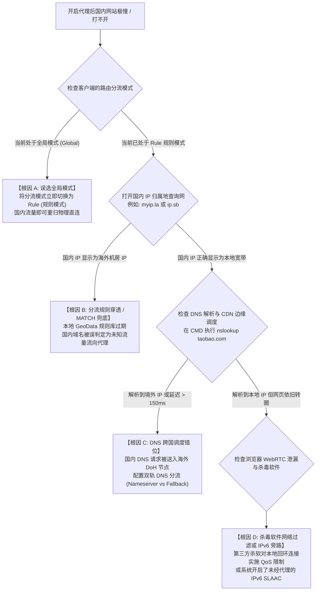

# 代理打开后国内网站变慢怎么办？规则分流、DNS 调度错位与路由环路深度排查实录

在科学上网的日常使用中，无数用户都曾经历过这种令人烦躁的“割裂”体验：**明明代理客户端显示节点一切正常，观看 YouTube、查询 Google 丝滑顺畅；可一旦切回国内应用，在百度查资料半天刷不出结果、淘宝和京东图片全变成灰色方块、微信文件发送频繁重试，甚至登录招商银行或支付宝时直接弹出“系统检测到异常登录风险并强制下线”！**

很多用户的第一直觉往往是“代理软件把宽带拖慢了”，甚至以为“只要翻墙，国内网速就必然受影响”。**从现代计算机网络拓扑与分布式 CDN 边缘计算调度机制（RFC 7871）来看，优质的科学上网环境必须实现真正的“零感知分流”——被封锁的境外流量通过加密隧道出海，而国内所有通信必须 100% 走本地物理宽带直连，延迟与速度不应发生哪怕 1 毫秒的劣化。**

导致国内网站变慢甚至瘫痪的核心根因，本质上被收敛在：**客户端分流模式误置为全局模式、递归 DNS 剥离 EDNS Client Subnet（ECS）引发跨国 CDN 调度错位、GeoSite/GeoIP 规则库更新滞后、以及虚拟网卡路由环路。** 本文将自顶向下拆解分流机理，并提供工业级双轨 DNS 配置模板与自动化排查脚本。

---

## 一、 为什么国内网站会变慢？跨国 CDN 调度错位机理

国内巨型互联网服务（如阿里淘宝、腾讯微信、字节抖音、百度）的绝大部分流量并不直接由北京或杭州的机房机架响应，而是依赖部署在全国各省市自治区的**边缘计算 CDN 节点**。

要理解速度劣化的本质，必须观察以下两种截然不同的数据包调度路径：

```
================================================================================
【理想路径: 本地直连与精确 CDN 边缘调度】
[用户 (上海电信)] ──► 本地 DNS (223.5.5.5) 带着上海电信 IP 发起解析 (RFC 7871 ECS)
                             │
                             ▼
[阿里 DNS 智能调度中心] ──► 识别出客户端位于上海电信
                             │
                             ▼
[返回上海本地 CDN 节点 (101.226.x.x)] ──► 物理延迟 2ms，图片秒开，下载跑满千兆！

--------------------------------------------------------------------------------

【灾难路径: 跨国 CDN 调度错乱 (由于全局模式或海外 DNS 解析)】
[用户 (上海电信)] ──► 客户端将国内域名解析也送往境外 Google DNS (8.8.8.8)
                             │
                             ▼
[8.8.8.8 (美西机房)] ──► 递归查询时向阿里 CDN 暴露的是 Google 美西出口 IP
                             │
                             ▼
[阿里 DNS 智能调度中心] ──► 误认为请求发起方位于美国加州
                             │
                             ▼
[返回美国圣何塞 CDN 节点 (198.18.x.x)]
                             │
                             ▼
【最终灾难结果】:
1. 用户在上海打开淘宝，一张 200KB 的商品图片要横跨太平洋从美国拉取；
2. 往返延迟从 2ms 暴增至 220ms (激增 110 倍)；
3. 淘宝风控引擎检测到中国境内账号短时间内从加州 IP 拉取资源，判定为被黑客撞库，强制弹验证码并冻结会话！
================================================================================
```

---

## 二、 国内网站访问受阻排查决策树（Mermaid 状态机）

当您遇到“翻墙正常但国内极慢”的故障时，请按照下述层级决策树排查：



---

## 三、 四大核心根因深度技术剖析

### 1. 根因一：误选客户端“全局模式 (Global)”
主流代理客户端（Clash Verge Rev、v2rayN、sing-box、Shadowrocket）通常提供三种基础流量模式：
1. **规则模式（Rule）**：**【生产环境唯一推荐日常模式】** 依靠规则流水线判断，仅让被阻断的境外服务走代理，国内流量一律本地物理直连；
2. **全局模式（Global）**：全系统所有套接字连接（哪怕访问 `192.168.1.1` 或 `baidu.com`）**无条件强行打包送入代理节点**；
3. **直连模式（Direct）**：所有流量绕过代理（相当于未开代理）。

**为什么绝不能常驻全局模式？**
- **物理延迟断崖**：局域网访问或同城通信被硬生生绕行日本或美西，延迟由 3ms 飙升至 200ms 以上；
- **浪费宝贵专线流量**：观看 B 站 4K、下载百度网盘或更新游戏会极速烧光机场的高昂专线配额；
- **账号风控甚至封号**：网银、微信支付、国税系统、Steam 国区检测到异常跨国 IP，直接触发保护性冻结。

### 2. 根因二：RFC 7871 (ECS) 缺失引发跨国 CDN 调度错乱
智能 DNS 解析依赖 **EDNS0 Client Subnet（RFC 7871 ECS 扩展）**。当客户端向递归 DNS 查询时，递归服务器理应携带客户端所在的网段信息（如 `101.226.0.0/24`）向权威 DNS 询问。
- 如果用户在客户端中错误地将国内主 DNS 配置为境外的 `8.8.8.8` 或 `1.1.1.1`；
- 或者使用了不支持 ECS 特性的加密 DoH 服务；
- 权威 DNS 无法获知客户端的真实中国大陆位置，只能根据递归解析服务器自身的 IP（位于美国或欧洲）进行边缘节点调度，导致国内网站全量调度至大洋彼岸的孤立边缘节点。

### 3. 根因三：GeoSite 与 GeoIP 规则数据库更新严重滞后
客户端判断一个域名或 IP 是否属于“国内直连”，完全依赖本地加载的 `geosite.dat` 与 `geoip.dat`：
- 国内互联网大厂几乎每周都在启用新的二级域名（如微信的视频号 CDN `finder.video.qq.com`、淘宝的短链解析 `tb.cn`）以及新采购的公网 IP 网段；
- 若客户端半年未曾更新 GeoData，这些新资产会被规则引擎判定为“未命中任何国内规则”，从而直接顺延跌落至最底部的 **`MATCH,PROXY` 兜底规则**，被误送入境外代理链路。

### 4. 根因四：双栈网络下的 IPv6 旁路抢占与解析泄露
许多现代家庭宽带已全量普及 IPv6，光猫默认通过 SLAAC 分配 `240e::` 或 `2408::` 开头的公网 IPv6 地址：
- 很多代理客户端在默认状态下仅对 IPv4 进行了 TUN 虚拟网卡劫持与 DNS 劫持，对 IPv6 处于半放任状态；
- 当浏览器发起 DNS 递归查询时，优先发起 `AAAA` 记录查询（IPv6 地址）；
- 若本地运营商的 IPv6 DNS 响应快于客户端内核的虚拟代理响应，浏览器会优先尝试通过**未受规则调优的物理 IPv6 链路直连**，引发极其严重的握手阻塞与跨地域卡顿。

---

## 四、 工业级双轨 DNS 分流标准配置模板 (Mihomo / Clash)

彻底终结国内网站变慢的核心工程手段，是在代理内核中建立坚不可摧的 **双轨并行 DNS 架构（Dual-Track Split DNS）**：国内域名 100% 由阿里/腾讯低延迟安全 DNS 直连解析，境外域名 100% 封闭在加密 DoH 通道内解析。

请在 Clash Verge Rev 的扩展配置（Merge）或配置编辑中导入以下标准配置模块：

```yaml
# ==============================================================================
# 工业级双轨 DNS 防泄漏与防跨国调度错位配置模板
# ==============================================================================
dns:
  enable: true
  listen: 0.0.0.0:1053
  ipv6: false                      # 强烈建议关闭 IPv6 解析，彻底防范 IPv6 旁路抢占
  enhanced-mode: fake-ip          # 开启 Fake-IP 虚拟映射，实现毫秒级瞬间响应
  fake-ip-range: 198.18.0.1/16
  fake-ip-filter:
    # 强制以下高敏感国内服务绝不分配 Fake-IP，必须由本地解析真实 IP
    - '*.lan'
    - '*.local'
    - 'localhost.ptlogin2.qq.com'
    - '*.wechat.com'
    - '*.tenpay.com'
    - '*.alipay.com'
    - '*.ntp.org'

  # [轨道 1: 国内直连默认 DNS 服务器] 仅使用国内低延迟无污染安全 DNS
  default-nameserver:
    - 223.5.5.5                    # 阿里公共 DNS
    - 119.29.29.29                  # 腾讯 DNSPod

  nameserver:
    - 223.5.5.5
    - 119.29.29.29

  # [轨道 2: 境外域名与防污染备用加密 DNS] 仅通过加密 DoH 通道出海
  fallback:
    - https://dns.google/dns-query
    - https://1.1.1.1/dns-query
    - https://dns.quad9.net/dns-query

  # [轨道 3: 严格的策略分流匹配引擎]
  nameserver-policy:
    # 命中国内大型域名的请求，强制走本地 223.5.5.5 直连解析，保障 CDN 调度 100% 在本地
    'geosite:cn,private':
      - 223.5.5.5
      - 119.29.29.29
    # 命中常见国内大厂专属域名强制直连
    'domain:baidu.com,qq.com,taobao.com,jd.com,bilibili.com':
      - 223.5.5.5
      - 119.29.29.29
    # 命中境外域名走加密 DoH
    'geosite:geolocation-!cn':
      - https://dns.google/dns-query
      - https://1.1.1.1/dns-query

rules:
  # 优先保障局域网与国内直连
  - GEOIP,private,DIRECT,no-resolve
  - GEOSITE,private,DIRECT
  - GEOSITE,cn,DIRECT
  - GEOIP,CN,DIRECT
  # 兜底走代理
  - MATCH,节点选择
```

---

## 五、 全自动国内直连与 CDN 调度健康诊断脚本

为了让用户客观诊断当前国内网站是否处于“跨国绕路”状态，以下提供可在 Windows PowerShell 中直接运行的一键诊断脚本：

```powershell
<#
.SYNOPSIS
    国内网站直连延迟与 CDN 调度健康深度审计脚本
.DESCRIPTION
    1. 测试主流国内服务 (Baidu, Taobao, B站) 真实端到端 RTT 往返时延
    2. 探测当前解析获得的 CDN IP 物理地理归属
    3. 校验分流有效性与 DNS 缓存健康状态
#>

Write-Host "==========================================================" -ForegroundColor Cyan
Write-Host "  网络诊断实验室 - 国内网站直连分流与 CDN 健康审计工具  " -ForegroundColor Cyan
Write-Host "==========================================================" -ForegroundColor Cyan

$testDomains = @(
    @{ Name = "百度搜索"; Domain = "www.baidu.com" },
    @{ Name = "淘宝商城"; Domain = "www.taobao.com" },
    @{ Name = "哔哩哔哩"; Domain = "www.bilibili.com" },
    @{ Name = "腾讯网  "; Domain = "www.qq.com" }
)

Write-Host "`n[Step 1/2] 正在测试主流国内大厂域名的解析与端到端往返时延..." -ForegroundColor Yellow

foreach ($item in $testDomains) {
    $domain = $item.Domain
    $name = $item.Name
    
    $stopwatch = [System.Diagnostics.Stopwatch]::StartNew()
    try {
        # 解析 IP
        $dnsResult = Resolve-DnsName -Name $domain -Type A -ErrorAction Stop
        $ip = ($dnsResult | Select-Object -ExpandProperty IPAddress -First 1)
        
        # 测算 TCP 连接延迟
        $tcpConn = Test-NetConnection -ComputerName $ip -Port 443 -WarningAction SilentlyContinue
        $stopwatch.Stop()
        
        $rtt = if ($tcpConn.PingReplyDetails) { $tcpConn.PingReplyDetails.RoundtripTime } else { [math]::Round($stopwatch.Elapsed.TotalMilliseconds) }
        
        # 判定是否属于 Fake-IP 虚拟地址池 (198.18.x.x)
        $isFakeIp = $ip -match "^198\.(18|19)\."
        
        Write-Host "----------------------------------------------------------" -ForegroundColor DarkGray
        Write-Host "目标服务: $name ($domain)" -ForegroundColor White
        Write-Host "解析出口: $ip $(if ($isFakeIp) { '[注意: 命中客户端 Fake-IP]' } else { '[真实公网 IP]' })" -ForegroundColor Gray
        Write-Host "握手延迟: $rtt ms" -ForegroundColor $(if ($rtt -le 35) { 'Green' } elseif ($rtt -le 80) { 'Yellow' } else { 'Red' })
        
        if ($rtt -gt 100) {
            Write-Host "[!] 警告: 延迟异常偏高 (>100ms)! 极大概率发生了跨国调度错位或误走代理!" -ForegroundColor Red
        } else {
            Write-Host "[√] 正常: 处于优质本地 CDN 调度范围内 (<35ms)" -ForegroundColor Green
        }
    } catch {
        Write-Host "[-] $name 测试失败: $($_.Exception.Message)" -ForegroundColor Red
    }
}

# 2. 刷新本地 DNS 缓存建议
Write-Host "`n[Step 2/2] 正在自动清理本地 Windows DNS 客户端解析缓存..." -ForegroundColor Yellow
Clear-DnsClientCache
Write-Host "[+] 本地 DNS 缓存已清空完毕!" -ForegroundColor Green

Write-Host "`n[完成] 诊断完毕! 若有红字异常，请检查客户端分流模式是否误设为 Global (全局模式)。" -ForegroundColor Cyan
```

---

## 六、 生产环境真实故障复盘（2大典型 RCA 案例）

### 案例一：外企总监开代理办公，淘宝京东图片加载极其迟缓达半个月
- **故障拓扑**：北京海淀区某科技高管，办公室配置 1000M 中国联通企业宽带，客户端使用 Clash Verge Rev。外网查阅技术文献秒开，但在工位打开淘宝、京东或拼多多时，页面框架能瞬间渲染，但核心商品宣传图转圈 15 秒以上才能勉强加载完成。
- **排查与抓包过程**：
  1. 打开 Chrome 开发者工具（F12）进入 Network 面板；
  2. 观察商品图片的请求耗时，发现单个 jpg 图片的 `Initial Connection + SSL` 耗时高达 **240ms**，`Waiting for server response (TTFB)` 达 **380ms**；
  3. 提取图片域名的 IP 地址（如 `img.alicdn.com` 对应 IP `198.18.0.84`）；
  4. 检查客户端 DNS 配置，发现该用户配置了海外的 `https://1.1.1.1/dns-query` 作为唯一的 DNS 解析服务器，未配置任何 `nameserver-policy` 分流；
  5. 导致 Cloudflare DoH 将阿里的 CDN 全部解析到了位于美国圣何塞的节点。
- **根因判定（RCA）**：全局单一海外 DoH 服务器剥离了中国客户端的 ECS 子网标签，引发权威 DNS 将所有国内静态资源调度至北美西海岸边缘机房。
- **修复方案**：应用上述双轨 DNS 策略模板，强制将 `geosite:cn` 规则绑定至 `223.5.5.5` 直连解析。修复后图片 TTFB 耗时瞬间降低至 **6ms**，商品图瞬间秒开。

### 案例二：开启代理后微信电脑端频繁提示“登录环境异常”并被踢下线
- **故障拓扑**：深圳某财务人员，电脑常驻开启 v2rayN 客户端。每次只要启动客户端，微信电脑版在半小时内必定被系统强制登出，并弹窗提示“账号存在被盗风险”。
- **排查与流量追踪**：
  1. 打开 Wireshark 抓取本地以太网卡通信；
  2. 发现微信核心通讯服务器域名为 `short.weixin.qq.com` 与 `long.weixin.qq.com`；
  3. 该用户使用的订阅规则中，路由模式勾选了“全局 (Global)”，微信的所有心跳与数据包均通过香港机房代理节点发出；
  4. 微信移动端（手机）走的是本地深圳电信直连，而电脑端走的是香港机房 IP，两者在腾讯安全后台产生严重的**“地理位置瞬移冲突”**，直接触发了腾讯最高等级的风控防御模型。
- **根因判定（RCA）**：错误开启全局模式导致办公软件通信绕经海外机房，触发国内金融社交平台的同号异地登录风控拦截。
- **修复方案**：将 v2rayN 路由模式修改为“绕过大陆（bypass cn）”，并在路由高级设置中添加进程直连规则 `WeChat.exe`。此后微信再无任何风控报警。

---

## 七、 常见高频报错与排障速查表 (FAQ)

### Q1: 切换到了 Rule 规则模式，为什么查当前 IP 还是显示海外？
- **回答**：这属于**正常现象**！因为您用来查询 IP 的网站（如 `ip.sb`、`whatismyipaddress.com`）本身属于海外域名，理应被规则模式调度到代理节点以展示您的节点出境 IP。判断国内直连是否正常，请使用专门的国内测速网（如 `speedtest.cn`）或在百度直接搜索“IP”，若百度搜索显示的依然是您本地的宽带运营商，说明分流完全正常。

### Q2: 为什么有些冷门国内网站在规则模式下依然很慢？
- **回答**：这是因为本地的 `geosite.dat` 规则库未及时收录该冷门域名的特征，导致其命中了最后的 `MATCH,PROXY` 兜底规则。
- **对策**：
  1. 在客户端中点击“更新 GeoData / GeoIP 数据库”；
  2. 或者手动在自定义规则顶部追加一行：`- DOMAIN-SUFFIX,目标域名.com,DIRECT` 强制其直连。

### Q3: 开启了 TUN 模式后，国内网站甚至直接打不开了怎么办？
- **回答**：通常是 TUN 虚拟网卡的 DNS 劫持模块发生了死锁或与物理网卡发生跃点抢占。请参阅专病排查手册：[TUN 模式与 Wintun 虚拟网卡崩溃排障全指南](/clients/clash-verge/mihomo-service/tun-mode-wintun-troubleshooting)。

---

## 八、 推荐高可用容灾与延伸阅读

如果您在日常使用中既需要极速纯净的海外节点加速科研与办公，又希望拥有毫秒级无感的国内直连体验，**强烈建议搭配具备智能动态分流规则与全线低延迟物理专线的高端服务商**：

<DisasterRecoveryBox />

### 相关进阶排查与排障手册
- [开启代理后国内网站卡顿与 DNS 泄漏深度调查](/issues/connection-failures/domestic-sites-slow-dns-leak-investigation)
- [规则模式与全局模式详细原理解析与场景决策指南](/tutorials/rule-modes)
- [科学上网连接成功却打不开网页排查步骤](/issues/connected-but-no-internet)
- [GeoSite 与自定义规则集 (Rule-Providers) 本地编写指南](/tutorials/geosite-direct-custom-ruleset-guide)
- [全节点大面积超时瘫痪根因判定与容灾逃生机制](/connection/all-nodes-down)
