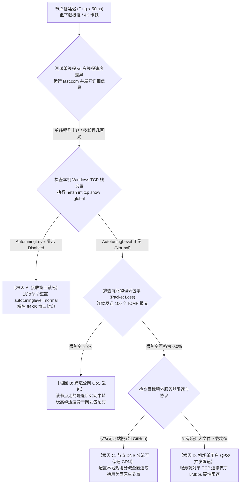

# 节点延迟很低但下载速度很慢？带宽、拥塞与长肥网络 BDP 深度调优：破除 ICMP 入口假象与 BBR 拥塞控制实战

在挑选与使用翻墙节点时，绝大多数用户与网络技术人员最常陷入的认知误区是：**“哪个节点延迟（Ping / RTT）最低，哪个节点的速度就最快。”**

然而在实际日常工况中，用户经常遭遇极为反常的矛盾现象：**在客户端节点列表中，香港或日本节点测速显示延迟只有 20ms~35ms，一片鲜艳的深绿色；但打开 YouTube 观看 4K 视频时，缓冲进度条频繁停滞、画质甚至被自动降级到 480P；在 GitHub、Steam 或通过浏览器下载大文件时，瞬时速度只有可怜的几百 KB/s，仿佛回到了拨号上网时代。**

为什么极低的延迟无法转化为充沛的下载带宽？低延迟背后隐藏着哪些商业包装与网络协议层面的“障眼法”？**从计算机网络传输层原理（RFC 1323 / RFC 7323）来看，延迟（RTT）仅仅代表单个微型探测数据包的往返耗时，而实际文件的持续吞吐量（Throughput）由带宽时延积（BDP）、TCP 接收窗口大小、丢包率对拥塞控制算法的数学惩罚、以及跨境物理链路的 QoS 队列深度共同决定。**

本文将以硬核数学模型与底层报文为依据，彻底拆解“低延迟低速度”的四大底层真相，并提供操作系统 TCP 协议栈调优与单线程吞吐实测指南。

---

## 一、 核心数学模型：Mathis 公式与带宽时延积 (BDP)

要理解为什么延迟低速度却上不去，必须掌握计算机网络中最经典的两个物理公式：

```
================================================================================
【模型 1: 带宽时延积 (Bandwidth-Delay Product, BDP)】
BDP (Bits) = 瓶颈物理带宽 (Bandwidth in bps) × 链路往返时延 (RTT in seconds)
BDP 代表在任意时刻，已经在物理光纤中飞驰但尚未得到接收端 ACK 确认的最大数据容量。

【模型 2: Mathis TCP 吞吐量理论极限公式】
                        MSS
吞吐量 (Throughput) ≤ ───────────── × C
                      RTT × √Loss

其中:
- MSS: 最大分段大小 (通常为 1460 或 1360 字节)
- RTT: 真实端到端往返时延 (秒)
- Loss: 链路物理丢包率 (0.01 代表 1%)
- C: 拥塞控制常数 (对于经典 Cubic 约为 0.93)
================================================================================
```

### 1. BDP 窗口锁死：为什么 64KB 默认窗口会扼死速度？
在未启用 TCP 窗口缩放选项（RFC 7323 Window Scale）或系统接收缓冲区被锁死时，TCP 报文头部的最大接收窗口（Receive Window, RWIN）只有 **65,535 字节（64 KB）**。
- 假设您正在连接一台美西服务器，真实 RTT 为 **200ms（0.2 秒）**；
- 根据公式，在单条 TCP 连接中，客户端在收到服务端 ACK 之前最多只能发送 64 KB 数据；
- **该单流的物理理论吞吐上限**被硬性焊死在：
  $$\text{Throughput} \le \frac{65{,}535 \times 8 \text{ bits}}{0.2 \text{ seconds}} \approx 2{,}621{,}400 \text{ bps} \approx 2.62 \text{ Mbps (约 327 KB/s)}$$
- **即使服务商为您提供了 10 Gbps 的物理光纤，在没有调优 TCP 窗口的情况下，单流下载速度也绝对不可能超过 327 KB/s！**

### 2. Mathis 公式惩罚：1% 丢包率带来的毁灭性灾难
观察 Mathis 公式的分母：$\text{RTT} \times \sqrt{\text{Loss}}$。
- 丢包率作为平方根项位于分母中。当跨国链路发生仅 **1%（0.01）** 的轻微丢包时，$\sqrt{0.01} = 0.1$，分母放大 10 倍，吞吐量直接缩水至原先的十分之一；
- 若丢包率上升到 **4%**，吞吐量瞬间骤降至二十分之一。
- 这在数学上彻底解释了：**为什么 Ping 值虽然看起来很低，但只要公网出口存在 2% 的微小丢包，单线程下载速度就会发生雪崩式坍塌。**

---

## 二、 破除低延迟神话的四大底层真相

```
+─────────────────────────────────────────────────────────────────────────────+
|                         低延迟高卡顿四大技术真相拆解                        |
+─────────────────────────────────────────────────────────────────────────────+
| 真相 1：测得的 20ms 只是到国内中转入口的距离 (门票延迟 vs 真实旅程)         |
|   - 很多客户端测试的 Ping 只是本地到上海/广州入口机房的 ICMP 握手耗时        |
|   - 入口机房通过跨境公网到境外落地小鸡的后半程丢包与延迟被完全掩盖          |
+─────────────────────────────────────────────────────────────────────────────+
| 真相 2：多线程 Speedtest 虚高跑分 vs 单线程真实业务卡顿                     |
|   - Speedtest 建立 16~32 条并发连接对冲丢包，刷出 500Mbps 跑分假象           |
|   - YouTube 4K 播放、网页请求、Git 克隆为单流长连接，遭遇丢包瞬间窗口腰斩    |
+─────────────────────────────────────────────────────────────────────────────+
| 真相 3：操作系统 TCP 自动调优被第三方软件恶意关闭 (Window Auto-Tuning)      |
|   - 各类“网速加速器”、“一键游戏优化”脚本误将 Windows 窗口自适应设为 Disabled |
|   - 导致长肥网络下 TCP 窗口死锁在 64KB，单流吞吐彻底丧失                    |
+─────────────────────────────────────────────────────────────────────────────+
| 真相 4：晚高峰运营商出口 QoS 削峰与骨干网 WRED 丢包                          |
|   - 廉价公网中转隧道在每晚 20:00~23:00 遭遇骨干网针对性限速与丢包          |
|   - 客户端保持低延迟心跳，但传输层数据包被运营商交换机批量丢入黑洞          |
+─────────────────────────────────────────────────────────────────────────────+
```

### 1. 真相一：测得的 20ms 只是国内中转入口的“门票响应”
绝大多数中转机场（无论是公网中转还是专线）均采用“**国内入口 POP + 境外落地 Edge**”的二段式架构：
- 当用户在客户端点击“延迟测试”时，客户端向节点配置的域名/IP 发送握手报文；
- 如果服务商没有开启真实 URL 测试，客户端抓取到的只是**您电脑到国内中转入口（如深圳移动机房）**的往返时间（20ms）；
- 但真正的瓶颈发生在后半段：国内机房到香港/美西落地机房的物理传输。如果后半程物理海缆遭遇拥塞丢包 20%，用户在客户端看到的依然是一片绿色的“20ms”，但实际业务传输早已彻底瘫痪。

### 2. 真相二：多线程测速的“泡沫掩盖”
很多用户拿 Speedtest 截图找客服理论：“测速明明跑了 600 Mbps，为什么看 YouTube 4K 会卡死？”
- **Speedtest 工作模式**：在毫秒内建立 16 到 32 条平行的 TCP 数据流，哪怕其中 3 条连接遭遇丢包而重传降速，其余 29 条连接依然能够瞬间拉满瞬时带宽，汇总相加得出一个极其震撼的跑分数字；
- **真实业务工作模式**：
  - YouTube、Netflix 播放器底层拉取 DASH 视频切片（`.m4s` 块）主要依赖 **单条或极少并发的 HTTP/2 连接**；
  - 网页加载图片、CSS、JS，或者下载单个 zip 压缩包，均为典型的单线程传输。
  - 在单线程模式下，一次微小丢包就会触发 TCP Cubic 的拥塞窗口减半，导致缓冲区耗尽并频繁弹窗缓冲。

---

## 三、 拥塞控制算法大比拼：Cubic vs BBR

在科学上网跨境链路这种典型的“高延迟、有丢包”的长肥网络（LFN）环境下，服务器与客户端采用何种**TCP 拥塞控制算法（Congestion Control Algorithm）**对最终速率具有决定性影响：

| 对比维度 | 传统 Cubic / Reno 算法 | Google BBR v1/v2/v3 算法 | UDP 乱序拥塞 (Hysteria 2 / Brutal) |
| :--- | :--- | :--- | :--- |
| **拥塞判断标准** | **基于丢包 (Loss-based)**：只要丢包就判定为拥塞 | **基于模型 (Model-based)**：测量最大带宽与最小 RTT | **基于设定速率与激进丢包探测** |
| **遇到丢包后的反应** | 拥塞窗口（`cwnd`）瞬间腰斩 50% 甚至归零 | 忽略非拥塞造成的随机丢包，保持最大发送速率 | 完全不减速，依赖自适应重传补偿 |
| **抗丢包能力** | 极差（丢包率 > 1% 时速度断崖式下跌） | **极强**（在 15%~20% 丢包下依然能跑满带宽） | **极致**（可承受 30% 丢包不卡顿） |
| **晚高峰表现** | 频繁陷入重传超时（RTO），视频严重卡顿 | 稳定榨干链路物理极限带宽 | 强势霸占出口队列，体验极其流畅 |
| **部署位置** | 客户端与服务端内核默认自带 | 需服务端 VPS 内核开启（Linux 4.9+） | 需协议原生支持（基于 QUIC/UDP） |

---

## 四、 工业级排查决策树（Mermaid 状态机）

当您遇到“节点 Ping 只有几十毫秒但下载极慢”时，请按照以下流程精准定位瓶颈：



---

## 五、 Windows / Linux 生产级 TCP 协议栈调优与单线程实测脚本

很多 Windows 用户电脑曾运行过各类所谓的“系统垃圾清理”、“网络优化大师”或网吧优化软件，这些工具经常错误地将 Windows 核心的 TCP 窗口自动调优关闭，导致单流长连接彻底瘫痪。

以下提供一套在管理员权限 PowerShell 中运行的全自动检测与优化脚本：

```powershell
<#
.SYNOPSIS
    长肥网络 (BDP) 与 Windows TCP 协议栈吞吐量终极优化与自检脚本
.DESCRIPTION
    1. 审计当前 TCP 窗口自动调优等级 (Auto-Tuning Level)
    2. 激活基于 RFC 7323 的 Window Scale 扩展
    3. 开启基于长肥网络的 ECN 与动态拥塞规避
    4. 单线程真实下载吞吐量测试
#>

Write-Host "==========================================================" -ForegroundColor Cyan
Write-Host "  网络诊断实验室 - Windows TCP 传输层吞吐深度优化工具  " -ForegroundColor Cyan
Write-Host "==========================================================" -ForegroundColor Cyan

# 1. 检查当前全局 TCP 参数
Write-Host "`n[Step 1/3] 正在审计 Windows 当前 TCP 全局参数配置..." -ForegroundColor Yellow
$tcpGlobal = netsh int tcp show global

Write-Host "当前核心参数快照:" -ForegroundColor Gray
$tcpGlobal | Where-Object { $_ -match "接收窗口自动调优级别|外包拥塞提供程序|ECN 功能" }

# 2. 执行工业级 TCP 栈调优 (解除 64KB 限制)
Write-Host "`n[Step 2/3] 正在应用高性能 TCP 吞吐量优化配置..." -ForegroundColor Yellow

try {
    # 强制开启接收窗口自动调节 (解除长肥网络 64KB 死锁)
    netsh int tcp set global autotuninglevel=normal | Out-Null
    Write-Host "[+] 成功启用: 接收窗口自动调优 (autotuninglevel = normal)" -ForegroundColor Green

    # 启用显式拥塞通知 (ECN)，减少丢包引发的重传
    netsh int tcp set global ecncapability=enabled | Out-Null
    Write-Host "[+] 成功启用: ECN 显式拥塞通知 (ecncapability = enabled)" -ForegroundColor Green

    # 开启动态复合 TCP / 拥塞控制优化
    netsh int tcp set supplemental template=internet congestionprovider=ctcp | Out-Null
    Write-Host "[+] 成功设置: 互联网模板拥塞提供程序为 CTCP" -ForegroundColor Green

    # 禁用过时的启发式网络限速
    netsh int tcp set heuristics disabled | Out-Null
    Write-Host "[+] 成功禁用: 历史遗留 TCP Heuristics 限制" -ForegroundColor Green
} catch {
    Write-Error "[-] 优化失败，请确保以管理员身份运行 PowerShell!"
}

# 3. 单线程真实吞吐量基准测速 (单流长连接 vs 延迟)
Write-Host "`n[Step 3/3] 正在通过代理端口进行单线程真实吞吐量实测 (拉取 50MB 纯净数据块)..." -ForegroundColor Yellow

$proxyUrl = "http://127.0.0.1:7897"
$testUrl = "https://speed.cloudflare.com/__down?bytes=52428800" # 50MB 测试文件

$webClient = New-Object System.Net.WebClient
$webClient.Proxy = New-Object System.Net.WebProxy($proxyUrl)
$stopwatch = [System.Diagnostics.Stopwatch]::StartNew()

try {
    Write-Host "[*] 正在拉取测试数据，测试单 TCP 传输流的抗丢包性能..." -ForegroundColor Gray
    $data = $webClient.DownloadData($testUrl)
    $stopwatch.Stop()
    
    $totalSeconds = $stopwatch.Elapsed.TotalSeconds
    $fileSizeBytes = $data.Length
    $speedMbps = [math]::Round(($fileSizeBytes * 8 / $totalSeconds) / 1MB, 2)
    $speedMBs = [math]::Round(($fileSizeBytes / $totalSeconds) / 1MB, 2)

    Write-Host "----------------------------------------------------------" -ForegroundColor DarkGray
    Write-Host "测试耗时        : $([math]::Round($totalSeconds, 2)) 秒" -ForegroundColor White
    Write-Host "传输数据量      : $([math]::Round($fileSizeBytes / 1MB, 2)) MB" -ForegroundColor White
    Write-Host "单线程真实带宽  : $speedMbps Mbps" -ForegroundColor Green
    Write-Host "单线程下载速率  : $speedMBs MB/s" -ForegroundColor Green
    Write-Host "----------------------------------------------------------" -ForegroundColor DarkGray

    if ($speedMbps -ge 100) {
        Write-Host "[评估结果]: 极优! 单线程轻松破百兆，足以支撑 4K/8K 极限高码率原盘播放。" -ForegroundColor Green
    } elseif ($speedMbps -ge 30) {
        Write-Host "[评估结果]: 良好! 满足 YouTube 4K 流畅播放要求。" -ForegroundColor Cyan
    } else {
        Write-Host "[评估结果]: 较弱! 单线程吞吐受限，若多线程跑分正常，说明链路存在微量丢包导致 TCP 窗口退避。" -ForegroundColor Yellow
    }
} catch {
    Write-Host "[-] 单线程测速失败: $($_.Exception.Message)" -ForegroundColor Red
    Write-Host "[!] 请确保客户端正在运行且本地端口为 7897 (或根据实际端口修改脚本)。" -ForegroundColor DarkGray
}

Write-Host "`n[完成] TCP 传输层优化与基准测试执行完毕!" -ForegroundColor Cyan
```

---

## 六、 生产环境真实故障复盘（2大典型 RCA 案例）

### 案例一：极客玩家选购 18ms 极速沪日专线，YouTube 却卡死在 360P
- **故障拓扑**：上海电信千兆宽带用户，购买了某知名高端机场的“沪日 IPLC 电竞专线”。客户端列表显示延迟仅 **18.4ms**，打开百度与网页秒开。但在 YouTube 看 4K 视频时，右键打开“详细统计信息（Stats for nerds）”，发现连接速度（Connection Speed）被死死卡在 **2,400 Kbps（约 2.4 Mbps）**，画质自动降为 360P。
- **排查与抓包过程**：
  1. 打开 Wireshark 抓取本地以太网卡通信报文；
  2. 观察从电脑发往本地代理端口的 TCP 握手报文，赫然发现 TCP `SYN` 报文的 Options 字段中，**`Window scale` 选项被完全剥离**；
  3. 客户端下发的 TCP Window 大小被静态锁定在 `65535`；
  4. 检查用户系统，该用户曾使用某“网游加速大师”优化系统，该软件修改了注册表 `HKLM\SYSTEM\CurrentControlSet\Services\Tcpip\Parameters`，强行注入了 `GlobalMaxTcpWindowSize = 65535` 并将 `TcpAutotuningLevel` 设为 `Disabled`。
- **根因判定（RCA）**：第三方优化软件锁死 Windows 接收窗口，导致端到端 TCP 窗口自适应失效。在 18ms 往返时延下，虽然延迟低，但单连接的物理窗口容量无法根据带宽动态扩张，单流吞吐被物理死锁在 2.4 Mbps。
- **修复方案**：执行上述 PowerShell 脚本，恢复 `autotuninglevel=normal`，并删除注册表静态窗口限制键值。重启电脑后，YouTube 4K Connection Speed 瞬间飙升至 **145,000 Kbps**，4K 秒开。

### 案例二：跨境开发者拉取海外 Docker 镜像频繁超时断连
- **故障拓扑**：北京某人工智能实验室，工程师通过代理从美西 Docker Hub 拉取 8GB 模型镜像。客户端连接美西节点，显示 Ping 为 165ms。拉取开始时速度能冲到 20MB/s，但跑了不到 30 秒速度骤降为几百 KB/s，最终频频触发 `context deadline exceeded` 失败重试。
- **排查与链路诊断**：
  1. 使用 MTR 对美西节点进行持续 500 次发包跟踪；
  2. 结果显示该节点的平均延迟为 165ms，但**物理丢包率（Loss%）在晚高峰浮动在 1.8% ~ 2.5% 之间**；
  3. 进一步排查服务商落地机器的内核设置，其使用的 Linux 内核依然为老旧的 3.10 内核，默认拥塞控制算法为 **Cubic**；
  4. 根据 Mathis 公式，在 165ms RTT 叠加 2% 丢包时，Cubic 算法每遇到一个丢包事件就触发快速重传并将发送窗口缩减一半，连接频繁进入拥塞恢复阶段，单流有效吞吐量跌破 500 KB/s。
- **根因判定（RCA）**：长距离高时延网络（RTT > 150ms）叠加微量公网丢包，使得基于丢包判定的传统 Cubic 拥塞控制算法彻底失效。
- **修复方案**：指导用户在客户端切换为基于 UDP 的 **Hysteria 2** 协议节点，或者更换为落地服务器开启了 **Google BBR 拥塞控制** 的真物理专线节点。在相同的 2% 丢包环境下，拉取速度稳定保持在 18MB/s，镜像顺利下载完毕。

---

## 七、 常见高频报错与排障速查表 (FAQ)

### Q1: 为什么在测速网站上跑单线程速度很慢，但 IDM 多线程下载飞快？
- **回答**：这恰恰印证了本文的结论！IDM（Internet Download Manager）通过开启 8 到 32 个线程将大文件切片同时下载。多线程相当于并发建立了 32 条 TCP 连接，每条连接即便因丢包被限速在 5 Mbps，32 条连接聚合后也能跑出 160 Mbps 的高速。但这无法解决 YouTube、Netflix 等必须依赖单连接连续推流的视频卡顿问题。

### Q2: 开启 Windows 的 `autotuninglevel=experimental`（实验性）会不会更快？
- **回答**：**不建议**。`experimental` 级别虽然会尝试更大胆的窗口扩张，但在某些国内家用旧款路由器或特定企业防火墙设备上，过于激进的窗口扩张可能触发路由器的内存保护机制，反而导致严重的丢包甚至断网。生产环境最稳定、兼容性最高的是 **`normal`（标准自动调节）**。

### Q3: 玩外服网络游戏，需要看单线程下载速度吗？
- **回答**：**不需要**。网络游戏（如 CS:GO、Apex、Valorant）的数据包特征是“极高频率（64~128 tick/s）、极小体积（单包几十字节）的 UDP 数据包”。玩游戏时最关键的指标是**绝对延迟（RTT）与延迟抖动（Jitter）**，只要丢包率为 0% 且抖动小于 2ms，游戏体验即可达到极致，带宽即使只有 2 Mbps 也绰绰有余。

---

## 八、 推荐高品质专线容灾逃生节点与延伸阅读

如果您已完成系统协议栈调优，但在晚高峰期间无论如何切换节点依然卡顿，说明服务商的跨境出口遭遇了物理层级的严重超售与丢包。**强烈建议更换为提供 0 丢包 CIR 保障的纯血二层物理专线服务商**：

<DisasterRecoveryBox />

### 相关进阶排查与排障手册
- [单线程测速与多线程测速深度解析：为什么 4K 视频卡顿但测速能跑千兆？](/diagnostics/speed-test-single-vs-multi-thread)
- [BGP 公网中转隧道与 IEPL 物理专线全方位对比与成本模型](/airports/speed-stability/iepl-vs-iplc/bgp-tunnel-vs-dedicated-line)
- [物理专线跨国多层封装引发的 PMTUD 黑洞与 MSS 夹逼调优](/airports/speed-stability/iepl-vs-iplc/dedicated-line-cross-border-mtu-mss-clamping)
- [全节点大面积超时瘫痪根因判定与容灾逃生机制](/connection/all-nodes-down)
- [真实延迟与单/多线程测速方法：拒绝虚高跑分](/diagnostics/latency-speed)
