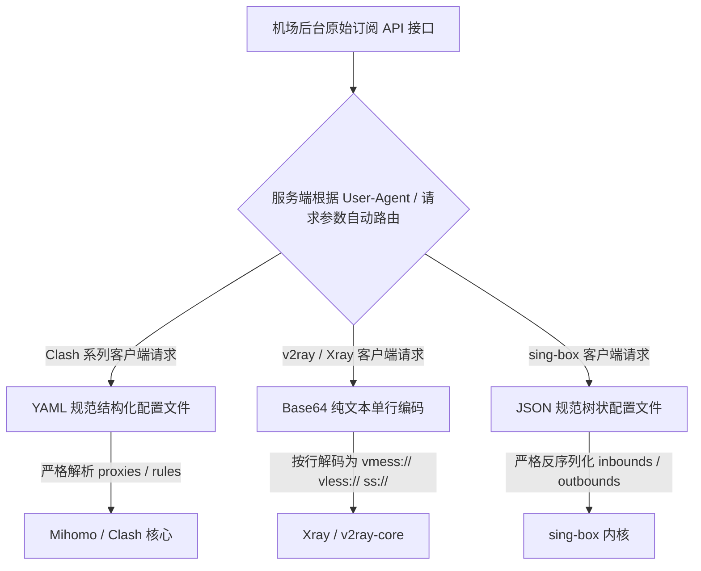
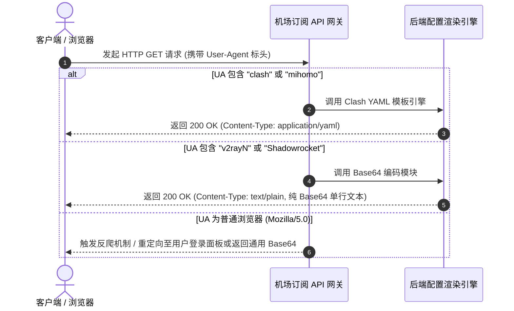

# 机场订阅链接无法导入怎么办？格式错误与客户端兼容问题全解析

在完成机场服务商的套餐选购与支付后，绝大多数用户面临的第一道技术门槛莫过于**“订阅链接导入失败（Subscription Import Failed）”**。

在实际使用过程中，这一故障的发生极具隐蔽性与迷惑性，不同桌面与移动端客户端抛出的错误提示也大相径庭：
- 在 **Clash Verge Rev** 或 **Clash Nyanpasu** 中点击导入，弹出 `Invalid YAML profile`、`yaml: line 1: did not find expected key` 或 `Fetch failed`；
- 在 **v2rayN** 中点击从剪贴板导入或更新，弹出 `The input is not a valid Base-64 string` 或界面列表毫无动静；
- 在 **Shadowrocket（小火箭）** 或 **v2rayNG** 中添加订阅并更新，页面转圈后节点数量依然停留在 0；
- 在 **sing-box** 或 **Karing** 中导入，提示 `json: cannot unmarshal string into Go struct` 或配置解析错误闪退。

许多初学者会下意识地认定“自己电脑断网了”或者“机场老板跑路了”。然而，从现代计算机网络工程与数据序列化标准的视角审视，**一次成功的订阅导入是一条由底层 TCP/TLS 握手、HTTP 请求标头内容协商、服务端 Token 鉴权计算、字符集编码转换以及严格抽象语法树（AST）重构共同构成的精密流水线**。在这条流水线上的任何一个微小环节发生协议不兼容、格式残缺或网络阻断，都会导致导入流程彻底终止。

本手册为您提供标准工业级的 12 大深度排查模块。我们将从底层数据协议、编码规范数学机理、运营商劫持排查直到跨客户端安全转换，为您提供一套具备根因分析（RCA）水准的全流程解决方案，助您彻底根除一切订阅无法导入的疑难杂症。

---

## 模块一：故障全景定义与核心指标判别

在展开深入排错前，网络工程师必须首先确认订阅无法导入发生的具体技术阶段。订阅失败绝非单纯的“无法访问”，而是可以严密细分为四大截然不同的技术阶段：

```
+─────────────────────────────────────────────────────────────────────────────+
|                         订阅链接导入流水线与故障发生点                        |
+─────────────────────────────────────────────────────────────────────────────+
| [第 1 阶段：网络通信层 (Transport)] ── 尚未获取到任何文本                   |
|   客户端 ──────(HTTP GET)──────► 运营商骨干网 ──────► 订阅 CDN 分发服务器     |
|   * 典型特征：报错 Fetch failed / Network error / Connection timed out        |
|   * 根源：本地运营商 DNS 污染拦截、SNI 阻断，或服务端机房宕机                  |
+─────────────────────────────────────────────────────────────────────────────+
| [第 2 阶段：鉴权状态层 (Authentication)] ── 收到服务端的明确拒绝响应        |
|   客户端 ◄─────(HTTP 401 / 403 / 502)───── 机场用户鉴权中心                   |
|   * 典型特征：提示 401 Unauthorized / 403 Forbidden                          |
|   * 根源：订阅链接末尾 Token 缺失、套餐已过期、或账户总流量已耗尽             |
+─────────────────────────────────────────────────────────────────────────────+
| [第 3 阶段：数据解码层 (Decoding)] ── 文本流无法还原为标准明文               |
|   客户端 Base64 解码器 ◄────── 数据文本流 ────── (抛出 Invalid Base-64)      |
|   * 典型特征：提示不是合法的 Base64 字符串、解析结果出现不可读二进制乱码       |
|   * 根源：字符数量未满足 4 字节对齐、缺失末尾等号填充、或包含了中文字符      |
+─────────────────────────────────────────────────────────────────────────────+
| [第 4 阶段：语法解析层 (Syntax Parsing)] ── 格式不兼容或语法结构损坏         |
|   客户端 YAML/JSON 编译引擎 ◄────── 明文字符串 ────── (抛出 YAML line error) |
|   * 典型特征：提示找不到预期键名、缩进不一致、或控制字符冲突                  |
|   * 根源：混用 Tab 与空格、机场下发的模板语法错误、误把 Base64 当作 YAML 导入 |
+─────────────────────────────────────────────────────────────────────────────+
```

### 快速自检三大关键指标

在开始繁复排查前，建议优先通过以下三大关键指标缩小故障半径：

1. **浏览器隐身测试指标（InPrivate Isolation Test）**：
   - 打开 Chrome 或 Edge 浏览器的无痕/隐身窗口，将订阅链接完整粘贴并回车。若能正常下载文件或在网页中打印大段以 `proxies:` 或 `vmess://` 开头的文本流，**100% 证明底层物理网络、运营商路由与服务端鉴权完全正常**，问题纯粹发生在客户端层面的编码解码或语法解析阶段；
2. **状态码响应特征指标（HTTP Status Code Signature）**：
   - 关注客户端报错弹窗或控制台日志中是否包含具体的 3 位数字状态码。若明确出现 `401 Unauthorized` 或 `403 Forbidden`，表明网络通信完全畅通，故障 100% 归因于用户账户到期、流量耗尽或 Token 密钥重置失效；若为 `502 Bad Gateway` 或 `504 Gateway Timeout`，则表明问题出在机场服务商的反向代理集群或后端数据库故障；
3. **内容前置指纹指标（Content-Type Fingerprint）**：
   - 将订阅链接获取到的前 20 个字符进行快速形态分类：若为无空格的纯连续英数字，属于 Base64 编码；若以 `port:`、`proxies:` 或 `mixed-port:` 开头，属于 YAML 规范；若以 `{` 开头并包含 `"inbounds"`，属于 JSON 规范；若以 `<!DOCTYPE html>` 或 `<html>` 开头，说明获取到的是运营商反诈阻断页或 Cloudflare 人机防护页面。

### 订阅失败 OSI 七层与应用层模型映射对照表

| 层级模型 | 关键协议与模块 | 故障表象与错误特征 | 现场确凿判定证据 |
|---|---|---|---|
| **应用通信层** | HTTP/1.1, HTTP/2, TLS 1.3 | 客户端抛出 `Fetch failed` 或 `context deadline exceeded` | 本地抓包显示无法完成 TLS ClientHello 握手，或 TCP 握手超时 |
| **安全鉴权层** | HTTP Bearer Token, API Secret | 客户端弹出 `401 Unauthorized` 或 `403 Forbidden` | 服务端响应头未携带有效配置，返回鉴权失败 JSON 提示 |
| **字符编码层** | RFC 4648 Base64, UTF-8 编码 | 客户端提示 `Invalid Base-64 string` 或出现乱码 | 字符串长度模 4 余数不为 0，缺少末尾补位等号 `=` |
| **数据结构层** | YAML 1.2, JSON RFC 8259 | 提示 `yaml: line X: did not find expected key` | 配置文件混入 Tab 制表符或键名冒号后缺少半角空格 |
| **域名解析层** | 递归 DNS, DoH, EDNS-Client-Subnet | 抛出 `lookup domain: no such host` | 本地运营商 LocalDNS 发生黑洞抢答污染，返回虚假 IP |
| **反代分发层** | Nginx 反向代理, Cloudflare CDN | 抛出 `502 Bad Gateway` 或返回 HTML 验证码页面 | 响应标头 `Server: cloudflare` 且 `Content-Type: text/html` |

---

## 模块二：订阅协议底层机制与三大主流格式模型

不同科学上网客户端之所以不能直接通用同一个订阅链接，核心原因在于各客户端运行在不同的底层核心（Core）之上，其依赖的配置文件数据模型与解析引擎存在本质区别：



### 三大主流格式技术特性对照表

| 订阅承载格式 | 适用客户端核心 | 内部数据结构与规范特征 | 典型解析失败报错 |
|---|---|---|---|
| **YAML 结构化规范** | Clash Verge Rev、Clash Nyanpasu、Mihomo Party | 树状层级缩进结构，包含 `port`、`proxies`、`proxy-groups`、`rules` 四大根节点 | `yaml: line X: did not find expected key` / `mapping values not allowed` |
| **Base64 纯文本编码** | v2rayN、v2rayNG、Shadowrocket (小火箭) | 经 Base64 编码的单行长文本，解码后为以换行符分隔的 `vmess://`、`vless://`、`ss://` 统一资源定位符 | `The input is not a valid Base-64 string` / 导入后节点列表空空如也 |
| **JSON 结构化规范** | sing-box、nekoray、Karing | 遵循严格 RFC 8259 规范的标准键值对 JSON，包含 `inbounds`、`outbounds`、`route` | `json: cannot unmarshal string into Go struct field` |

> [!IMPORTANT] 核心格式不兼容认知
> 绝不能将纯 Base64 字符串直接粘贴进 Clash Verge Rev 的订阅 URL 框中！若机场未提供专门的 Clash 订阅，直接粘贴会导致 Clash 的 YAML 解析引擎在第 1 行报错退出。同理，将完整的 Clash YAML 文本粘贴进 v2rayN 中，v2rayN 也会因为找不到 `vmess://` 前缀而导致节点列表为空。

---

## 模块三：12 种高频报错日志解码与逐行破译

当客户端弹窗报错时，底层控制台往往已经捕获了最直接的错误日志切片。切勿只看表面的弹窗，学会查阅控制台日志是定位故障的最短路径。

### 真实生产环境报错日志切片

```log
2026-10-25 11:20:01 [ERROR] [Profile] fetch profile error: Get "https://sub.domain.com/api/v1/client/subscribe?token=xxx": context deadline exceeded (Client.Timeout exceeded while awaiting headers)
2026-10-25 11:20:03 [ERROR] [Profile] parse yaml failed: yaml: line 88: mapping values are not allowed in this context
2026-10-25 11:20:05 [WARNING] [Fetch] remote server return status code 401 Unauthorized
2026-10-25 11:20:07 [ERROR] [v2rayN] FormatException: The input is not a valid Base-64 string as it contains a non-base 64 character, more than two padding characters, or an illegal character among the padding characters.
2026-10-25 11:20:09 [ERROR] [Profile] fetch profile error: dial tcp: lookup sub.domain.com: no such host
2026-10-25 11:20:11 [WARNING] [Auth] server response: 403 Forbidden (Traffic limit exceeded or account expired)
2026-10-25 11:20:13 [ERROR] [Profile] response Content-Type is text/html; charset=utf-8, expect application/yaml or text/plain
2026-10-25 11:20:15 [FATAL] [Subconverter] failed to fetch target: download failed with code 502
2026-10-25 11:20:17 [ERROR] [TLS] handshake failed: x509: certificate signed by unknown authority
2026-10-25 11:20:19 [ERROR] [YAML] found duplicate %YAML directive at line 1
2026-10-25 11:20:21 [ERROR] [Profile] subscription link returned empty body (content-length: 0)
2026-10-25 11:20:23 [WARNING] [WAF] Cloudflare challenge page detected, challenge required
```

### 12 大核心报错代码逐行深度解码对照表

| 核心报错关键词 | 发生环节 | 底层网络工程诱因与发生机理 | 针对性排查行动指南 |
|---|---|---|---|
| `context deadline exceeded` | 传输层 (HTTP) | 本地客户端发出的 HTTP 请求在等待响应头时超时，未收到服务器应答 | 本地运营商 DNS 阻断或机场订阅服务器遭受攻击，切换手机热点拉取 |
| `yaml: line X: mapping...` | 语法解析层 | 配置文件第 X 行缩进混用了 Tab 键，或冒号后缺少了半角空格分隔符 | 查看配置源码定位第 X 行，将 Tab 替换为 2 空格并在冒号后补齐空格 |
| `status code 401` | 业务鉴权层 | 订阅 URL 中的 `token=` 参数无效，或此前曾在用户中心点击过重置订阅 | 登录机场官网重新获取最新的订阅完整链接，替换客户端中的失效链接 |
| `The input is not a valid Base-64` | 字符解码层 | 下发的 Base64 文本总长度不是 4 的倍数，缺失末尾补齐符 `=` | 在字符串末尾手动追加 1 或 2 个 `=` 满足 RFC 4648 对齐规范 |
| `lookup ...: no such host` | 域名解析层 (DNS) | 本地 DNS 无法将机场订阅服务器的域名解析为实际公网 IP | 修改本地物理网卡 DNS 为公共 DNS（如 223.5.5.5 或 119.29.29.29） |
| `403 Forbidden` | 业务鉴权层 | 用户的订阅套餐已到期，或者当前周期的流量配额已经彻底用光 (0 MB) | 登录机场控制台核查账户有效期与剩余流量，按需续费或充值重置包 |
| `Content-Type is text/html` | 业务反代层 | 服务端下发的不是订阅配置，而是反诈宣传页、反爬验证码或 404 网页 | 在浏览器隐身窗口打开该 URL，确认是否触发了 Cloudflare 人机验证 |
| `download failed with code 502` | 服务端网关 | 订阅转换器（如 Subconverter）的上游机房网关无法连接到机场原始服务器 | 检查机场原始节点源是否正常，或切换其他高可用公共/私有订阅转换后端 |
| `x509: certificate signed...` | 安全握手层 (TLS) | 机场订阅域名的 SSL 证书过期，或本地安装了抓包软件注入了未知自签 CA | 校准系统时间，或在客户端设置中暂时开启允许不安全证书选项排查 |
| `duplicate %YAML directive` | 语法解析层 | 配置文件源码开头重复声明了多次 `%YAML 1.1` 指令，触发语法冲突 | 删除配置开头的重复声明指令，保留单条配置头即可正常加载 |
| `returned empty body` | 业务传输层 | HTTP 请求返回 200 OK，但响应体长度为 0，服务端节点数据库未返回数据 | 机场后台节点分配策略异常，通常为刚注册未选择节点分组，联系客服 |
| `Cloudflare challenge detected` | 安全防护层 (WAF) | 客户端的下载 User-Agent 触发了 Cloudflare 防火墙的五秒人机盾拦截 | 修改客户端订阅下载 User-Agent，模拟正常浏览器标头或更换备用域名 |

---

## 模块四：本地运营商 DNS 阻断与 SNI 劫持排查

在部分省份与特定宽带网络环境（尤其以**中国移动家庭宽带、铁通宽带、部分广电网络及高校校园网**最为高发），运营商骨干网部署了高性能深度包检测（DPI）网关。这些网关会针对境外机场常用的订阅二级分发域名执行 **DNS 抢答污染** 或 **TLS SNI 阻断**：

```
+─────────────────────────────────────────────────────────────────────────────+
|                     运营商 DNS 污染与隐形阻断示意图                         |
+─────────────────────────────────────────────────────────────────────────────+
| 客户端发出 DNS 递归查询：sub.speedcloud.com 的 IP 是什么？                  |
|       │                                                                     |
|       ▼                                                                     |
| 运营商宽带局部递归 DNS 劫持服务器 ──(劫持抢答)──► 返回虚假 IP: 127.0.0.1 / 0.0.0.0 |
|       │                                                                     |
|       ▼                                                                     |
| 客户端向 127.0.0.1 发起 HTTP GET 请求 ──► 本机无服务响应 ──► 抛出 Fetch failed |
|       │                                                                     |
|       ▼ (若运营商采用 HTTP 劫持)                                            |
| 运营商重定向服务器 ──► 返回 302 跳转 ──► 落地为运营商“反诈宣传与拦截警示网页” |
+─────────────────────────────────────────────────────────────────────────────+
```

### 100% 验证是否遭到运营商拦截的方法

1. 打开电脑浏览器，按 `Ctrl + Shift + N` 打开一个全新的 **无痕/隐身窗口（InPrivate）**；
2. 将机场订阅链接完整粘贴到地址栏并按下回车；
3. **根据浏览器反馈判定**：
   - **正常现象**：浏览器立即开始下载一个文件，或直接在页面中打印大段以 `proxies:` 或 `vmess://` 开头的文本流；
   - **被拦截现象**：页面提示 `无法访问此网站`、`ERR_NAME_NOT_RESOLVED`、或页面直接跳转到运营商的“反诈提醒 / 阻断公告”页面；
   - **结论**：若浏览器在此网络下根本打不开链接，客户端在导入时 100% 会报 `Fetch failed`。这绝对不是客户端故障！

### 三大破除方案

- **方案 A（最迅速）：切换手机 5G 移动热点**  
  断开电脑 Wi-Fi，打开手机 4G/5G 个人热点连接电脑。由于手机蜂窝网络与家庭宽带使用的 DNS 策略不同，通常能秒级拉取成功；
- **方案 B：向机场客服获取备用免翻订阅域名**  
  绝大多数专业机场均常备数个未经污染的国内 CDN 镜像域名（如针对移动优化的专属拉取域名）；
- **方案 C：本地手动下载为 `.yaml` 文件离线导入**  
  如果在手机或其他网络环境下能打开链接，将网页内容保存为 `config.yaml` 文件发送到电脑，在 Clash Verge Rev 中点击 **「从文件导入 (Import from file)」**。

---

## 模块五：Base64 编码缺失填充与 URL-Safe 字符冲突机理

在使用 v2rayN、v2rayNG 或小火箭等基于通用 URI 协议的客户端时，经常遭遇 `Invalid Base-64 string` 错误。理解其底层编码数学原理，能让你轻松手动修复损坏的链接。

### 1. RFC 4648 规范中的 4 字节对齐机制与位运算还原
Base64 编码算法的核心思想是：将每 3 个字节（共 24 个二进制比特位）的原始数据流，重新切分为 4 个 6 位的独立单元。每个 6 位的数值范围恰好是 0 至 63，可通过预设的 64 个字符映射表（大写 A-Z、小写 a-z、数字 0-9、符号 `+` 与 `/`）无损转换为可在纯文本介质中安全传输的 ASCII 字符。

这种以 3 字节输入对应 4 字节输出的数学映射关系，决定了**一个符合工业级规范的标准 Base64 编码字符串，其字符总长度必须严格能够被 4 整除（Length % 4 == 0）**：
- **余 1 字节场景**：若原始输入数据总字节数除以 3 余 1 个字节（8 个比特位），编码器在取出该字节后，将其前 6 位转为一个字符，剩余 2 位后面补 4 个二进制 0 转换为第二个字符。为满足 4 字符输出组的要求，尾部必须强制追加 **两个等号 `==`** 作为空位填充；
- **余 2 字节场景**：若原始数据长度除以 3 余 2 个字节（16 个比特位），编码器将其切分为两个 6 位单元并生成两个字符，剩余 4 位后面补 2 个二进制 0 生成第三个字符。为凑齐 4 字符输出组，尾部必须强制追加 **一个等号 `=`** 作为填充；
- **简易后端缺失填充的灾难**：在许多小型机场或个人搭建的订阅服务端脚本中，开发者为了节省传输字符数或在字符串切片时不小心漏掉了末尾的等号。当严格遵循 .NET 或 Java 运行时规范的客户端（如使用 C# 开发的 v2rayN）调用底层 `Convert.FromBase64String` 时，运行时会执行严苛的输入边界检查，发现长度模 4 不为 0 瞬间抛出 `FormatException: Invalid length for a Base-64 char array or string`，导致整个导入流程直接被异常阻断。

### 2. URL-Safe Base64 与标准 Base64 字符冲突
在现代 Web 体系中，HTTP GET 请求通常通过 URL 传递参数。然而，标准 Base64 字母表中的符号 `+` 和 `/` 在 URL 语法中属于保留关键字：
- 加号 `+` 在进入大多数 Web 服务器（如 Nginx、Apache、IIS）反向代理时，会被自动转义解码为空格字符；
- 斜杠 `/` 会被当成 URI 路由的路径层级分隔符，导致参数解析截断。

为了应对这一传输限制，RFC 4648 第 5 节正式定义了 **URL-Safe Base64（安全型 Base64）**：
- 将符号 `+` 替换为连字符减号 `-`；
- 将符号 `/` 替换为下划线 `_`。

不幸的是，大多数科学上网桌面客户端（如老版本 v2rayN、v2rayNG、部分移动端工具）内置的解码器仅仅实现了针对标准 Base64 的解码逻辑。当它们读取到包含 `-` 或 `_` 的订阅文本时，底层的字符查表算法会抛出“包含非 Base-64 字符”的非法输入警告。因此，在客户端未能内置兼容层的情况下，用户必须在导入前将 `-` 全局还原为 `+`，将 `_` 全局还原为 `/`，方可恢复解码。

```
+─────────────────────────────────────────────────────────────────────────────+
|                         Base64 快速修复算法对照                             |
+─────────────────────────────────────────────────────────────────────────────+
| 原始破损串：dm1lc3M6Ly9leUp6YV...k2SlBq     (长度 102 字符，102 % 4 = 2)    |
| 修复措施 1：末尾补齐两个等号 ─────────────► 追加 "=="                       |
| 修复措施 2：字符集转换 ───────────────────► 将 "-" 还原为 "+"，"_" 还原为 "/"|
| 最终合法串：dm1lc3M6Ly9leUp6YV...k2SlBq==   (长度 104 字符，104 % 4 = 0)    |
+─────────────────────────────────────────────────────────────────────────────+
```

---

## 模块六：YAML 语法树破译与缩进空格排查

对于 Clash 系客户端，所有的节点与路由配置都基于严格的 YAML 1.2 语法。YAML 的可读性极高，但其基于缩进的抽象语法树（AST）对格式的容错率极低：

### 1. Tab 制表符污染（绝对禁忌）
在 YAML 规范中，**严格禁止使用制表符（Tab 键）作为缩进字符**，缩进必须且只能使用半角空格（通常规范为 2 个半角空格）。如果在机场下发或手动编辑的过程中不小心混入了一个 Tab 键，Mihomo 内核在词法扫描（Lexer）时会抛出不可挽回的致命报错：
```log
yaml: line 45: found character that cannot start any token (control characters are not allowed)
```
排查方法：使用代码编辑器（如 VS Code 或 Notepad++）开启“显示所有不可见字符”功能。制表符通常显示为一个小箭头 `→`，而空格显示为小灰点 `·`。遇到制表符必须全部全局替换为 2 个半角空格。

### 2. 键值冒号后缺少空格分隔符
在 YAML 语法定义中，冒号 `:` 用于声明字典映射关系。规范强制要求：**冒号后必须紧随至少一个半角空格或换行符**，否则词法解析器将无法把冒号识别为键值分隔符，而是会将其视作普通文本标量的一部分：
- ❌ 语法错误：`name:香港 01`（解析器会将其视作一个未分割的整体标量字符串，而非键值对，进而抛出 `did not find expected key`）；
- ✅ 标准语法：`name: "香港 01"`。

### 3. 特殊字符破坏语法结构与强制转义规则
如果机场的节点名称中包含冒号、中括号、花括号、单双引号、反斜杠或井号（例如 `[IEPL] 香港:01 #推荐 (专线)`）：
- 中括号 `[...]` 在 YAML 中表示内联序列数组；
- 花括号 `{...}` 表示内联映射字典；
- 井号 `#` 表示单行注释符号。
若服务端未对节点名称使用英文双引号包裹，解析器在递归构建抽象语法树时会误把中括号当成内联列表或把井号当成注释，导致后续字段丢失并抛出 `mapping values are not allowed in this context`。
标准工业级规范要求：所有包含特殊字符或非英文字符的节点名称与密码，必须显式包裹在半角双引号中，例如：`name: "[IEPL] 香港:01 #推荐 (专线)"`。

---

## 模块七：User-Agent 识别与服务端动态分发陷阱

许多初学者不知道：**机场后台提供的其实是同一个基础订阅 API 接口，它是根据发起 HTTP 请求的客户端所携带的 `User-Agent` (UA) 请求标头，来动态决定下发什么格式内容的**！



### Clash Verge 导入失败的 UA 陷阱与修复

有时在 Clash Verge Rev 中点击导入提示格式错误，是因为客户端当前配置的默认下载 UA 丢失，导致机场下发了 Base64 纯文本给 Clash，Clash 的 YAML 解析器自然报错。
- **修复方法**：进入 Clash Verge Rev 设置 → 找到 **「订阅下载 User-Agent」**，将其手动设置为：
  `clash-verge/v1.6.4 clash.meta`
  重新点击导入，服务端即可精准识别并下发标准的 Clash 配置文件。

---

## 模块八：订阅转换器（Subconverter）安全使用与自建避坑

当机场只提供通用 Base64 订阅，而你需要导入 Clash；或者机场原生配置缺少自定义分流策略组需要重新聚合时，**订阅转换器（Subconverter）**成为了必备技术桥梁。然而，作为连接异构客户端的中间件系统，理解其内部转换管道与安全边界是保障数据隐私与导入成功的必修课。

### 1. Subconverter 核心处理流水线与 AST 抽象语法树重构
在开源工具 Subconverter 内部，一次跨协议格式转换经历以下四大严密阶段：
1. **抓取阶段 (Fetcher)**：通过 HTTP 客户端向目标机场 URL 发起请求，自动携带伪装的 User-Agent 获取原始文本；
2. **反序列化解析阶段 (Parser)**：根据内容特征识别输入流，将 Base64 单行文本拆解为独立的协议 URI，提取 `vmess://` 的 JSON 载荷或 `ss://` 的 SIP002 格式，在内存中构建出统一的节点对象模型；
3. **规则引擎与过滤器 (Filter & Rule Engine)**：根据用户传入的正则过滤参数（如 `include`、`exclude`）剔除特定地区的节点，并加载分流规则集（如 ACL4SSR 或自定义规则列表）；
4. **生成与序列化阶段 (Generator)**：将内存中的节点对象数组重新编排，结合目标客户端（如 Clash、sing-box、Surge、Loon）的语法规范，生成格式规范、缩进严密的目标 YAML 或 JSON 配置文件。

### 2. 第三方公共在线转换器的重大风险
- **Token 泄露与套餐盗刷**：公共转换器的服务商后台可以轻而易举记录你提交的完整订阅链接。不法分子可以直接提取你的 Token，将你的高速专线流量配额用于大规模黑灰产爬虫或多人共享节点；
- **恶意节点注入与中间人篡改**：部分恶意在线转换器会在下发的配置中，悄悄插入他们自建的代理节点或恶意分流规则，将你的金融支付、数字货币交易所流量强制路由至其搭建的恶意嗅探服务器上；
- **配置持久化缓存隐患**：许多公共转换器为了减轻服务器重复请求压力，在 Redis 中启用了长达数小时的订阅结果缓存。当机场服务端节点发生紧急割接或入口 IP 更换时，公共转换器依然返回旧缓存，导致用户拉取到的配置全部显示超时红字。

### 3. 工业级安全准则与本地私有化容器部署
- **绝不在来源不明的免费在线转换网站输入真实订阅**；
- 若必须使用第三方服务，请选用知名开源项目维护者搭建的无日志后端，并在参数中开启配置过滤；
- **终极安全方案**：在本地通过 Docker 运行纯本地离线的 Subconverter 容器，确保所有订阅数据、Token 密钥与节点流向全程封印在本地回环地址中：

```bash
# 本地单机部署纯离线 Subconverter 容器 (数据不经过任何第三方服务器)
docker run -d --name subconverter -p 25500:25500 tindy2013/subconverter:latest

# 本地转换请求格式：
# http://127.0.0.1:25500/sub?target=clash&url=你的机场订阅链接
```

---

## 模块九：8 大真实企业与个人级故障案例实录与复盘（RCA 全景）

### 案例 1：中国移动宽带 HTTP 劫持下发“反诈警示页”致使 Clash 解析崩溃
- **背景与现象**：某广东移动宽带用户新购机场，在 Clash 中点击导入订阅，反复弹窗提示 `Invalid YAML profile: yaml: line 1: did not find expected key`；
- **抓包与取证**：Wireshark 抓包显示，客户端向订阅域名发起 HTTP 请求后，移动宽带出口网关劫持了 80 端口并重定向返回了一张 HTML 反诈宣传网页（包含 `<!DOCTYPE html>...`）；
- **根因分析 (RCA)**：Clash 误将重定向收到的 HTML 网页代码当作 YAML 进行解析，在第 1 行遇到 `<` 尖括号字符瞬间抛出词法错误崩溃退出；
- **复盘与根治**：指导用户在手机上开启移动热点，电脑连接热点后再次点击导入，秒级拉取到纯净配置；并在本地配置 DoH 加密 DNS 避开运营商明文 DNS 劫持。

### 案例 2：Base64 缺失末尾两个等号导致 v2rayN 无法导入
- **背景与现象**：某外企员工在导入自建节点订阅时，v2rayN 提示 `The input is not a valid Base-64 string`；
- **抓包与取证**：检查订阅文本，字符总长度为 182。经计算：`182 mod 4 = 2`。由于缺少对齐填充，.NET 的 `Convert.FromBase64String` 底层 API 直接抛出格式异常；
- **根因分析 (RCA)**：自建后端脚本在生成 Base64 时粗暴剥离了末尾的填充符，违反了 RFC 4648 的 4 字节对齐规范；
- **复盘与根治**：在文本末尾手动键入两个等号 `==`，使长度达到 184（`184 mod 4 = 0`），重新导入后所有 12 个节点瞬时完整解析呈现。

### 案例 3：套餐到期 403 导致“断网与更新”的双重死锁闭环
- **背景与现象**：用户发现无法翻墙，尝试在 Clash 中点击更新订阅，客户端提示 `403 Forbidden`；
- **抓包与取证**：查看服务端返回的 HTTP 响应头，`Subscription-Userinfo: upload=120000; download=107374182400; total=107374182400; expire=1730000000`，显示流量已耗尽；
- **根因分析 (RCA)**：用户的套餐实际上在昨天就已经到期，导致服务端鉴权拒绝（403）。但用户并不知情，不断尝试重启代理并重试更新；而此时由于系统代理处于开启状态，所有的本地请求又被死锁在本地代理端口上，甚至连机场官网都无法打开进行续费；
- **复盘与根治**：手动关闭系统代理，在纯净直连环境下打开浏览器登录机场官网，补缴续费后，回到客户端点击更新，订阅即刻恢复绿灯。

### 案例 4：使用野鸡公共转换器遭遇节点劫持与数字货币被盗
- **背景与现象**：某加密货币交易者使用了网络搜索排在第一位的一个免费在线订阅转换工具，将自己的机场订阅转换为 Clash 配置；
- **抓包与取证**：对比转换前后的配置文件，发现配置文件中被第三方后端静默插入了一条分流规则：针对 `binance.com` 与 `okx.com` 的流量全部强制走转换器站长添加的恶意节点；
- **根因分析 (RCA)**：公共在线转换器站长恶意嗅探并篡改分流规则，对高净值交易平台实施中间人攻击与会话劫持；
- **复盘与根治**：彻底作废该机场 Token，在本地搭建私有 Docker Subconverter 容器进行配置处理，并全盘重置交易所 API Key。

### 案例 5：Cloudflare 开启 5 秒盾人机验证导致桌面客户端下载全部熔断
- **背景与现象**：某大型机场遭到同行 DDoS 攻击，站长在 Cloudflare 后台开启了“Under Attack Mode（五秒盾）”，导致数万名用户客户端订阅全部更新失败；
- **抓包与取证**：客户端请求订阅接口时，Cloudflare 边缘节点返回 HTTP 403 / 503，响应正文包含 Cloudflare Turnstile 验证 JavaScript 代码；
- **根因分析 (RCA)**：桌面代理客户端内置的 HTTP 客户端不具备完整的浏览器 JavaScript 渲染引擎，无法通过人机验证挑战，导致订阅拉取直接中断；
- **复盘与根治**：机场技术团队将客户端订阅接口路由从开启 5 秒盾的防护规则中剥离，设置独立的 API 访问白名单，客户端更新恢复正常。

### 案例 6：Subconverter 规则正则冲突导致重复 `proxies:` 键名引发 YAML 异常
- **背景与现象**：某用户使用本地订阅转换器生成 Clash 配置后，导入提示 `yaml: line 150: mapping key "proxies" already defined at line 12`；
- **抓包与取证**：打开生成的 YAML 文本，发现文本中出现了两个 `proxies:` 代码块；
- **根因分析 (RCA)**：用户在转换参数中同时指定了自定义外部规则与本地合并模板，两套模板各自包含一个代理根节点，触发了严格 YAML 规范中的键名重复冲突；
- **复盘与根治**：清理转换器参数，删除冗余的外部合并规则，使用标准单一模板重新生成配置。

### 案例 7：Shadowsocks 2022 节点 URI 包含未转义特殊字符导致小火箭解析中断
- **背景与现象**：某用户向 Shadowrocket 导入新版 Shadowsocks 2022 节点时，节点列表只显示了一半，后面的节点全部丢失；
- **抓包与取证**：解码 Base64 文本，发现某节点密码中包含了未经过 URL 编码的 `#` 和 `@` 字符；
- **根因分析 (RCA)**：URI 规范中 `#` 代表锚点，`@` 代表用户信息与主机地址的分隔符。未编码的特殊字符导致解析器错误切分了 URI 字符串；
- **复盘与根治**：在服务端将特殊字符使用标准百分号编码（如将 `#` 转为 `%23`），小火箭顺利解析出全部节点。

### 案例 8：旧版 Windows 7 / 10 LTSC 系统缺少 TLS 1.3 密码套件导致握手超时
- **背景与现象**：某企业内网工控机运行 Windows 10 LTSC 早期版本，在导入订阅时始终提示 `TLS handshake failed`；
- **抓包与取证**：Wireshark 抓包显示，客户端 ClientHello 中仅列出了旧版 TLS 1.2 弱密码套件，而机场订阅 CDN 强制要求 TLS 1.3；
- **根因分析 (RCA)**：旧版操作系统未启用现代椭圆曲线密码套件，与现代 CDN 发生协商断裂；
- **复盘与根治**：通过 Windows 注册表为系统套接字启用 TLS 1.3 支持，或在客户端配置中强制使用 Go 内置网络栈完成握手。

---

## 模块十：双平台自动化自救脚本与格式修复工具

针对最常见的 Base64 填充缺失以及本地解析死锁问题，可直接运行以下脚本进行快速自动化修复。

### 1. Windows PowerShell 自动补齐 Base64 修复脚本
若您手头的订阅文本在 v2rayN 中报 Base-64 错误，打开 PowerShell，运行以下代码即可自动完成 4 字节对齐补全：

```powershell
# Base64 订阅自动补齐与合法性校验脚本
function Fix-Base64Subscription {
    param([string]$SubText)
    $cleanText = $SubText.Trim()
    $remainder = $cleanText.Length % 4
    if ($remainder -eq 2) {
        $cleanText += "=="
        Write-Host "[√] 检测到缺失 2 个填充符，已自动追加 ==" -ForegroundColor Green
    } elseif ($remainder -eq 3) {
        $cleanText += "="
        Write-Host "[√] 检测到缺失 1 个填充符，已自动追加 =" -ForegroundColor Green
    } elseif ($remainder -eq 1) {
        Write-Host "[!] 错误：Base64 字符串严重损坏 (余数为 1)，无法自动修复！" -ForegroundColor Red
        return $null
    } else {
        Write-Host "[√] 长度符合 4 字节对齐规范，无需追加填充。" -ForegroundColor Cyan
    }
    # 替换 URL-Safe 字符为标准字符
    $cleanText = $cleanText.Replace("-", "+").Replace("_", "/")
    return $cleanText
}

# 示例调用：
# Fix-Base64Subscription -SubText "dm1lc3M6Ly9leU..." | Set-Clipboard
# Write-Host "已修复并复制到系统剪贴板，可直接在 v2rayN 中粘贴导入！"
```

### 2. Node.js 一键检测与清洗 YAML 格式脚本 (`clean_yaml.cjs`)
如果 Clash 配置文件报语法错误，可运行以下脚本自动检查非法 Tab 键并进行空格归一化：

```javascript
const fs = require('fs');

function cleanYamlFile(filePath) {
    if (!fs.existsSync(filePath)) {
        console.error('文件不存在:', filePath);
        return;
    }
    let content = fs.readFileSync(filePath, 'utf8');
    const lines = content.split('\n');
    let fixedLines = [];
    let tabCount = 0;

    lines.forEach((line, index) => {
        if (line.includes('\t')) {
            tabCount++;
            // 将 Tab 键强制替换为 2 个半角空格
            line = line.replace(/\t/g, '  ');
        }
        fixedLines.push(line);
    });

    fs.writeFileSync(filePath, fixedLines.join('\n'), 'utf8');
    console.log(`[√] YAML 语法清洗完成！共修复了 ${tabCount} 处非法 Tab 制表符污染。`);
}

// 调用示例: node clean_yaml.cjs config.yaml
```

---

## 模块十一：场景化容灾雷达与机场服务商故障判定

> [!IMPORTANT] 场景化容灾判定分界线
> 经过前述 10 大模块的排查验证后，如果：
> 1. 您在无缓存的浏览器隐身窗口、甚至切换了手机 5G 移动热点后，该订阅链接依然返回 `502 Bad Gateway`、`504 Gateway Timeout` 或 `ERR_CONNECTION_REFUSED`；
> 2. 登录机场官网后台，发现用户中心公告显示“后端鉴权集群正在遭到 DDoS 攻击”或“正在进行主数据库紧急割接”；
> 3. 您向客服索要备用订阅链接，对方回复需要等待数小时至数天修复。
> 
> **这标志着当前故障 100% 属于机场服务商侧的后端基础设施崩溃**。此时本地无论如何重装客户端或修改系统设置均毫无意义。

针对此种服务商侧不可抗力导致的断网，专业网络可观测实验室强烈建议部署**具备分布式独立鉴权集群与高可用多活订阅架构的备用机场方案**：

<DisasterRecoveryBox 
  alertTitle="🚨 确认当前机场订阅服务器宕机？启动高可用专线容灾预案"
  triggerCondition="经排查排除本地网络、DNS 与格式问题，确认为服务商订阅分发 API 集群瘫痪或长时间熔断"
  recommendedAction="立即接入具备【全球多地 Anycast 订阅分发 CDN】与【原生免配置客户端直连】的旗舰级备用机场"
  primaryAirportName="光速云 (Guangsu)"
  primaryAirportUrl="/airports/guangsu"
  primaryFeatures="全球 Anycast 订阅高可用分发 / 晚高峰实测 529Mbps / BGP 多入口自动漂移"
  backupAirportName="飞猫云 (Feimao)"
  backupAirportUrl="/airports/feimao"
  matrixUrl="/airports/"
/>

---

## 模块十二：知识库拓扑与标准化闭环内链

为了方便您在不同故障维度之间快速跳转，本站已建立完整的网状诊断拓扑：

- **订阅日常维护**：日常使用中点击更新突然报错？请参阅 [机场订阅更新失败：网络超时与鉴权排错](/subscription/update-failed)。
- **节点超时排查**：订阅成功导入但节点测速全红？请参阅 [Clash Verge Rev 节点超时 12 大模块排查全流程](/clients/clash-verge-rev-timeout)。
- **系统代理排查**：节点显示正常但网页打不开？请参阅 [科学上网连接成功却打不开网页排查步骤](/issues/connected-but-no-internet)。
- **网络可观测性工具**：测试当前真实出口 IP 与 DNS 泄漏？请访问 [在线网络诊断实验室](/diagnostics/)。
- **全网专线梯队横评**：需要对比更多高可用备用方案？请查看 [2026 稳定抗封锁 42 家机场品牌横向评测与选型表](/airports/)。
