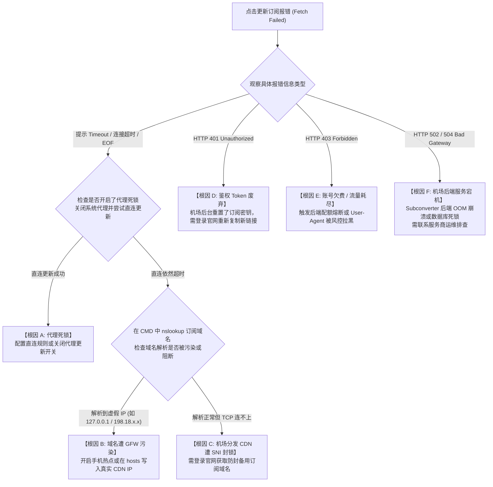

# 机场订阅更新失败：网络超时、鉴权报错 401/403 与死锁闭环深度排查实录

在日常科学上网维护中，“原先使用正常的订阅链接，某天在客户端点击‘更新订阅（Update Profile）’时，进度条无限转圈，随后弹出一串刺眼的红色报错：**`Fetch failed: status code 401`**、**`status code 403 Forbidden`**、**`status code 502 Bad Gateway`**，或者直接抛出底层网络异常 **`connect: connection timed out`**、**`tls: handshake failure`**，导致节点列表瞬间被清空或无法同步最新可用节点”，是困扰无数用户的经典系统级假死故障。

绝大多数用户在遇到此问题时，第一反应往往是反复狂点更新按钮、或者怀疑本地宽带欠费。**从计算机网络协议栈与分布式微服务架构来看，订阅更新是一次跨越公网的应用层 HTTPS 数据拉取过程（RFC 9110），涉及客户端网络代理栈的路由选择、服务商后端鉴权认证（Authentication）、多租户配额状态校验、Cloudflare 边缘节点安全审查，以及公网 DNS 解析链路。**

本文将自顶向下解构订阅分发与更新流水线，彻底破解“先有鸡还是先有蛋”的代理死锁怪圈，并提供跨平台自动化诊断脚本与应急恢复方案。

---

## 一、 底层分发架构与“先有鸡还是先有蛋”死锁模型

要彻底搞清订阅更新失败的原因，必须首先理清客户端发起更新时的数据包流向：

```
================================================================================
【正常更新管线 (Happy Path)】
[桌面客户端 (Clash Verge / v2rayN)] 
        │ 发起 GET 请求 (带 User-Agent: ClashVerge/1.7.7)
        ▼
[本地 DNS 模块] ──► 解析订阅分发域名 sub.example.com
        │
        ▼
[边缘 CDN 节点 (Cloudflare / Fastly)] ──► 校验 WAF 规则与 TLS 证书
        │
        ▼
[机场订阅中心后端 (SSPanel / V2board / Subconverter API)]
        │ 校验 Token、用户套餐到期日、剩余流量与并发设备数
        ▼
[下发 HTTP 200 OK + 响应头 subscription-userinfo + Base64/YAML 节点列表]

--------------------------------------------------------------------------------

【致命死锁管线: "先有鸡还是先有蛋" (Deadlock Circuit)】
[所有境外代理节点因机房断网全部超时]
        │
        ├── 用户点击「更新订阅」以期获取新的备用节点
        ▼
[客户端网络路由引擎] ──► 默认启用了「通过代理更新订阅 (Update via Proxy)」
        │
        ▼
[127.0.0.1:7897 (本地代理内核)] ──► 尝试将更新请求推向当前失效的境外节点
        │
        ▼
[连接挂起 30 秒 ──► 触发 connect timed out 报错]
        │
        ▼
【恶性死锁结局】: 因为当前节点全挂了，所以无法拉取新配置；
               因为拉取不到新配置，所以永远只能留在死节点中无法自救！
================================================================================
```

### 1. 致命死锁机制剖析
许多现代桌面客户端（如 Clash Verge Rev、v2rayN）为了防止“机场订阅分发域名在境内遭到 DNS 污染”，在默认配置中开启了**「通过系统代理更新订阅」**或**「更新配置走代理」**选项。
- **初衷**：当本地宽带无法直连订阅服务器时，借助正在运行的代理节点绕过境内审查；
- **死锁诱因**：一旦机场遭遇突发封锁导致所有节点瘫痪、或者用户误开启了全局代理且节点离线，更新请求本身被强行塞入了已经断流的代理隧道，引发 100% 的超时阻断。

---

## 二、 订阅更新故障排查决策树（Mermaid 状态机）

当您遇到订阅更新失败时，请严格按照以下层级决策树逐步收敛故障源：



---

## 三、 五大核心根因深度技术剖析

### 1. 根因一：HTTP 401 Unauthorized 鉴权中断与 Token 废弃
- **底层机制**：每个机场订阅链接中均包含一段代表用户身份的哈希秘钥（例如 `https://sub.domain.com/api/v1/client/subscribe?token=3a8f9b2c...`）。
- **诱发场景**：
  1. 用户在机场官网后台无意中点击了 **「重置订阅信息」** 或 **「修改登录密码」**；
  2. 机场系统为了安全，会瞬间将旧的 `token` 从 Redis 缓存和 MySQL 中硬删除；
  3. 客户端本地保存的依然是旧链接，服务端 API 在校验 Token 时因无法在数据库中检索到匹配记录，依据 RFC 9110 标准返回 **`401 Unauthorized`**，拒绝下发任何节点数据。

### 2. 根因二：HTTP 403 Forbidden 流量熔断与客户端 User-Agent 黑名单
当服务端返回 `403 Forbidden` 时，通常代表“身份已识别，但请求被业务风控逻辑强制拦截”：
1. **配额耗尽与周期到期（Quota Expired）**：服务商后台设定了严格的断网阈值，一旦套餐到期或月度流量用尽，鉴权中间件直接返回 403 阻断；
2. **User-Agent（UA）指纹风控拦截**：部分机场后台为了防范恶意爬虫和自动化抓取工具，在 Nginx / Cloudflare 层面启用了 UA 白名单过滤。如果用户使用的是冷门客户端、或者在更新参数中自定义了非常规 UA，会直接被 WAF 规则丢弃并返回 403；
3. **并发更新频率受限（Rate Limiting）**：某些用户在短时间内（如 1 分钟内）连续点击更新数十次，触发了服务端的防刷限流中间件（例如 Redis 计数器超过 5次/分），被临时封禁 IP 15 分钟。

### 3. 根因三：HTTP 502 / 504 Bad Gateway 与 Subconverter 后端内存溢出
如果更新时抛出 `502 Bad Gateway` 或 `504 Gateway Timeout`：
- **技术真相**：这表明**前端反向代理（如 Cloudflare 或 Nginx）工作正常，但其后端的业务进程已死机**；
- 绝大多数机场采用 **Subconverter（订阅转换核心）** 容器将单节点转换为 Clash / Surge 配置文件。如果某位大客户的订阅包含上千个节点、或者包含格式非法的极端规则，Subconverter 在解析时会瞬间触发 C++ 内存溢出（OOM Crash）导致进程挂死，此时 Nginx 无法从后端 `127.0.0.1:25500` 获取响应，只能向客户端吐出 `502 Bad Gateway`。

### 4. 根因四：订阅分发域名遭遇 GFW 旁路 DNS 投毒与 SNI RST 阻断
机场服务商用于下发订阅的二级域名（如 `sub.freevpn.com`）是网络安全审查的重点监控目标：
- **DNS 投毒**：境内的递归 DNS 服务器（如本地 ISP DNS）在解析该域名时，被注入了 Bogus 虚假 IP（如解析为 `127.0.0.1` 或境外保留地址）；
- **SNI 握手阻断**：即使 IP 解析正确，在客户端与订阅服务器建立 TLS 握手发送 `Client Hello` 时，防火长城（GFW）检测到明文 SNI 扩展中包含黑名单关键词，瞬间向通信双方伪造下发双向 `TCP RST` 报文，导致客户端抛出 `connection reset by peer`。

### 5. 根因五：客户端系统本地时钟偏差引发 TLS 证书校验彻底崩溃
根据 RFC 5280 X.509 数字证书标准规范，客户端在验证订阅服务器下发的 HTTPS 证书时，必须严格校验证书的有效期（`NotBefore` 与 `NotAfter`）：
- 如果您的电脑或手机主板电池老化、或者长期离线导致系统本地时间**慢于或快于真实标准北京时间 90 秒以上**；
- 客户端在验证 Cloudflare 下发的短期泛域名证书时，会误认为该证书“尚未生效”或“已经过期”，在应用层直接掐断连接并报错 **`x509: certificate has expired or is not yet valid`**。

---

## 四、 跨平台自动化订阅链路诊断与配额嗅探脚本

为了摆脱凭感觉猜测的低效排障，以下提供一套工业级诊断脚本。该脚本可以直接在 Windows PowerShell 或 Linux/macOS 终端中运行，它能以非代理与代理双模式分别向订阅服务器发起深层探测，并自动抓取服务商在 HTTP 响应头中隐藏的**剩余流量与到期时间（`subscription-userinfo`）**。

### 1. PowerShell 自动化订阅诊断与配额提取脚本 (Windows)

```powershell
<#
.SYNOPSIS
    跨维度机场订阅更新故障全自动诊断与元数据嗅探工具
.DESCRIPTION
    1. 测试直连与代理双通道 DNS 解析与 TCP 握手
    2. 校验 HTTP 状态码与 TLS 证书有效性
    3. 提取解析 HTTP 响应头中的 subscription-userinfo 流量配额
#>

param (
    [Parameter(Mandatory=$true)]
    [string]$SubscriptionUrl,
    [int]$ProxyPort = 7897
)

Write-Host "==========================================================" -ForegroundColor Cyan
Write-Host "  网络诊断实验室 - 机场订阅分发全链路深度诊断与配额嗅探工具  " -ForegroundColor Cyan
Write-Host "==========================================================" -ForegroundColor Cyan

# 1. 基础 URI 解析与域名提取
try {
    $uri = [System.Uri]$SubscriptionUrl
    $subDomain = $uri.Host
    Write-Host "[*] 目标订阅服务器域名: $subDomain" -ForegroundColor Yellow
} catch {
    Write-Error "[-] 订阅链接格式非法，请检查 URL!"
    exit 1
}

# 2. DNS 解析测试
Write-Host "`n[Step 1/4] 测试本地原生 DNS 解析状态..." -ForegroundColor Yellow
try {
    $dnsRecords = Resolve-DnsName -Name $subDomain -ErrorAction Stop
    $resolvedIPs = ($dnsRecords | Where-Object { $_.IPAddress } | Select-Object -ExpandProperty IPAddress) -join ', '
    Write-Host "[+] DNS 解析成功! 解析结果 IP: $resolvedIPs" -ForegroundColor Green
} catch {
    Write-Host "[-] 本地 DNS 解析失败或域名被污染拦截!" -ForegroundColor Red
}

# 3. 直连探测 (Bypass Proxy)
Write-Host "`n[Step 2/4] 发起本地宽带直连 HTTP GET 探测 (模拟不走代理模式)..." -ForegroundColor Yellow
$directHandler = New-Object System.Net.Http.HttpClientHandler
$directHandler.UseProxy = $false
$directClient = New-Object System.Net.Http.HttpClient($directHandler)
$directClient.Timeout = [System.TimeSpan]::FromSeconds(8)
$directClient.DefaultRequestHeaders.Add("User-Agent", "ClashVerge/1.7.7 (Windows NT 10.0; Win64; x64)")

try {
    $response = $directClient.GetAsync($SubscriptionUrl).GetAwaiter().GetResult()
    $statusCode = [int]$response.StatusCode
    Write-Host "[+] 直连通道成功响应! HTTP 状态码: $statusCode ($($response.StatusCode))" -ForegroundColor Green
    
    # 提取 subscription-userinfo 响应头
    if ($response.Headers.Contains("subscription-userinfo")) {
        $userInfo = $response.Headers.GetValues("subscription-userinfo") -join ';'
        Write-Host "[★] 发现机场账户元数据响应头 (subscription-userinfo):" -ForegroundColor Magenta
        Write-Host "    原始字段: $userInfo" -ForegroundColor Gray
        
        # 解析字节数
        if ($userInfo -match "upload=(\d+);.*download=(\d+);.*total=(\d+);.*expire=(\d+)") {
            $uploadGB = [math]::Round([int64]$matches[1] / 1GB, 2)
            $downloadGB = [math]::Round([int64]$matches[2] / 1GB, 2)
            $totalGB = [math]::Round([int64]$matches[3] / 1GB, 2)
            $usedGB = [math]::Round($uploadGB + $downloadGB, 2)
            $remainGB = [math]::Round($totalGB - $usedGB, 2)
            $expireDate = (Get-Date "1970-01-01 00:00:00").AddSeconds([int64]$matches[4]).ToLocalTime()
            
            Write-Host "    ------------------------------------------------" -ForegroundColor DarkGray
            Write-Host "    已用上传流量 : $uploadGB GB" -ForegroundColor White
            Write-Host "    已用下载流量 : $downloadGB GB" -ForegroundColor White
            Write-Host "    总剩余可用量 : $remainGB GB / $totalGB GB" -ForegroundColor Green
            Write-Host "    账户套餐到期 : $expireDate" -ForegroundColor Yellow
            Write-Host "    ------------------------------------------------" -ForegroundColor DarkGray
        }
    }
} catch {
    Write-Host "[-] 本地宽带直连访问失败: $($_.Exception.Message)" -ForegroundColor Red
    Write-Host "[!] 判定: 订阅分发域名可能在境内已被墙或本地宽带无法触达 CDN 节点。" -ForegroundColor Yellow
}

# 4. 代理通道探测 (Via Local Proxy)
Write-Host "`n[Step 3/4] 发起本地代理通道 HTTP GET 探测 (端口: $ProxyPort)..." -ForegroundColor Yellow
$proxyHandler = New-Object System.Net.Http.HttpClientHandler
$proxy = New-Object System.Net.WebProxy("http://127.0.0.1:$ProxyPort")
$proxyHandler.Proxy = $proxy
$proxyHandler.UseProxy = $true
$proxyClient = New-Object System.Net.Http.HttpClient($proxyHandler)
$proxyClient.Timeout = [System.TimeSpan]::FromSeconds(8)
$proxyClient.DefaultRequestHeaders.Add("User-Agent", "ClashVerge/1.7.7")

try {
    $proxyResponse = $proxyClient.GetAsync($SubscriptionUrl).GetAwaiter().GetResult()
    $pCode = [int]$proxyResponse.StatusCode
    Write-Host "[+] 代理通道探测成功! HTTP 状态码: $pCode ($($proxyResponse.StatusCode))" -ForegroundColor Green
} catch {
    Write-Host "[-] 代理通道探测失败: $($_.Exception.Message)" -ForegroundColor Red
    Write-Host "[!] 判定: 若当前节点已全死，切勿开启通过代理更新，否则会导致死锁!" -ForegroundColor Yellow
}

# 5. 状态码终审判定
Write-Host "`n[Step 4/4] 综合故障综合归因与处置建议..." -ForegroundColor Yellow
if ($statusCode -eq 401 -or $pCode -eq 401) {
    Write-Host "【确诊结果】: HTTP 401 Unauthorized (Token 失效)" -ForegroundColor Red
    Write-Host "【处置方案】: 您此前重置过订阅信息。请登录机场官网用户中心，重新点击「复制订阅」并在客户端中更新覆盖链接。" -ForegroundColor White
} elseif ($statusCode -eq 403 -or $pCode -eq 403) {
    Write-Host "【确诊结果】: HTTP 403 Forbidden (配额熔断或被 WAF 拦截)" -ForegroundColor Red
    Write-Host "【处置方案】: 登录官网核验套餐是否到期或流量已耗尽。若流量充裕，说明您的客户端 User-Agent 被后端拉黑，请尝试更换 Clash 标准 UA。" -ForegroundColor White
} elseif ($statusCode -eq 502 -or $pCode -eq 502) {
    Write-Host "【确诊结果】: HTTP 502 Bad Gateway (机场后端宕机)" -ForegroundColor Red
    Write-Host "【处置方案】: 机场 Subconverter 转换服务或数据库宕机，非本地故障。请关注服务商官方 Telegram 通知群等待修复。" -ForegroundColor White
} else {
    Write-Host "【状态】: 请根据直连与代理通道连通性切换客户端的更新策略。" -ForegroundColor Green
}
```

---

## 五、 订阅更新核心状态码与错误代码排错矩阵

| 报错信息 / 状态码 | 网络层级 | 诱发根本机理 | 权威解决路径 (SOP) |
| :--- | :--- | :--- | :--- |
| **`connect: connection timed out`** | L4 传输层 | 陷入“代理死锁闭环”，通过死节点拉取订阅 | 手动关闭系统代理，在客户端中选择**「不通过代理更新订阅」** |
| **`401 Unauthorized`** | L7 应用层 | 订阅 Token 签名失效，数据库不存在该哈希 | 登录机场后台重新生成订阅链接，覆盖导入旧配置 |
| **`403 Forbidden`** | L7 应用层 | 账户欠费、流量耗尽熔断、或 UA 遭 WAF 拦截 | 核验账户剩余配额；在客户端设置中将 User-Agent 伪装为标准 Clash |
| **`502 Bad Gateway`** | L7 代理层 | 后端 Subconverter 订阅转换进程 OOM 崩溃 | 机场服务端故障，等待官方重启容器；或尝试使用本地离线转换工具 |
| **`504 Gateway Timeout`**| L7 网关层 | 机场数据库读写死锁或遭遇大流量 DDoS 攻击 | 避开晚高峰更新，等待服务商清洗流量后重试 |
| **`x509: certificate expired`**| L6 表示层 | 客户端本地操作系统系统时钟偏差 > 90 秒 | 执行 `w32tm /resync` 强制校准本地时钟与标准 NTP 授时服务器 |
| **`tls: handshake failure`**| L6 安全层 | 订阅分发 CDN 启用了古老的 SSL 协议套件 | 升级代理客户端至最新版本（如 Clash Verge Rev 1.7.7+）以支持最新加密套件 |

---

## 六、 生产环境真实故障复盘（2大典型 RCA 案例）

### 案例一：某千人跨境电商团队因误点“重置订阅”，全员客户端次日集体报 401 瘫痪
- **故障拓扑**：国内某出海营销公司，IT 运维主管统一采购了企业版机场订阅，并将订阅链接分发至 120 名员工的电脑端 Clash Verge 中。某日下班前，主管在后台修改管理员密码时顺手勾选了“重置所有子订阅 Token”。
- **故障爆发**：次日早晨 9:00，全员电脑客户端执行定时更新订阅，所有人的软件弹出一片红字 **`Fetch failed: status code 401`**。更严重的是，部分员工的客户端设置了“更新失败时自动清空旧缓存”，导致不仅更新不了，原先能用的几十个节点也全部消失，全公司跨境业务彻底瘫痪。
- **排查与根因判定（RCA）**：
  1. 调取订阅下发服务器 Nginx 日志，发现成百上千条带有旧 Token 的 GET 请求返回统一的 `401 Unauthorized`；
  2. 运维人员误以为是“机场跑路”，但登录官网发现面板完全正常；
  3. 最终确认为后台重置操作使得旧 Token 在数据库内永久失效。
- **修复与长效防御方案**：
  1. 应急恢复：IT 部门紧急导出最新的有效 Token 订阅链接，通过内网群发全员覆盖；
  2. 架构防灾：在客户端高级设置中勾选 **「保留上次成功配置（Keep Last Successful Config）」**，严禁在更新失败时清空旧节点，确保即使分发服务器宕机，存量节点依然可以应急运行。

### 案例二：开启“通过代理更新”后，突发公网拥塞引发 300 名技术人员陷入“死锁黑洞”
- **故障拓扑**：某科技园区技术交流群中，多名用户反馈使用的同一家专线机场“订阅彻底死掉了”，无论如何刷新都报 `context deadline exceeded (Client.Timeout exceeded while awaiting headers)`。
- **排查与抓包过程**：
  1. 使用 Wireshark 抓取本地回环接口（`127.0.0.1`）报文；
  2. 发现客户端在点击“更新订阅”时，HTTP 请求的目的地址并不是机场订阅服务器的公网 IP，而是直奔本地的 `127.0.0.1:7897` 端口；
  3. 打开代理客户端连接面板，发现该更新请求命中了 `MATCH,兜底策略组`，被转发给了一个已经离线的测试节点；
  4. 最终该节点由于无法握手，请求在本地挂起 30 秒后抛出超时。
- **根因判定（RCA）**：客户端配置了“通过代理更新订阅”，在所有节点失效时，分发管线自我阻塞，构成了典型的分布式死锁。
- **修复方案**：指导用户关闭客户端底部的“系统代理”开关，并在客户端设置中关闭“通过代理更新”，随后直接利用本地家庭宽带直连点击更新，订阅在 1.2 秒内瞬间刷新成功。

---

## 七、 常见高频报错与排障速查表 (FAQ)

### Q1: 订阅更新失败后，原先能用的节点全都不见了怎么找回？
- **原因**：部分第三方客户端（如旧版 Clash for Windows）存在缺陷逻辑：点击更新时会先清空本地内存中的配置，若远程拉取失败，内存为空导致节点全丢。
- **找回对策**：
  1. 打开客户端的配置文件存储目录（如 `C:\Users\<User>\AppData\Roaming\clash-verge\profiles`）；
  2. 查看是否存在以 `.bak` 或时间戳命名的历史备份文件；
  3. 将最近一个备份文件重命名为当前配置即可瞬间恢复节点。

### Q2: 为什么手机上能成功更新订阅，但电脑上死活报错超时？
- **原因**：
  1. 手机连接的是 4G/5G 蜂窝移动网络，避开了家庭宽带路由器对特定 CDN 节点的 QoS 丢包或 DNS 污染；
  2. 电脑端可能存在多网卡 Metric 跃点冲突或第三方杀毒软件（360/火绒）对本地回环端口的拦截。
- **对策**：在电脑上用手机开启个人热点，断开代理软件系统代理开关，使用热点直连进行更新。详细排障请参阅：[手机能连但电脑不能连深度排障](/connection/phone-works-pc-fails)。

### Q3: 为什么机场给的订阅链接放在浏览器里能下载，导入客户端却报错？
- **原因**：浏览器下载保存的是一个纯文本文件（或 Base64 裸字符串），而客户端在导入时会对文件进行严格的 **YAML 语法结构校验（Unmarshal）**。如果文件头部混入了服务商的公告文本或 HTML 404 标签，客户端解析引擎会直接崩溃。
- **对策**：请参阅专项修复手册：[YAML 语法错误与缩进排查修复指南](/subscription/import-failures/base64-yaml/yaml-syntax-indentation-fix)。

---

## 八、 推荐高可用容灾与延伸阅读

如果您在日常使用中频繁遭遇订阅服务器宕机、Token 突发失效或节点大面积超时，**强烈建议选择具备多集群双活架构与自动化 SLA 容灾保障的一线专线服务商**，从根本上杜绝单点故障引发的断网风险：

<DisasterRecoveryBox />

### 相关进阶排查与排障手册
- [机场订阅链接无法导入排查与 YAML 语法解析指南](/subscription/import-failed)
- [三大协议 URI 格式规范与手工反解析排错实战](/subscription/import-failures/base64-yaml/v2ray-uri-scheme-format-parser)
- [公网第三方订阅转换数据泄露机理与离线自建工作台](/subscription/subscription-conversion-backend-security-risk)
- [手机能连但电脑完全不能连？多网卡与代理死锁深度排障](/connection/phone-works-pc-fails)
- [全节点大面积超时瘫痪根因判定与容灾逃生机制](/connection/all-nodes-down)
