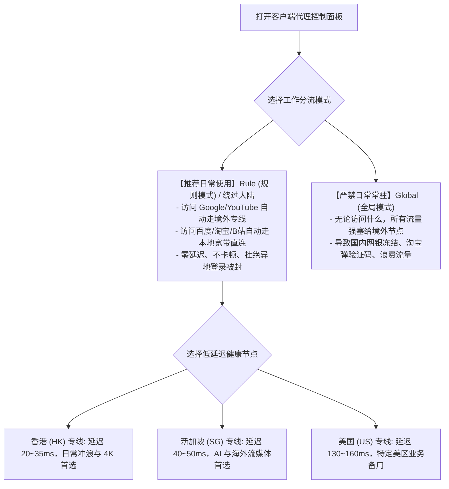

# 新手从零安装科学上网客户端到首次成功连接指南：跨平台工具选型、订阅导入与防断网实操完全手册

对于刚接触网络诊断与科学上网的初学者而言，在购买或获取到机场订阅链接后，往往会瞬间陷入迷茫与焦虑：**“面对电脑和手机，完全不知道去哪里下载干净正版的客户端软件；在搜索引擎搜索下载，常常误入充斥着流氓广告甚至盗号木马的山寨钓鱼网站；拿到一串形如 `https://...token=xxx` 的长链接，不知道该粘贴在软件的哪个输入框；好不容易连上了，微信打不开、电脑下次开机直接全局断网！”**

实际上，现代计算机科学上网技术已经高度工程化与标准化。只要牢牢把握**“跨平台正版客户端甄别 → 操作系统提权初始化 → 订阅一对一精准导入 → 确立 Rule 规则分流模式 → 开启系统代理与双向验证”**这五步标准流水线，任何零基础用户均可在 5 分钟内安全、顺畅、零故障地开启全球网络访问。

本篇万字级完全新手指南将为您提供跨 Windows、macOS、Android 与 iOS 四大主流操作系统的保姆级安装与防坑实操手册。

---

## 一、 核心流程总览：科学上网五步标准化流水线 (SOP)

```
================================================================================
【科学上网零基础首次连接五步标准化流水线】
[步骤 1: 客户端获取] ──► 认准官方 GitHub / 官方海外 App Store，拒绝任何第三方网盘
           │
           ▼
[步骤 2: 运行环境提权] ──► 安装 .NET 8.0 依赖，Windows Defender / 手机权限白名单放行
           │
           ▼
[步骤 3: 订阅精准导入] ──► 区分 Clash YAML 与 Base64 链接，一键静默拉取健康节点
           │
           ▼
[步骤 4: 确立分流模式] ──► 100% 锁定「Rule (规则模式)」，严禁日常误开「Global (全局)」
           │
           ▼
[步骤 5: 开启双向验证] ──► 开启系统代理，验证海外 Google 秒开与国内百度/B站秒开
================================================================================
```

---

## 二、 第一步：跨平台客户端官方选型与纯净安装包防骗鉴真

搜索引擎竞价广告和第三方所谓“绿色下载站”充斥着经过恶意二次打包、植入了抓包劫持与后门木马的假冒客户端。请严格依据以下官方矩阵进行获取：

| 设备平台 | 推荐首选客户端 | 官方正版获取格式与架构 | 核心前置依赖与注意事项 |
| :--- | :--- | :--- | :--- |
| **Windows 10 / 11** | **Clash Verge Rev** | `Clash.Verge_x.x.x_x64-setup.exe` | 绝大多数 PC 选 `x64`；解压与安装路径**严禁包含中文或空格** |
| **Windows 老旧机器**| **v2rayN** | `v2rayN-with-dependencies.zip` | 必须预装微软 **.NET Desktop Runtime 8.0 (x64)** |
| **macOS (苹果电脑)** | **Clash Verge Rev** | `Clash.Verge_x.x.x_aarch64.dmg` | M1/M2/M3/M4 选 **`aarch64`**；早期 Intel 处理器 Mac 选 `x64` |
| **Android (安卓手机)**| **v2rayNG** | `v2rayNG_x.x.x_arm64-v8a.apk` | 认准 **`arm64-v8a`** 架构；开启电池优化“无限制”与后台自启 |
| **iPhone / iPad (iOS)**| **Shadowrocket (小火箭)**| 官方美区/港区 App Store | **开发者必须为 `Shadow Launch Technology Limited`**，谨防国区假冒 |

> [!CAUTION] 鉴真防骗核心警示
> 1. **严禁在百度/360搜索中直接点击带有“广告”标识的下载站**；
> 2. 正版 Shadowrocket 在国区 App Store 已经下架，国区搜索出的所有带有“小火箭”字样的软件 **100% 均为恶意扣费山寨应用**；
> 3. 正版开源软件（Clash Verge Rev、v2rayN、v2rayNG）**终身免费且零广告**，凡是要求“微信扫码付 19.9 元才能下载”的均为黑产钓鱼网站。

---

## 三、 第二步：跨平台订阅精准导入标准化实操

不同的客户端对订阅链接的语法格式要求截然不同，请根据您使用的客户端进行针对性操作：

### 1. Windows / macOS 端：Clash Verge Rev 导入方法
1. 登录您的机场后台，点击 **「复制 Clash 订阅」**（或带有 Clash 标识的一键导入按钮）；
2. 打开 Clash Verge Rev 客户端；
3. 点击左侧导航栏的 **「订阅 (Profiles)」**；
4. 在顶部正中央的长条输入框中，按键盘快捷键 `Ctrl + V`（Mac 为 `Cmd + V`）粘贴刚刚复制的链接；
5. 点击右侧的 **「导入 (Import)」** 按钮；
6. 界面在 2 秒内会生成一张新的配置卡片。**用鼠标单击该配置卡片**，确保卡片左侧亮起蓝色激活条，代表配置已生效。

### 2. Windows 端：v2rayN 导入方法
1. 登录机场后台，点击 **「复制 V2Ray 订阅」**（或通用 Base64 订阅链接）；
2. 打开 v2rayN 主界面，点击顶部菜单栏的 **「订阅分组」** → **「订阅分组设置」**；
3. 点击左下角 **「添加」**，输入分组备注名称，在“可选地址 (Url)”中粘贴链接并点击确定；
4. 返回主界面，点击顶部菜单栏 **「订阅分组」** → **「更新当前订阅 (不通过代理)」**，所有节点瞬间展开。

### 3. Android 安卓手机端：v2rayNG 导入方法
1. 登录机场后台复制订阅链接；
2. 打开 v2rayNG，滑动展开左侧侧边栏，点击 **「订阅分组设置」**；
3. 点击右上角 **「+」** 号，填入备注，粘贴链接后点击右上角勾号保存；
4. 返回主界面，点击右上角三点菜单，选择 **「更新订阅」** 即可。

### 4. iOS 苹果手机端：Shadowrocket (小火箭) 导入方法
1. 复制机场后台的小火箭订阅链接；
2. 打开 Shadowrocket，点击主界面右上角的 **「+」** 号；
3. 将第一行“类型”选择为 **`Subscribe`**；
4. 在 `URL` 一栏中粘贴刚刚复制的长链接，点击右上角 **「完成」**；
5. 软件会自动向云端发起握手，数秒内拉取全部节点列表。

---

## 四、 第三步：节点选择策略与「Rule 规则分流模式」确立

这是决定您的日常网络是丝滑流畅还是卡顿崩溃的**最核心操作环节**：



### 节点选择的三大黄金法则：
1. **看网页与日常娱乐**：首选 **香港（HK）** 节点。由于地理物理距离最近，往返延迟通常只有 20ms~35ms，打开网页与本地宽带毫无二致；
2. **使用 ChatGPT / Claude 等 AI 平台**：优先选择 **新加坡（SG）**、**日本（JP）** 或标注有 `原生/AI` 的专属节点，避免因机房 IP 风控遭遇 Access Denied；
3. **避开扎堆节点**：不要所有人一窝蜂挤在“香港 01”，切换到“香港 03”或“新加坡 02”，带宽更充裕、体验更平滑。

---

## 五、 第四步：开启系统代理与“双向连通性”验证标准

1. **拨动主开关**：
   - 在 **Clash Verge Rev** 中：点击左侧导航栏左下角的 **「系统代理 (System Proxy)」** 开关，使其变为点亮状态；
   - 在 **v2rayN** 中：底部状态栏确认选择为 **「自动配置系统代理」**（托盘图标由蓝变红）；
   - 在 **Shadowrocket** 中：滑动最上方的 **「未连接」** 主开关；
2. **执行双向连通性验证（黄金测试标准）**：
   - 打开浏览器，新建隐身标签页；
   - **验证海外可达性**：在地址栏输入 `https://www.google.com`，能够秒级呈现搜索框并顺畅搜索；
   - **验证国内直连性**：在地址栏输入 `https://www.baidu.com` 或 `https://www.bilibili.com`，视频秒开且网页顶部搜索显示的 IP 归属地依然是您所在的本地城市（如“广东广州电信”）。
- **两项均验证通过，标志着您的科学上网客户端已经 100% 部署成功！**

---

## 六、 第五步：5 步防断网铁律与日常避坑军规

为了防止明天开机突然断网、或者关闭软件后连国内网页也打不开，请新手牢记以下五项铁律：

```
+─────────────────────────────────────────────────────────────────────────────+
|                         科学上网新手日常五大防断网铁律                       |
+─────────────────────────────────────────────────────────────────────────────+
| 铁律 1：退出软件前，务必先关闭「系统代理」开关                               |
|   - 很多电脑关机或重启时强杀进程，导致注册表 ProxyEnable=1 残留。            |
|   - 下次开机电脑将无法打开任何网页！养成"先关开关、再退软件"的好习惯。        |
+─────────────────────────────────────────────────────────────────────────────+
| 铁律 2：严禁电脑里同时开启两款不同的代理软件                                 |
|   - 切勿在开着 Clash 的同时又打开 v2rayN，两款软件会抢占 7890/10809 端口，     |
|   - 导致本地端口竞态死锁，双双崩溃断网。                                     |
+─────────────────────────────────────────────────────────────────────────────+
| 铁律 3：遇到全列表节点超时，首先核对系统本地时间                             |
|   - 现代代理协议（VLESS/VMess/TLS）包含防重放安全时间戳机制。                 |
|   - 若电脑时间慢了 90 秒以上，所有节点会全部返回 -1 或 Timeout。同步时间即愈。|
+─────────────────────────────────────────────────────────────────────────────+
| 铁律 4：每周手动点击一次「更新订阅」                                         |
|   - 机场服务商为了抗封锁，会定期更换国内入口机房与落地 IP。                  |
|   - 长时间不更新订阅会导致存量节点失效。                                     |
+─────────────────────────────────────────────────────────────────────────────+
| 铁律 5：谨慎常驻开启 TUN 虚拟网卡模式                                        |
|   - 普通网页浏览仅需「系统代理」；打游戏或终端不通时再开 TUN，防止网卡冲突。  |
+─────────────────────────────────────────────────────────────────────────────+
```

---

## 七、 生产环境真实新手翻车复盘（2大典型 RCA 案例）

### 案例一：新手电脑关机后次日连百度都打不开，误以为宽带欠费
- **故障拓扑**：某文科研究生，昨晚按照教程在 Windows 笔记本上使用 Clash Verge Rev 查阅论文正常。今早开机准备上网课，发现 Chrome 提示 `无法连接到代理服务器 ERR_PROXY_CONNECTION_FAILED`，连百度和微信都无法登录。该同学以为宽带欠费，拨打电信客服报障排查半天无果。
- **排查与根因判定（RCA）**：
  1. 检查电信光猫与本地 IP，网络物理层完全正常；
  2. 打开 Windows 设置中的“代理”面板，发现 `使用代理服务器` 开关被勾选，指向 `127.0.0.1:7897`；
  3. 但任务管理器中并没有运行 Clash Verge Rev（昨晚关机前没有退出软件，电脑强行关机导致注册表代理未释放）；
  4. 浏览器每次发起的国内连接全被推给 `127.0.0.1:7897`，而本地此时根本没有程序在监听，被操作系统直接拒连。
- **修复方案**：教该同学手动重新打开一次 Clash Verge Rev，点击打开系统代理然后再点击关闭；或者手动在 Windows 代理设置中将开关拨至“关”。网络瞬间恢复。

### 案例二：误在国区 App Store 搜索小火箭，被山寨应用扣款 198 元
- **故障拓扑**：某苹果手机用户，想在 iPhone 上翻墙。在国区 App Store 搜索“小火箭”，下载了一款名为“小火箭-网络加速器”的应用。软件提示“免费试用 3 天”，用户双击侧边电源键授权，三天后苹果账户被自动扣除每周 48 元（一个月被扣近 200 元），且软件根本无法连接外网。
- **根因判定（RCA）**：正版 Shadowrocket 早已从国区下架，用户在国区搜索下载到了利用关键词抢注的山寨扣费钓鱼应用。
- **修复方案**：立即在 iPhone 系统「设置」→ 点击 Apple ID 头像 →「订阅」中取消该山寨应用的连续包周自动续费；随后登录美区 Apple ID，前往美区 App Store 认准开发者 `Shadow Launch Technology Limited` 下载正版小火箭。

---

## 八、 常见高频报错与排障速查表 (FAQ)

### Q1: 节点测速全部超时，显示红色怎么办？
- **回答**：请按以下顺序列装排查：
  1. 检查电脑系统右下角时间，偏差超 90 秒会导致节点全红，点击“同步时间”；
  2. 点击「更新订阅」，获取最新可用入口；
  3. 若依然全红，说明服务商机房遭受断网维护。详细排查请参阅：[梯子突然全部连不上全链路排查实战](/connection/all-nodes-down)。

### Q2: 开启代理后国内网站（淘宝、B站）极其卡顿怎么办？
- **回答**：90% 是因为您将分流模式误设为了 **`Global (全局模式)`**，导致国内流量强行走美国节点绕路。立即在客户端代理设置中将模式切换为 **`Rule (规则模式)`**。详细分析请参阅：[代理打开后国内网站变慢怎么办？](/issues/domestic-sites-slow)。

### Q3: 为什么软件提示端口被占用（Port In Use）？
- **回答**：说明电脑上有其他软件提前霸占了 `7890` 或 `7897` 端口。进入客户端「设置」，将混合端口手动修改为 `27897` 等冷门端口并保存即可。

---

## 九、 推荐高可用专线容灾逃生节点与延伸阅读

当您经过上述标准化配置将客户端部署完毕后，若节点依然在晚高峰期间频繁超时或断流，问题往往出在您所购买的廉价公网中转遭遇了运营商 QoS 丢包。**强烈建议在多端主力设备中配置全天候稳定 0 丢包的顶级内网物理专线**：

<DisasterRecoveryBox />

### 相关进阶排查与排障手册
- [Clash Verge Rev 核心操作手册与 TUN 模式配置指南](/clients/clash-verge-rev)
- [科学上网连接成功却打不开网页排查步骤](/issues/connected-but-no-internet)
- [手机能连但电脑完全不能连？跨设备网络栈深度排错](/connection/phone-works-pc-fails)
- [全节点大面积超时瘫痪根因判定与容灾逃生机制](/connection/all-nodes-down)
- [2026 稳定抗封锁 42 家专线机场综合横评与选型大横表](/airports/)
