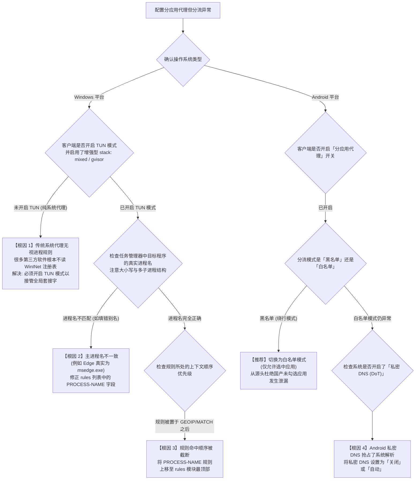

# 分应用代理与特定程序绕行配置指南：从 Windows 进程嗅探到 Android VpnService 物理分流实战

在多任务并发的生产力与数字生活环境中，许多技术工程师与重度网络用户经常面临严峻的“流量隔离”现实矛盾：
- **场景一（办公合规与安全保密）**：在访问海外技术文档、GitHub 或 Google 时需要代理，但企业内部的飞书、钉钉、微信办公群、局域网 NAS 与内网 OA 系统必须 **100% 物理直连**，严禁任何敏感企业数据包流经境外 VPS 节点；
- **场景二（电竞游戏与带宽独占）**：在玩 Steam、Apex 英雄或英雄联盟日服时，希望低延迟电竞专线独占所有带宽，严防后台运行的迅雷、百度网盘、BT 下载或 Windows 自动更新偷跑宝贵的高昂专线流量；
- **场景三（异地风控规避）**：国内银行 App、股票交易软件、支付宝与国税开票系统对登录 IP 极其敏感，一旦被代理节点误转发，极易触发异地登录保护甚至冻结账户。

这种按照**发起网络请求的具体应用程序（Application / Process）**进行三层或七层精细化路由隔离的技术，被称为 **分应用代理（Per-App Proxy / Process Split Tunneling）**。

本篇万字级实战手册将从操作系统底层网络栈（Windows WFP、Android VpnService、macOS Packet Filter）的嗅探与标记机理出发，提供涵盖三大主流操作系统的工业级配置模板与排障指南。

---

## 一、 底层实现机理：进程级数据包识别与过滤模型

要实现精确到“某个 `.exe`”或“某个安卓应用包名”的流量分流，代理客户端与操作系统必须在网络协议栈中协作完成套接字元数据（Socket Metadata）的追踪与匹配：

```
================================================================================
【Windows 平台: 基于 WFP / ETW 的进程名嗅探模型 (PROCESS-NAME)】
[应用程序: WeChat.exe] ──► 发起 TCP connect() 系统调用
                               │
                               ▼
[Windows 内核网络栈 (TCPIP.sys)] ──► 查询 EPROCESS 进程结构体并打上 PID 标记
                               │
                               ▼
[Mihomo TUN / Wintun 驱动] ──► 捕获套接字元数据: PID = 14208 -> "WeChat.exe"
                               │
                               ▼
[Clash 路由匹配引擎] ──► 命中规则: PROCESS-NAME,WeChat.exe,DIRECT
                               │
                               ▼
[物理网卡以太网接口] ──► 100% 本地物理宽带直连 (完全不进代理内核加密管线)

--------------------------------------------------------------------------------

【Android 平台: 基于 UID 与 VpnService 沙盒过滤模型】
[App: com.tencent.mm (微信)] ──► Linux 内核分配独立 UID (如 u0_a185)
                               │
                               ▼
[Android VpnService 接口] ──► 检查允许/绕行 UID 列表 (addAllowedApplication)
                               │
                               ├── 微信 UID 命中排除白名单 ──► 物理 wlan0 直连 (绕过 tun0 网卡)
                               └── Chrome UID 命中代理名单 ──► 注入 tun0 虚拟网卡 ──► 境外节点
================================================================================
```

### 1. Windows：基于进程名（PROCESS-NAME）与绝对路径（PROCESS-PATH）
在 Windows 平台上，代理客户端（如 Clash Verge Rev / Mihomo）在开启 TUN 模式或系统代理时，可以通过 **Windows 过滤平台（Windows Filtering Platform, WFP）** 或对套接字表（`GetExtendedTcpTable`）的轮询，精确获取持有每个 TCP/UDP 连接句柄的 `ProcessId (PID)`，并向上反查得到进程的可执行文件名（如 `chrome.exe`）或全路径。
- **匹配速度**：内核哈希表毫秒级检索；
- **优势**：哪怕该软件访问从未见过的未知海外 IP，只要进程名命中规则，分流判定 100% 生效。

### 2. Android：基于 Linux UID 的底层硬隔离
Android 操作系统为每个安装的 App 分配了一个独立的 Linux 用户 ID（UID）。当代理软件调用 Android 原生 `VpnService.Builder` 时，系统 API 提供了 `addAllowedApplication()` 与 `addDisallowedApplication()` 两个系统级方法。
- **工作机制**：内核三层路由表直接在网卡驱动之前对 UID 进行二选一判定。被排除的 App 生成的所有 IP 报文，**在物理层面上根本不会被送入 `tun0` 虚拟网卡**，从而实现绝对零泄漏的物理级直连。

---

## 二、 全平台分应用代理排障决策树 (Mermaid)

当您配置了分应用代理但发现特定软件依然被误代理、或者该直连的软件断网时，请按照以下流程排查：



---

## 三、 Windows 平台高阶进程分流实战配置 (Mihomo / Clash)

在 Windows 端的 **Clash Verge Rev** 或 **sing-box** 中，基于进程名编写规则是实现“生产力隔离”的最强手段。

### 1. 获取软件的真实进程名
1. 打开目标软件；
2. 按快捷键 `Ctrl + Shift + Esc` 打开 Windows 任务管理器；
3. 切换到 **「详细信息」** 选项卡；
4. 找到正在运行的软件，查看其准确的 **「映像名称」**（例如微信任为 `WeChat.exe`，飞书为 `Feishu.exe`，钉钉为 `DingTalk.exe`）。

### 2. 编写工业级分流规则集（覆写配置 / Merge）
在客户端的自定义配置或订阅覆写配置中，将以下规则插入到 `rules:` 的**最上方**（保证最高优先级匹配，防止被后序的 `MATCH` 或 `GEOIP` 提前拦截）：

```yaml
rules:
  # ==============================================================================
  # [模块 A: 强制本地直连白名单] 办公协同、企业网盘、金融税务、P2P下载
  # ==============================================================================
  # 办公通讯工具 (严防公司监控日志出现境外代理握手)
  - PROCESS-NAME,WeChat.exe,DIRECT
  - PROCESS-NAME,WeChatAppEx.exe,DIRECT
  - PROCESS-NAME,Feishu.exe,DIRECT
  - PROCESS-NAME,DingTalk.exe,DIRECT
  - PROCESS-NAME,AliWangWang.exe,DIRECT
  - PROCESS-NAME,TencentMeeting.exe,DIRECT
  - PROCESS-NAME,wemeetapp.exe,DIRECT

  # 大流量下载与 P2P 传输 (严防偷跑机场宝贵的专线流量)
  - PROCESS-NAME,Thunder.exe,DIRECT
  - PROCESS-NAME,qbittorrent.exe,DIRECT
  - PROCESS-NAME,Transmission.exe,DIRECT
  - PROCESS-NAME,BaiduNetdisk.exe,DIRECT
  - PROCESS-NAME,AliyunDrive.exe,DIRECT

  # 国内金融与税务软件 (严防异地 IP 触发风控冻结)
  - PROCESS-NAME,alipay.exe,DIRECT
  - PROCESS-NAME,hxsoft.exe,DIRECT

  # ==============================================================================
  # [模块 B: 强制电竞游戏走专用低延迟专线策略组]
  # ==============================================================================
  - PROCESS-NAME,steam.exe,DIRECT
  - PROCESS-NAME,steamwebhelper.exe,DIRECT
  - PROCESS-NAME,r5apex.exe,游戏专线节点
  - PROCESS-NAME,LeagueClientUx.exe,游戏专线节点
  - PROCESS-NAME,VALORANT-Win64-Shipping.exe,游戏专线节点

  # ==============================================================================
  # [模块 C: 强制走境外代理通道的开发与协同工具]
  # ==============================================================================
  - PROCESS-NAME,cursor.exe,主力专线节点
  - PROCESS-NAME,Code.exe,主力专线节点
  - PROCESS-NAME,Telegram.exe,主力专线节点
  - PROCESS-NAME,Discord.exe,主力专线节点
  - PROCESS-NAME,Spotify.exe,主力专线节点

  # ==============================================================================
  # [模块 D: 兜底通用规则]
  # ==============================================================================
  - GEOSITE,cn,DIRECT
  - GEOIP,CN,DIRECT
  - MATCH,兜底策略组
```

### 3. 解除 Windows UWP 沙盒回环隔离（解决微软商店断网）
Windows 对所有从应用商店下载的 **UWP 应用（Universal Windows Platform）** 实施了 AppContainer 隔离，默认禁止其向本地回环地址（`127.0.0.1`）发起通信。这会导致内置的 Edge、微软应用商店、Xbox 游戏服务在开启系统代理时出现“无法加载页面”或报错 `0x80072EFD`。

#### 一键提权豁免操作步骤：
1. 打开 **Clash Verge Rev** 客户端；
2. 点击左侧导航栏的 **「设置」**；
3. 在系统增强模块中找到 **「Windows 工具」**，点击打开 **「UWP 回环工具 (UWP Loopback Tool)」**；
4. 在弹出的图形界面中点击右上角的 **「Exempt All（全部豁免）」**；
5. 点击 **「Save Changes（保存更改）」**。此时系统所有 UWP 软件均可顺畅使用代理通道。

---

## 四、 Android 平台：白名单模式与最佳保活实践

在 Android 客户端（v2rayNG、Clash Verge Android、sing-box）中配置分应用代理是提升手机续航与保障隐私的最佳方案。

### 1. 黄金准则：始终选择「白名单（仅允许选中的应用）」而非黑名单
- **黑名单模式（绕过模式）**：所有 App 默认全部走代理，用户必须一个个勾选不需要代理的国内 App。一旦手机新安装了某个国内软件，该软件会**默认被送入境外代理**，极易造成数据泄漏；
- **白名单模式（仅允许模式，强烈推荐）**：所有 App 默认 100% 走纯净的本地手机移动宽带直连。只有被明确勾选的 App 才会通过代理。

### 2. Android 平台标准实操清单：
1. 打开 **v2rayNG** 客户端，滑动进入左侧侧边栏，点击 **「设置」**；
2. 找到 **「路由设置」** 分类下的 **「分应用代理 (Per-App Proxy)」**；
3. 开启顶部开关，确保工作模式为 **「仅允许选中的应用」**；
4. 在搜索栏中依次搜索并勾选需要翻墙的境外应用：
   - 浏览器：`Google Chrome` / `Firefox`
   - 社交与办公：`Telegram` / `X (Twitter)` / `Discord` / `Slack`
   - 影音娱乐：`YouTube` / `Netflix` / `Spotify`
   - AI 工具：`ChatGPT` / `Claude`
5. 微信、支付宝、网银、美团、高德地图一律保持**未勾选状态**。
- **收益**：彻底杜绝国内软件在境外出口留下访问足迹，且手机后台耗电量直降 30% 以上。

---

## 五、 三大平台分应用代理能力深度横评与 macOS 进阶剖析

| 维度指标 | Windows (Mihomo TUN) | Android (VpnService) | macOS (Packet Filter / Surge) |
| :--- | :--- | :--- | :--- |
| **底层截获机制** | WFP 驱动 / 套接字 PID 查找 | Linux 内核 UID 沙盒过滤 | BSD PF 核心包过滤 / NetworkExtension |
| **规则颗粒度** | **进程名 / 绝对路径 / 端口** | **应用包名 (Package Name)** | 进程名 / 二进制签名 / 域名 |
| **配置复杂度** | 中等（需编写 YAML 规则） | 极低（UI 勾选框一键开关） | 中等（UI 规则编辑器） |
| **绕过风险** | 若未开 TUN 仅开系统代理则易被绕过 | **绝对零绕过**（内核层强隔离） | 需系统扩展（System Extension）授权 |
| **对性能影响** | CPU 占用极低（低于 1%） | 零额外开销（内核原生支持） | 极低 |
| **沙盒兼容性** | 需借助 CheckNetIsolation 解除 UWP | 原生支持所有沙盒 App | 需针对 App Sandbox 处理证书 |

### macOS 平台进程隔离的技术路径与局限
在苹果 macOS 操作系统中，实现进程级分流主要依赖两条截然不同的底层技术链路：
1. **基于 BSD PF (Packet Filter) 锚点规则注入**：
   macOS 底层沿袭了 FreeBSD 的 PF 防火墙。传统的增强型代理工具通过向 `/etc/pf.anchors/` 写入重定向规则，将特定 UID 或 GID 的 TCP 出站流量重定向至本地监听端口。其优势在于无需对内核做深度修改，但缺点是苹果在后续版本中逐步收紧了 PF 的未授权调用权限，且无法直接感知应用层的 App Sandbox 边界。
2. **基于 NetworkExtension 框架的 App Proxy Provider**：
   现代 macOS（macOS Big Sur 11 及后续版本）全面引入了系统扩展（System Extension）架构。代理客户端作为独立的守护进程向系统注册 `NEAppProxyProvider`。每当某个 App 尝试创建 `NWConnection` 或 BSD 套接字时，操作系统的内核网络层会首先将该连接上下文传递给扩展程序，扩展程序读取当前可执行文件的 `audit_token` 与代码签名证书（Designated Requirement），从而百分之百精确地锁定发起进程。
3. **终端开发者环境的特殊性**：
   在 macOS 下，终端中的 `curl`、`git`、`brew` 等命令行二进制工具默认不读取系统的 HTTP 代理设置。工程师若未开启增强模式，必须在 `~/.zshrc` 中显式注入环境变量（如 `export all_proxy=socks5://127.0.0.1:7890`），方能迫使终端工具将网络报文送入代理通道。

---

## 六、 生产环境真实故障复盘（2大典型 RCA 案例）

### 案例一：某研发团队未配置分应用代理，Git 自动拉取大仓库拖垮团队专线限额
- **故障拓扑**：杭州某跨境电商技术研发团队，公司为 30 名工程师采购了每月 500GB 的企业级 IEPL 高速物理专线。某月中旬，仅到 12 号专线流量便彻底耗尽并触发熔断，导致全公司无法访问境外代码仓库。
- **排查与审计过程**：
  1. 调取专线后台流量统计面板，发现某台 Windows 开发机在 3 天内产生了 380GB 的下行流量；
  2. 经排查该工程师电脑，发现其在 Clash Verge Rev 中开启了“全局代理 (Global)”，且未配置任何进程规则；
  3. 后台运行的内网自动化部署脚本每隔 10 分钟在拉取国内自建 GitLab 仓库与超大 Docker 镜像包；
  4. 由于配置了全局模式，原本应该走局域网 1000Mbps 直连的内网 Docker 镜像，全部被硬生生绕行香港专线下载，导致昂贵的专线流量在数天内被烧光。
- **根因判定（RCA）**：缺乏进程级分流防御机制，高吞吐量内网镜像传输与本地编译进程被误调度至境外专线。
- **修复方案**：全员统一推送 Mihomo 规则覆写脚本，强制将 `docker.exe`、`git.exe`、`node.exe` 的内网 IP 段与指定进程做 `DIRECT` 白名单绑定，专线流量消耗骤降 85%。

### 案例二：微信电脑端开启代理后频繁弹出异地登录安全警告
- **故障拓扑**：某金融外贸企业用户，电脑端使用 Clash Verge Rev。每次只要打开客户端，电脑端微信就会频繁被强制下线，要求手机扫码重新验证，甚至弹出“当前登录环境存在安全风险”。
- **排查与抓包过程**：
  1. 打开 Wireshark 对电脑本地回环与物理网卡进行抓包；
  2. 发现用户配置的分流规则中使用了 `GEOSITE,cn,DIRECT`；
  3. 但微信部分新上线的多媒体服务器与文件传输服务器解析出的 IP 位于香港或未被传统 GeoIP 库及时收录的 CDN 节点；
  4. 导致这部分连接命中了最后的兜底规则 `MATCH,PROXY`，微信服务器检测到同一个账号在同一分钟内既有国内深圳 IP 心跳，又有香港落地机房 IP 发送的文件数据包，判定为跨地域盗号攻击并触发风控。
- **根因判定（RCA）**：单纯依赖域名与 IP 规则库存在时效性盲区，无法彻底防范国内大型 App 的动态 CDN 节点被误代理。
- **修复方案**：在 rules 顶层直接添加 `- PROCESS-NAME,WeChat.exe,DIRECT` 与 `- PROCESS-NAME,WeChatAppEx.exe,DIRECT`。无论微信连接什么冷门 IP，系统强制无条件物理直连，异地安全警告彻底消失。

---

## 七、 常见高频报错与排障速查表 (FAQ)

### Q1: 已经在配置文件里写了 `PROCESS-NAME,WeChat.exe,DIRECT`，为什么抓包还是走了代理？
- **原因**：
  1. 您使用的是传统的“系统代理 (System Proxy)”模式，而某些程序发起的连接没有走标准 HTTP 协议，或者使用了特定虚拟网卡驱动；
  2. 规则书写顺序错误，该条规则被写在了 `MATCH` 或全局规则的下方，导致执行前就已经被短路匹配。
- **对策**：开启客户端的 **TUN 模式**，并将进程规则剪切粘贴至 `rules:` 模块的第一行。

### Q2: 怎么在 Chrome 浏览器里单独实现分应用代理，而不影响其他浏览器？
- **对策**：无需全局开启任何系统代理，只需在 Chrome 快捷方式的“目标”属性后追加启动参数：
  ```text
  chrome.exe --proxy-server="http://127.0.0.1:7897"
  ```
  这样仅有该 Chrome 实例会走代理，Edge、Firefox 以及电脑其他所有程序完全保持物理直连原貌。

### Q3: 为什么分应用代理开启后，特定游戏依然提示连接失败？
- **原因**：很多现代网游（如反作弊驱动 Vanguard、Easy Anti-Cheat）运行在 Windows Ring 0 内核层，甚至在三层虚拟网卡初始化之前就已经建立了 UDP 直连握手。
- **对策**：在客户端中针对该游戏配置专用的 UDP 分流节点，并将 TUN 堆栈切换为兼容性最强的 `system` 或 `gvisor` 模式。

### Q4: WSL2 虚拟环境与 Windows UWP 进程名称为什么无法被命中？
- **WSL2 子系统特殊性**：WSL2 运行于轻量级 Hyper-V 虚拟机内，内部所有的网络调用在宿主机任务管理器中均被封装为 `vmmem` 宿主进程，而非 Linux 内的 `git` 或 `node`。若需分流 WSL2 流量，严禁盲目填写 `PROCESS-NAME,ubuntu.exe`，应在宿主目录创建 `%USERPROFILE%\.wslconfig` 文件，写入 `[wsl2]` 配置项 `networkingMode=mirrored`（镜像网络模式），迫使虚拟机直接共享 Windows 本机网络栈与代理规则。
- **UWP 商店版应用特殊性**：部分从微软应用商店安装的软件（如 UWP 版微信或网易云音乐），其网络通信经常委托给系统的 `ApplicationFrameHost.exe` 或 `RuntimeBroker.exe` 代理进程。若规则仅匹配原始程序名，极易发生漏网。最佳工程方案是借助客户端自带的 UWP 回环豁免工具一键全选解除沙盒限制。

---

## 八、 自动化审计：PowerShell 进程套接字与分流状态检查脚本

为了彻底验证特定软件当前是否真正遵守分流规则、是否误连本地代理端口，管理员可直接运行以下 PowerShell 脚本进行套接字级实时审计。脚本执行后将输出两类判定状态：
1. **黄色高危（走本地代理端口）**：代表该进程正在将数据包泵入 7890/7897 监听端口，若该软件属于办公或金融软件，说明分流白名单未生效，需紧急排查规则顺序；
2. **绿色安全（物理网卡直连远端）**：代表该进程完全绕过了代理内核，直接通过底层物理网卡建立套接字通信，实现绝对隔离。

```powershell
<#
.SYNOPSIS
    netzhenduan.cc 进程级网络套接字与代理监听审计脚本
.DESCRIPTION
    实时捕获指定进程名（如 WeChat, Feishu, Chrome）的对外 TCP/UDP 连接，
    比对是否与本地代理监听端口 (7890/7897) 产生绑定关系，判定分流隔离状态。
#>

param (
    [string]$TargetProcess = "WeChat"
)

Write-Host "==========================================================" -ForegroundColor Cyan
Write-Host "  netzhenduan.cc 进程级网络套接字分流审计探针" -ForegroundColor Cyan
Write-Host "==========================================================" -ForegroundColor Cyan

$procs = Get-Process -Name "*$TargetProcess*" -ErrorAction SilentlyContinue
if (-not $procs) {
    Write-Host "[!] 未检测到运行中的进程: $TargetProcess" -ForegroundColor Yellow
    return
}

$pids = $procs | ForEach-Object { $_.Id }
Write-Host "[*] 目标进程已定位: $($procs.Name -join ', ') (PID: $($pids -join ', '))" -ForegroundColor Green

$conns = Get-NetTCPConnection | Where-Object { $pids -contains $_.OwningProcess }
if (-not $conns) {
    Write-Host "[INFO] 目标进程当前无活跃的外发 TCP 连接（可能处于空闲等待状态）。" -ForegroundColor DarkYellow
    return
}

Write-Host "`n[*] 正在审计目标进程的活跃 TCP 套接字状态 (共 $($conns.Count) 条):" -ForegroundColor Cyan
$proxyPorts = @(7890, 7897, 10808, 10809)

foreach ($c in $conns) {
    $remoteIp = $c.RemoteAddress
    $remotePort = $c.RemotePort
    $state = $c.State
    $isProxy = $false
    if (($remoteIp -eq "127.0.0.1" -or $remoteIp -eq "::1") -and ($proxyPorts -contains $remotePort)) {
        $isProxy = $true
    }
    
    $statusColor = if ($isProxy) { "Yellow" } else { "Green" }
    $routingDesc = if ($isProxy) { "走本地代理端口 ($remotePort)" } else { "物理网卡直连远端 ($remoteIp:$remotePort)" }
    Write-Host ("  [{0,-11}] 本地: {1,-20} -> 远端: {2,-21} | 路由: {3}" -f $state, "$($c.LocalAddress):$($c.LocalPort)", "$remoteIp`:$remotePort", $routingDesc) -ForegroundColor $statusColor
}

Write-Host "`n==========================================================" -ForegroundColor Cyan
```

---

## 九、 推荐高可用容灾与延伸阅读

当您经过上述配置实现了本地环境的精准分流隔离后，若需要为特定的开发或外贸应用配置高速稳定的通道，**强烈建议搭配低延迟、不限设备并发连接的二层物理专线**，保障高并发办公互不干扰：

<DisasterRecoveryBox />

### 相关进阶排查与排障手册
- [TUN 虚拟网卡与系统代理全场景实测决策指南](/tutorials/first-time-setup/client-modes/tun-vs-system-proxy-gaming-udp-guide)
- [新手翻墙零基础排坑与客户端选型完全指南](/tutorials/first-time-setup)
- [开启代理后国内网站卡顿与 DNS 泄漏深度调查](/issues/connection-failures/domestic-sites-slow-dns-leak-investigation)
- [Mihomo 核心内核提权与 TUN 模式 Wintun 网卡深度修复](/clients/clash-verge/mihomo-service/tun-mode-wintun-troubleshooting)
- [全节点大面积超时瘫痪根因判定与容灾逃生机制](/connection/all-nodes-down)
