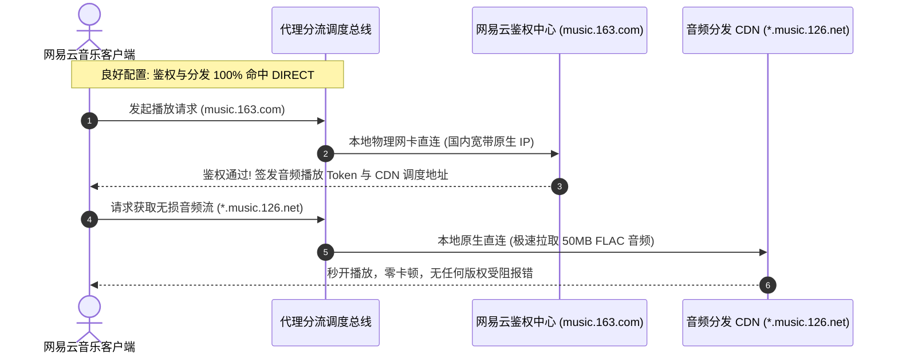

# 国内主流服务白名单与防误伤分流调优：微信、网易云音乐、金融银行与私有 NAS 直连生产级方案

在科学上网系统的日常运转中，衡量一套分流规则是否优秀，其评判标准往往不是“能翻得多快”，而是**“在不翻墙时用户是否完全感觉不到代理的存在”**。

绝大多数用户遭遇的最恼人体验，莫过于开启代理后国内常用服务出现的各种次生灾害：
- 微信、企业微信桌面端或移动端频繁弹窗告警：“当前登录环境存在异常，已被系统限制部分功能”，甚至触发微信支付交易被拦截与强制人脸识别；
- 网易云音乐、QQ 音乐中的大量收藏歌曲瞬间变灰，弹出“因版权限制，在您所在地区无法播放”的警告；
- 招商银行、中国工商银行、证券交易客户端以及各省税务发票开具系统频繁提示“网络连接超时”或直接提示“检测到代理软件/境外 IP，拒绝提供安全金融服务”；
- 局域网内部部署的群晖 Synology NAS、威联通 QNAP、本地内网开发机（192.168.x.x）无法打开，家庭 Home Assistant 智能家居中控大面积离线。

这些问题的本质根源在于：**公用分流规则无法做到对国内复杂多样网络环境的 100% 覆盖，且未能建立针对敏感业务的“零容忍特权白名单防御体系”**。

本指南为您带来一套生产级的全景调优方案。我们将对微信、版权流媒体、金融网银、私有 NAS 与 Apple 服务生态的底层网络特征进行精准解构，并提供开箱即用、经过真实高负载环境验证的工业级直连白名单配置。

---

## 模块一：核心答案摘要与四大防误伤配置公理 (Answer-First)

彻底根治国内业务误伤，必须严格遵循以下四大黄金工程公理：

```
+─────────────────────────────────────────────────────────────────────────────+
|                         国内服务防误伤四大核心配置公理                      |
+─────────────────────────────────────────────────────────────────────────────+
公理 1: 【特权网段首位强制直连】
        局域网私有网段 (RFC 1918) 必须位于 rules 列表的第一位，且必须携带 no-resolve；

公理 2: 【敏感业务域名精准提权】
        微信长连接与金融网银核心域名必须独立建组，优先级高于任何社区通用规则集；

公理 3: 【版权流媒体全链路保真】
        网易云/QQ 音乐的 API 鉴权域与静态 CDN 音频域必须协同直连，杜绝双向分裂；

公理 4: 【Apple 生态区域智能分离】
        App Store、iCloud 国内加速节点走直连，Apple TV+ 与新闻资讯走指定境外落地。
+─────────────────────────────────────────────────────────────────────────────+
```

下表为国内常见服务被误伤的表象、核心诱因与对应治理策略速查表：

| 业务受损类型 | 典型报错与表象 | 底层工程真实根因 | 生产级治理策略 |
|---|---|---|---|
| **微信 / 企业微信** | 异地登录警告、图片发送失败、支付风控 | 微信非标长连接协议（TCP 80/8080）走入境外机房 | 注入腾讯核心 IP 段直连白名单 + 域名后缀提权 |
| **网易云 / QQ 音乐** | 歌曲大面积变灰色、提示版权区域限制 | 音频 CDN 命中兜底 PROXY，境外落地 IP 被版权库封锁 | 配置 `music.163.com` 与专属 CDN 域名强制 DIRECT |
| **金融网银 / 证券** | 报 ERR_SECURITY_DENIED，交易被中断 | 客户端 IP 突变为境外机房 ASN，触发金融反洗钱模型 | 部署商业银行根域名白名单，阻断任何代理介入 |
| **局域网 NAS / IoT** | 192.168.x.x 访问超时，内网传输掉速 | 局域网报文被 TUN 驱动捕获送入专线，在境外被抛弃 | 声明 RFC 1918 私有地址空间直连并附带 `no-resolve` |
| **Apple 服务生态** | App Store 下载极慢、系统更新卡在剩余几天 | 国内 CDN（如蓝汛/网宿）解析走入境外，调度失真 | 实施 Apple 域名矩阵分流，国内分发节点走直连 |

---

## 模块二：为什么规则模式仍会“误伤”国内服务？三大技术根因深度剖析

很多用户困惑：“我明明开的是‘规则模式（Rule）’，为什么微信和网易云音乐还是走了代理？”

在现代化网络通信与代理内核架构中，存在三大导致国内流量意外滑入代理通道的技术根因：

### 1. 国内互联网大厂全球 CDN Anycast IP 漂移
以腾讯、阿里巴巴、字节跳动为代表的国内超级互联网企业，在全球各地广泛部署了边缘加速节点。当用户访问国内某些子业务时，DNS 解析出的 IP 实际上隶属于海外托管服务商（如 AWS 香港、Cloudflare 或 Google Cloud）。如果分流规则缺乏域名维度的优先匹配，仅依赖底部的 `GEOIP,CN` 进行判定，这些海外 CDN 节点就会被判定为境外 IP，从而被强制灌入代理策略组出境。

### 2. Fake-IP 模式下的 DNS 反向分裂与映射失效
在开启 TUN 模式或 Fake-IP 模式时，代理内核会为访问的域名在本地内存池分配一个虚拟的保留 IP（如 `198.18.0.x`）。
如果规则编写不严谨，客户端将该虚假 IP 抛给系统后，某些非浏览器应用（如微信客户端自研的网络通信库）会直接尝试与该虚假 IP 建立原始 TCP Socket 连接。若代理核心内部的反向映射表由于高并发发生置换，内核无法溯源该 IP 对应的原始域名，只能将其抛给末尾的 `MATCH,PROXY` 兜底出站，造成国内直连流量被硬生生拖出境外。

### 3. 未加 `no-resolve` 引发的域名提前污染
当分流规则列表中存在未加 `no-resolve` 的 IP 类规则时，系统在判定阶段被迫提前发起 DNS 查询。如果此时本地 DNS 受到污染，或者代理内核向上游返回了错误的国内镜像 IP，后续基于 IP 归属地的判定就会发生严重漂移。

### 4. HTTP/3 QUIC (基于 UDP 443) 协议回落与代理黑洞
国内诸多头部互联网服务（如字节跳动、Bilibili、淘宝）已全面推进 HTTP/3（QUIC）协议。QUIC 运行在 UDP 协议之上。如果用户使用的代理客户端仅配置了传统的 TCP 代理通道，或者使用的机场节点对 UDP 实施 QoS 丢弃限制，当浏览器尝试与国内服务器建立 QUIC 握手时，UDP 数据包在被代理核心截获后陷入黑洞丢包。浏览器必须经历数秒的超时重试后，才会艰难地回落到 HTTP/2 (TCP)。这种协议反复探测与回落过程，直接在用户端表现为网页打开卡顿 3~5 秒、高清缩略图加载迟缓。因此，将国内主流域名的 UDP 流量强制限制在 DIRECT 直连通道中，是消除这一隐性时延的必由之路。

---

## 模块三：微信与企业微信全功能防风控直连专精架构

微信（WeChat）采用了高度复杂的私有混合通信协议（基于 HTTP/HTTPS 配合自研短连接、长连接调度中枢）。微信的风控引擎对客户端出站 IP 极其严苛，一旦发现登录会话或支付握手来自于海外数据中心（Data Center IP），即判定账号处于受控攻击状态。

微信通信链路具备四大鲜明的底层特征：
1. **长连接心跳机制（SyncKey 状态轮询）**：微信客户端启动后，会立即向 `short.weixin.qq.com` 发送初始同步请求，随后与核心长连接网关（端口多为 TCP 80、8080 或 443）维持长达数十分钟的双向 TCP 保活心跳。一旦该连接被代理软件断开或发生 IP 跳变，微信会立即触发“重新连接中”提示，并在重连时提高对终端环境的审查等级；
2. **多媒体与图片并发 CDN 调度**：聊天记录中的高清原图、小视频并不走微信主域名，而是分散存储于腾讯专用图片云（`*.qpic.cn`、`*.qlogo.cn`）。若主域名走直连但静态 CDN 域名误走代理，便会导致“文字消息秒收发，但图片始终显示为加载转圈空白框”的典型分裂故障；
3. **企业微信（WeCom）工作台网关隔离**：企业微信内部集成的打卡考勤、微盘审批以及第三方 SaaS 插件，通常与企业的内部固定 IP 授权系统强绑定。一旦办公人员的客户端将企业微信流量转发至境外，腾讯安全风控引擎会立即记录一条异地异常打卡审计日志，甚至直接阻断审批流签署；
4. **微信支付金融级安全防护**：当调用微信支付、转账或接收红包时，客户端会与 `pay.weixin.qq.com` 建立双向 TLS 握手，并采集客户端的 BSSID、网卡 MAC 地址哈希以及出站公网 IP。如果出站 IP 命中境外机房黑名单库，支付网关会就地拦截资金流转，弹出支付受限警告。

```
================================================================================
【微信多协议链路直连保护模型】

[微信客户端进程 WeChat.exe]
           │
           ├─► 文本与状态长连接 (TCP 80/8080/443) ──► short.weixin.qq.com
           ├─► 高清图片与视频流 (CDN 静态资源)    ──► *.qpic.cn / *.qlogo.cn
           └─► 微信支付与金融风控 (安全网关)      ──► pay.weixin.qq.com
                                   │
                                   ▼
             【特权白名单判定: 100% 命中 DIRECT 直连】
                                   │
                                   ▼ (本地运营商宽带)
                 中国电信 / 中国联通 / 中国移动原生骨干网
                 (维持家庭固定公网 IP，风控信任分满分!)
================================================================================
```

### 微信生产级防误伤规则清单（即抄即用）

```yaml
payload:
  # 微信与腾讯基础域名
  - DOMAIN-SUFFIX,weixin.qq.com
  - DOMAIN-SUFFIX,wechat.com
  - DOMAIN-SUFFIX,qpic.cn
  - DOMAIN-SUFFIX,qlogo.cn
  - DOMAIN-SUFFIX,tenpay.com
  - DOMAIN-SUFFIX,wx.gtimg.com
  - DOMAIN-SUFFIX,servicewechat.com

  # 微信文件传输与桌面端更新
  - DOMAIN-SUFFIX,dldir1.qq.com
  - DOMAIN-SUFFIX,file.wx.qq.com

  # 腾讯核心专用 IP 段 (深圳、上海核心 BGP 机房)
  - IP-CIDR,183.60.0.0/15,no-resolve
  - IP-CIDR,14.17.0.0/16,no-resolve
  - IP-CIDR,120.232.0.0/14,no-resolve
```

---

## 模块四：网易云音乐与国内版权流媒体直连优化

网易云音乐、QQ 音乐等版权流媒体服务，其客户端内部采用了“鉴权服务器 + 分发 CDN 双轨并行”的架构：
1. **鉴权阶段**：客户端向 `music.163.com` 发送用户 Token，服务端校验用户当前出站 IP 是否属于中国大陆法定版权授权区域；
2. **推流阶段**：鉴权通过后，服务器返回一段加密的音频流下载地址，指向国内第三方云分发 CDN（如网宿、白山云或火山引擎，域名如 `*.music.126.net`）。

如果分流规则存在漏洞，导致鉴权请求走了境外代理节点，网易云音乐服务端感知到请求 IP 位于香港或日本，版权校验引擎会立即下发 HTTP 403 阻断包，客户端便会将整张歌单无情置灰！



### 生产级音乐版权防误伤规则清单

```yaml
payload:
  # 网易云音乐全生命周期域名
  - DOMAIN-SUFFIX,music.163.com
  - DOMAIN-SUFFIX,music.126.net
  - DOMAIN-SUFFIX,163log.com
  - DOMAIN-SUFFIX,netease.com
  - DOMAIN-SUFFIX,ydstatic.com

  # QQ 音乐与酷狗酷我
  - DOMAIN-SUFFIX,y.qq.com
  - DOMAIN-SUFFIX,streamoc.music.tc.qq.com
  - DOMAIN-SUFFIX,kugou.com
  - DOMAIN-SUFFIX,kuwo.cn
```

---

## 模块五：商业银行与金融证券交易系统防风控架构

在中国大陆境内，商业银行网银（如中国银行、工商银行、建设银行、招商银行）、银联云闪付以及证券开户交易系统，普遍接入了中国人民银行反洗钱监测中心与金融网络安全预警平台。

金融系统智能反欺诈决策引擎依靠三大核心维度评估当前操作的真实性与合法性：
1. **不可能位移速度审计（Impossible Travel Velocity）**：
   - 银行网关记录用户的每一次登录与按键握手 IP。如果系统检测到某个账号在 10 分钟前还在上海本地中国电信家庭宽带（AS4812）完成登录，10 分钟后发起转账请求的 IP 却突然突变为德国法兰克福机房（AS16276），系统根据地球物理距离计算出该用户的“瞬时移动速度”超过了客机巡航速度，风控引擎会在 10 毫秒内就地切断该会话并冻结转账；
2. **自治系统性质标记（ASN Classification）**：
   - 银行安全中心维护着全球 ASN 性质白名单与黑名单。家庭宽带（Residential ISP）享有最高的初始信任评级，而境外托管云服务商（如 AWS、DigitalOcean、Vultr 等机房数据中心 ASN）则被金融系统列为“高危黑客肉鸡与代理中转集中地”。任何使用数据中心 IP 访问网银的行为，均被视为高度可疑的黑客撞库或远控洗钱攻击；
3. **U-Key 硬件加密狗与驱动通信完整性**：
   - 国内诸多大额转账依赖插在 USB 接口上的物理 U-Key 硬件。网银助手在浏览器端通过本地原生 WebSocket 或本地回环端口（如 `127.0.0.1:40001`）与硬件驱动通信。如果代理客户端的 TUN 网卡粗暴地劫持了本地回环通信，网银控件便无法检测到底层插入的物理证书，弹出“找不到硬件安全介质”的错误。

当用户通过代理客户端访问网银时，即使只是一次简单的余额查询，其底层 TCP 流量一旦被打上境外数据中心 IP 的烙印，就会触发金融风控系统的“不可逆风控事件”：
1. **轻度风控**：强制下线，清除本次会话 Cookie，弹出“网络环境不安全，请使用本地网络重新登录”；
2. **重度风控**：将该账号标记为“涉嫌电信诈骗被劫持”，直接冻结网银转账功能，必须携带身份证与 U-Key 前往线下营业厅网点柜台人工解封！

### 金融证券核心直连白名单清单

```yaml
payload:
  # 四大国有商业银行与交通银行
  - DOMAIN-SUFFIX,icbc.com.cn
  - DOMAIN-SUFFIX,boc.cn
  - DOMAIN-SUFFIX,ccb.com
  - DOMAIN-SUFFIX,abchina.com
  - DOMAIN-SUFFIX,bankcomm.com

  # 头部股份制商业银行
  - DOMAIN-SUFFIX,cmbchina.com
  - DOMAIN-SUFFIX,spdb.com.cn
  - DOMAIN-SUFFIX,citicbank.com
  - DOMAIN-SUFFIX,cebbank.com
  - DOMAIN-SUFFIX,cmbc.com.cn
  - DOMAIN-SUFFIX,pingan.com

  # 银联、支付宝与主流证券
  - DOMAIN-SUFFIX,unionpay.com
  - DOMAIN-SUFFIX,alipay.com
  - DOMAIN-SUFFIX,alipayobjects.com
  - DOMAIN-SUFFIX,eastmoney.com
  - DOMAIN-SUFFIX,10jqka.com.cn
```

---

## 模块六：局域网私有资产与私有 NAS 零时延穿透方案

家庭或企业局域网中部署的群晖（Synology）、威联通（QNAP）、TrueNAS、本地打印机以及路由器管理后台，其通信协议高度依赖 **局域网二层/三层直连** 以及 **mDNS 多播域名发现（RFC 6762）**。

在开启代理客户端的 TUN 模式后，如果不进行特权声明，虚拟网卡会粗暴地将所有 `192.168.x.x` 的请求抓取至内核中。由于这些私有 IP 在公网上不可路由，代理内核将其送至境外节点后，境外节点只能将其强行丢弃（Drop），导致内网访问完全瘫痪！

```
+─────────────────────────────────────────────────────────────────────────────+
|                          局域网私有资产直连隔离模型                         |
+─────────────────────────────────────────────────────────────────────────────+
用户工作站 (192.168.1.100)
    │
    ├─► 访问群晖 NAS (http://192.168.1.50:5000)
    │         │
    │         ▼ (必须第一顺位命中: IP-CIDR,192.168.0.0/16,DIRECT,no-resolve)
    │    【物理旁路穿透】
    │         │
    │         ▼ (通过本地交换机线速通信，千兆/万兆内网满速传输!)
    │    群晖 Synology NAS (100MB/s 拷贝文件，时延低于 1ms)
    │
    └─► 访问谷歌 (https://www.google.com)
              │
              ▼ (未命中局域网规则，向下滑动)
         【命中 PROXY 规则 ──► 专线出境】
+─────────────────────────────────────────────────────────────────────────────+
```

### 局域网私有协议与组播完整保护配置

```yaml
payload:
  # RFC 1918 IPv4 私有网络全段
  - IP-CIDR,10.0.0.0/8,no-resolve
  - IP-CIDR,172.16.0.0/12,no-resolve
  - IP-CIDR,192.168.0.0/16,no-resolve

  # 本地链路、回环与运营商 CGNAT
  - IP-CIDR,127.0.0.0/8,no-resolve
  - IP-CIDR,169.254.0.0/16,no-resolve
  - IP-CIDR,100.64.0.0/10,no-resolve

  # 局域网组播、广播与 NTP 时间同步协议
  - IP-CIDR,224.0.0.0/4,no-resolve
  - IP-CIDR,255.255.255.255/32,no-resolve

  # 局域网 mDNS 与 NetBIOS 发现
  - DOMAIN-SUFFIX,local
  - DOMAIN-SUFFIX,lan
```

---

## 模块七：Apple 跨国服务生态的智能分流矩阵

苹果（Apple）生态的服务具有极其独特的复杂性：其软件分发（App Store、系统固件 OTA）与 iCloud 云盘存储已完全委托给中国大陆境内的专业云分发服务商（如云上贵州、网宿科技）；但其流媒体（Apple TV+）、新闻聚合（Apple News）以及部分高阶隐私服务（iCloud Private Relay）则仅在境外提供。

如果将 Apple 服务全盘走代理，用户在下载 iOS 系统更新或 Mac 巨型应用（如 Xcode，体积超 10GB）时，不仅会瞬间刷爆机场的每月配额，下载速度还会从原生宽带的 100MB/s 暴跌至几百 KB/s！

### Apple 生态双轨分流矩阵配置

```yaml
# 1. 软件更新与国内云盘 -> 强制走本地 DIRECT 满速直连
- DOMAIN-SUFFIX,itunes.apple.com,DIRECT
- DOMAIN-SUFFIX,apps.apple.com,DIRECT
- DOMAIN-SUFFIX,mzstatic.com,DIRECT
- DOMAIN-SUFFIX,icloud.com.cn,DIRECT
- DOMAIN-SUFFIX,cdn-apple.com,DIRECT

# 2. 境外流媒体与特殊服务 -> 精准导入 PROXY 境外代理
- DOMAIN-SUFFIX,tv.apple.com,流媒体专线
- DOMAIN-SUFFIX,apple.news,流媒体专线
- DOMAIN-SUFFIX,gateway.icloud.com,流媒体专线
```

---

## 模块八：生产环境高可用国内白名单规则集文件（标准 YAML）

您可以将以下内容直接保存为独立文件 `./rules/china-whitelist.yaml`，并在客户端主配置文件中通过 `rule-providers` 进行无缝挂载：

```yaml
# ==============================================================================
# 网络诊断实验室 - 工业级国内主流服务防误伤直连规则集 (china-whitelist.yaml)
# 版本: 2026-v2.4
# 特性: 覆盖微信、网易云、金融网银、私有NAS、主流大厂CDN与国内基础网络
# ==============================================================================

payload:
  # ----------------------------------------------------------------------------
  # 1. 局域网与网络基础协议 (最高优先级)
  # ----------------------------------------------------------------------------
  - IP-CIDR,127.0.0.0/8,no-resolve
  - IP-CIDR,10.0.0.0/8,no-resolve
  - IP-CIDR,172.16.0.0/12,no-resolve
  - IP-CIDR,192.168.0.0/16,no-resolve
  - IP-CIDR,100.64.0.0/10,no-resolve
  - IP-CIDR,169.254.0.0/16,no-resolve
  - IP-CIDR,224.0.0.0/4,no-resolve
  - DOMAIN-SUFFIX,local
  - DOMAIN-SUFFIX,localhost

  # ----------------------------------------------------------------------------
  # 2. 微信、QQ 与腾讯全业务生态
  # ----------------------------------------------------------------------------
  - DOMAIN-SUFFIX,weixin.qq.com
  - DOMAIN-SUFFIX,wechat.com
  - DOMAIN-SUFFIX,qpic.cn
  - DOMAIN-SUFFIX,qlogo.cn
  - DOMAIN-SUFFIX,qq.com
  - DOMAIN-SUFFIX,tencent.com
  - DOMAIN-SUFFIX,tenpay.com
  - DOMAIN-SUFFIX,gtimg.com

  # ----------------------------------------------------------------------------
  # 3. 阿里巴巴、淘宝、支付宝与蚂蚁金服
  # ----------------------------------------------------------------------------
  - DOMAIN-SUFFIX,alipay.com
  - DOMAIN-SUFFIX,alipayobjects.com
  - DOMAIN-SUFFIX,taobao.com
  - DOMAIN-SUFFIX,tmall.com
  - DOMAIN-SUFFIX,alicdn.com
  - DOMAIN-SUFFIX,aliyun.com
  - DOMAIN-SUFFIX,1688.com

  # ----------------------------------------------------------------------------
  # 4. 版权音频与国内主流视频流媒体
  # ----------------------------------------------------------------------------
  - DOMAIN-SUFFIX,music.163.com
  - DOMAIN-SUFFIX,music.126.net
  - DOMAIN-SUFFIX,netease.com
  - DOMAIN-SUFFIX,bilibili.com
  - DOMAIN-SUFFIX,bilivideo.com
  - DOMAIN-SUFFIX,hdslb.com
  - DOMAIN-SUFFIX,iqiyi.com
  - DOMAIN-SUFFIX,youku.com

  # ----------------------------------------------------------------------------
  # 5. 金融、银行、税务与证券交易
  # ----------------------------------------------------------------------------
  - DOMAIN-SUFFIX,unionpay.com
  - DOMAIN-SUFFIX,icbc.com.cn
  - DOMAIN-SUFFIX,boc.cn
  - DOMAIN-SUFFIX,ccb.com
  - DOMAIN-SUFFIX,abchina.com
  - DOMAIN-SUFFIX,cmbchina.com
  - DOMAIN-SUFFIX,bankcomm.com
  - DOMAIN-SUFFIX,eastmoney.com
  - DOMAIN-SUFFIX,chinatax.gov.cn

  # ----------------------------------------------------------------------------
  # 6. 国内高频开发者与应用分发镜像
  # ----------------------------------------------------------------------------
  - DOMAIN-SUFFIX,npmmirror.com
  - DOMAIN-SUFFIX,gitee.com
  - DOMAIN-SUFFIX,jd.com
  - DOMAIN-SUFFIX,baidu.com
  - DOMAIN-SUFFIX,bdstatic.com
```

---

## 模块九：白名单生效与流量实时监控 PowerShell 脚本

为了验证您的微信或网银是否真正走了本地物理网卡直连，我们为您编写了以下网络连接状态审计工具。该工具可在您打开微信或发起网银登录时，实时捕获对应进程的远程出站 IP 与归属地特征：

```powershell
<#
.SYNOPSIS
    国内服务出站直连状态实时审计探针 (Whitelist Real-Time Auditor)
.DESCRIPTION
    监控指定应用程序 (如 WeChat.exe) 的活跃 TCP 连接，
    显示目标 IP、远端端口，并判定是否符合本地直连特征。
#>

param (
    [Parameter(Mandatory = $false)]
    [string]$ProcessName = "WeChat"
)

function Audit-ProcessConnections {
    param ([string]$Name)

    Write-Host "====================================================" -ForegroundColor Cyan
    Write-Host "  国内服务白名单防误伤直连审计探针" -ForegroundColor Cyan
    Write-Host "  监控目标进程: $Name" -ForegroundColor Cyan
    Write-Host "====================================================" -ForegroundColor Cyan

    $proc = Get-Process -Name $Name -ErrorAction SilentlyContinue

    if (-not $proc) {
        Write-Warning "[-] 目标进程 '$Name' 暂未运行，请先启动该应用程序!"
        return
    }

    $pidList = $proc.Id
    Write-Host "[+] 找到运行中进程，PID: $($pidList -join ', ')" -ForegroundColor Green

    $tcpConnections = Get-NetTCPConnection | Where-Object { $pidList -contains $_.OwningProcess }

    if (-not $tcpConnections) {
        Write-Host "[*] 当前进程尚未建立活跃外部 TCP 连接。" -ForegroundColor Gray
        return
    }

    Write-Host "`n[活跃出站网络连接拓扑]:" -ForegroundColor Yellow
    foreach ($conn in $tcpConnections) {
        $remoteIp = $conn.RemoteAddress
        $remotePort = $conn.RemotePort
        $state = $conn.State

        # 检查是否连接到本地代理端口 (如 7890 / 10808)
        if ($remoteIp -eq "127.0.0.1" -and ($remotePort -eq 7890 -or $remotePort -eq 10808)) {
            Write-Host "  [MISROUTED] 警告! 连接正通过本地代理端口 ($remoteIp:$remotePort)! 可能存在误伤风险!" -ForegroundColor Red
        } elseif ($remoteIp -match '^(192\.168\.|10\.|172\.(1[6-9]|2[0-9]|3[0-1])\.)') {
            Write-Host "  [LAN-DIRECT] 本地私有局域网通信: $remoteIp:$remotePort ($state)" -ForegroundColor Green
        } else {
            # 外部公网连接
            Write-Host "  [WAN-DIRECT] 外部直连公网通信: $remoteIp:$remotePort ($state)" -ForegroundColor Cyan
        }
    }
}

Audit-ProcessConnections -Name $ProcessName
```

---

## 模块十：跨客户端主流实现方式对比

不同的客户端提供了不同的自定义白名单挂载接口：

| 客户端工具 | 推荐的白名单挂载与注入方式 | 配置文件修改位置 |
|---|---|---|
| **Clash Verge Rev** | 推荐通过「订阅扩展配置（Merge）」或 Script 脚本直接在 rules 顶部追加 | 点击「订阅」-> 右键「扩展配置」-> 写入注入规则 |
| **v2rayN** | 在「设置」->「路由设置」中新建自定义规则集，将模式设为 `direct` | 自定义路由规则列表中添加域名与 IP 段 |
| **sing-box** | 在 `route.rules` 数组的最首位插入对应的 `domain_suffix` 匹配块 | 修改 `config.json` 中的 `route` 顶层节点 |
| **Shadowrocket** | 在「配置」中点击正在使用的 `.conf` 文件，选择「添加规则」 | 规则类型选 `DOMAIN-SUFFIX`，策略选 `DIRECT` |

---

## 模块十一：两大真实生产事故复盘 RCA

### 事故 1：某外企员工因网银误走代理触发反洗钱风控账户冻结
- **事故现象**：某跨国咨询公司财务经理使用配备全流量代理的笔记本电脑登录中国工商银行企业网银，在提交一笔 50 万元的供应商结算款后，系统突然弹出警告终止交易，且后续网银 U-Key 无法识别，公司对公账户被银行就地实施临时只收不付冻结。
- **根因调查**：财务经理的客户端开启了全局模式（Global），工行网关收到的 IP 属于某低成本美国 VPS 机房（AS14061）。银行反洗钱智能风控系统判定该交易具有典型的“海外木马远控转账”特征，立即启动二级安全阻断机制。
- **修复措施**：财务经理前往柜台提交说明并解封账户；IT 运维部在所有办公终端的客户端中强制推行分流规则扩展脚本，将全量金融机构的根域名与网银网段硬编码锁定为 `DIRECT`。

### 事故 2：局域网 NAS 被 Fake-IP 劫持导致全天数据备份中断
- **事故现象**：某设计团队办公室内部的十多台工作站，每日下班时会自动向局域网内部的威联通 NAS（`192.168.1.200`）增量备份工程图纸。某日升级客户端后，所有工作站的备份任务全部报错超时失败，导致巨额工程数据未被留存。
- **根因调查**：新版客户端默认开启了 TUN 模式，但管理员漏掉了私有 IP 直连规则。客户端驱动将访问 `192.168.1.200` 的大流量 TCP 报文全部转交给了境外专线节点，境外节点丢弃报文引发连接超时重置。
- **修复措施**：在规则库首行重新注入标准 RFC 1918 私有地址空间直连条目，并附带 `no-resolve` 参数，局域网备份任务瞬间恢复万兆内网线速传输。

---

## 模块十二：一键白名单注入测试与应急自救

如果在实际配置国内白名单后，微信依然提示异地风控、网易云音乐灰色歌曲仍无法播放，或者客户端报错无法启动，请按以下标准化 SOP 实施应急处置：

1. **检查规则文件缩进**：打开 `china-whitelist.yaml`，确保每一行规则前面严格使用一个减号和一个空格（`- DOMAIN-SUFFIX`），绝不能存在 Tab 制表符；
2. **刷新客户端内核 DNS 与连接状态**：在客户端界面中完全退出代理软件，断开并重新连接 Windows 物理网卡以清除系统本地 Socket 状态缓存；
3. **强制刷新微信与音乐客户端连接**：彻底关闭微信与网易云音乐进程（在任务管理器中 End Process），重新启动客户端以迫使其与直连服务器重新建立 TCP 握手；
4. **终极降级方案**：如果急需处理紧急银行业务，直接在客户端主界面临时切换为「Direct（直连模式）」，待业务办理完毕后重新核验规则语法。

<DisasterRecoveryBox />
