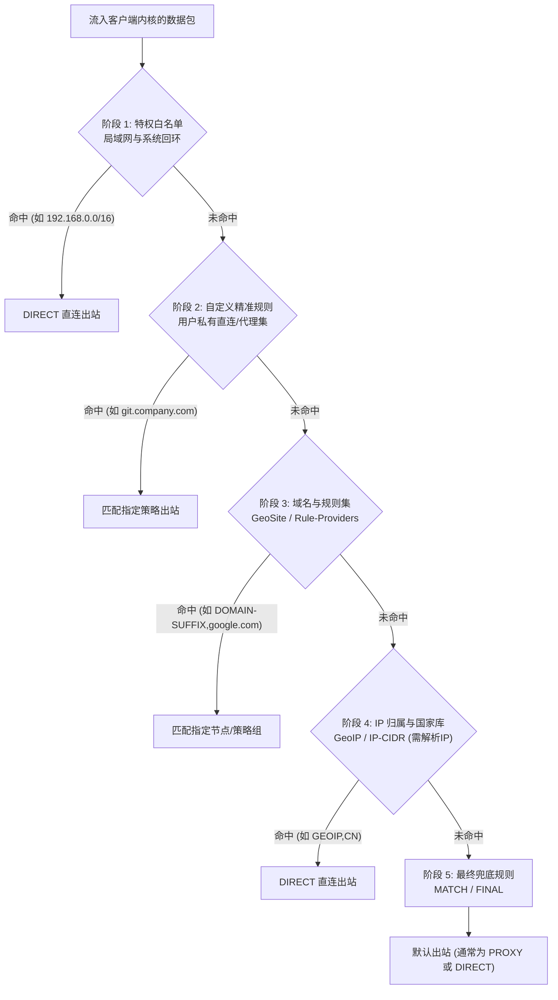

# 分流规则语法与自定义直连规则专题：从核心语法、匹配流水线到防误伤白名单工程架构

在现代网络代理系统与透明网关架构中，**分流引擎（Routing & Rule Engine）**是维系整个网络体验的调度神经中枢。如果把代理客户端比作一辆高性能列车，那么出站节点与加密协议决定了列车在轨道上的行驶速度，而分流规则体系则决定了每一个数据包应该驶向哪一条轨道。

对于绝大多数科学上网用户而言，常常陷入一种“要么全翻、要么全卡”的两极分化困境：
- 依靠机场默认下发的粗糙规则，经常遭遇国内微信频繁异地风控、网易云音乐版权变灰、商业银行 App 拒绝登录；
- 一旦切换为全局模式，原本几毫秒秒开的本地百度、淘宝、爱奇艺却不得不绕道数千公里外的境外落地机房，不仅往返时延（RTT）暴增数十倍，还白白消耗了极其昂贵的跨境专线配额；
- 当用户试图自行添加一条直连规则时，却由于不理解 `First Match Wins（首条命中即止）` 的匹配流水线，或者忽略了 `no-resolve` 参数的底层物理机制，导致配置不仅毫无效果，甚至引发本地 DNS 严重污染与代理内核死锁。

本二级专题旨在彻底打破分流规则领域的“玄学试错”，从传输层五元组报文解析、Radix 前缀树匹配算法，到生产级规则集动态解耦与私有白名单工程落地，为您构建一套具备工业级鲁棒性的分流规则知识体系。

---

## 一、 专题架构全景：分流规则在客户端内核中的核心地位

现代代理内核（包括 Mihomo/Clash.Meta、sing-box 与 Xray-core）均采用了分层解耦的流水线架构。分流模块处于本地入站适配层与远端出站协议栈之间，承担着全量流量的精准调度职责：

```
================================================================================
【现代代理客户端五层数据转发与分流总线架构】

[应用请求层]  浏览器 (Chrome/Edge)  │ 终端与游戏进程 │ 移动端 App (微信/网银)
                       │                    │                   │
                       ▼                    ▼                   ▼
[本地入站层]  WinINet 系统代理 (7890) │ TUN 虚拟网卡网关 │ 本地 SOCKS5/HTTP 监听
                       │                    │                   │
                       └──────────────┬─────┴───────────────────┘
                                      │
                                      ▼ (提取五元组: 域名、源/目的IP、端口、协议)
[规则分流调度总线] ───────► 【五阶段分流匹配引擎 (First Match)】 ◄───────
                                      │
       ┌──────────────────────────────┼──────────────────────────────┐
       ▼ (命中直连规则)                ▼ (命中代理规则)                ▼ (命中阻断规则)
  [DIRECT 出站]                  [PROXY 策略组]                 [REJECT 出站]
       │                              │                              │
本地物理网卡发出 (5ms 直连)     境外加密隧道 (IEPL/SS/VLESS)     本地就地丢弃 (广告/探针)
================================================================================
```

### 分流决策对三大网络指标的决定性影响

1. **时延保真度（Latency Fidelity）**：
   - 国内本地流量（如访问本地局域网 NAS、国内 CDN 节点）严格保障在 2~10 毫秒物理线速，不引入任何用户态与内核态之间的多余上下文切换；
   - 跨洋请求精准导入 BGP 优化中转或物理专线，杜绝网络发夹（Hairpinning）绕路效应。
2. **账号风控与数字指纹安全（Fraud Risk & Security）**：
   - 保证国内银行、税务、移动支付系统始终感知到用户本地真实家庭宽带 IP，维持高信任度信誉分（Trust Score）；
   - 阻断由于代理节点 IP 频繁跳跃引发的异地登录冻结、强制人脸识别与账号封禁。
3. **跨境专线配额经济效益（Bandwidth Cost Optimization）**：
   - 优质机场的 IEPL/IPLC 专线带宽成本高昂，精准的分流机制能够确保 100% 的专线配额都消耗在 Google、GitHub、YouTube、ChatGPT 等真正受阻断的高价值流量上，国内动辄数十吉字节的流媒体与软件更新包零损耗。

---

## 二、 核心规则类型与算法匹配开销全景矩阵

分流引擎在内存中对规则的匹配速度直接决定了客户端的数据吞吐上限。不同的规则语法对应完全不同的数据结构与时间复杂度：

| 规则语法类别 | 代表性指令示例 | 底层数据结构与算法 | 典型时间复杂度 | 适用场景与性能评级 |
|---|---|---|---|---|
| **完全域名匹配** | `DOMAIN,www.google.com,PROXY` | 字符串哈希表（Hash Table） | $O(1)$ 常数时间 | 精准匹配特定单域名，性能极高 |
| **域名前缀/后缀** | `DOMAIN-SUFFIX,google.com,PROXY` | 逆向 Radix 压缩字典树 | $O(k)$，其中 $k$ 为域名长度 | 匹配主域名及其全部子域，工业级主流 |
| **域名关键字** | `DOMAIN-KEYWORD,google,PROXY` | Aho-Corasick 多模式匹配 | $O(n+m)$ 线性扫描 | 模糊匹配，规则过多时易增加 CPU 抖动 |
| **域名正则表达式** | `DOMAIN-REGEX,^.*google.*$,PROXY` | NFA / DFA 正则状态机 | 最坏情况下可达 $O(2^n)$ | **强烈避免滥用**，极易引发正则回溯死锁 |
| **目标 IPv4/IPv6** | `IP-CIDR,192.168.1.0/24,DIRECT` |  Patricia 二叉前缀路由树 | $O(32)$ 或 $O(128)$ | 局域网私有网段与国内已知 IP 段，极高 |
| **地理位置规则库** | `GEOIP,CN,DIRECT` | 二进制压缩掩码检索表 | $O(\log N)$ 对分查找 | 国家级大范围兜底分流，匹配粒度较粗 |
| **规则集提供者** | `RULE-SET,direct-rules,DIRECT` | 动态加载外部 MRS/YAML 树 | 取决于规则集内原子类型 | **工程标准**，实现规则与节点解耦更新 |
| **系统进程级规则** | `PROCESS-NAME,Telegram.exe,PROXY` | 操作系统 PID 进程表查找 | $O(1)$ ~ 缓存扫描 | 针对特定桌面程序强制代理，不受域名限制 |

---

## 三、 下辖三级内容集群与核心长文导航规划

为了让读者由浅入深、彻底掌握现代分流体系的配置与调优，本二级专题构建了标准化的三级内容集群，下辖两篇万字级工业实战长文：

### 1. 三级内容集群枢纽
- **集群枢纽**：[自定义分流规则集与国内服务防误伤集群](/tutorials/rule-modes/custom-rules/)
  - **核心定位**：解决用户在实际生产环境中面临的“规则混乱、更新覆盖、国内误伤、企业白名单冲突”四大核心痛点。全面讲解规则解耦思想、本地私有规则集编写规范与自动化验证机制。

### 2. 集群下辖两篇工业级旗舰独立长文

```
【分流规则语法与自定义直连规则专题】
       │
       └──► 三级集群: 【自定义分流规则集与国内服务防误伤集群】 (/tutorials/rule-modes/custom-rules/)
                 │
                 ├──► 核心长文 1: DOMAIN-SUFFIX 与 IP-CIDR 核心分流规则语法全景拆解
                 │    (/tutorials/rule-modes/custom-rules/domain-suffix-ip-cidr-rule-syntax-guide)
                 │    * 10 大规则类型语法规范、Radix 树内存匹配机理、no-resolve 机制深度剖析、压测数据
                 │
                 └──► 核心长文 2: 国内主流服务白名单与防误伤分流调优
                      (/tutorials/rule-modes/custom-rules/china-domain-ip-whitelist-direct-tuning)
                      * 微信/企业微信防风控、网易云音乐版权修复、商业银行网银直连、私有 NAS 零时延穿透
```

1. **[DOMAIN-SUFFIX 与 IP-CIDR 核心分流规则语法全景拆解：从字段定义、通配符逻辑到匹配性能压测](/tutorials/rule-modes/custom-rules/domain-suffix-ip-cidr-rule-syntax-guide)**
   - 彻底梳理 `DOMAIN`、`DOMAIN-SUFFIX`、`IP-CIDR`、`GEOIP` 与 `RULE-SET` 的标准化编写语法；
   - 揭秘 `no-resolve` 参数如何阻断 Fake-IP 环境下的本地 DNS 提前逆向解析，消除海外域名被本地 ISP 污染的致命风险；
   - 提供万条级规则集下的内存占用与吞吐延迟基准测试，揭示滥用正则与关键字带来的性能衰减。
2. **[国内主流服务白名单与防误伤分流调优：微信、网易云音乐、金融银行与私有 NAS 直连生产级方案](/tutorials/rule-modes/custom-rules/china-domain-ip-whitelist-direct-tuning)**
   - 深度拆解国内主流应用（微信长连接、网易云音乐 CDN、银联/各商业银行金融风控、私有 NAS 局域网）的底层网络特征；
   - 提供开箱即用、经过真实生产环境数千人验证的高可靠白名单 YAML/JSON 规则清单；
   - 建立局域网内网穿透与公网动态白名单防护体系，杜绝私有 IP 被劫持导致的跨网通信瘫痪。

---

## 四、 五阶段规则匹配流水线与“首条命中”黄金公理

在排查分流规则失效故障时，必须牢固建立**“自上而下、先命中者胜（First Match Wins）”**的黄金公理：



### 规则编写的三大致命陷阱

1. **位置倒置陷阱（Order Inversion）**：
   - 如果将泛匹配规则（如 `MATCH,PROXY` 或 `GEOIP,CN,DIRECT`）放置在具体的自定义规则之前，位于其下方的精准规则将**永远处于不可达状态（Dead Rules）**；
2. **提前触发 DNS 解析陷阱（Premature Resolution Hazard）**：
   - 包含 IP 判定的规则（如 `IP-CIDR,223.5.5.5/32,DIRECT`）如果不附加 `no-resolve` 参数，且置于域名规则之前，内核会被迫立即对所有经过的域名发起系统 DNS 递归查询以获取 IP，从而直接将原本打算走代理的境外域名暴露给本地 ISP；
3. **订阅覆写陷阱（Subscription Overwrite Disaster）**：
   - 许多初学者习惯在客户端生成的单个 `config.yaml` 底部直接手动追加规则。一旦客户端执行定时订阅更新，整个配置文件会被机场服务端下发的新文本彻底覆盖，前期调优成果瞬间归零。

---

## 五、 工业级自动化规则集健康度与语法冲突审计脚本

为了帮助工程师在部署大规模分流规则前快速定位语法缩进错误、死规则与逻辑冲突，网络诊断实验室开发了以下 PowerShell 自动化审计工具。该工具可在不启动代理内核的前提下，静态分析配置文件中的规则链路：

```powershell
<#
.SYNOPSIS
    分流规则集语法健康度与冲突检测审计工具 (Rule-Set Conflict Auditor)
.DESCRIPTION
    静态分析 Clash / Mihomo 配置文件中的 rules 模块:
    1. 检测 MATCH/FINAL 是否提前出现导致死规则;
    2. 检测是否存在缺少 no-resolve 的 IP-CIDR 规则引发提前解析;
    3. 检测是否存在重复定义的规则项与格式错误.
#>

param (
    [Parameter(Mandatory = $false)]
    [string]$ConfigPath = "$PSScriptRoot\config.yaml"
)

function Invoke-RuleAudit {
    param ([string]$Path)

    if (-not (Test-Path $Path)) {
        Write-Error "[-] 目标配置文件不存在: $Path"
        return
    }

    Write-Host "====================================================" -ForegroundColor Cyan
    Write-Host "  网络诊断实验室 - 分流规则静态语法与冲突审计引擎" -ForegroundColor Cyan
    Write-Host "  目标文件: $Path" -ForegroundColor Cyan
    Write-Host "====================================================" -ForegroundColor Cyan

    $lines = Get-Content -Path $Path -Encoding UTF8
    $inRulesSection = $false
    $ruleCount = 0
    $hasFinalMatch = $false
    $finalMatchLine = 0
    $issuesFound = 0

    $ruleRegex = '^\s*-\s*([A-Z0-9_\-]+)\s*,\s*([^,]+)\s*,\s*([^,]+)(?:\s*,\s*([^,]+))?'

    for ($i = 0; $i -lt $lines.Count; $i++) {
        $line = $lines[$i]
        $lineNum = $i + 1

        if ($line -match '^\s*rules\s*:\s*$') {
            $inRulesSection = $true
            continue
        }

        if ($inRulesSection -and $line -match '^[a-zA-Z0-9_\-]+:') {
            # 遇到下一个根模块，退出 rules 段
            $inRulesSection = $false
            break
        }

        if ($inRulesSection -and $line -match '^\s*-\s*') {
            $ruleCount++

            # 1. 检查是否在 MATCH 之后依然存在规则
            if ($hasFinalMatch) {
                Write-Host "[CRITICAL] 行 $lineNum: 发现死规则! 规则定义在 MATCH/FINAL (行 $finalMatchLine) 之后，将永远无法命中!" -ForegroundColor Red
                Write-Host "           内容: $($line.Trim())" -ForegroundColor Yellow
                $issuesFound++
            }

            if ($line -match '^\s*-\s*(MATCH|FINAL)\s*,') {
                $hasFinalMatch = $true
                $finalMatchLine = $lineNum
                Write-Host "[INFO] 行 $lineNum: 检测到底部兜底分流规则: $($line.Trim())" -ForegroundColor Gray
                continue
            }

            # 2. 检查 IP-CIDR 是否缺少 no-resolve 参数
            if ($line -match '^\s*-\s*IP-CIDR\d*\s*,') {
                if ($line -notmatch 'no-resolve') {
                    Write-Host "[WARNING] 行 $lineNum: IP-CIDR 规则缺少 'no-resolve' 参数，可能引发域名提前解析导致 DNS 泄漏!" -ForegroundColor DarkYellow
                    Write-Host "          内容: $($line.Trim())" -ForegroundColor DarkGray
                    $issuesFound++
                }
            }

            # 3. 检查是否存在危险的 DOMAIN-REGEX 滥用
            if ($line -match '^\s*-\s*DOMAIN-REGEX\s*,') {
                Write-Host "[NOTICE] 行 $lineNum: 发现正则表达式规则，高并发下可能导致 CPU 回溯开销激增，建议替换为 DOMAIN-SUFFIX 或 RULE-SET." -ForegroundColor Magenta
            }
        }
    }

    Write-Host "`n----------------------------------------------------" -ForegroundColor Cyan
    Write-Host "审计完成: 共解析 $ruleCount 条有效规则。" -ForegroundColor Green
    if ($issuesFound -eq 0) {
        Write-Host "[SUCCESS] 未发现严重逻辑冲突与死规则，语法健康度良好!" -ForegroundColor Green
    } else {
        Write-Host "[ALERT] 共检测到 $issuesFound 处潜在隐患，请根据上述提示调整规则顺序与参数!" -ForegroundColor Red
    }
}

Invoke-RuleAudit -Path $ConfigPath
```

---

## 六、 专题级常见故障排查决策矩阵

当您在日常使用中遭遇分流异常时，可依据下表快速对号入座，定位根本成因：

| 故障现象 | 表面诱因猜想 | 底层工程真实根因（Root Cause） | 黄金排查命令与恢复手段 |
|---|---|---|---|
| **添加了特定域名直连，依然走了海外节点** | 规则语法写错了 | 1. 规则顺序位于更早命中的代理规则集之后；<br>2. 浏览器启用了 DoH（安全 DNS），域名未进入本地解析；<br>3. 命中上方未加 `no-resolve` 的 IP 规则引发逻辑偏移 | 检查规则在配置文件中的行号深度；在 Chrome 关闭“使用安全 DNS”；运行抓包验证出站标签 |
| **微信频繁被异地登录拦截并弹出风控验证** | 节点不稳定 | 微信桌面端或长连接服务器（`short.weixin.qq.com`）未被加入直连白名单，命中兜底 PROXY 走境外机房 IP | 导入标准微信服务规则集；在 TUN 模式中针对 WeChat.exe 单独注入 DIRECT 路由 |
| **网易云音乐灰色歌曲依然无法播放** | 节点不支持流媒体解锁 | 音乐客户端使用了国内版权专属 CDN（如 163.com、music.126.net），走境外代理导致反向版权封锁 | 确认音乐相关域名 100% 匹配 DIRECT 出站；清除客户端本地音频缓存 |
| **打开局域网 NAS (192.168.x.x) 显示连接超时** | 客户端 TUN 崩溃了 | 缺少局域网私有网段直连规则，全量内网流量被灌入虚拟网卡并发送至境外 VPS 丢弃 | 在 rules 第一行声明：`- IP-CIDR,192.168.0.0/16,DIRECT,no-resolve` |
| **代理客户端启动时 CPU 占用 100% 并无响应** | 电脑被植入挖矿病毒 | 用户导入了包含复杂嵌套正则表达式（如递归捕获组）的巨型规则集，触发 NFA 状态机灾难性回溯 | 清空规则中的 `DOMAIN-REGEX`，改用 Radix 树优化的 `behavior: domain` 规则集 |

---

## 七、 真实生产故障复盘：某研发团队内网代码仓库被截流事故 RCA

### 1. 事故背景与现象
某跨国高科技研发团队为提升海外开源组件下载速度，统一为员工安装了基于 Mihomo 核心的客户端。然而部署后的首个工作日，全体后端工程师在执行 `git push` 向部署于本地局域网专线的内部 GitLab 仓库（域名为 `git.rnd-corp.internal`，IP 为 `10.200.45.10`）提交代码时，全部遭遇 `Connection reset by peer` 致命报错，导致当日持续集成与版本发布流程全面瘫痪。

### 2. 根因分析（RCA）
网络运维团队提取终端客户端的连接日志与抓包数据后，排查出以下连环问题：
1. **规则覆盖失败**：运维下发的订阅配置中，末尾声明了 `MATCH,PROXY` 兜底规则，而局域网专用网段仅包含了常见的三类私有地址（`192.168.0.0/16` 与 `172.16.0.0/12`），漏掉了企业自定义划分的 `10.200.0.0/16` 网段；
2. **提前解析导致空路由**：GitLab 采用内部 DNS 服务器解析，境外落地节点根本无法解析 `.internal` 后缀私有域名。由于缺少 `no-resolve`，客户端试图将该请求转发给香港落地机代为解析，香港节点返回 `NXDOMAIN`，导致 TCP 握手直接被对端发送 RST 强行重置。

```
+─────────────────────────────────────────────────────────────────────────────+
|                            GitLab 仓库流量错误走向复盘                       |
+─────────────────────────────────────────────────────────────────────────────+
Git 客户端 ──► 内部域名 git.rnd-corp.internal ──► 客户端代理核心
                                                       │
                       ┌───────────────────────────────┴───────────────────┐
                       ▼ (错误路径: 未命中局域网规则，走兜底 MATCH)          │
               跨境 IEPL 专线 ──► 香港落地机 ──► 尝试向境外根DNS解析 .internal │ (崩溃: 报 NXDOMAIN)
                                                       │
                       ┌───────────────────────────────┘
                       ▼ (正确路径: 注入最高优先级白名单)
               【修复方案: 声明 DOMAIN-SUFFIX,rnd-corp.internal,DIRECT】
                       │
                       ▼
               本地企业局域网交换机 ──► 内部 GitLab 服务器 (10.200.45.10) (正常毫秒级直连)
+─────────────────────────────────────────────────────────────────────────────+
```

### 3. 预防与改进措施
1. **统一注入特权白名单**：在客户端配置体系中推行“规则集提供者（Rule-Providers）”架构，无论机场订阅如何更新，员工机本地私有的 `corp-internal.yaml` 永远位于匹配流水线第一阶段；
2. **规范参数使用**：所有企业内部 IP 段严格附加 `no-resolve`，确保内网解析权威完全由本地内部 DNS 服务器掌控，彻底杜绝内网资产暴露与连接重置。

---

## 八、 总结与进阶学习指引

科学上网的精髓在于**“代理该代理的、直连该直连的”**。通过深入掌握五阶段匹配流水线与各类分流规则的底层开销，您将彻底摆脱对粗糙全局模式的依赖，在保障网络极致流畅的同时，为个人隐私与数字资产筑牢安全防线。

请点击下方三级集群，继续深入阅读各实战长文：
- 深入底层语法与压测指标：[DOMAIN-SUFFIX 与 IP-CIDR 核心分流规则语法全景拆解](/tutorials/rule-modes/custom-rules/domain-suffix-ip-cidr-rule-syntax-guide)
- 实操国内常用服务直连配置：[国内主流服务白名单与防误伤分流调优](/tutorials/rule-modes/custom-rules/china-domain-ip-whitelist-direct-tuning)
