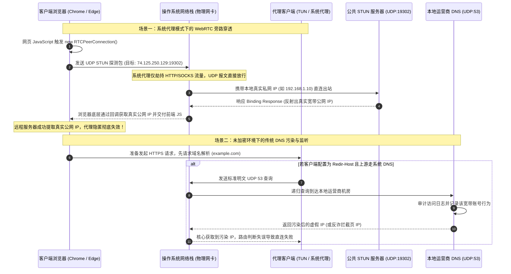
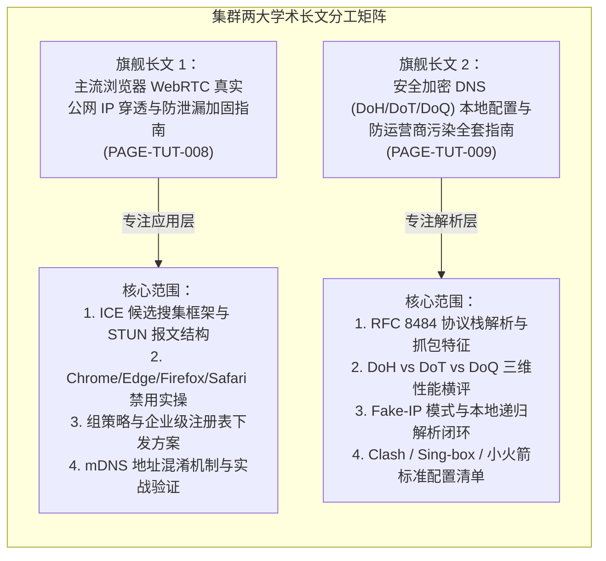
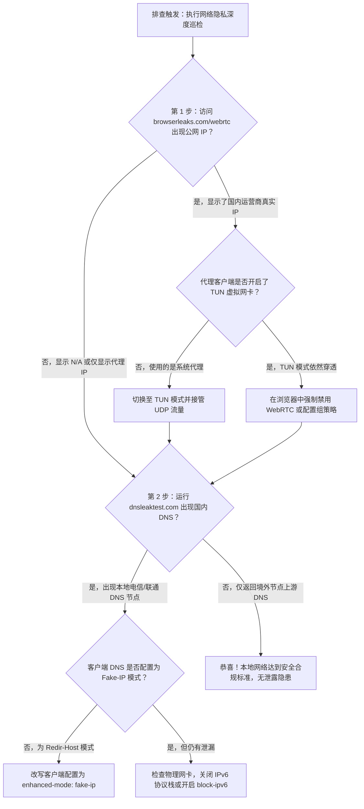

# DNS 泄露防御与 WebRTC 穿透加固集群

在科学上网与跨境通信实践中，大量用户虽然正确配置了代理软件并启用了全局或规则分流，却依然遭遇“真实 IP 被远程服务器捕获”、“特定敏感访问行为被本地运营商明文记录”甚至“访问受限站点被重定向至反诈拦截页”的严重安全事故。此类问题的核心根源，在于操作系统底层网络通信机制中存在两大极其隐蔽的“旁路穿透通道”：**浏览器层面的 WebRTC STUN 穿透**，以及**解析层面的传统 UDP 53 明文 DNS 污染与泄漏**。

本集群作为《科学上网安全防护与数字隐私加固专题》（`/tutorials/security-privacy/`）的核心攻坚模块，专注于从协议底层与终端沙盒两个维度彻底截断所有旁路穿透风险。通过系统化梳理 ICE 框架网络探测机理与 RFC 8484 加密 DNS 协议栈，为工程人员与高级极客提供兼顾极致隐私与高速访问的端到端加固方案。

---

## 1. 集群定位与核心技术攻坚矩阵

本三级内容集群位于整套安全防御体系的技术底层，直接接管数据包发出的最初两道关口——“域名解析”与“P2P 通信候选收集”。

```
========================================================================================
【DNS 泄露防御与 WebRTC 穿透加固集群 技术矩阵】

                 ┌────────────────────────────────────────────────────────┐
                 │  三级集群核心中枢: DNS 泄露防御与 WebRTC 穿透加固集群   │
                 └──────────────────────────┬─────────────────────────────┘
                                            │
                    ┌───────────────────────┴───────────────────────┐
                    ▼                                               ▼
     【攻坚方向 A：应用层/浏览器沙盒】                【攻坚方向 B：网络层/加密解析栈】
     
     攻坚重点: 阻断 WebRTC 旁路穿透                  攻坚重点: 阻断运营商 DNS 投毒与监听
     核心协议: ICE / STUN / TURN (RFC 5389/8445)     核心协议: DoH / DoT / DoQ (RFC 8484/7858/9250)
     攻击向量: UDP 旁路探测直通物理网卡              攻击向量: 明文 UDP 53 端口中间人篡改/SNI 关联
     防御深度: Flags 禁用 / 组策略 / mDNS 随机化     防御深度: Fake-IP 映射 / 本地 DoH 闭环 / 双栈拦截
     对应长文: 《主流浏览器 WebRTC 防穿透加固指南》  对应长文: 《安全加密 DNS 本地配置全套指南》
========================================================================================
```

### 核心攻坚技术指标
- **零真实 IP 泄露率（Zero Leak Rate）**：在任意公开 WebRTC 检测靶场（如 BrowserLeaks、IPLeak）中，绝对不返回本地局域网物理网段（如 `192.168.x.x`）及宽带真实公网出口 IP。
- **DNS 请求 100% 密文传输**：消除全网卡范围内针对 UDP 端口 53 的任何明文出站数据包，彻底剥夺本地宽带运营商（ISP）的报文解析与访问意图审计能力。
- **解析时延控制与零死锁**：在开启本地安全加密 DNS（DoH / DoT）后，首包查询时延（TTFB）保持在 30ms 以内，杜绝“代理未启动时 DNS 无法解析导致连环断网”的先有鸡还是先有蛋死锁。

---

## 2. 报文时序与微观穿透/劫持时序拓扑

为了理解为何系统代理无法阻断泄露，必须分析 WebRTC 与明文 DNS 在操作系统内部绕过代理的微观时序流程：



---

## 3. 核心长文规划与攻坚分工

针对上述两个截然不同的系统层级，本集群规划了两篇高度专注、技术细节互补的工业级独立长文：



### 1. [主流浏览器 WebRTC 真实公网 IP 穿透与防泄漏加固指南](/tutorials/security-privacy/dns-webrtc-hardening/webrtc-browser-hardening-guide.md)
- **解决核心痛点**：为什么开启全局代理后，访问海外检测站点依然能够一眼识别出位于国内的具体省份和运营商？
- **技术突破口**：深入拆解 Chromium 与 Gecko 内核对 WebSockets 与 WebRTC 的网络通道绑定机制，详细给出禁用 `media.peerconnection.enabled`、配置组策略 `WebRtcIPHandlingPolicy` 以及利用扩展插件强制走代理通道的完整 SOP。

### 2. [安全加密 DNS (DoH / DoT / DoQ) 本地配置与防运营商污染全套指南](/tutorials/security-privacy/dns-webrtc-hardening/secure-dns-doh-dot-privacy-configuration.md)
- **解决核心痛点**：为什么访问某些小众境外技术论坛时频繁报错连接重置，或者域名被解析到了不可达的保留 IP？
- **技术突破口**：系统化解构运营商旁路投毒机制，指导用户在主流代理客户端中部署双组加密 DNS（境内直连走清华/阿里 DoH，境外走 Cloudflare / Google DoH），并结合 Fake-IP 模式实现真正的一劳永逸防泄漏。

---

## 4. 四大多端穿透与配置陷阱

在多端设备与复杂网络环境中，以下四大隐蔽陷阱是导致防御策略破功的最主要诱因：

### 陷阱一：移动端（iOS / Android）原生 App 的不受控 WebRTC
桌面浏览器尚可通过设置或扩展轻松禁用 WebRTC，但移动端原生 App（如特定海外交友软件、跨国银行客户端、海外短视频 App）在编译时已内置了定制的 WebRTC SDK，直接调用底层 Socket 发送 UDP 探测。若代理软件未开启 TUN 全局虚拟网卡模式，此类原生 App 的流量将直接穿透物理 5G 基站连接，导致设备指纹被瞬间锁定。

### 陷阱二：Windows 系统的“智能多宿主名称解析”（Smart Multi-Homed Name Resolution）
Windows 10/11 为加速域名解析，默认启用了“智能多宿主名称解析”机制。当本地存在多个活动网卡（如同时连接了 Wi-Fi、以太网与代理虚拟网卡）时，系统会**并发向所有网卡的所有 DNS 服务器发送同一条查询请求**。即便代理虚拟网卡正常返回了安全结果，只要物理网卡的运营商 DNS 响应速度稍快，系统便会优先采纳被污染的结果，并将用户的请求记录留存在本地运营商服务器中。

### 陷阱三：IPv6 自动无状态配置（SLAAC）引发的隐式直连
随着国内三大运营商全面铺开 IPv6，家庭路由器通常默认下发公网 IPv6 地址。大量代理规则仅配置了针对 IPv4 的分流，导致客户端向双栈域名发起请求时，优先发起 AAAA 记录解析，并直接通过操作系统的 IPv6 协议栈进行公网直连，绕过全部代理加密防护。

### 陷阱四：未加密 DNS 的“静默回退（Fallback）”机制
部分用户在配置加密 DNS 时，错误地将公共非加密 DNS（如 `114.114.114.114` 或 `8.8.8.8`）作为备用服务器（Fallback）。当本地网络发生抖动或加密握手延迟超过阈值时，客户端核心会自动静默回退至明文查询，导致此前全部的安全加固瞬间失效。

---

## 5. 关键安全与加密性能基准表

下表为不同防御策略与加密协议在实际网络环境下的性能表现与安全评级对照：

| 防护方案与协议维度 | 传输协议与端口 | 首包解析延迟 (RTT) | WebRTC 穿透防御力 | DNS 投毒防御力 | 跨平台部署复杂度 | 资源与 CPU 开销 |
| :--- | :--- | :--- | :--- | :--- | :--- | :--- |
| **原生系统默认 (无防护)** | 明文 UDP / 端口 53 | 极低 (~5-15ms) | 零防御 (100% 泄露) | 零防御 (极易被篡改) | 零门槛 | 几乎为 0 |
| **浏览器 WebRTC 禁用** | 应用层阻止 API 调用 | 不影响解析时延 | 100% 彻底杜绝 | 无关 (由解析层决定) | 低 (修改配置项即可) | 降低内存与 CPU |
| **DoT (DNS over TLS)** | TCP 封装 TLS / 端口 853 | 中等 (~40-80ms) | 无关 (由应用层决定) | 极高 (证书强校验) | 中等 (需支持 853 端口) | 需维护 TLS 长连接 |
| **DoH (DNS over HTTPS)** | HTTP/2 多路复用 / 端口 443 | 优秀 (~20-50ms) | 无关 (由应用层决定) | 极高 (与 HTTPS 流量混淆) | 低 (主流客户端原生支持) | 极低 (复用 TCP 会话) |
| **DoQ (DNS over QUIC)** | UDP 封装 QUIC / 端口 853 | 极高 (~15-35ms, 0-RTT) | 无关 (由应用层决定) | 极高 (抗丢包与换网重连) | 高 (需现代核心支持) | 略高于普通 UDP |
| **Fake-IP 本地映射模式** | 本地虚拟保留网段分配 | 极限秒回 (<1ms) | 无关 (由应用层决定) | 免疫投毒 (出站由节点解析) | 中等 (需搭配 TUN 模式) | 极低 (无远端解析等待) |

---

## 6. 快速自查与定位决策树

当终端用户怀疑自身环境存在泄露隐患时，按照以下排查 SOP 树实施逐级诊断：



---

## 7. 本地自动化巡检与状态探针脚本

为了方便技术人员在批量部署终端后自动化验证 WebRTC 与 DNS 的防护状态，团队编写了跨平台的快速探测脚本（以 Python 3 为例）：

```python
#!/usr/bin/env python3
"""
网络诊断实验室 - DNS 泄露与 STUN 穿透快速探测探针
依赖: pip install dnspython requests
"""

import sys
import socket
import requests
import dns.resolver

def check_stun_reachability():
    print("[*] 正在测试公共 STUN 端口 (UDP:19302) 本地探测状态...")
    stun_host = "stun.l.google.com"
    stun_port = 19302
    
    # 构造极简 STUN Binding Request 报文 (RFC 5389)
    # Message Type: 0x0001, Message Length: 0x0000, Magic Cookie: 0x2112A442, Transaction ID: 12 bytes
    stun_req = b"\x00\x01\x00\x00\x21\x12\xa4\x42" + b"\x12\x34\x56\x78\x9a\xbc\xde\xf0\x11\x22\x33\x44"
    
    sock = socket.socket(socket.AF_INET, socket.SOCK_DGRAM)
    sock.settimeout(3.0)
    
    try:
        sock.sendto(stun_req, (stun_host, stun_port))
        data, addr = sock.recvfrom(2048)
        print(f"  [!] 警告: 本地可直接与公共 STUN 服务器通信 (来自 {addr})！")
        print("  [!] 提示: 若未在浏览器端禁用 WebRTC，外部站点可直接通过此通道刺破真实公网 IP！")
    except socket.timeout:
        print("  [+] 安全: 本地无法直接与公共 STUN 服务器通信 (请求超时或已被客户端拦截)！")
    except Exception as e:
        print(f"  [*] STUN 探测遇到异常: {e}")
    finally:
        sock.close()

def check_dns_hijacking():
    print("\n[*] 正在测试本地明文 DNS (UDP:53) 污染与投毒状态...")
    resolver = dns.resolver.Resolver()
    resolver.timeout = 2.0
    resolver.lifetime = 2.0
    
    # 测试一个在公网必然不存在的保留域名
    fake_domain = "this-domain-definitely-does-not-exist-xyz999.com"
    try:
        answers = resolver.resolve(fake_domain, "A")
        ips = [rdata.address for rdata in answers]
        print(f"  [!] 严重安全事故: 不存在的域名竟然被解析到了 IP: {ips}！")
        print("  [!] 结论: 本地运营商正在实施恶意 DNS 投毒与劫持！必须立即部署 DoH 加密！")
    except (dns.resolver.NXDOMAIN, dns.resolver.NoAnswer):
        print("  [+] 状态正常: 不存在的域名正确返回 NXDOMAIN，未触发基础投毒。")
    except Exception as e:
        print(f"  [*] 解析异常 (可能已处于安全断网状态): {e}")

def check_egress_ip():
    print("\n[*] 正在验证当前公网可见出口...")
    try:
        r = requests.get("https://api.ipify.org?format=json", timeout=5)
        ip = r.json().get("ip")
        print(f"  [+] 当前活动出口 IP: {ip}")
    except Exception as e:
        print(f"  [-] 获取公网 IP 失败: {e}")

if __name__ == "__main__":
    print("==================================================")
    print("   网络诊断实验室 - DNS & WebRTC 安全健康度探针")
    print("==================================================")
    check_stun_reachability()
    check_dns_hijacking()
    check_egress_ip()
    print("\n[*] 探测完毕。\n")
```

---

## 8. 生产环境实战事故复盘

### 案例一：海外记者因 WebRTC 泄露真实物理位置遭遇定点追踪

#### 事故现场与背景
某常驻亚太地区的跨国媒体记者，在公共网络环境下撰写敏感报道。为了保障安全，其笔记本常年开启号称“军工级加密”的商业 VPN 客户端，并确认 IP 地址查询网站显示为荷兰阿姆斯特丹。然而，其在访问某调查问卷系统后不久，本地网络提供商便精准获知了其当前接入的真实 Wi-Fi 热点物理位置。

#### 调查排查与根因深度还原
1. 取证专家提取记者的浏览器环境，发现其使用的是默认配置的原生 Chrome 浏览器。
2. 商业 VPN 客户端仅在操作系统底层建立了基于系统代理的隧道，并未在虚拟网卡层阻断对标准 UDP 端口（19302）的旁路直连。
3. 调查问卷网页内嵌了一段利用第三方开源库构建的 WebRTC 测速代码。代码调用 `RTCPeerConnection` 向 Google 公共 STUN 节点发送了探测包。
4. 探测包穿透了系统代理，记者的真实运营商公网 IP（某酒店光纤宽带公网 IP）以及本地分配的内网私有 IP（`192.168.10.88`）在 200 毫秒内被远程服务器全量记录。

#### 治理方案与长效加固
1. 在浏览器核心中将 WebRTC 策略配置为彻底关闭（`media.peerconnection.enabled = false`）。
2. 将商业客户端更换为基于内核 TUN 模式运行的现代可编程代理核心，并在底层路由表中强行丢弃一切指向外部 STUN 服务的 UDP 报文。

---

### 案例二：跨国企业研发中心因 DoH 静默回退引发内部域名遭劫持

#### 事故现场与背景
某跨国高科技公司国内研发中心为防止核心技术架构泄露，要求全体研发人员使用配置了 DoH 加密的客户端访问海外内部代码托管平台（`git.internal.corp`）。某日多名工程师反馈代码提交频繁报“证书不可信”警告，且页面跳转至带有博彩广告的镜像钓鱼站。

#### 调查排查与根因深度还原
1. 抓包分析发现，该企业客户端配置的上游海外 DoH 服务器因突发网络跨境抖动，短时间内出现连续 3 次握手超时。
2. 客户端在配置中声明了未加密的国内公共 DNS（`114.114.114.114`）作为 `fallback`。
3. 客户端在 DoH 失败后触发静默回退，自动降级为明文 UDP 53 请求向公共 DNS 查询内部专有域名。
4. 本地宽带运营商的旁路劫持系统检测到该查询后，立即伪造返回了一个恶意的泛解析 IP，导致研发人员流量被全量牵引至钓鱼服务器。

#### 治理方案与长效加固
1. 彻底清除代理核心配置中的明文 Fallback，上游服务器全部强制限定为双活高可用 DoH（如 Cloudflare + Google）。
2. 在客户端内部启用 `fallback-filter`，严格过滤来自非信任通道的虚假 IP 响应。
3. 在分流规则中明确将内部专有域名（`*.corp`）绑定至专有加密通道，彻底根除静默降级带来的安全隐患。

---

## 9. 灾难恢复与白名单安全兜底原则

<DisasterRecoveryBox />

当安全策略（如禁用 WebRTC 或强制加密 DNS）引发日常办公功能异常时，切勿盲目推翻全部防御配置，应依据标准作业程序实施局部精准豁免。

### 降级脱困三阶梯操作
1. **音视频会议专属豁免**：
   若日常必须使用腾讯会议网页版、Google Meet 或 Zoom，建议不要在主工作浏览器中反复开关 WebRTC，而应**单独开辟一个专用的辅助浏览器（如专用 Firefox 配置文件）**用于音视频通话，主浏览环境始终保持彻底禁用状态。
2. **DNS 解析快速容灾切换**：
   若海外 DoH 节点突遭大面积阻断导致全网无法解析域名，切勿切换回本地运营商 DNS。应在客户端配置中预埋具备高防抗封锁特性的备用 DoH 节点（如阿里加密 DNS `https://dns.alidns.com/dns-query`），在维持密文传输的前提下恢复连通性。
3. **关键金融与办公业务直连兜底**：
   对于国内税务、企业微信、各大网银等强实名系统，始终通过 `DOMAIN-SUFFIX` 规则直接放行直连，避免高强度安全防护策略触发金融系统的防黑客风控误伤。

---

## 10. 集群导航与全景延伸阅读

本集群是构建不可刺破隐私防护网的核心支撑，建议按照以下学习与实战路径深入推进：

- **二级专题中枢**：[科学上网安全防护与数字隐私加固专题](/tutorials/security-privacy/index.md) —— 全面掌握端到端威胁建模与防护全景图。
- **本集群攻坚长文一**：[主流浏览器 WebRTC 真实公网 IP 穿透与防泄漏加固指南](/tutorials/security-privacy/dns-webrtc-hardening/webrtc-browser-hardening-guide.md) —— 彻底封堵应用层最隐蔽的 IP 泄露通道。
- **本集群攻坚长文二**：[安全加密 DNS (DoH / DoT / DoQ) 本地配置与防运营商污染全套指南](/tutorials/security-privacy/dns-webrtc-hardening/secure-dns-doh-dot-privacy-configuration.md) —— 建立无死角的加密解析闭环。
- **底层检测工具**：[DNS 泄漏与防污染深度检测](/diagnostics/dns-leak.md) —— 掌握网络工程师专用的多维泄漏抓包分析技巧。
- **分流规则定制**：[自定义分流规则与白名单直连优化](/tutorials/rule-modes/custom-rules/index.md) —— 配合精细化路由规则消除误伤。
