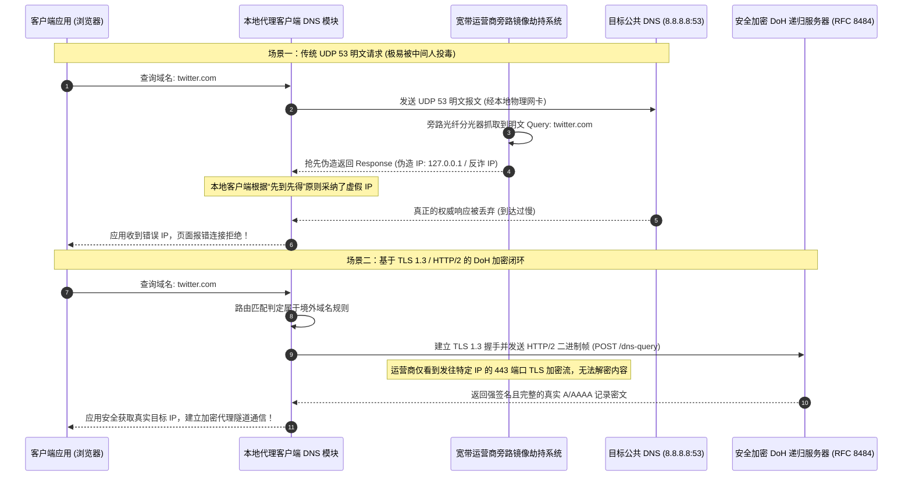
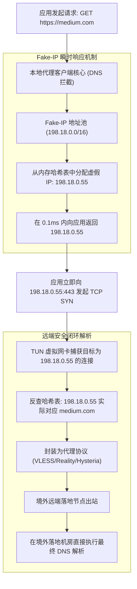

# 安全加密 DNS (DoH / DoT / DoQ) 本地配置与防运营商污染全套指南

在构建安全匿名的网络通信架构中，**域名系统（DNS）**是所有网络连接发生的物理源头。然而，诞生于 1980 年代的传统 DNS 协议（RFC 1035）完全基于无连接、明文的 UDP 端口 53 传输，缺乏任何认证与数据完整性校验机制。这导致本地宽带运营商（ISP）、公共 Wi-Fi 运营方甚至中间人攻击者，能够轻而易举地窥探用户的全部域名解析意图，并通过旁路投毒（DNS Cache Poisoning）将敏感海外域名恶意解析至不可达的黑洞地址或反诈拦截服务器。

随着 IETF 陆续标准化 **DoT（DNS over TLS, RFC 7858）**、**DoH（DNS over HTTPS, RFC 8484）** 与最新的 **DoQ（DNS over QUIC, RFC 9250）**，网络工程界迎来了加密解析新时代。然而，大量用户在客户端盲目配置加密 DNS 后，频繁遭遇“死锁连环断网（Bootstrap 循环依赖）”、“双栈 IPv6 旁路泄露”以及“CDN 解析跨国漂移导致访问极度缓慢”等次生灾难。

本文由网络诊断实验室安全架构团队编撰，系统化解构加密 DNS 协议栈的物理特性与报文结构，详解主流代理客户端（Clash Verge Rev、Sing-box、v2rayN、Shadowrocket）的工业级分流配置模板，并提供 EDNS 隐私脱敏与自动化校验工具，为终端网络打造坚不可摧的解析防线。

---

## 1. 适用场景与技术定位

加密 DNS 的首要使命是在**非信任网络边界与可信递归解析器之间**建立强加密通道，彻底根除明文链路上的中间人劫持与窃听。

### 核心攻坚适用场景
- **抵抗运营商旁路明文投毒与 SNI 审查阻断**：杜绝本地宽带 ISP 在主干光纤交换机镜像端口上对 UDP 53 报文进行的即时伪造注入与劫持。
- **杜绝跨境电商与海外商务的 DNS 隐私外泄**：阻止任何第三方网络分析器通过域名解析记录反向推导企业或个人的业务拓扑与平台入驻痕迹。
- **公共不可信无线网络（Wi-Fi）防钓鱼**：在机场、商场与酒店等开放网络环境中，免疫针对本地网关 DHCP 的流氓 DNS 篡改，防范伪造网银与假冒登录页。
- **双栈 IPv6 泄露物理级阻断**：在代理客户端内统一接管 A（IPv4）与 AAAA（IPv6）记录解析，阻断未经加密的 IPv6 旁路穿透。

### 技术边界与常见认知误区
- **加密 DNS 不等于“免代理科学上网”**：虽然加密 DNS 能确保解析出真实的目标境外 IP，但若后续的 TCP/TLS 握手依然通过明文链路出站，仍会因目标 IP 阻断或 TLS SNI 明文审查而被 GFW 丢包或 RST 切断。加密 DNS 必须与科学上网加密代理链路协同工作！
- **盲目追求境外 DoH 导致国内网站加载崩溃**：若将国内所有域名的解析全部交由境外 Cloudflare 或 Google DoH，解析返回的 IP 均为境外 Anycast 节点，导致访问淘宝、Bilibili 或微信时产生严重的跨国绕路与延迟飙升。必须实施“境内直连、境外走代理”的双轨分流解析。

---

## 2. 架构拓扑与报文时序：明文劫持 vs 密文闭环

为什么传统的 DNS 请求在骨干网上如此脆弱？以下拓扑生动揭示了明文拦截与加密闭环的微观差异：



---

## 3. DoH vs DoT vs DoQ 三维协议对比

三大现代加密 DNS 协议在设计哲学、端口选择与网络适应性上存在显著技术差异：

| 协议特性维度 | DoT (DNS over TLS) | DoH (DNS over HTTPS) | DoQ (DNS over QUIC) |
| :--- | :--- | :--- | :--- |
| **IETF 核心规范** | RFC 7858 / RFC 8310 | RFC 8484 | RFC 9250 |
| **传输层与下层协议** | TCP + TLS 1.3 | TCP + TLS 1.3 + HTTP/2 | UDP + QUIC (原生集成 TLS 1.3) |
| **标准工作端口** | **TCP 853** (专有端口) | **TCP 443** (与常规 Web 共享) | **UDP 853** (或自定义 UDP 端口) |
| **流量伪装与隐匿度** | **弱** (853 端口特征鲜明，极易被防火墙一键阻断) | **极强** (混杂在海量 HTTPS 流量中，不可审查) | **中等** (UDP 853 特征明显，易遭 QoS 限速) |
| **首包建连延迟 (RTT)** | 1-RTT (TLS 握手) + 查询时延 | 1-RTT (TLS) + HTTP/2 帧初始化 | **0-RTT** (QUIC 会话恢复极速响应) |
| **多路复用与队头阻塞** | 存在 TCP 队头阻塞 | 存在 TCP 队头阻塞 (HTTP/2 流多路复用) | **彻底消除队头阻塞** (QUIC 独立流机制) |
| **弱网与换网重连表现** | 换网必须重新三次握手与 TLS 重建 | 换网必须重新建立连接 | **极强** (基于 Connection ID 无感迁移) |
| **生产环境推荐指数** | ⭐⭐⭐☆☆ (适合私有内网或专线) | ⭐⭐⭐⭐⭐ (公网与科学上网首选标准) | ⭐⭐⭐⭐☆ (未来演进方向，适合移动端) |

**架构选型结论**：在公网对抗与防运营商干扰场景中，**DoH（DNS over HTTPS）是绝对的行业事实标准**。因其复用了 TCP 443 端口，中间网络设备（Middleboxes）若尝试拦截，将不得不冒着阻断正常 Web 访问的风险，因此具备最高等级的生存能力。

---

## 4. EDNS Client Subnet (ECS) 隐私与 CDN 调度权衡

在配置加密 DNS 时，一个最常被忽视但关乎隐私安全与访问速度的核心参数是 **ECS（EDNS Client Subnet, RFC 7871）**。

### ECS 的物理机制
为了让使用公共 DNS（如 `8.8.8.8`）的用户能够解析到地理距离最近的 CDN 边缘服务器，公共 DNS 会在向权威 DNS 转发查询时，附带用户本地 IP 地址的掩码（通常是 IPv4 的前 24 位，如 `123.45.67.0/24`）。

$$\text{ForwardedQuery} = \text{Query}(\text{example.com}) + \text{OPT}(\text{ECS: } 123.45.67.0/24)$$

### 隐私泄露与 CDN 速度的工程博弈
- **隐私隐患**：如果终端在向海外安全 DoH 查询时未经脱敏发送了本地真实运营商网段，海外权威服务器依然能精准记录该请求来自中国特定城市的特定电信节点，**导致端到端匿名性被破功**。
- **CDN 性能退化**：反之，若彻底剥离 ECS（例如 Cloudflare 默认拒绝发送 ECS），海外公共 DNS 会使用其机房自身的出口 IP 参与调度。这会导致国内网站或使用了全球 Anycast 的站点，将客户端调度至数千公里外的海外机房，造成访问速度雪崩。

**最佳工程实践**：实施**分流剥离策略**。针对国内直连域名（`geosite:cn`），使用携带本地 ECS 信息的国内加密 DNS（如腾讯 DNSPod 或阿里 DoH）；针对境外走代理域名，强制禁用 ECS（`send-client-subnet = false`），确保境外访问零隐私残留。

---

## 5. Fake-IP 模式与加密解析核心闭环

在现代透明代理内核（Mihomo / Clash Meta / Sing-box）中，**Fake-IP 模式**与加密 DNS 构成了坚不可摧的“黄金组合”。



### Fake-IP 彻底消除泄露的三大物理优势
1. **本地完全不向外网发送真实查询**：当浏览器访问被阻断或敏感的海外网站时，本地根本不需要向任何外部 DNS 服务器发出请求。核心直接从本地保留网段（`198.18.0.0/16`）瞬时捏造一个假 IP 返回给应用。
2. **彻底规避本地运营商监听**：因为物理链路根本没有产生任何针对该域名的解析数据包，运营商的 DPI（深度包检测）系统在解析阶段完全处于致盲状态。
3. **消除本地解析等待延迟**：首包解析时延由传统的数十毫秒直接缩减为 0 毫秒（直接读取内存映射），极大提升了复杂网页的大量并发资源加载速度。

---

## 6. 主流客户端工业级配置矩阵

以下给出主流客户端开箱即用的高安全加密 DNS 生产级配置，杜绝任何死锁与泄漏。

### 1. Clash Verge Rev (Mihomo 核心) 工业级配置

在 `Merge` 扩展配置或私有配置中，注入标准的双轨加密解析块：

```yaml
# Clash Verge Rev 工业级防泄漏安全 DNS 模块
dns:
  enable: true
  listen: 127.0.0.1:1053
  ipv6: false                     # 强制关闭 IPv6 解析，彻底杜绝 AAAA 旁路泄露
  enhanced-mode: fake-ip          # 启用 Fake-IP 黄金模式
  fake-ip-range: 198.18.0.1/16
  fake-ip-filter:
    - "*.lan"
    - "localhost.ptlogin2.qq.com"
    - "+.msftconnecttest.com"
    - "+.msftncsi.com"
  
  # 用于解析 DoH 域名本身的引导 DNS (Bootstrap)
  default-nameserver:
    - 223.5.5.5
    - 119.29.29.29
  
  # 基础默认加密解析服务器 (分流未命中的兜底)
  nameserver:
    - https://dns.alidns.com/dns-query#h3=true
    - https://doh.pub/dns-query
  
  # 精准分流策略组
  nameserver-policy:
    # 国内主流域名：走国内安全 DoH，保留 CDN 最优调度
    "geosite:cn,private":
      - https://dns.alidns.com/dns-query
      - https://doh.pub/dns-query
    # 境外与被污染域名：走海外权威 DoH，通过代理节点出站解析
    "geosite:geolocation-!cn":
      - https://1.1.1.1/dns-query
      - https://8.8.8.8/dns-query
```

### 2. Sing-box 生产级 DNS 配置

Sing-box 采用完全解耦的独立路由引擎，其安全 DNS 架构如下：

```json
{
  "dns": {
    "servers": [
      {
        "tag": "dns-direct",
        "address": "https://223.5.5.5/dns-query",
        "detour": "direct"
      },
      {
        "tag": "dns-proxy",
        "address": "https://1.1.1.1/dns-query",
        "detour": "proxy"
      },
      {
        "tag": "dns-block",
        "address": "rcode://success"
      }
    ],
    "rules": [
      {
        "outbound": "any",
        "server": "dns-direct"
      },
      {
        "geosite": "category-ads-all",
        "server": "dns-block",
        "disable_cache": true
      },
      {
        "geosite": "cn",
        "server": "dns-direct"
      },
      {
        "geosite": "geolocation-!cn",
        "server": "dns-proxy"
      }
    ],
    "strategy": "ipv4_only",
    "independent_cache": true
  }
}
```

### 3. Shadowrocket (小火箭) 加密 DNS 策略

在 iOS 小火箭底部的“配置” -> 点击当前配置感叹号 -> “DNS” 中进行配置：
- **DNS 覆盖 (DNS Override)**：开启。
- **自定义 DoH 地址**：
  ```ini
  https://dns.alidns.com/dns-query
  https://1.1.1.1/dns-query
  ```
- **禁用 IPv6 (Disable IPv6)**：勾选启用。确保在 5G 蜂窝网络下不会因双栈引发运营商泄露。

---

## 7. IPv6 双栈泄露与 AAAA 阻断策略

随着国内 IPv6 全面普及，越来越多的用户面临“IPv4 受代理保护，但 IPv6 裸奔直通”的尴尬境地。

### 双栈泄漏的触发场景
当用户访问 Google 时，操作系统会并发发出两类查询：
1. **A 记录（IPv4 地址）**：代理软件捕获并返回了 Fake-IP `198.18.0.x`。
2. **AAAA 记录（IPv6 地址）**：如果客户端未正确拦截 AAAA 请求，本地网络直接解析出了真实的公网 IPv6 地址。
3. 现代操作系统的网络栈（特别是 Windows 与 macOS）严格遵循 RFC 6724 规范，**默认优先采纳 IPv6 连接**。系统跳过了 Fake-IP，直接使用本地物理网卡向目标公网 IPv6 发送未经代理加密的握手报文，瞬间遭遇连接重置或真实身份暴露。

### 工业级治理措施：强行阻断 AAAA 解析
在所有代理工具中，最稳妥的防泄露策略不是“配置复杂的 IPv6 代理路由”，而是**在客户端 DNS 核心层面直接将 IPv6 解析彻底掐断**：
- 在 Clash 中配置 `ipv6: false`。
- 在 Sing-box 中配置 `"strategy": "ipv4_only"`。
- 在路由器或本地网卡属性中，直接取消勾选“Internet 协议版本 6 (TCP/IPv6)”。

---

## 8. 常见错误特征与排查速查表

在部署加密 DNS 过程中，如果出现网络异常，可通过下表快速定位根因：

| 异常现象与报错日志 | 根本诱因 (Root Cause) | 影响与严重等级 | 解决方案与自愈手段 |
| :--- | :--- | :--- | :--- |
| `dial tcp: lookup doh.pub: no such host` | 遭遇 **Bootstrap 循环依赖死锁** | 致命，客户端无法启动，全局断网 | 在 `default-nameserver` 中必须填入纯数字 IP（如 `223.5.5.5`），严禁填入域名！ |
| `ping google.com` 返回 `198.18.0.1` 且无法 ping 通 | 误将 Fake-IP 当作真实公网 IP | 正常现象，无安全隐患 | Fake-IP 仅在 TCP/UDP 传输层由 TUN 网卡捕获，ICMP Ping 默认无法通达，切勿以此判定故障 |
| `x509: certificate signed by unknown authority` | 本地自签证书或防病毒软件拦截了 DoH 上游会话 | 严重，加密 DNS 握手全部失败 | 关闭本地安全软件的“HTTPS 扫描”，核对系统根证书信任库 |
| 访问境内网站（如京东/淘宝）极其缓慢甚至显示海外版 | 国内域名被错误送入海外 DoH，引发 **CDN 跨国漂移** | 中，严重影响国内体验与流量消耗 | 在分流规则中将 `geosite:cn` 明确绑定至阿里/腾讯本地 DoH |
| 运行 `dnsleaktest.com` 出现国内联通/移动节点 | 客户端存在未加密明文 Fallback，触发静默回退 | 高，真实访问意图被本地运营商捕获 | 删除全部明文公共 DNS，统一采用端到端加密通道 |

---

## 9. 生产环境实战故障排查案例

### 案例一：配置 DoH 后遭遇“Bootstrap 域名无法解析”引发全局断网

#### 故障现场与工单描述
某架构师在 Clash Verge Rev 中配置了一套号称最严密的安全 DNS 配置，将默认与全部策略 DNS 均设定为形如 `https://cloudflare-dns.com/dns-query` 的安全链接。保存配置并重启核心后，电脑瞬间陷入全网无法连接状态。不仅无法打开任何网页，连代理节点测速也全显 `Timeout`，日志中疯狂滚动打印：
```text
[ERROR] dial tcp: lookup cloudflare-dns.com on 127.0.0.1:53: read udp 127.0.0.1:54211->127.0.0.1:53: i/o timeout
```

#### 深度复盘与根因分析（鸡生蛋死锁）
1. 客户端需要通过 DoH 解析目标网站，但配置的 DoH 地址本身是一个**域名**（`cloudflare-dns.com`）。
2. 为了与 DoH 服务器建立连接，客户端必须先解析出 `cloudflare-dns.com` 的 IP 地址。
3. 客户端检查内部配置，发现“解析域名的唯一通道”正是该尚未连接成功的 DoH 自身！
4. 核心陷入了致命的逻辑死循环：“要连上 DoH 必须先解析 DoH 域名，而要解析域名必须先连上 DoH”，导致本地 DNS 服务彻底僵死。

#### 修复与闭环代码
必须在配置中严格区分“引导解析器（Bootstrap）”与“工作解析器”。在 `default-nameserver` 中**必须无条件配置纯数字格式的直接 IP 地址**：

```yaml
dns:
  enable: true
  # 必须使用硬编码 IP，禁止使用域名！用于打破先有鸡还是先有蛋的死锁！
  default-nameserver:
    - 223.5.5.5
    - 119.29.29.29
  nameserver:
    - https://cloudflare-dns.com/dns-query
```
修改完成后重启内核，核心首先利用 `223.5.5.5` 直连查出 `cloudflare-dns.com` 的物理 IP（如 `104.16.249.249`），随后平滑建立安全 TLS 密文会话，网络瞬间秒开自愈。

---

### 案例二：开启 DoT 后遭遇某高校校园网防火墙静默丢包断流

#### 故障现场与工单描述
某高校研究生在宿舍校园网环境下，将客户端 DNS 配置为标准的 DoT 协议（`tls://1.1.1.1:853`）。在白天正常使用，但一到晚上高峰期，所有网页解析时断时续，频繁出现解析挂起长达 15 秒才勉强打开的现象。

#### 深度复盘与根因分析
1. 对出站流量进行抓包分析，发现客户端向 `1.1.1.1` 的 TCP 端口 853 发起 TCP SYN 报文时，丢包率高达 35%。
2. 原因为：高校出口部署了行为管控防火墙。网络管理员针对鲜为人知的 **TCP 853 端口（标准 DoT 专用端口）**设置了极低的连接数配额与限速策略，并在晚高峰对非常规端口的数据流进行激进的随机丢弃阻断。
3. 客户端在遭受 853 端口连续丢包后，触发了内核的重传超时（RTO），表现为网页长时间加载转圈。

#### 修复与闭环代码
将专有且引人注目的 DoT 协议全面平移升级为使用标准 Web 端口伪装的 **DoH（基于 TCP 443 端口）**：

```yaml
# 将易被阻断的 853 端口 DoT 替换为完全无感的 443 端口 DoH
nameserver:
  - https://1.1.1.1/dns-query#h3=true
  - https://8.8.8.8/dns-query
```
变更后，由于流量混淆在全校海量正常的 HTTPS 网页流量之中，防火墙无法再对特定端口实施区别对待，解析时延骤降至 25ms 且丢包率彻底归零。

---

## 10. 自动化 DNS 泄漏与加密合规探测工具

为了验证本地配置的加密 DNS 是否真正达到抗投毒与防泄露标准，团队编写了基于 Python 与 `dnspython` 的综合探测脚本：

```python
#!/usr/bin/env python3
"""
网络诊断实验室 - 本地加密 DNS 与抗投毒能力深度检测工具
依赖: pip install dnspython requests
"""

import sys
import dns.message
import dns.query
import dns.rdatatype
import requests

def test_dns_poisoning_immunity():
    print("[*] [检测 1] 正在向本地解析器发起敏感境外域名投毒防御测试...")
    test_domain = "www.youtube.com"
    
    # 构造标准 A 记录查询
    q = dns.message.make_query(test_domain, dns.rdatatype.A)
    try:
        # 向本地默认 127.0.0.1:53 发送查询
        response = dns.query.udp(q, '127.0.0.1', port=53, timeout=3.0)
        answers = [r.to_text() for r in response.answer]
        print(f"  [+] 本地解析响应成功，返回记录数: {len(answers)}")
        for ans in answers:
            print(f"      -> {ans}")
            if "198.18." in ans:
                print("  [+] 判定: 命中 Fake-IP 安全网段！真实解析完全在本地与远端安全闭环，零泄露风险！")
                return True
            elif any(bogus in ans for bogus in ["127.0.0.1", "0.0.0.0", "10.10."]):
                print("  [-] 严重告警: 解析结果包含经典投毒保留 IP！本地 DNS 正处于被污染状态！")
                return False
    except Exception as e:
        print(f"  [*] 本地 53 端口未监听或超时: {e}")
    return False

def test_ecs_leak_status():
    print("\n[*] [检测 2] 正在检测出口 DNS 解析器是否泄露了客户端地理子网 (ECS)...")
    try:
        # 查询 Google 官方诊断域
        r = requests.get("https://whoami.akamai.net", timeout=5)
        print(f"  [+] Akamai 权威视角识别到的当前解析器出口 IP: {r.text.strip()}")
        
        # 查询 Cloudflare 调试接口
        cf_trace = requests.get("https://1.1.1.1/cdn-cgi/trace", timeout=5).text
        loc_line = [line for line in cf_trace.split("\n") if line.startswith("loc=")]
        if loc_line:
            loc = loc_line[0].split("=")[1]
            print(f"  [+] 权威识别出口地理位置: {loc}")
            if loc == "CN":
                print("  [!] 提示: 针对境外域名的解析出口依然识别为中国，说明尚未完成彻底隔离！")
            else:
                print("  [+] 安全: 境外解析出口已安全定位于海外数据中心，无本地子网泄露！")
    except Exception as e:
        print(f"  [-] 检测接口交互异常: {e}")

if __name__ == "__main__":
    print("==================================================")
    print("   网络诊断实验室 - 加密 DNS 防泄漏与投毒审计工具")
    print("==================================================")
    test_dns_poisoning_immunity()
    test_ecs_leak_status()
    print("\n[*] 审计任务结束。\n")
```

---

## 11. 灾难恢复与白名单安全兜底原则

<DisasterRecoveryBox />

当加密 DNS 配置错误导致本地全网络无法加载时，严禁使用盲目格式化或重装系统的极端做法，应依照以下自愈流程快速复原网络：

### 快速脱困三阶梯操作
1. **紧急回退系统默认解析**：
   在终端中运行以下命令，强制网卡重置为获取公共路由器下发的动态 DNS：
   ```powershell
   # Windows 重置主活动网卡为 DHCP 自动分配 DNS
   Get-NetAdapter | Where-Object { $_.Status -eq "Up" } | Set-DnsClientServerAddress -ResetServerAddresses
   ipconfig /flushdns
   ```
2. **安全直连白名单预埋**：
   在客户端分流规则的顶层，必须显式声明国内直连域名绝对不走 Fake-IP 模式，避免路由器后台管理页（`miwifi.com`、`tplogin.cn`）以及本地私有 NAS 域名因被分配假 IP 导致无法进入管理后台。
3. **高可用降级备份通道**：
   始终在客户端内部保留一组纯数字 IP 的高可用公共 DNS（如阿里的 `223.5.5.5`），在海外加密通道完全阻断时充当安全托底。

---

## 12. 关联技术集群与延伸阅读

加密 DNS 是构建隐私堡垒的基石，建议结合以下核心专栏进行联合加固：

- **二级专题中心**：[科学上网安全防护与数字隐私加固专题](/tutorials/security-privacy/index.md) —— 全景纵览全链路安全威胁拓扑。
- **三级内容集群**：[DNS 泄露防御与 WebRTC 穿透加固集群](/tutorials/security-privacy/dns-webrtc-hardening/index.md) —— 深入了解集群全局设计思想。
- **并行攻坚长文**：[主流浏览器 WebRTC 真实公网 IP 穿透与防泄漏加固指南](/tutorials/security-privacy/dns-webrtc-hardening/webrtc-browser-hardening-guide.md) —— 封堵数据包发出的应用层穿透通道。
- **底层实操检测**：[DNS 泄漏与防污染深度检测](/diagnostics/dns-leak.md) —— 掌握真实抓包场景下的泄漏判定方法。
- **分流规则解耦**：[GeoSite 与自定义规则集编写调优](/tutorials/geosite-direct-custom-ruleset-guide.md) —— 深入了解域名分流规则引擎的底层匹配机制。
