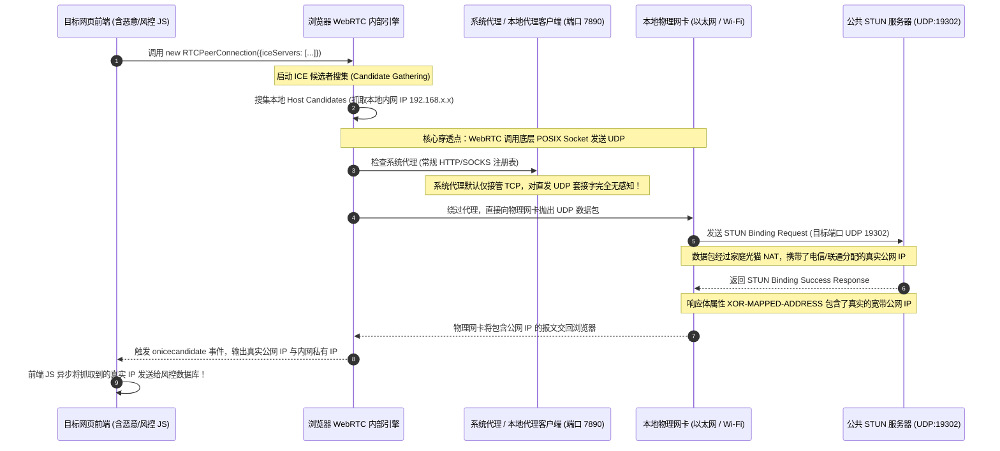
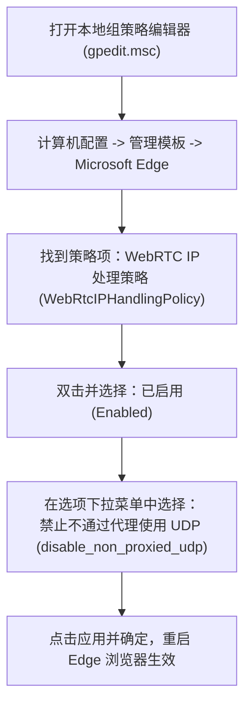

# 主流浏览器 WebRTC 真实公网 IP 穿透与防泄漏加固指南

在数字身份隐匿、跨境网络运维与多账号合规防关联领域，**WebRTC（Web Real-Time Communication）IP 穿透泄露**被称为最致命且隐蔽的“阿喀琉斯之踵”。无数工程师和运营人员在电脑上开启了全局代理，使用 IP 查询工具确认出口已显示为海外数据中心，然而在目标站点的安全风控系统眼中，其真实的物理机房局域网 IP（如 `192.168.1.55`）甚至国内宽带运营商分配的公网 IPv4/IPv6 地址却一览无余。

这种“代理掩护彻底失效”的现象并非代理协议被破解，而是浏览器内置的实时音视频通信协议栈在执行标准规范时，绕过代理层向外探测所致。本文由网络诊断实验室安全架构团队编撰，系统化剖析 WebRTC ICE 框架与 STUN 协议的物理工作原理，详解各主流浏览器（Chrome、Edge、Firefox、Safari）的底层策略配置，并给出企业级组策略下发与自动化检测代码，为终端安全加固提供工业级技术闭环。

---

## 1. 适用场景与技术定位

WebRTC 是 W3C 与 IETF 联合制定的浏览器原生音视频通信标准，旨在让浏览器无需安装任何插件即可实现点对点（P2P）低延迟音视频通话与数据传输。然而，在科学上网与匿名通信场景中，其底层设计哲学与代理隐私保护存在根本性的冲突。

### 核心受害与防护场景
- **跨境电商与海外社交账号矩阵防关联**：亚马逊、eBay、TikTok、PayPal 等跨国风控系统，通过前端注入一行微型 JavaScript 代码调用 WebRTC API，毫秒级读取访问者的真实宽带公网 IP 与本地网卡私有 IP，将同一物理环境下的多账号瞬间标记并关联封禁。
- **涉密调研与敏感业务流量审计防御**：防止本地 ISP 或针对性渗透方通过在目标页面布置 WebRTC 探针，穿透代理直接捕捉终端的物理真实地理归属。
- **双栈 IPv6 意外旁路封堵**：当代理客户端仅接管了系统的 IPv4 协议栈时，WebRTC 的候选收集器会优先探测物理网卡直通的公网 IPv6 地址并直接回传给服务器。

### 技术边界与副作用预警
- **协作软件兼容性妥协**：彻底禁用 WebRTC 将直接导致网页版 Google Meet、Discord 网页语音、Zoom 网页端以及腾讯会议网页版无法建立音视频推拉流。用户需权衡“全局彻底封死”与“基于多 Profile 隔离”的工程选型。

---

## 2. 架构拓扑与报文时序：STUN 穿透机理

为什么系统代理（System Proxy）无法阻止 WebRTC 泄露真实 IP？理解其底层通信拓扑是制定防护策略的前提。



从上述微观时序可以看出，传统的**系统代理模式（修改 Windows IE 代理设置或 macOS 网络偏好设置）**仅对遵循系统代理约定的上层应用层 HTTP/HTTPS/Socks5 TCP 流量生效。而 WebRTC 是在浏览器沙盒内部直接调用操作系统网络驱动，向远端 STUN 服务器广播 UDP 探测包。除非在操作系统内核层通过 TUN 网卡强制拦截所有 UDP 出站，否则应用层必须主动实施加固。

---

## 3. WebRTC 四大 IP 处理策略策略机理

在 Chromium 源码架构中，Google 为解决 WebRTC 的隐私争议，引入了 `WebRtcIPHandlingPolicy`（WebRTC IP 处理策略枚举）。理解这四种模式的边界是所有 Chromium 体系浏览器（Chrome、Edge、Brave、Vivaldi）调优的核心基准：

| 策略枚举名称 | 候选者搜集行为（ICE Candidates） | 代理兼容度 | 真实 IP 泄露风险 | 推荐适用场景 |
| :--- | :--- | :--- | :--- | :--- |
| **`default`** | 搜集所有物理网卡、虚拟网卡上的所有 IPv4/IPv6 与 STUN 反射地址 | 完全无视系统代理 | **极高 (100% 泄露)** | 原生默认状态，严禁在代理环境下使用 |
| **`default_public_and_private_interfaces`** | 搜集默认网关上的私网 IP 与公网 IP，略过非活动适配器 | 略微降低多网卡干扰 | **高 (依然泄露公网 IP)** | 局域网常规办公 |
| **`default_public_interface_only`** | 仅通过默认网络接口搜集公网反射地址，强制隐藏局域网私网 IP | 依赖默认出口 | **中 (仍可能被 STUN 反射)** | 仅需隐藏内网 IP 的常规环境 |
| **`disable_non_proxied_udp`** | **强制禁止任何不经过代理的 UDP 通信**，仅允许通过代理连接传输 WebRTC | 完美契合代理客户端 | **零泄露 (完全隐匿)** | **跨境电商、安全运维与匿名通信唯一推荐** |

当配置为 `disable_non_proxied_udp` 时，Chromium 内核会强制切断一切绕过代理的本地 Socket 创建请求。若当前代理通道不支持 UDP 转发，WebRTC 将直接放弃建立直连，或者退化为通过代理服务器中继（TURN 模式），从而实现物理级的公网 IP 彻底防护。

---

## 4. Chrome & Chromium 体系彻底防御实战

针对 Google Chrome 及所有基于 Chromium 内核的衍生浏览器，存在三种不同层级的防御手段，建议根据权限由深至浅依次部署：

### 方法一：启动参数物理锁定（最高优先级，绝对免疫）
在 Chrome 桌面快捷方式的目标路径后追加启动参数，直接在引擎引导阶段锁定网络策略：

```bash
# Windows 快捷方式目标添加参数示例：
"C:\Program Files\Google\Chrome\Application\chrome.exe" --force-webrtc-ip-handling-policy=disable_non_proxied_udp

# macOS 终端启动命令：
/Applications/Google\ Chrome.app/Contents/MacOS/Google\ Chrome --args --force-webrtc-ip-handling-policy=disable_non_proxied_udp
```

### 方法二：企业级组策略 / 注册表硬编码（防篡改标准）
在 Windows 操作系统中，通过直接覆写注册表策略，可防止任何扩展程序或网页脚本擅自恢复默认设置。

以管理员身份启动 PowerShell，执行以下注册表写入指令：

```powershell
# 创建 Chrome 策略注册表键值
$chromePolicyPath = "HKLM:\SOFTWARE\Policies\Google\Chrome"
if (!(Test-Path $chromePolicyPath)) {
    New-Item -Path $chromePolicyPath -Force | Out-Null
}

# 强制将 WebRTC 处理策略锁定为 disable_non_proxied_udp
Set-ItemProperty -Path $chromePolicyPath -Name "WebRtcIPHandlingPolicy" -Value "disable_non_proxied_udp" -Type String

Write-Host "[+] Google Chrome WebRTC 安全策略已成功写入注册表！" -ForegroundColor Green
```

### 方法三：应用层开源安全扩展挂载
若受限于受控环境无法修改注册表或启动快捷方式，可在 Chrome 网上应用店安装具备良好声誉的开源加固扩展：
- **WebRTC Control**：提供单选按钮一键将底层 API 切换为完全伪装或禁用。
- **uBlock Origin**：在设置面板的“隐私”选项卡中，勾选“避免 WebRTC 泄露本地 IP 地址”。该功能在底层会直接向浏览器注入对应的阻止策略。

---

## 5. Edge 组策略与 Windows 注册表加固

Microsoft Edge 与 Windows 10/11 系统的安全机制深度绑定，微软为其提供了专属的企业级策略模板。



### 自动化 PowerShell 注册表写入脚本（适用于家庭版无组策略环境）
针对没有 `gpedit.msc` 的 Windows 家庭版系统，运行以下脚本直接向 Edge 策略注入最高安全指令：

```powershell
<#
.SYNOPSIS
    Microsoft Edge WebRTC 穿透彻底防御自动化配置脚本
#>
$edgePolicyPath = "HKLM:\SOFTWARE\Policies\Microsoft\Edge"
if (!(Test-Path $edgePolicyPath)) {
    New-Item -Path $edgePolicyPath -Force | Out-Null
}

# 1. 禁用非代理 UDP
Set-ItemProperty -Path $edgePolicyPath -Name "WebRtcIPHandlingPolicy" -Value "disable_non_proxied_udp" -Type String

# 2. 限制本地区域网 IP 暴露白名单 (设为空即禁止所有站点搜集本地私有 IP)
Set-ItemProperty -Path $edgePolicyPath -Name "WebRtcLocalIpsAllowedUrls" -Value @() -Type MultiString

Write-Host "[+] Microsoft Edge WebRTC 组策略已强制下发并锁定！" -ForegroundColor Green
```

---

## 6. Firefox Gecko 体系终极加固方案

Mozilla Firefox 采用独立的 Gecko 渲染内核与自主研发的网络协议栈，在隐私控制自由度上远超 Chromium 体系。Firefox 允许用户在底层彻底关停 WebRTC 引擎，实现 100% 的绝对阻断。

### 核心参数调整步骤（`about:config`）
在 Firefox 地址栏输入 `about:config` 并回车，接受风险提示后，检索并修改以下四个基石键值：

```ini
# 1. 全局彻底关停 WebRTC 核心功能 (最强硬核防御，彻底杜绝所有探测)
media.peerconnection.enabled = false

# 2. 若因特定业务必须保留 WebRTC，则保持上一项为 true，强制启用以下三项隔离策略：
# 强制 ICE 仅使用代理通道，严禁物理网卡直出
media.peerconnection.ice.proxy_only = true

# 彻底剥离 Host 本地候选者，不向远程返回任何内网 IP
media.peerconnection.ice.no_host = true

# 仅搜集默认活动网卡地址
media.peerconnection.ice.default_address_only = true
```

> [!TIP]
> 对于追求绝对匿名的安全从业者，强烈建议将 `media.peerconnection.enabled` 直接置为 `false`。此时任何网页尝试执行 `new RTCPeerConnection()` 都会直接抛出 `ReferenceError: RTCPeerConnection is not defined` 异常，前端脚本完全丧失探测能力。

---

## 7. Safari (WebKit) 与 iOS 移动端防穿透规范

Apple 生态在隐私保护上采取了独特的策略。自 iOS 12 与 macOS Mojave 起，Apple 在 WebKit 内核中强制推行了 **mDNS（多播 DNS）候选者混淆机制**。

### 1. macOS 桌面端 Safari 设置
在 macOS 上，Safari 默认会对本地私有 IP 进行 UUID 随机化混淆。但若要进一步防范公网反射，可通过 Safari 开发者菜单强化：
1. 打开 Safari -> “设置” -> “高级” -> 勾选底部的“在菜单栏中显示开发功能”。
2. 依次点击顶部菜单栏“开发” -> “实验功能（Feature Flags）”。
3. 确保勾选 **“WebRTC mDNS ICE candidates”**。
4. 若需要彻底测试禁用，取消勾选 **“WebRTC STUN Candidate Handling”**。

### 2. iOS 移动端防穿透的核心困境与正解
在 iPhone 与 iPad 设备上，由于 iOS 系统的沙盒强约束，**任何第三方浏览器（包括 Chrome iOS、Edge iOS）在底层均强制使用系统 WebKit 框架**，且苹果未向普通用户开放修改底层 WebRTC 策略的开关。

因此，在 iOS 设备上防范 WebRTC 穿透，唯一的工业级方案是在**代理客户端层面（Shadowrocket、Quantumult X、Loon、Surge）**阻断 STUN 协议：

```ini
# Shadowrocket / Surge 规则配置示例：直接在路由层将 STUN 端口强行 REJECT
[Rule]
# 拦截 Google 与公共主流 STUN 探测端口 (UDP:19302 与 UDP:3478)
AND,((DEST-PORT,19302),(PROTOCOL,UDP)),REJECT-DROP
AND,((DEST-PORT,3478),(PROTOCOL,UDP)),REJECT-DROP
DOMAIN-KEYWORD,stun,REJECT-DROP
DOMAIN-SUFFIX,stun.l.google.com,REJECT-DROP
```

通过在本地虚拟 TUN 网卡出口直接丢弃针对 STUN 服务的 UDP 请求，即可在 iOS 系统层面阻断应用层提取反射 IP 的能力。

---

## 8. mDNS 随机化混淆机理与技术局限

许多用户在测试 WebRTC 时，发现返回的 IP 变成了一串形如 `4f8c9b2d-7a1e-4c3d-8f0a-1b2c3d4e5f6a.local` 的字符串，误以为已经实现了完全安全。这其实是 IETF RFC 8828 规范定义的 **mDNS 候选者混淆机制**。

### mDNS 的运行机理
为了防止网页收集内部局域网拓扑（例如推测公司内网网段 `10.240.x.x`），浏览器不再直接向页面输出真实的本地私有 IPv4 地址，而是在操作系统本地注册一个伪随机生成的 UUID，并将其映射为 `.local` 本地域名。

### 为什么 mDNS 无法防范公网 IP 泄露？
$$\text{CandidateTypes} = \{ \text{Host (mDNS混淆)}, \underbrace{\text{Server Reflexive (STUN反射)}}_{\text{依然泄露真实公网IP!}}, \text{Relayed (中继)} \}$$

如公式所示，mDNS 混淆**仅仅保护了内网私有 IP（Host Candidate）**。当网页通过 STUN 服务器获取到通过路由器 NAT 映射后的公网地址（Server Reflexive Candidate，简称 `srflx`）时，该公网 IP 依然以明文形式直接呈现在前端控制台。因此，**单纯依赖 mDNS 无法解决跨国跨境访问中的真实外网 IP 泄露！**

---

## 9. 跨平台加固方案横评对照表

综合评估各类浏览器在加固后的安全防护力与日常实用性：

| 浏览器与内核 | 核心防御手段 | 真实公网 IP 阻断率 | 内网 IP 隐匿度 | 音视频会议兼容性 | 企业批量部署难度 | 推荐指数 |
| :--- | :--- | :--- | :--- | :--- | :--- | :--- |
| **Firefox (Gecko)** | `media.peerconnection.enabled = false` | **100% (物理熔断)** | **100% (彻底阻断)** | 网页会议无法使用 | 极低 (`user.js` 统一推送) | ⭐⭐⭐⭐⭐ (极客与高危业务首选) |
| **Edge (Chromium)** | 组策略 `disable_non_proxied_udp` | **100% (代理接管)** | **100% (强制隐藏)** | 经代理转发仍可正常使用 | 极低 (AD 域控 / GPO 秒下发) | ⭐⭐⭐⭐⭐ (企业办公最佳平衡) |
| **Chrome (Chromium)** | 注册表策略 / 启动参数注入 | **100% (代理接管)** | **100% (强制隐藏)** | 经代理转发仍可正常使用 | 低 (支持企业策略注册表) | ⭐⭐⭐⭐☆ (主力浏览器标准解) |
| **Brave 浏览器** | 内置“Fingerprinting & WebRTC”开关 | **100% (内置沙盒)** | **100% (智能混淆)** | 需手动按站点白名单放行 | 中 (个人手动调整) | ⭐⭐⭐⭐☆ (开箱即用隐私型) |
| **Safari (iOS/macOS)** | 系统 mDNS + 客户端丢弃 STUN UDP | **95% (需代理协同)** | **100% (原生 mDNS)** | 依赖代理核心 UDP 调度 | 高 (受限于 iOS 沙盒) | ⭐⭐⭐☆☆ (苹果移动生态妥协方案) |

---

## 10. 生产环境实战故障排查案例

### 案例一：跨境独立站卖家因 WebRTC 穿透导致 PayPal 提现账户被永久冻结

#### 故障现场与工单描述
某跨境独立站运营公司在深圳办公，旗下 5 名员工使用同一台办公台式机分别登录不同国家的 PayPal 商业账户进行日常收付款。网络配置使用了高端静态原生美国住宅代理，并在每次登录前清理浏览器缓存与 Cookie。然而在某次例行提现时，两个高流水账户同时收到“由于存在高风险异常登录，账户已被永久冻结”的通知邮件。

#### 调查排查与根因深度解构
1. 安全人员调取当班员工使用的 Chrome 浏览器环境，发现其仅在浏览器中安装了普通的 SwitchyOmega 插件将流量路由至本地端口。
2. 打开 `browserleaks.com/webrtc` 进行实测，页面瞬间在 `Remote IP Address` 一栏清晰显示出了深圳电信的宽带公网 IP。
3. 原因为：PayPal 前端安全风控体系部署了高频 WebRTC 探针。当员工在未加固的 Chrome 中发起登录操作时，虽然 HTTP 认证请求通过了美国住宅代理节点，但后端的反欺诈引擎通过 WebRTC 旁路捕获到了深圳的本地宽带 IP。
4. 风控数据库检测到登录会话中同时存在相隔数万公里的双重公网 IP，触发反洗钱（AML）红线，实施不可逆冻结。

#### 修复与闭环代码
1. 立即停止使用单一浏览器多开，引入专业的指纹隔离浏览器，并在主环境 Chrome 中执行组策略注入：
   ```powershell
   Set-ItemProperty -Path "HKLM:\SOFTWARE\Policies\Google\Chrome" -Name "WebRtcIPHandlingPolicy" -Value "disable_non_proxied_udp" -Type String
   ```
2. 在本地网关路由器上部署 iptables 防火墙策略，彻底阻断全局域网发往外部常见公共 STUN 端口的数据报文。
3. 后续重构环境后，WebRTC 返回值稳定维持为 `n/a`，业务恢复平稳运转。

---

### 案例二：加固 WebRTC 后跨国企业海外面试平台黑屏报错

#### 故障现场与工单描述
某互联网大厂安全部门根据合规要求，对全体研发员工的办公电脑统一通过域控强制下发了 `media.peerconnection.enabled = false`。下发后第二天，人事与海外招聘团队反馈紧急故障：所有 HR 与面试官在通过浏览器登录海外招聘平台进行视频面试时，视频窗口全黑，控制台疯狂报错 `DOMException: Could not start video source` 与 `RTCPeerConnection is undefined`，面试流程完全中断。

#### 调查排查与根因深度解构
1. 故障原因在于安全团队采取了“一刀切”的激进方案。面试系统依赖标准的 WebRTC 点对点流媒体交换，由于 API 被从全局作用域中直接注销，前端框架无法完成信令协商。
2. 招聘与面试业务本身需要音视频交互，但并不属于匿名涉密业务，与涉密跨境调试存在场景冲突。

#### 修复与规整方案
1. 废除针对全局办公环境的强行停用策略，改为精准的分权分域治理模式。
2. 面试官专属电脑将策略调整为平衡模式：
   ```ini
   # 允许 WebRTC 运行，但仅允许使用默认活动网卡并隐藏私有 IP
   WebRtcIPHandlingPolicy = default_public_interface_only
   ```
3. 对于高度涉密岗位的设备，指导其建立**双 Profile 双轨制**：主力工作空间（Profile A）完全禁用 WebRTC，音视频办公空间（Profile B）单独放行并限定企业内网代理节点接入。视频会议系统顺利恢复，两类业务各得其所。

---

## 11. 自动化 WebRTC 泄露检测与合规校验脚本

在批量终端维护或自动化回归测试中，可利用基于 Node.js 与 Puppeteer 的离线检测脚本，模拟真实恶意网站对当前浏览器的 WebRTC 防护能力进行自动化压力测试：

```javascript
/**
 * 网络诊断实验室 - WebRTC 自动化防穿透合规性巡检脚本
 * 运行依赖: npm install puppeteer
 * 用法: node test_webrtc_leak.js
 */

const puppeteer = require('puppeteer');

(async () => {
    console.log("[*] 正在启动待测浏览器环境并加载 WebRTC 探测探针...");

    // 启动本地受测浏览器，可附带需要测试的加固参数
    const browser = await puppeteer.launch({
        headless: "new",
        args: [
            // 如需测试加固效果，取消下行注释：
            // '--force-webrtc-ip-handling-policy=disable_non_proxied_udp'
        ]
    });

    const page = await browser.newPage();

    // 注入标准 WebRTC 探测脚本
    const detectedIPs = await page.evaluate(async () => {
        return new Promise((resolve) => {
            const ips = new Set();
            
            // 检查 API 是否已被物理注销
            if (typeof RTCPeerConnection === 'undefined') {
                return resolve({ status: "BLOCKED", details: "API Completely Disabled", ips: [] });
            }

            try {
                const pc = new RTCPeerConnection({
                    iceServers: [{ urls: "stun:stun.l.google.com:19302" }]
                });

                pc.createDataChannel("leak_probe");

                pc.onicecandidate = (event) => {
                    if (!event || !event.candidate) {
                        // 候选者收集结束
                        resolve({
                            status: ips.size === 0 ? "PROTECTED" : "LEAKED",
                            details: ips.size === 0 ? "No candidates found" : "IP Exposed",
                            ips: Array.from(ips)
                        });
                        return;
                    }

                    const cand = event.candidate.candidate;
                    // 正则提取 IPv4 地址
                    const ipRegex = /([0-9]{1,3}(\.[0-9]{1,3}){3})/;
                    const match = ipRegex.exec(cand);
                    if (match) {
                        ips.add(match[1]);
                    }
                };

                pc.createOffer().then(offer => pc.setLocalDescription(offer));

                // 设置 5 秒超时保护
                setTimeout(() => {
                    resolve({
                        status: ips.size === 0 ? "PROTECTED" : "LEAKED",
                        details: "Timeout reached",
                        ips: Array.from(ips)
                    });
                }, 5000);

            } catch (err) {
                resolve({ status: "ERROR", details: err.message, ips: [] });
            }
        });
    });

    console.log("\n================ [WebRTC 检测报告] ================");
    console.log(`防泄漏状态: ${detectedIPs.status}`);
    console.log(`执行详情:   ${detectedIPs.details}`);
    
    if (detectedIPs.ips.length > 0) {
        console.error("[-] 严重警报: 检测到 WebRTC 泄露真实 IP 地址:");
        detectedIPs.ips.forEach(ip => console.error(`    -> 暴露地址: ${ip}`));
        console.error("[-] 结论: 当前浏览器处于高危未防护状态，必须立即部署加固！");
    } else {
        console.log("[+] 安全结论: 未能提取到任何明文 IP 地址，加固策略 100% 生效！");
    }
    console.log("====================================================\n");

    await browser.close();
})();
```

---

## 12. 灾难恢复与白名单安全兜底原则

<DisasterRecoveryBox />

当加固策略导致日常音视频会议、企业内网协作系统完全瘫痪时，必须遵循以下灾难恢复规程快速恢复生产力。

### 生产恢复三原则
1. **多 Profile（多配置文件）环境物理隔离**：
   切勿在日常办公的主浏览器与高危涉密浏览器之间频繁修改底层策略。应在 Chrome 或 Edge 中创建独立的“音视频专用 Profile”，仅在该环境中放行特定内部系统的 WebRTC 通信。
2. **紧急快速复原命令（Windows 注册表）**：
   若需立即恢复系统默认设置，以管理员身份运行以下指令即可瞬时移除强制策略：
   ```powershell
   Remove-ItemProperty -Path "HKLM:\SOFTWARE\Policies\Google\Chrome" -Name "WebRtcIPHandlingPolicy" -ErrorAction SilentlyContinue
   Remove-ItemProperty -Path "HKLM:\SOFTWARE\Policies\Microsoft\Edge" -Name "WebRtcIPHandlingPolicy" -ErrorAction SilentlyContinue
   ```
3. **分流模式兜底保障**：
   在代理客户端中，始终确保将腾讯会议（`*.tencentmeeting.com`）、飞书（`*.feishu.cn`）以及钉钉域名划入直连白名单，规避代理转发引入的音视频高抖动与卡顿。

---

## 13. 关联技术集群与延伸阅读

WebRTC 防穿透仅是端到端安全的第一道闸门，建议结合以下模块搭建坚不可摧的数字隐私堡垒：

- **二级专题中心**：[科学上网安全防护与数字隐私加固专题](/tutorials/security-privacy/index.md) —— 全景纵览终端安全架构与威胁建模。
- **三级内容集群**：[DNS 泄露防御与 WebRTC 穿透加固集群](/tutorials/security-privacy/dns-webrtc-hardening/index.md) —— 深入了解集群全景拓扑与长文分工。
- **并行攻坚长文**：[安全加密 DNS (DoH / DoT / DoQ) 本地配置与防运营商污染全套指南](/tutorials/security-privacy/dns-webrtc-hardening/secure-dns-doh-dot-privacy-configuration.md) —— 封堵数据包发出的第二道关键解析泄露口。
- **底层排错联动**：[WebRTC 泄漏与 DoH 测速实战](/diagnostics/dns-leak-prevention/webrtc-doh/webrtc-ip-leak-stun-fix.md) —— 掌握真实抓包场景下的 STUN 阻断分析技巧。
- **分流规则定制**：[自定义分流规则与国内白名单优化](/tutorials/rule-modes/custom-rules/china-domain-ip-whitelist-direct-tuning.md) —— 避免加固策略误伤国内正常音视频服务。
