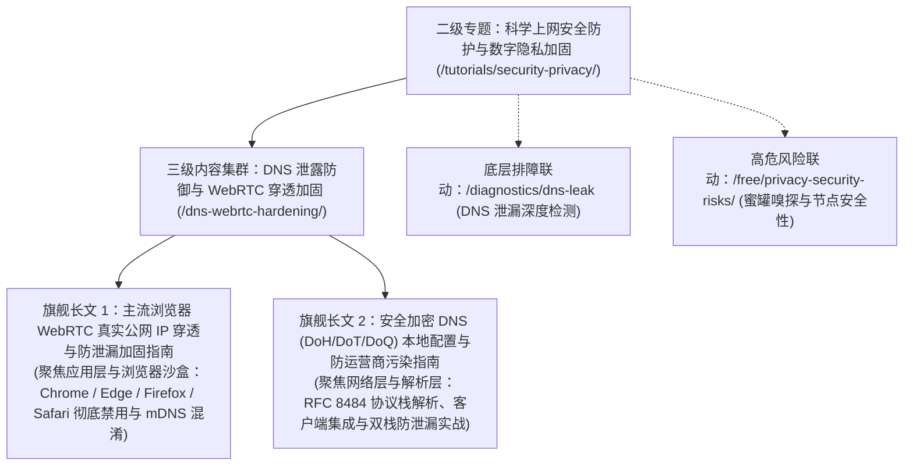
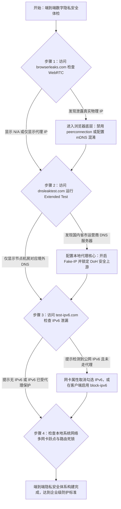

# 科学上网安全防护与数字隐私加固专题

在现代网络安全对抗与跨境流量传输体系中，“开启代理”仅仅解决了链路层面的可达性问题，远未实现真正的匿名与端到端隐私安全。绝大多数用户普遍存在致命误区，误以为只要客户端显示“已连接”或者“已开启全局代理”，自身在公网上的行为就彻底隐匿。然而，在复杂的多层协议栈中，浏览器的实时音视频通信机制（WebRTC）、操作系统底层的双栈解析（IPv4 / IPv6 DNS）、未加密的套接字旁路通信以及本地网络指纹，都能在用户毫不知情的情况下，直接将真实公网 IP 与物理地理位置暴露无遗。

本专题由网络诊断实验室联合资深渗透测试与网络安全架构团队编撰，旨在为技术人员、安全敏感行业从业者及追求极致隐私的极客用户，建立一套覆盖应用层、传输层与操作系统底座的三维安全防护与隐私加固体系。

---

## 1. 适用场景与技术定位

本二级专题在《科学上网新手使用教程与基础指南》（`/tutorials/`）大专题中承担“安全与隐私中枢”定位。它连接了基础安装分流与深层协议逆向，为用户提供工业级防护基准。

### 核心覆盖场景
- **端到端身份防穿透防护**：针对跨国商务、跨境电商多店铺防关联、海外社交平台合规运营等场景，彻底杜绝因网络底层旁路泄露引发的账号关联封禁与风控封锁。
- **本地 ISP 嗅探与 DNS 污染规避**：针对运营商在宽带出口部署的明文 UDP 53 报文劫持、SNI 阻断及 HTTP 缓存投毒，构建本地安全加密解析闭环。
- **多网卡与双栈协议栈防泄露**：解决家庭或企业环境中由于 IPv6 默认旁路直连导致的“IPv4 走代理、IPv6 裸连直通”严重隐私泄露事故。
- **公共 Wi-Fi 与不可信网络加固**：在机场、咖啡厅等开放无线环境中，抵御局域网 ARP 欺骗、SSL 剥离（SSL Stripping）与流氓 DHCP 劫持。

### 禁用与反面模式（Anti-Patterns）
- **盲目迷信“无痕浏览 / Incognito 模式”**：无痕模式仅在本地不保留历史记录与 Cookie，对网络数据包传输完全透明，无法阻止 WebRTC 穿透与 DNS 泄漏。
- **多层代理套娃无序串联**：在缺乏路由规划的情况下盲目嵌套多层 VPN 或代理，不仅引入巨大的延迟抖动，更容易因链路断开触发非预期直连。
- **依赖未经验证的公共免费 DoH 地址**：随意接入未知的第三方免费加密 DNS，容易落入具备日志留存与流量分析能力的恶意中继节点陷阱。

---

## 2. 网络安全边界与端到端威胁拓扑

在典型的网络访问过程中，用户数据需穿过浏览器沙盒、操作系统网络栈、代理客户端内核、物理网络适配器以及运营商骨干网，每个层级均存在独特的泄露面：

```
========================================================================================
【科学上网全链路隐私泄露面与安全防御拓扑】

[应用层: 浏览器 / 桌面软件]
   │
   ├── 泄露面 A: WebRTC STUN 协议旁路请求 ──────────────► [穿透虚拟网卡，直达物理网卡]
   │                                                     └── 暴露真实局域网 IP 与宽带外网 IP
   ├── 泄露面 B: HTML5 Canvas / Audio 浏览器设备指纹 ──► 追踪用户设备唯一硬件特征
   │
[操作系统与解析层: Windows / macOS / Linux]
   │
   ├── 泄露面 C: IPv6 协议栈未接管 ────────────────────► [本地运营商 IPv6 链路直通]
   │                                                     └── 形成双栈割裂，IPv6 真实身份裸奔
   ├── 泄露面 D: 系统多网卡 Metric 跃点冲突 ────────────► [DNS 请求走物理网卡明文 53 端口]
   │                                                     └── 运营商全程监听域名访问清单
   │
[本地代理客户端中枢: Clash / Sing-box / Xray / 小火箭]
   │
   ├── 防御中枢: 规则分流与 Fake-IP / Redir-Host 模式映射
   ├── 加密中枢: 本地安全 DoH / DoT / DoQ 循环向上游安全递归服务器取词
   │
[物理链路层: Wi-Fi / 5G / 光纤宽带]
   │
   └── 加密通道: TLS 1.3 / Reality / Hysteria 2 混淆外层载荷 ──► 远端高防落地节点
========================================================================================
```

从上述拓扑可见，仅在代理客户端层面建立加密通道，若未在应用层遏制 WebRTC 旁路以及在解析层拦截明文 DNS，外部观察者依然可以通过自动化指纹探测脚本，在毫秒级时间内重构出用户的真实物理身份。

---

## 3. 本专题下辖核心集群与深度长文分工

本二级专题下辖聚焦网络穿透与传输安全的核心集群，并规划了两篇工业级万字长文，形成递进式的防护实操体系：



### 两篇旗舰独立长文的核心职能定位
1. **[主流浏览器 WebRTC 真实公网 IP 穿透与防泄漏加固指南](/tutorials/security-privacy/dns-webrtc-hardening/webrtc-browser-hardening-guide.md)**：
   - 深入浏览器底层 WebRTC 架构，详解 ICE（Interactive Connectivity Establishment）框架与 STUN 协议为何能够绕过代理虚拟网卡。
   - 针对 Chromium 体系（Chrome、Edge、Brave）与 Gecko 体系（Firefox），提供从内置 Flags、注册表与组策略到扩展程序的四层彻底阻断实操。
2. **[安全加密 DNS (DoH / DoT / DoQ) 本地配置与防运营商污染全套指南](/tutorials/security-privacy/dns-webrtc-hardening/secure-dns-doh-dot-privacy-configuration.md)**：
   - 全面解构传统 UDP 53 明文域名解析被旁路监听与投毒的物理机理。
   - 深度对比 DoH（基于 HTTP/2）、DoT（基于 TLS 853 端口）与 DoQ（基于 QUIC）的握手时延与抗封锁能力，提供在 Clash Verge、Sing-box、v2rayN 与 Shadowrocket 中的标准配置模板。

---

## 4. 终端安全防护关键参数与指标基准表

评估本地网络环境是否达到工业级安全标准，可依据以下 8 项核心度量衡进行逐项核验：

| 度量衡项目 | 脆弱不合规状态（高风险） | 标准安全状态（合规推荐） | 极致防溯源状态（高级极客） | 检测定位工具 |
| :--- | :--- | :--- | :--- | :--- |
| **WebRTC IP 暴露** | 暴露本地局域网与运营商公网真实 IP | 仅返回代理节点出口 IP 或 mDNS 随机掩码 | 浏览器完全禁用 WebRTC，返回空接口 | `browserleaks.com/webrtc` |
| **DNS 解析归属地** | 显示中国电信 / 联通 / 移动本地机房 IP | 仅显示代理落地节点所在国家的上游 DNS | 私有加密递归 DNS，带 ECS 脱敏掩码 | `dnsleaktest.com` |
| **DNS 传输加密** | 传统明文 UDP 端口 53 传输 | 全量强制 DoH (HTTPS) 或 DoT (TLS) | 本地 SmartDNS / AdGuard Home 混淆转发 | Wireshark 过滤 `udp.port == 53` |
| **IPv6 双栈泄露** | 本地拥有公网 IPv6 且流量直出公网 | 客户端强制拦截或代理接管 IPv6 | 物理网卡彻底关闭 IPv6 协议栈绑定 | `test-ipv6.com` |
| **代理伪装度 (Scamalytics)** | 风险评分高于 50 分，标记为已知机房代理 | 风险评分低于 20 分，标记为普通住宅 | 原生住宅双 ISP 纯净原生 IP 落地 | `ipinfo.io` / `scamalytics.com` |
| **SNI 明文可见性** | 目标域名在 TLS Client Hello 中完全明文 | 采用 ECH（加密客户端 Hello）或专线封装 | 纯私有内网 IEPL 隧道物理隔离 | Wireshark 过滤 `ssl.handshake.extensions_server_name` |
| **浏览器指纹抗性** | Canvas / WebGL 硬件哈希全网唯一 | 开启基础防追踪与指纹随机化混淆 | 专用指纹浏览器沙盒隔离环境 | `amiunique.org` |
| **系统代理死锁容灾** | 退出客户端后系统代理未复原致全局断网 | 客户端具备优雅退出机制与注册表自动自愈 | 内核级透明 TUN 虚拟网卡接管 | PowerShell 注册表检测脚本 |

---

## 5. 常见隐私泄露特征与根因速查表

在多设备使用环境中，出现隐私穿透时通常伴随显著的异常行为特征：

| 故障现象与隐患特征 | 底层技术诱因 (Root Cause) | 影响面与安全风险 | 紧急止血方案 |
| :--- | :--- | :--- | :--- |
| 访问 Google 正常，但访问 IP 查询站显示国内本地 IP | 客户端未接管 UDP 协议，WebRTC 走物理网卡穿透 | 极高，远程站点已捕获真实宽带 IP | 浏览器关闭 WebRTC 或客户端开启全局 TUN 模式 |
| 境外网站打开缓慢，甚至跳转至反诈拦截页 | 本地 DNS 走明文 UDP 53，遭遇运营商 SNI / DNS 投毒 | 极高，访问意图与境外目标完全被明文审计 | 开启 Fake-IP 模式并配置 DoH 加密上游 |
| 账号在推特 / 跨境电商登录瞬间触发二次验证或封禁 | 节点 IP 纯净度低且本地 WebRTC 泄露了中国物理坐标 | 高，触发平台异地并发与高危代理风控 | 更换原生住宅节点并实施全套浏览器加固 |
| 客户端开启后，微信图片秒开但收发文字出现明显延迟 | 路由规则将国内全量通信导向了远程代理节点 | 中，增加代理流量消耗且触发国内应用异地风控 | 重新校准 GeoSite / GeoIP 国内直连规则 |
| 电脑休眠唤醒后，所有浏览器均提示“无法连接到代理服务器” | WinINET 注册表静态代理残留，核心进程未自愈拉起 | 中，影响日常正常办公与上网体验 | 运行注册表修复命令或重启代理客户端核心 |

---

## 6. 端到端隐私加固标准决策树

为了让用户在最短时间内建立完备的防御体系，团队提炼了五步自愈加固决策时序：



---

## 7. 自动化网络环境指纹与隐私探测脚本

在配置好各项防护规则后，工程师可以在本地终端中执行以下基于 PowerShell 的轻量级隐私健康度巡检脚本，快速评估本地网络的安全水位：

```powershell
<#
.SYNOPSIS
    网络诊断实验室 - 本地客户端网络隐私与泄漏自动化探测工具
.DESCRIPTION
    检测本地 IPv4/IPv6 协议栈状态、DNS 服务器配置、系统代理注册表以及公网出口可见性。
#>

Write-Host "==========================================================" -ForegroundColor Cyan
Write-Host "     网络诊断实验室 - 端到端隐私泄漏与代理健康度检测" -ForegroundColor Cyan
Write-Host "==========================================================" -ForegroundColor Cyan

# 1. 检查物理网卡与虚拟网卡的 IPv6 状态
Write-Host "`n[*] [检测项 1] 正在分析网络适配器 IPv6 绑定状态..." -ForegroundColor Yellow
$adapters = Get-NetAdapterBinding -ComponentId ms_tcpip6 | Where-Object { $_.ComponentId -eq "ms_tcpip6" }
$ipv6EnabledCount = 0
foreach ($a in $adapters) {
    if ($a.Enabled) {
        Write-Host "  [!] 警告: 网卡 [$($a.Name)] 启用了原生 IPv6 协议绑定！" -ForegroundColor Red
        $ipv6EnabledCount++
    }
}
if ($ipv6EnabledCount -eq 0) {
    Write-Host "  [+] 合规: 全局网卡 IPv6 均已禁用，彻底杜绝 IPv6 旁路穿透隐患。" -ForegroundColor Green
} else {
    Write-Host "  [!] 提示: 若代理客户端未开启 IPv6 接管，强烈建议在网卡属性中关闭 IPv6 协议栈。" -ForegroundColor Magenta
}

# 2. 检查系统全局代理注册表项 (WinINET)
Write-Host "`n[*] [检测项 2] 正在分析 Windows 系统代理注册表设置..." -ForegroundColor Yellow
$regPath = "HKCU:\Software\Microsoft\Windows\CurrentVersion\Internet Settings"
$proxyEnable = (Get-ItemProperty -Path $regPath).ProxyEnable
$proxyServer = (Get-ItemProperty -Path $regPath).ProxyServer

if ($proxyEnable -eq 1) {
    Write-Host "  [+] 系统代理状态: 开启 (ProxyEnable = 1)" -ForegroundColor Green
    Write-Host "  [+] 监听服务器地址: $proxyServer" -ForegroundColor Cyan
} else {
    Write-Host "  [*] 系统代理状态: 未开启 (若使用 TUN 虚拟网卡模式则属于正常现象)。" -ForegroundColor Gray
}

# 3. 探测当前生效的本地 DNS 服务器
Write-Host "`n[*] [检测项 3] 正在提取活动网卡首选 DNS 解析服务器..." -ForegroundColor Yellow
$dnsServers = Get-DnsClientServerAddress -AddressFamily IPv4 | Where-Object { $_.ServerAddresses.Count -gt 0 }
foreach ($dns in $dnsServers) {
    $addrs = $dns.ServerAddresses -join ", "
    Write-Host "  接口 [$($dns.InterfaceAlias)] DNS 地址: $addrs" -ForegroundColor White
    if ($addrs -match "192\.168\." -or $addrs -match "10\." -or $addrs -match "172\.") {
        Write-Host "    └─ 状态: 本地内网网关分配，若未开启 Fake-IP，存在本地 ISP 劫持风险！" -ForegroundColor Red
    } elseif ($addrs -match "127\.0\.0\.1") {
        Write-Host "    └─ 状态: 本地代理核心接管，DNS 处于安全隔离保护状态。" -ForegroundColor Green
    }
}

# 4. 探测公网出口 IP 与地理位置归属
Write-Host "`n[*] [检测项 4] 正在探测公网出口身份..." -ForegroundColor Yellow
try {
    $ipInfo = Invoke-RestMethod -Uri "https://ipinfo.io/json" -TimeoutSec 5 -ErrorAction Stop
    Write-Host "  [+] 当前公网可见 IP: $($ipInfo.ip)" -ForegroundColor Green
    Write-Host "  [+] 出口地理归属:   $($ipInfo.city), $($ipInfo.region), $($ipInfo.country)" -ForegroundColor Green
    Write-Host "  [+] 运营商/机房 ASN: $($ipInfo.org)" -ForegroundColor Green
    if ($ipInfo.country -eq "CN") {
        Write-Host "  [!] 严重警报: 当前公网出口依然显示为中国大陆！代理未生效或发生全局泄漏！" -ForegroundColor Red
    } else {
        Write-Host "  [+] 身份隐匿状态正常: 出口已成功定向至境外安全网络。" -ForegroundColor Green
    }
} catch {
    Write-Host "  [-] 探测接口无响应，当前可能处于完全断网状态或代理连接超时。" -ForegroundColor Red
}

Write-Host "`n======================= 检测完毕 =======================" -ForegroundColor Cyan
```

---

## 8. 生产环境实战故障排查案例

### 案例一：跨境电商多账号因 WebRTC 穿透触发全量关联封店

#### 故障现场与工单描述
某跨国亚马逊与 eBay 运营团队在同一台物理办公电脑上，通过切换代理节点尝试管理三个海外店铺。尽管在访问查询网站时公网 IP 均显示为美国本土独立 IP，但三个店铺在同一天内被平台安全系统判定为“账户强关联”并实施封禁。平台给出的风控封禁证据中赫然记录了同一个国内家庭宽带公网 IP。

#### 排查与根因深度解构
1. 安全人员使用标准 WebRTC 探针页面测试该团队使用的 Chrome 浏览器，发现浏览器在建立音视频通信预检时，直接向公共 STUN 服务器（`stun.l.google.com:19302`）发送了基于 UDP 的绑定请求。
2. 由于代理客户端仅配置了“系统代理模式”（修改了系统 HTTP/Socks5 注册表），未接管操作系统的底层 UDP 报文转发。
3. 浏览器的 WebRTC 引擎绕过了系统代理设置，直接利用 Windows 的主物理网卡向外网 STUN 服务器暴露了主机的物理局域网私网 IP 以及电信宽带的真实公网 IP。
4. 电商平台的前端反欺诈脚本通过一行极简的 JavaScript 代码 `new RTCPeerConnection()` 轻松读取到了真实公网 IP，直接刺破了代理伪装。

#### 修复与规整方案
1. 在办公浏览器中彻底关闭 WebRTC：通过策略或扩展将 WebRTC 策略配置为完全禁用，或者启用 mDNS 随机化替代。
2. 客户端由系统代理模式全面升级为 **TUN 虚拟网卡内核模式**，并在配置文件中强行拦截外发给公共 STUN 服务器的 UDP 3478/19302 端口请求。
3. 变更生效后，重新测试 WebRTC 结果为彻底阻断，后续新建店铺稳定运行再无关联异常。

---

### 案例二：开启全局代理后访问内网 NAS 与国内银行出现风控锁定

#### 故障现场与工单描述
某金融机构架构师在笔记本上开启了小火箭与 Clash 的“全局代理”模式以便全天候测试海外 API。然而在工作期间，其手机与笔记本频繁收到公司内网警报，访问本地 NAS（`192.168.1.100`）提示连接被拒绝，同时个人招商银行 App 与网银证书直接被冻结并提示“检测到异常异地 IP 登录”。

#### 排查与根因深度解构
1. 用户的误区在于混淆了“全局路由”与“规则分流”。在“全局代理（Global / Proxy）”模式下，所有流量无论目标地址是本地私有 IP 还是国内金融域名，全部被强行打包送往海外机房。
2. 境外服务器无法访问用户家庭或公司的私有内网地址（RFC 1918 网段），导致访问本地 NAS 必然失败。
3. 招商银行等高风控系统监测到客户端登录 IP 瞬间从国内日常 IP 跳变至境外机房机柜 IP，且 TLS 报文行为特征异常，立即触发银行内部的自动化反洗钱与异地欺诈风控规则，锁定账户转账功能。

#### 修复与规整方案
1. 立即停止使用“全局代理”模式，切换为 **“规则（Rule / Config）”模式**。
2. 在分流规则首行注入私有网段与国内核心金融直连白名单：
   ```ini
   [Rule]
   # 局域网物理直连
   IP-CIDR, 192.168.0.0/16, DIRECT, no-resolve
   IP-CIDR, 10.0.0.0/8, DIRECT, no-resolve
   IP-CIDR, 172.16.0.0/12, DIRECT, no-resolve
   # 国内银行直连
   DOMAIN-SUFFIX, cmbchina.com, DIRECT
   DOMAIN-SUFFIX, alipay.com, DIRECT
   ```
3. 账户申请解除风控限制后，本地私网访问与海外调试恢复并行互不干扰。

---

## 9. 灾难恢复与白名单安全兜底原则

<DisasterRecoveryBox />

当安全加固策略过于激进，导致本地网络出现全局断网、无法解析任何域名或系统组件无法登录时，必须立即执行紧急降级与复原规程。

### 降级脱困三步自愈操作
1. **紧急重置系统 DNS 与网络堆栈**：
   以管理员身份打开终端，执行以下重置序列，清除所有异常的静态 DNS 绑定与套接字死锁：
   ```powershell
   # 清除本地 DNS 缓存并重置套接字目录
   ipconfig /flushdns
   netsh winsock reset
   netsh int ip reset
   ```
2. **浏览器 WebRTC 应急复原**：
   若因完全禁用 WebRTC 导致腾讯会议网页版、Google Meet 或 Zoom 无法建立音视频通话，切勿直接删除配置，应将其临时降级为 `default_public_interface_only` 模式，确保仅通过活动默认出口通信。
3. **安全服务白名单豁免**：
   始终在代理规则最顶层保留紧急直连通道，避免由于代理服务商突发宕机导致求救信号与基础运维通道被同步封死。

---

## 10. 关联技术专题与延伸阅读导航

构建高韧性且不可穿透的隐私防线，需要结合本实验室其他纵深模块构筑联动防线：

- **本专题三级集群**：[DNS 泄露防御与 WebRTC 穿透加固集群](/tutorials/security-privacy/dns-webrtc-hardening/index.md) —— 深入了解集群全景与两篇核心长文分工。
- **旗舰长文实战一**：[主流浏览器 WebRTC 真实公网 IP 穿透与防泄漏加固指南](/tutorials/security-privacy/dns-webrtc-hardening/webrtc-browser-hardening-guide.md) —— 彻底封堵浏览器应用层最隐蔽的 IP 泄漏通道。
- **旗舰长文实战二**：[安全加密 DNS (DoH / DoT / DoQ) 本地配置与防运营商污染指南](/tutorials/security-privacy/dns-webrtc-hardening/secure-dns-doh-dot-privacy-configuration.md) —— 实现解析层抗污染与防监听全套落地。
- **底层排错联动**：[DNS 泄漏与防污染深度检测](/diagnostics/dns-leak.md) —— 掌握真实抓包场景下的泄漏判定方法。
- **高危风险防范**：[免费节点隐私安全威胁与蜜罐节点识别](/free/privacy-security-risks/free-node-security-threats.md) —— 警惕来自上游不可信节点的流量嗅探攻击。
